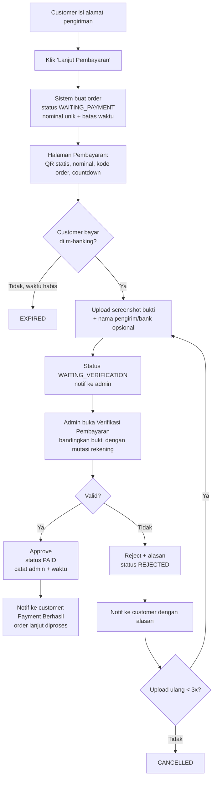

# Manual Payment (QRIS Statis + Upload Bukti + Verifikasi Admin)

Dokumen ini berisi **business flow** dan **prompt siap pakai** untuk membangun proses pembayaran manual
tanpa payment gateway. Customer membayar lewat QR statis milik penjual, mengunggah bukti transfer, lalu
admin memverifikasi dan mengubah status menjadi **Payment Berhasil**.

---

## 1. Aktor

| Aktor | Peran |
|---|---|
| **Customer** | Checkout, isi alamat, scan QR, bayar di m-banking/e-wallet, upload bukti |
| **Admin** | Melihat daftar pembayaran yang menunggu verifikasi, cek mutasi rekening, Approve / Reject |
| **Sistem** | Membuat order, menampilkan QR, menghitung batas waktu, mengubah status, mengirim notifikasi |

## 2. Status order (lifecycle)

| Kode | Label di UI | Arti |
|---|---|---|
| `WAITING_PAYMENT` | Menunggu Pembayaran | Order dibuat, QR tampil, bukti belum di-upload |
| `WAITING_VERIFICATION` | Menunggu Verifikasi | Bukti sudah di-upload, menunggu admin |
| `PAID` | Payment Berhasil | Admin sudah approve |
| `REJECTED` | Pembayaran Ditolak | Admin reject; customer boleh upload ulang |
| `EXPIRED` | Kedaluwarsa | Batas waktu bayar lewat tanpa bukti |
| `CANCELLED` | Dibatalkan | Dibatalkan customer/admin sebelum `PAID` |

Transisi yang diizinkan:

```
WAITING_PAYMENT      -> WAITING_VERIFICATION (customer upload bukti)
WAITING_PAYMENT      -> EXPIRED              (batas waktu lewat)
WAITING_PAYMENT      -> CANCELLED            (customer/admin batalkan)
WAITING_VERIFICATION -> PAID                 (admin approve)
WAITING_VERIFICATION -> REJECTED             (admin reject + alasan)
REJECTED             -> WAITING_VERIFICATION (customer upload ulang, maks. 3x)
REJECTED             -> CANCELLED            (batas upload ulang habis / admin batalkan)
```

Transisi lain ditolak oleh sistem (misalnya `PAID` tidak bisa kembali ke status lain).

## 3. Business flow



### 3.1 Sisi Customer
1. Customer mengisi alamat, lalu klik **Lanjut Pembayaran**.
2. Sistem membuat order `WAITING_PAYMENT` dan mengarahkan ke **Halaman Pembayaran** yang menampilkan:
   - Gambar QR statis (QRIS) milik penjual.
   - **Total yang harus dibayar** (dengan kode unik), tombol *Salin nominal*.
   - Nomor order dan countdown batas waktu (default 24 jam).
   - Instruksi singkat: buka m-banking/e-wallet, scan QR, masukkan nominal **persis**, simpan bukti.
3. Setelah bayar, customer klik **Upload Bukti Pembayaran**, pilih file screenshot, isi nama pengirim
   (opsional), lalu kirim.
4. Status berubah menjadi **Menunggu Verifikasi**. Halaman menampilkan bukti yang sudah di-upload.
5. Jika ditolak, customer melihat alasan penolakan dan tombol **Upload Ulang**.
6. Jika disetujui, customer melihat **Payment Berhasil**.

### 3.2 Sisi Admin
1. Admin membuka menu **Verifikasi Pembayaran**. Default filter: `WAITING_VERIFICATION`, urut terlama dulu.
2. Admin membuka detail: nomor order, customer, nominal tagihan, waktu upload, preview bukti (bisa zoom).
3. Admin mencocokkan dengan mutasi rekening/QRIS merchant (nominal unik + waktu).
4. **Approve**: status `PAID`, sistem mencatat `verified_by` dan `verified_at`.
5. **Reject**: wajib pilih/isi alasan (nominal tidak sesuai, bukti tidak terbaca, bukti duplikat,
   dana belum masuk, lainnya). Status `REJECTED`.

## 4. Business rules

- **PM-01** QR adalah **gambar statis** yang dikonfigurasi admin (upload di halaman Setting). Tidak ada
  integrasi payment gateway.
- **PM-02** Karena QR statis tidak membawa nominal, sistem menambahkan **kode unik 3 digit (1–999)** ke
  total belanja supaya admin mudah mencocokkan mutasi. Kode unik tidak boleh dipakai dua order aktif
  (`WAITING_PAYMENT`/`WAITING_VERIFICATION`) dengan total dasar yang sama.
- **PM-03** Batas waktu pembayaran default **24 jam** sejak order dibuat (bisa dikonfigurasi). Lewat batas
  tanpa bukti → `EXPIRED` dan stok yang di-reserve dikembalikan.
- **PM-04** Bukti: format **JPG, JPEG, PNG, atau PDF**, maksimal **5 MB**, satu file per upload. Validasi
  dilakukan di client **dan** server (cek MIME asli, bukan hanya ekstensi).
- **PM-05** Upload hanya diizinkan saat status `WAITING_PAYMENT` atau `REJECTED`, dan hanya oleh pemilik order.
- **PM-06** Upload ulang setelah reject maksimal **3 kali**. Setelah itu order `CANCELLED`.
- **PM-07** Setiap upload disimpan sebagai riwayat (tidak menimpa file lama) untuk audit.
- **PM-08** Hanya user dengan role **Admin** yang bisa Approve/Reject. Reject wajib berisi alasan.
- **PM-09** Approve/Reject hanya berlaku untuk status `WAITING_VERIFICATION`. Gunakan pengecekan status
  saat update (optimistic lock) agar dua admin tidak memproses order yang sama.
- **PM-10** Setiap perubahan status dicatat di log: status lama, status baru, pelaku, waktu, catatan.
- **PM-11** Notifikasi (email/WhatsApp/in-app, sesuai yang tersedia) dikirim saat: bukti di-upload (ke admin),
  `PAID` (ke customer), `REJECTED` (ke customer, dengan alasan), `EXPIRED` (ke customer).
- **PM-12** File bukti tidak boleh diakses publik. Hanya pemilik order dan admin, melalui URL bertanda
  tangan/endpoint yang dicek otorisasinya.

## 5. Data model (minimal)

**orders** (tambahan kolom)
| Kolom | Tipe | Keterangan |
|---|---|---|
| `subtotal` | decimal | Total belanja + ongkir |
| `unique_code` | int | 1–999 |
| `amount_due` | decimal | `subtotal + unique_code` |
| `payment_status` | enum | Lihat bagian 2 |
| `payment_deadline` | datetime | `created_at + 24 jam` |
| `reupload_count` | int | Default 0 |

**payment_proofs**
| Kolom | Tipe | Keterangan |
|---|---|---|
| `id` | PK | |
| `order_id` | FK | |
| `file_path` | string | Path di storage privat |
| `sender_name` | string, null | Opsional dari customer |
| `uploaded_at` | datetime | |
| `review_status` | enum | `PENDING`, `APPROVED`, `REJECTED` |
| `reviewed_by` | FK user, null | |
| `reviewed_at` | datetime, null | |
| `reject_reason` | string, null | |

**payment_status_logs**: `id`, `order_id`, `from_status`, `to_status`, `actor_id`, `note`, `created_at`.

**payment_settings**: `qr_image_path`, `merchant_name`, `payment_deadline_hours`, `max_reupload`.

## 6. Layar (UI)

| Layar | Pengguna | Elemen utama |
|---|---|---|
| Checkout – Alamat | Customer | Form alamat, ringkasan order, tombol **Lanjut Pembayaran** |
| Pembayaran | Customer | QR, nominal + tombol salin, no. order, countdown, instruksi, tombol **Upload Bukti** |
| Upload Bukti (modal) | Customer | Dropzone, preview, nama pengirim, tombol **Kirim** |
| Status Order | Customer | Badge status, bukti terakhir, alasan reject, tombol **Upload Ulang** |
| Verifikasi Pembayaran (list) | Admin | Filter status/tanggal, pencarian no. order, tabel, badge jumlah pending |
| Detail Verifikasi | Admin | Info order, nominal tagihan, preview bukti (zoom), riwayat upload & log, tombol **Approve** / **Reject** |
| Setting Pembayaran | Admin | Upload QR, nama merchant, batas waktu, maks. upload ulang |

## 7. Acceptance criteria

1. Setelah isi alamat dan klik Lanjut Pembayaran, order dibuat dengan `WAITING_PAYMENT`, `amount_due`
   = subtotal + kode unik, dan halaman menampilkan QR, nominal, serta countdown.
2. Upload file > 5 MB atau bukan JPG/PNG/PDF ditolak dengan pesan jelas, di client dan server.
3. Upload valid mengubah status ke `WAITING_VERIFICATION` dan order muncul di list admin.
4. Admin Approve → status `PAID`, customer melihat **Payment Berhasil**, log tercatat.
5. Admin Reject tanpa alasan tidak bisa disubmit. Reject dengan alasan → `REJECTED`, customer melihat alasan.
6. Upload ulang ke-4 ditolak dan order menjadi `CANCELLED`.
7. Order tanpa bukti melewati batas waktu menjadi `EXPIRED` (via scheduler/cron).
8. Customer lain atau user tanpa login tidak bisa membuka file bukti atau endpoint admin.
9. Dua admin yang Approve order yang sama bersamaan: hanya satu yang berhasil, yang lain mendapat pesan
   "status sudah berubah".

---

## 8. Prompt (siap dipakai)

Salin prompt di bawah ke AI coding assistant. Sesuaikan bagian dalam `[...]`.

```text
Kamu adalah senior full-stack engineer. Bangun fitur "Manual Payment" (tanpa payment gateway)
di project ini. Stack: [isi stack, contoh: Next.js + Prisma + PostgreSQL / Laravel + MySQL].
Pelajari dulu struktur project, auth, role, model Order, dan halaman checkout yang sudah ada,
lalu ikuti pola dan styling yang ada. Jangan mengubah hal di luar cakupan fitur ini.

## Konsep
Setelah customer mengisi alamat dan klik "Lanjut Pembayaran", sistem menampilkan QR statis (QRIS)
milik penjual. Customer membayar lewat m-banking/e-wallet, lalu mengunggah screenshot bukti di web.
Admin memverifikasi bukti dan mengubah status menjadi "Payment Berhasil".

## Status order
WAITING_PAYMENT (Menunggu Pembayaran), WAITING_VERIFICATION (Menunggu Verifikasi),
PAID (Payment Berhasil), REJECTED (Pembayaran Ditolak), EXPIRED (Kedaluwarsa), CANCELLED (Dibatalkan).
Transisi yang diizinkan:
- WAITING_PAYMENT -> WAITING_VERIFICATION | EXPIRED | CANCELLED
- WAITING_VERIFICATION -> PAID | REJECTED
- REJECTED -> WAITING_VERIFICATION | CANCELLED
Transisi lain harus ditolak di server. Taruh aturan transisi di satu fungsi/service.

## Business rules
1. QR adalah gambar statis yang diatur admin di halaman Setting Pembayaran.
2. amount_due = subtotal + kode unik 3 digit (1-999). Kode unik tidak boleh bentrok dengan order aktif
   (WAITING_PAYMENT/WAITING_VERIFICATION) yang subtotal-nya sama.
3. Batas waktu bayar default 24 jam (configurable). Buat scheduled job yang mengubah order
   WAITING_PAYMENT yang lewat batas menjadi EXPIRED dan mengembalikan stok yang di-reserve.
4. Bukti: JPG/JPEG/PNG/PDF, maks 5 MB, 1 file per upload. Validasi di client dan server
   (cek MIME asli). Simpan di storage privat, jangan public.
5. Upload hanya oleh pemilik order dan hanya saat status WAITING_PAYMENT atau REJECTED.
6. Upload ulang setelah reject maks 3 kali (configurable). Lewat dari itu order jadi CANCELLED.
7. Setiap upload disimpan sebagai record baru di payment_proofs (riwayat, tidak menimpa).
8. Hanya role Admin yang bisa Approve/Reject, dan hanya untuk status WAITING_VERIFICATION.
   Reject wajib menyertakan alasan (pilihan: Nominal tidak sesuai, Bukti tidak terbaca,
   Bukti duplikat, Dana belum masuk, Lainnya + teks).
9. Gunakan update bersyarat (WHERE payment_status = 'WAITING_VERIFICATION') supaya dua admin
   tidak memproses order yang sama. Jika gagal, tampilkan "Status sudah berubah, muat ulang".
10. Catat setiap perubahan status di payment_status_logs (from, to, actor, note, waktu).
11. Kirim notifikasi [email / WhatsApp / in-app] saat: bukti di-upload (ke admin), PAID,
    REJECTED (dengan alasan), dan EXPIRED (ke customer).
12. File bukti hanya bisa diakses pemilik order dan admin melalui endpoint yang dicek otorisasinya
    atau signed URL berumur pendek.

## Data model
- orders: tambah subtotal, unique_code, amount_due, payment_status, payment_deadline, reupload_count.
- payment_proofs: id, order_id, file_path, sender_name (nullable), uploaded_at, review_status
  (PENDING/APPROVED/REJECTED), reviewed_by, reviewed_at, reject_reason.
- payment_status_logs: id, order_id, from_status, to_status, actor_id, note, created_at.
- payment_settings: qr_image_path, merchant_name, payment_deadline_hours, max_reupload.
Buat migration dan seed setting default.

## Halaman customer
1. Checkout Alamat: tombol "Lanjut Pembayaran" membuat order lalu redirect ke halaman Pembayaran.
2. Pembayaran: QR, nama merchant, total dengan kode unik (tombol "Salin"), catatan
   "Transfer sesuai nominal persis, termasuk 3 digit terakhir", nomor order, countdown,
   langkah bayar, tombol "Upload Bukti Pembayaran".
3. Modal Upload: dropzone + preview, input nama pengirim (opsional), tombol Kirim, loading state,
   pesan error yang jelas.
4. Status Order: badge status, bukti terakhir, alasan reject, tombol "Upload Ulang"
   (sisa kesempatan ditampilkan), dan tampilan "Payment Berhasil" saat PAID.

## Halaman admin
1. Verifikasi Pembayaran (list): default filter WAITING_VERIFICATION, urut terlama dulu,
   filter status & tanggal, cari no. order/nama customer, badge jumlah pending di menu.
2. Detail Verifikasi: info order & customer, amount_due (tonjolkan 3 digit unik), preview bukti
   dengan zoom/buka tab baru, riwayat upload dan log status, tombol Approve (dengan konfirmasi)
   dan Reject (modal alasan wajib).
3. Setting Pembayaran: upload/ganti gambar QR, nama merchant, batas waktu (jam), maks upload ulang.

## API (sesuaikan dengan konvensi project)
- POST   /orders/{id}/checkout-payment       -> buat order + kode unik + deadline
- GET    /orders/{id}/payment                -> data halaman pembayaran
- POST   /orders/{id}/payment-proofs         -> upload bukti (multipart)
- GET    /payment-proofs/{id}/file           -> stream file (cek otorisasi)
- GET    /admin/payments?status=&from=&to=&q=
- GET    /admin/payments/{orderId}
- POST   /admin/payments/{orderId}/approve
- POST   /admin/payments/{orderId}/reject    -> body: { reason_code, reason_note }
- GET/PUT /admin/payment-settings

## Acceptance criteria (buat test untuk setiap poin)
1. Lanjut Pembayaran -> order WAITING_PAYMENT, amount_due = subtotal + kode unik, QR & countdown tampil.
2. File > 5 MB atau tipe salah ditolak di client dan server.
3. Upload valid -> WAITING_VERIFICATION dan muncul di list admin.
4. Approve -> PAID, customer melihat "Payment Berhasil", log tercatat.
5. Reject tanpa alasan tidak bisa disubmit; dengan alasan -> REJECTED dan alasan tampil ke customer.
6. Upload ulang melebihi batas -> ditolak dan order CANCELLED.
7. Order lewat deadline tanpa bukti -> EXPIRED oleh scheduled job.
8. User lain/tanpa login tidak bisa akses file bukti atau endpoint admin (403/401).
9. Approve bersamaan oleh dua admin -> hanya satu berhasil.

## Output yang diharapkan
- Ringkasan rencana sebelum mulai coding.
- Migration, model, service transisi status, endpoint, halaman UI, scheduled job, notifikasi, test.
- Di akhir: daftar file yang diubah/dibuat, cara menjalankan, dan cara mengetes manual end-to-end.
```
