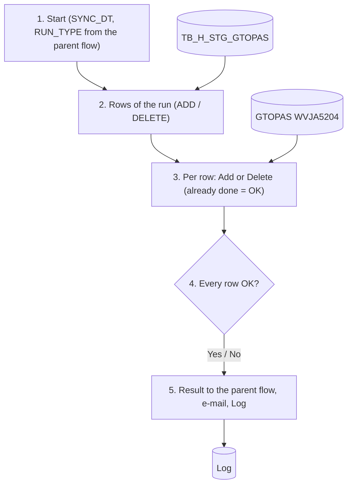
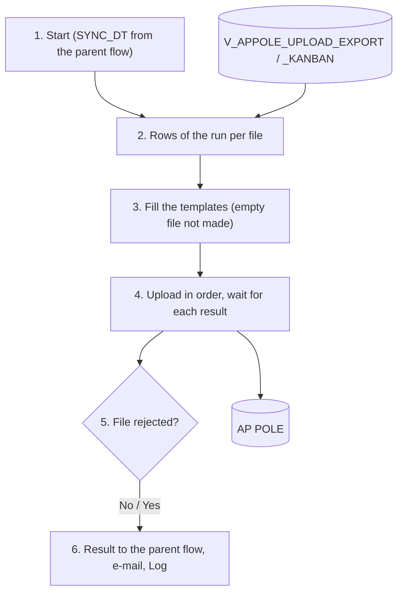

# Crossdock Master sync to GTOPAS and AP POLE: knowledge file

_Generated 26-Nov-2026 by prepare_code/build_knowledge.py from the UISS, the RPA step documents and the staging SQL of the Crossdock project (NSP). Example data are dummy parts DUMMY-00x and dummy destinations. Pictures are not included._

## Contents

1. Summary of the rules
2. Staging tables
3. RPA steps XD06 (GTOPAS)
4. RPA steps XD07 (AP POLE)
5. UISS XD06 IF Cross Dock Master to GTOPAS
6. UISS XD07 IF Cross Dock Master to AP POLE
7. SQL: tables, stored procedures, views, queries

## 1. Summary of the rules

- NSP screens and uploads (XD01 Kanban / Export Crossdock Master, XD02, XD03) and the batch XD05 update the master, then call **SP_STG_WRITE**, which writes the change to a staging table in the format of the target: TB_H_STG_APPOLE_KANBAN (AP POLE file LLM9Q910), TB_H_STG_APPOLE_EXPORT (AP POLE file LLM9Q880), TB_H_STG_GTOPAS (GTOPAS screen WVJA5204).
- **SYNC_STATUS** is 0 (to send) or 1 (sent). A key has at most one row with 0. Keys: Kanban PERIOD + PART_NO; Export PERIOD + NSP_PART_NO + DEST_CODE + ORDER_TYPE; GTOPAS PERIOD + P_NO + DESTINATION_CODE.
- A new change of a key updates its unsent row (example: Case/Day 5 -> 4 -> 6 before [Sync] leaves one row with 6). A change back to the value already sent deletes the unsent row (nothing to send). A sent row (1) is never changed; the next change inserts a new row.
- Kanban OPERATION_TYPE (set at the save, against the last Max sent): 1 Max down, 2 Max up, 3 Max same, 4 never sent, 5 only the destinations changed (header row, ACTION KEEP, not uploaded). The header 5 is deleted when no Export row of the part waits.
- **[Sync]** (D/S, Export Crossdock Master) calls **SP_STG_SYNC**: rows 0 -> 1 with **SYNC_DT** = time of the click, the same value for the whole run (AP POLE: Current and Next period; GTOPAS: Current only). NSP passes SYNC_DT to the RPA parent flow. There is no run ID column.
- RPA parent flow CDX_SYNC_PARENT: GTOPAS rows in the run -> scenario 1, XD06 first, XD07 only when XD06 succeeded; no GTOPAS row -> scenario 2, XD07 only. Period Rollover (day 1, 00:10, **SP_STG_ROLLOVER**): GTOPAS rows of the new Current period, XD06 only.
- Robots use a read-only DB user and read `WHERE SYNC_STATUS = '1' AND SYNC_DT = :sync_dt`. Nothing is written back to NSP; the result is an e-mail. [Re-send last Sync] runs MAX(SYNC_DT) again.
- XD07 uploads up to three files in this order: 1 EXPORT_PRE (Export rows of parts whose Max goes down), 2 KANBAN (OPERATION_TYPE 1 to 4), 3 EXPORT_POST (other Export rows). Inside a file, per part, down / delete (0) rows come before up / add rows. A file without rows is not made.

## 2. Staging tables

Columns of the three staging tables. The views V_APPOLE_UPLOAD_KANBAN / V_APPOLE_UPLOAD_EXPORT are in section 7.

### TB_H_STG_APPOLE_KANBAN (history, proposed)
Used by: XD01, XD02, XD03, XD05, XD07

AP POLE Kanban rows in the format of the upload file LLM9Q910, one row per Kanban change of a part + period (one unsent row at a time: a new change updates it), plus the header row (OPERATION_TYPE 5) when only the destinations changed. Written by SP_STG_WRITE (XD01, XD02, XD05); SYNC_STATUS and SYNC_DT set by SP_STG_SYNC. Read by XD07 through V_APPOLE_UPLOAD_KANBAN and V_APPOLE_UPLOAD_EXPORT.

| Column | Type | PK | Null | Description |
|---|---|---|---|---|
| STG_ID | BIGINT | Y | N | Running number: order of the inserts |
| PERIOD | CHAR(6) |  | N | Calculation period YYYYMM. FK1 (PART_NO, PERIOD) -> TB_M_PART_CANDIDATE. File column Effective Month / Year = MM/YYYY of PERIOD, made by the view (not stored) |
| ACTION | VARCHAR(6) |  | N | ADD (new part, new period) / EDIT (Pcs/Case or Max changed) / KEEP (header written by an Export save, Kanban unchanged) |
| PART_STATUS | VARCHAR(10) |  | N | Active / Inactive in the period when the row is written (an Inactive part stays in the AP POLE Kanban) |
| OPERATOR_ID | CHAR(2) |  | N | Always P6. File / screen column: Operator ID. Default 'P6' |
| PART_NO | VARCHAR(TBD) |  | N | Part number with "-" (NSP format); FK1. File / screen column: Part No. |
| PART_NAME | VARCHAR(TBD) |  | N | From TB_M_PART_CANDIDATE at the insert. File / screen column: Part Name |
| SHIPPING_BOX_QTY | NUMBER(5) |  | N | Pcs/Case. File / screen column: Shipping Box Qty |
| MAX_SHIPPING_BOX_QTY | NUMBER(5) |  | N | Max Case/Day. File / screen column: Max Shipping Box Qty |
| MAX_ALLOWANCE_QTY | NUMBER(9) |  | N | Shipping Box Qty x Max Shipping Box Qty. File / screen column: Max Allowance Qty |
| OPERATION_TYPE | NUMBER(1) |  | N | Header of the part, set by SP_STG_WRITE at the save: 1 = Max down, 2 = Max up, 3 = Max same (only Pcs/Case changed, or a new period with the same Max), 4 = never sent, 5 = Kanban unchanged, only the destinations changed (ACTION KEEP). 1 to 4 against the last Max sent: same period, else the latest earlier period. Upload: 1 -> the Export rows of the part in EXPORT_PRE before KANBAN; 2, 3, 4 -> KANBAN then EXPORT_POST; 5 -> EXPORT_POST only, the row is not in the KANBAN file |
| SOURCE | VARCHAR(6) |  | N | SCREEN / UPLOAD / BATCH (XD05) |
| UPLOAD_ID | VARCHAR(TBD) |  | Y | Upload of the Kanban or Export Excel (Log); NULL when SOURCE is not UPLOAD |
| SYNC_STATUS | CHAR(1) |  | N | 0 = to send (written or updated by SP_STG_WRITE), 1 = sent (SP_STG_SYNC at [Sync], SP_STG_ROLLOVER for GTOPAS). One row with 0 per key at a time: a new change of the key updates it. Default '0' |
| SYNC_DT | DATETIME2(0) |  | Y | Time of the [Sync] click (or of the Period Rollover), the same value for every row of that click: the RPA reads the rows of a run by SYNC_DT; [Re-send last Sync] = MAX(SYNC_DT); Last Sent on the screen = latest value |
| CREATED_BY | VARCHAR(20) |  | N | User of the save / upload, or XD05BATCH |
| CREATED_DT | DATETIME |  | N | Time of the insert (same transaction as the master update) |
| CHANGED_BY | VARCHAR(20) |  | Y | User of the save that updated the unsent row, of [Sync], or XD05BATCH (Period Rollover) |
| CHANGED_DT | DATETIME |  | Y | Time of that update |

### TB_H_STG_APPOLE_EXPORT (history, proposed)
Used by: XD01, XD02, XD03, XD05, XD07

AP POLE Export rows in the format of the upload file LLM9Q880, one row per added, changed or removed destination + order type of a part + period (one unsent row per key: a new change updates it). Written by SP_STG_WRITE (XD01, XD03, XD05); SYNC_STATUS and SYNC_DT set by SP_STG_SYNC. Read by XD07 through V_APPOLE_UPLOAD_EXPORT.

| Column | Type | PK | Null | Description |
|---|---|---|---|---|
| STG_ID | BIGINT | Y | N | Running number: order of the inserts |
| PERIOD | CHAR(6) |  | N | Calculation period YYYYMM. FK1 (NSP_PART_NO, PERIOD) -> TB_M_PART_CANDIDATE. File column Effective Month / Year = MM/YYYY of PERIOD, made by the view (not stored) |
| NSP_PART_NO | VARCHAR(TBD) |  | N | Part number with "-" (key back to NSP); FK1 |
| DEST_CODE | CHAR(7) |  | N | Destination code, 7 digits. No FK: a DELETE row points to a removed destination |
| ACTION | VARCHAR(6) |  | N | ADD / EDIT / DELETE (DELETE = Max Shipping Box (RCS) 0) |
| PART_NO | VARCHAR(TBD) |  | N | Part number without "-". File / screen column: Part No. |
| BUYER_PD | CHAR(8) |  | N | DEST_CODE in 5-2 format. File / screen column: Buyer-PD |
| ORDER_TYPE | VARCHAR(2) |  | N | '**', 'C', '9', 'V' (system master). File / screen column: Order Type |
| TRANSPORT_CODE | CHAR(1) |  | N | Always 2. File / screen column: Transport Code. Default '2' |
| MAX_SHIPPING_BOX_RCS | NUMBER(5) |  | N | Case/Day of the destination; 0 = delete. File / screen column: Max Shipping Box (RCS) |
| SOURCE | VARCHAR(6) |  | N | SCREEN / UPLOAD / BATCH (XD05) |
| UPLOAD_ID | VARCHAR(TBD) |  | Y | Upload of the Kanban or Export Excel (Log); NULL when SOURCE is not UPLOAD |
| SYNC_STATUS | CHAR(1) |  | N | 0 = to send (written or updated by SP_STG_WRITE), 1 = sent (SP_STG_SYNC at [Sync], SP_STG_ROLLOVER for GTOPAS). One row with 0 per key at a time: a new change of the key updates it. Default '0' |
| SYNC_DT | DATETIME2(0) |  | Y | Time of the [Sync] click (or of the Period Rollover), the same value for every row of that click: the RPA reads the rows of a run by SYNC_DT; [Re-send last Sync] = MAX(SYNC_DT); Last Sent on the screen = latest value |
| CREATED_BY | VARCHAR(20) |  | N | User of the save / upload, or XD05BATCH |
| CREATED_DT | DATETIME |  | N | Time of the insert (same transaction as the master update) |
| CHANGED_BY | VARCHAR(20) |  | Y | User of the save that updated the unsent row, of [Sync], or XD05BATCH (Period Rollover) |
| CHANGED_DT | DATETIME |  | Y | Time of that update |

### TB_H_STG_GTOPAS (history, proposed)
Used by: XD01, XD02, XD03, XD05, XD06

GTOPAS WVJA5204 rows: a part + destination to add or delete, written by SP_STG_WRITE only when the destination appears or disappears for the part (any order type) and GTOPAS does not have that state yet (one unsent row per key). Sent by [Sync] (Current period) or the Period Rollover (new Current period). Read by XD06.

| Column | Type | PK | Null | Description |
|---|---|---|---|---|
| STG_ID | BIGINT | Y | N | Running number: order of the inserts |
| PERIOD | CHAR(6) |  | N | Calculation period YYYYMM (GTOPAS has no period: [Sync] sends the Current period, the Period Rollover the new Current). FK1 (P_NO, PERIOD) -> TB_M_PART_CANDIDATE |
| ACTION | VARCHAR(6) |  | N | ADD / DELETE: the destination appears or disappears for the part (any order type). No row for a Case/Day change or for a state GTOPAS already has. File / screen column: Add / Delete (MT = DEL) |
| DEPOT_CODE | CHAR(2) |  | N | Always 01. File / screen column: Depot Code. Default '01' |
| P_NO | VARCHAR(TBD) |  | N | Part number with "-"; FK1. File / screen column: P/No. |
| DESTINATION_CODE | CHAR(7) |  | N | 7-digit code, the same in NSP and GTOPAS. File / screen column: Destination Code |
| MAKER_CODE | CHAR(1) |  | N | Always A. File / screen column: Maker Code. Default 'A' |
| DOMESTIC_OVERSEAS | CHAR(1) |  | N | Always 2. File / screen column: Domestic/Overseas. Default '2' |
| TOPAS_ORDER_TYPE | CHAR(1) |  | N | Always 3. File / screen column: TOPAS Order Type. Default '3' |
| ORDER_TRANSPORTATION_CODE | CHAR(1) |  | N | Always 2. File / screen column: Order Transportation Code. Default '2' |
| SOURCE | VARCHAR(6) |  | N | SCREEN / UPLOAD / BATCH (XD05) |
| UPLOAD_ID | VARCHAR(TBD) |  | Y | Upload of the Kanban or Export Excel (Log); NULL when SOURCE is not UPLOAD |
| SYNC_STATUS | CHAR(1) |  | N | 0 = to send (written or updated by SP_STG_WRITE), 1 = sent (SP_STG_SYNC at [Sync], SP_STG_ROLLOVER for GTOPAS). One row with 0 per key at a time: a new change of the key updates it. Default '0' |
| SYNC_DT | DATETIME2(0) |  | Y | Time of the [Sync] click (or of the Period Rollover), the same value for every row of that click: the RPA reads the rows of a run by SYNC_DT; [Re-send last Sync] = MAX(SYNC_DT); Last Sent on the screen = latest value |
| CREATED_BY | VARCHAR(20) |  | N | User of the save / upload, or XD05BATCH |
| CREATED_DT | DATETIME |  | N | Time of the insert (same transaction as the master update) |
| CHANGED_BY | VARCHAR(20) |  | Y | User of the save that updated the unsent row, of [Sync], or XD05BATCH (Period Rollover) |
| CHANGED_DT | DATETIME |  | Y | Time of that update |

## 3. RPA steps XD06 (GTOPAS)

### XD06 RPA Cross Dock Master to GTOPAS: steps of the robot

| Item | Value |
|---|---|
| Function | XD06 IF Cross Dock Master to GTOPAS (desktop flow CDX_XD06_GTOPAS, started by the parent flow CDX_SYNC_PARENT) |
| Started by | Scenario 1 of [Sync] / [Re-send last Sync] (run with GTOPAS rows), or the Period Rollover on day 1 (00:10) |
| Input | SYNC_DT of the run; table TB_H_STG_GTOPAS, rows with SYNC_STATUS 1 and that SYNC_DT (read-only DB user) |
| Output | Rows added / deleted on GTOPAS WVJA5204 (Depot 01); STATUS to the parent flow; e-mail |

AP POLE and GTOPAS pictures: screens given by the user (a red mark comes from the original picture). NSP picture: prototype. Query results and files: example data of the full flow simulation (dummy parts DUMMY-00x, [Sync] of 2026-11-10 11:00:00); column name with * = helper column of NSP, not written to the file or the screen.

#### Steps

##### 1. NSP: D/S clicks [Sync (n)] (or Period Rollover)

The run has GTOPAS rows (a part became Active / Inactive, a destination was added / removed): the parent flow starts XD06 first. The Period Rollover starts XD06 by itself, no screen.

_[Screen: NSP: D/S clicks [Sync (n)] (or Period Rollover); picture r01_nsp_sync.png not included]_

##### 2. Get data: rows of the run ([Sync])

The robot reads TB_H_STG_GTOPAS with SYNC_STATUS 1 and the SYNC_DT of the run: one row per part + destination, ACTION ADD or DELETE. Example: run of 10-Nov, three ADD rows.

```sql
SELECT * FROM TB_H_STG_GTOPAS WHERE SYNC_STATUS = '1' AND SYNC_DT = '2026-11-10 11:00:00' ORDER BY P_NO, DESTINATION_CODE
```

| STG_ID* | PERIOD* | ACTION* | DEPOT_CODE | P_NO | DESTINATION_CODE | MAKER_CODE | DOMESTIC_OVERSEAS | TOPAS_ORDER_TYPE | ORDER_TRANSPORTATION_CODE |
|---|---|---|---|---|---|---|---|---|---|
| 6 | 202611 | ADD | 01 | DUMMY-004 | 9715310 | A | 2 | 3 | 2 |
| 7 | 202611 | ADD | 01 | DUMMY-004 | 9600110 | A | 2 | 3 | 2 |
| 8 | 202611 | ADD | 01 | DUMMY-002 | 9655510 | A | 2 | 3 | 2 |

##### 3. Get data: rows of the run (Period Rollover)

Example: rollover of 01-Jan, two DELETE rows (part became Inactive) and one ADD row (part became Active).

```sql
SELECT * FROM TB_H_STG_GTOPAS WHERE SYNC_STATUS = '1' AND SYNC_DT = '2027-01-01 00:10:00' ORDER BY P_NO, DESTINATION_CODE
```

| STG_ID* | PERIOD* | ACTION* | DEPOT_CODE | P_NO | DESTINATION_CODE | MAKER_CODE | DOMESTIC_OVERSEAS | TOPAS_ORDER_TYPE | ORDER_TRANSPORTATION_CODE |
|---|---|---|---|---|---|---|---|---|---|
| 14 | 202701 | DELETE | 01 | DUMMY-004 | 9715310 | A | 2 | 3 | 2 |
| 15 | 202701 | DELETE | 01 | DUMMY-004 | 9600110 | A | 2 | 3 | 2 |
| 16 | 202701 | ADD | 01 | DUMMY-006 | 9811110 | A | 2 | 3 | 2 |

##### 4. GTOPAS: open Crossdock Master and search the row

Menu Supply > Master > Crossdock Master (WVJA5204). Depot Code = 01, P/No. and Destination Code of the row, [Search].

_[Screen: GTOPAS: open Crossdock Master and search the row; picture g01_wvja5204_delete.png not included]_

##### 5. DELETE row: MT = DEL

On the row found, MT = DEL and confirm. GTOPAS shows "MZD34006FEI: Registration completed." = done. Row not found = already gone = OK. Any other message = the row failed: it is listed and the robot goes on with the next row.

_[Screen: DELETE row: MT = DEL; picture g01_wvja5204_delete.png not included]_

##### 6. ADD row: register

Register a new row: Depot Code 01, Maker Code A, P/No., Domestic/Overseas 2, Destination Code, TOPAS Order Type 3, Order Transportation Code 2. Message MZD34006FEI = done; row already there = OK. ILLUSTRATION below: no screenshot of the register screen yet.

> ILLUSTRATION, not a screenshot: register row on GTOPAS WVJA5204 (screenshot of the register screen to be added)

| No | MT | R | Depot Code | Maker Code | P/No. | Domestic/Overseas | Destination Code | TOPAS Order Type | Order Transportation Code |
|---|---|---|---|---|---|---|---|---|---|
|  |  |  | 01 | A | DUMMY-004 | 2 | 9715310 | 3 | 2 |

##### 7. Result: STATUS and e-mail

SUCCESS when every row is OK, else FAILED with the failed rows. Scenario 1: the parent flow starts XD07 only on SUCCESS. One e-mail per run; nothing is written back to NSP. FAILED: D/S clicks [Re-send last Sync].

#### Notes

- The GTOPAS screenshot is the screen given by the user (part 52119-BZV60, destination 9618274, a DEL row), not the dummy data of the example; it shows the search fields and the message of a delete.
- Screenshot of the register (ADD) screen of WVJA5204 to be added; TOPAS Order Type 3 or * is TBC (FB-203).
- GTOPAS has no period: the rows of the Next period go at the Period Rollover, not at [Sync].

## 4. RPA steps XD07 (AP POLE)

### XD07 RPA Cross Dock Master to AP POLE: steps of the robot

| Item | Value |
|---|---|
| Function | XD07 RPA Cross Dock Master to AP POLE (desktop flow CDX_XD07_APPOLE, started by the parent flow CDX_SYNC_PARENT) |
| Started by | D/S [Sync] or [Re-send last Sync] on NSP. Scenario 1: after XD06 GTOPAS succeeded. Scenario 2: at once. |
| Input | SYNC_DT of the run (time of the [Sync] click, given by the parent flow); views V_APPOLE_UPLOAD_EXPORT / V_APPOLE_UPLOAD_KANBAN, rows with SYNC_STATUS 1 and that SYNC_DT (read-only DB user) |
| Output | Files uploaded on AP POLE in the order 1 EXPORT_PRE, 2 KANBAN, 3 EXPORT_POST; e-mail SUCCESS / FAILED |

AP POLE and GTOPAS pictures: screens given by the user (a red mark comes from the original picture). NSP picture: prototype. Query results and files: example data of the full flow simulation (dummy parts DUMMY-00x, [Sync] of 2026-11-10 11:00:00); column name with * = helper column of NSP, not written to the file or the screen.

#### Steps

##### 1. NSP: D/S clicks [Sync (n)]

Export Crossdock Master, ongoing period. [Sync] sets the staging rows 0 -> 1 with SYNC_DT = time of the click and starts the parent flow with that SYNC_DT. This is the only manual step; everything below is the robot.

_[Screen: NSP: D/S clicks [Sync (n)]; picture r01_nsp_sync.png not included]_

##### 2. Get data: file 1 EXPORT_PRE

The robot reads the Export rows of the run for file 1: parts whose Max Case/Day goes down (OPERATION_TYPE 1). Per part, ROW_ORDER 1 (down or delete) comes before 2 (up or add).

```sql
SELECT * FROM V_APPOLE_UPLOAD_EXPORT WHERE SYNC_STATUS = '1' AND SYNC_DT = '2026-11-10 11:00:00' AND FILE_NO = 1 ORDER BY PERIOD, NSP_PART_NO, ROW_ORDER, STG_ID
```

| STG_ID* | PERIOD* | NSP_PART_NO* | FILE_NO* | ROW_ORDER* | EFFECTIVE_MONTH_YEAR | PART_NO | BUYER_PD | ORDER_TYPE | TRANSPORT_CODE | MAX_SHIPPING_BOX_RCS |
|---|---|---|---|---|---|---|---|---|---|---|
| 10 | 202611 | DUMMY-002 | 1 | 1 | 11/2026 | DUMMY002 | 98111-10 | \*\* | 2 | 12 |
| 11 | 202611 | DUMMY-002 | 1 | 2 | 11/2026 | DUMMY002 | 96555-10 | \*\* | 2 | 8 |

##### 3. Get data: file 2 KANBAN

The Kanban rows of the run with OPERATION_TYPE 1 to 4 (a header with 5 is not uploaded).

```sql
SELECT * FROM V_APPOLE_UPLOAD_KANBAN WHERE SYNC_STATUS = '1' AND SYNC_DT = '2026-11-10 11:00:00' ORDER BY PERIOD, PART_NO
```

| STG_ID* | PERIOD* | OPERATION_TYPE* | EFFECTIVE_MONTH_YEAR | OPERATOR_ID | PART_NO | PART_NAME | SHIPPING_BOX_QTY | MAX_SHIPPING_BOX_QTY | MAX_ALLOWANCE_QTY |
|---|---|---|---|---|---|---|---|---|---|
| 6 | 202611 | 1 | 11/2026 | P6 | DUMMY-002 | DUMMY PART 002 | 12 | 20 | 240 |
| 5 | 202611 | 4 | 11/2026 | P6 | DUMMY-004 | DUMMY PART 004 | 6 | 20 | 120 |

##### 4. Get data: file 3 EXPORT_POST

Every other Export row of the run (OPERATION_TYPE 2, 3, 4 or 5 on the Kanban row of the part).

```sql
SELECT * FROM V_APPOLE_UPLOAD_EXPORT WHERE SYNC_STATUS = '1' AND SYNC_DT = '2026-11-10 11:00:00' AND FILE_NO = 3 ORDER BY PERIOD, NSP_PART_NO, ROW_ORDER, STG_ID
```

| STG_ID* | PERIOD* | NSP_PART_NO* | FILE_NO* | ROW_ORDER* | EFFECTIVE_MONTH_YEAR | PART_NO | BUYER_PD | ORDER_TYPE | TRANSPORT_CODE | MAX_SHIPPING_BOX_RCS |
|---|---|---|---|---|---|---|---|---|---|---|
| 8 | 202611 | DUMMY-004 | 3 | 2 | 11/2026 | DUMMY004 | 97153-10 | \*\* | 2 | 12 |
| 9 | 202611 | DUMMY-004 | 3 | 2 | 11/2026 | DUMMY004 | 96001-10 | \*\* | 2 | 8 |

##### 5. Fill the template: file 1

Copy of the stored template LLM9Q880, one row per Export row, helper columns left out. A file without rows is not made.

File: `LLM9Q880_20261110110000_1_EXPORT_PRE.xls (template LLM9Q880)`

| Effective Month / Year | Part No. | Buyer-PD | Order Type | Transport Code | Max Shipping Box (RCS) |
|---|---|---|---|---|---|
| 11/2026 | DUMMY002 | 98111-10 | \*\* | 2 | 12 |
| 11/2026 | DUMMY002 | 96555-10 | \*\* | 2 | 8 |

##### 6. Fill the template: file 2

Copy of the stored template LLM9Q910, one row per Kanban row.

File: `LLM9Q910_20261110110000_2_KANBAN.xls (template LLM9Q910)`

| Effective Month / Year | Operator ID | Part No. | Part Name | Shipping Box Qty | Max Shipping Box Qty | Max Allowance Qty |
|---|---|---|---|---|---|---|
| 11/2026 | P6 | DUMMY-002 | DUMMY PART 002 | 12 | 20 | 240 |
| 11/2026 | P6 | DUMMY-004 | DUMMY PART 004 | 6 | 20 | 120 |

##### 7. Fill the template: file 3

Copy of the stored template LLM9Q880.

File: `LLM9Q880_20261110110000_3_EXPORT_POST.xls (template LLM9Q880)`

| Effective Month / Year | Part No. | Buyer-PD | Order Type | Transport Code | Max Shipping Box (RCS) |
|---|---|---|---|---|---|
| 11/2026 | DUMMY004 | 97153-10 | \*\* | 2 | 12 |
| 11/2026 | DUMMY004 | 96001-10 | \*\* | 2 | 8 |

##### 8. AP POLE: log in, menu Master

The robot logs in to AP POLE (https://ap-pole.toyota-asia.com/lm9/) with the robot user and opens the menu Master.

_[Screen: AP POLE: log in, menu Master; picture a01_menu_master.png not included]_

##### 9. Upload file 1 EXPORT_PRE

Common File Upload (WLM98010). Report Type = the Export Customer Cross Dock Master upload (LM9Q870), File Name = LLM9Q880_20261110110000_1_EXPORT_PRE.xls, [Upload]. Wait for the result: an error stops the run (next files not uploaded).

_[Screen: Upload file 1 EXPORT_PRE; picture b04_upload_lm9q870.png not included]_

##### 10. Upload file 2 KANBAN

Report Type = LM9Q900 - Upload Kanban Part Master, File Name = LLM9Q910_20261110110000_2_KANBAN.xls, [Upload]. Wait for the result.

_[Screen: Upload file 2 KANBAN; picture a07_upload_lm9q900.png not included]_

##### 11. Upload file 3 EXPORT_POST

Report Type = LM9Q870 again, File Name = LLM9Q880_20261110110000_3_EXPORT_POST.xls, [Upload]. Wait for the result.

_[Screen: Upload file 3 EXPORT_POST; picture b04_upload_lm9q870.png not included]_

##### 12. Check: Cross Dock Kanban Part Master

Master > Cross Dock Kanban Part Master (WLM9Q890), search the parts of the run: Shipping Box Qty and Max Shipping Box Qty of the effective month show the uploaded values.

_[Screen: Check: Cross Dock Kanban Part Master; picture a04_wlm9q890_result.jpg not included]_

##### 13. Check: Export Customer Cross Dock Master

Tick the part, [Maintain Cross Dock] (WLM9Q860): the Buyer-PD rows show the uploaded Max Shipping Box (RCS); 0 = deleted.

_[Screen: Check: Export Customer Cross Dock Master; picture b02_wlm9q860.jpg not included]_

##### 14. Result: e-mail

The robot gives STATUS back to the parent flow; the parent flow sends one e-mail per run (SUCCESS / FAILED, file and row of an error). Nothing is written back to NSP. FAILED: D/S clicks [Re-send last Sync].

#### Notes

- File names follow the templates decided for the staging (LLM9Q910 Kanban, LLM9Q880 Export). The Report Type names on the AP POLE screen are LM9Q900 / LM9Q870: which report type takes which template is TBC with the AP POLE team.
- The AP POLE screens are the screens given by the user (16-Nov), not taken during a robot run.
- Order of the files: EXPORT_PRE before KANBAN when Max goes down, so AP POLE never has destinations above the Max.
- One row per key: a part edited twice before [Sync] has one row with the last value (the unsent row is updated, not added). [Re-send last Sync] reads MAX(SYNC_DT).

## 5. UISS XD06 IF Cross Dock Master to GTOPAS

### XD06 – IF Cross Dock Master to GTOPAS

> Generated from `deliverables/function_list_v2/specs/XD06_spec.json` (UISS `XD06_UISS_Batch_IFCrossDockMasterToGTOPAS.xlsx`). Do not edit by hand: change the spec and run `python3 prepare_code/build_md.py`. Document names: GTOPAS / NSP (prototype: G-System / Supplier System).

| Phase | Project | Block | Function | Created | By | Type |
|---|---|---|---|---|---|---|
| DR | Crossdock Optimization | Batch | XD06 IF Cross Dock Master to GTOPAS | 18-Oct-26 | FID Rayhan | batch |

#### Revision

| Rev | Author | Date | Reviewed by | Description |
|---|---|---|---|---|
| 0.1 | FID Rayhan | 18-Oct-26 |  | Initial Draft |
| 0.2 | FID Rayhan | 17-Nov-26 |  | [Sync] runs the RPA from the download: the bot downloads the XD01 Export Excel (no direct read of the NSP database), fills the work sheet GTOPAS Compare and then adds / deletes on WVJA5204. User guide Crossdock_User_Guide_GTOPAS.xlsx. |
| 0.3 | FID Rayhan | 17-Nov-26 |  | Sync Status rule of XD01 (No Sync only for a value sent to the target); a manual Active -> Inactive is also listed in Active to Inactive and deleted. |
| 0.4 | FID Rayhan | 18-Nov-26 |  | Waiting parts follow the [Sync] definition of XD01: every part with status Active (ongoing period) or Inactive whose Sync Status is No Sync or Failed, whatever the filter (Candidate never); table of the part status in 4.2. |
| 0.5 | FID Rayhan | 18-Nov-26 |  | Sheet "Active to Inactive" removed (18-Nov): Inactive parts with No Sync / Failed are taken by [Sync] by their status. Inactive parts are not in sheet Export Crossdock Master, so their rows are deleted by the compare. |
| 0.6 | FID Rayhan | 19-Nov-26 |  | Notification email of the RPA (Power Automate): cases SUCCESS / FAILED / bot not started, recipients, subject, body, attachment, retry (4.4); LOG6. |
| 0.7 | FID Rayhan | 19-Nov-26 |  | GTOPAS = Current period; automatic run after the Period Rollover; several order types of a destination = one GTOPAS row (19-Nov). |
| 0.8 | FID Rayhan | 20-Nov-26 |  | No response to NSP: the bot does not write TB_M_PART_CANDIDATE / TB_M_PART_CANDIDATE / TB_H_PART_CANDIDATE; the result is the notification e-mail; [Re-send last Sync] (20-Nov). |
| 0.9 | FID Rayhan | 20-Nov-26 |  | TB_R_CROSSDOCK_IF_RESULT removed; the parts of the run come from the send time on TB_M_PART_CANDIDATE (GTOPAS_SYNC_DT / APPOLE_SYNC_DT) and SYNC_RUN_ID (20-Nov). |
| 1.0 | FID Rayhan | 22-Nov-26 |  | Source = TB_H_PART_CANDIDATE_STG_SYNC only; parts of the run by GTOPAS_SYNC_STATUS 0 + PERIOD ([Sync] Current, Period Rollover new period), no date condition (22-Nov). |
| 1.1 | FID Rayhan | 23-Nov-26 |  | Source TB_H_STG_GTOPAS (rows ADD / DELETE of the run); started by the RPA parent flow: scenario 1 GTOPAS before AP POLE, a failed GTOPAS stops AP POLE; Period Rollover XD06 only (23-Nov). |
| 1.2 | FID Rayhan | 26-Nov-26 |  | Staging: no SYNC_RUN_ID, the run is SYNC_DT (one value per [Sync] click / rollover); one unsent row per key (a new change updates it, back to the sent value deletes it); SYNC_STATUS 0 / 1. SQL: prepare_code/sql/crossdock_staging_sync.sql. |

#### 1. General

##### Objective

- To make the GTOPAS Crossdock Master (WVJA5204, Depot 01) follow NSP by an RPA: add the part + destination rows that appear in NSP and delete the rows that disappear.
- Source data: only TB_H_STG_GTOPAS (read-only DB user), rows of the run (SYNC_DT): [Sync] (Current period), [Re-send last Sync] or the Period Rollover (new Current period, XD05 process 3).
- Started by the RPA parent flow: in scenario 1 XD06 runs before XD07 and its result decides whether XD07 starts (refer 4.1).
- GTOPAS has no period: it always shows the Current month, so the Next period reaches GTOPAS only at the Period Rollover.
- The robot writes nothing back to NSP; the result comes by the notification e-mail.

##### Operation flow

*Operation flow* (no image)

##### Input

| Name | Type | Description |
|---|---|---|
| TB_H_STG_GTOPAS | DB | Rows with SYNC_STATUS '1' and SYNC_DT = SYNC_DT of the run: ACTION ADD / DELETE per part + destination |
| GTOPAS WVJA5204 | System | Rows of the parts of the run (Depot 01), read by the robot |

##### Output

| Name | Type | Description |
|---|---|---|
| GTOPAS WVJA5204 | System | Rows added / deleted by the robot (not in NSP scope) |
| Result to the parent flow | Variable | STATUS SUCCESS / FAILED and the failed rows |
| Log | DB | One record per run; notification e-mail |

##### Parameters

| Name | Description |
|---|---|
| Target system | 'GTOPAS' |
| Method | RPA desktop flow CDX_XD06_GTOPAS started by the Power Automate parent flow CDX_SYNC_PARENT ([Sync], [Re-send last Sync], Period Rollover); it works on GTOPAS screen Crossdock Master |
| User | RPA bot user (GTOPAS login); read-only DB user on NSP |
| Depot Code | '01' (mandatory search condition of the GTOPAS screen) |
| Row key | P/No. + Destination Code (one GTOPAS row per part + destination, whatever the order type) |

##### GTOPAS Screen Crossdock Master (WVJA5204)

| Item | Use by the bot |
|---|---|
| Menu | Supply > Master > Crossdock Master |
| Search: Depot Code (*) | '01' |
| Search: P/No., Destination Code, Maker Code, Dom/Os, TOPAS Order Type, Trans Code | P/No. + Destination Code to find the row of the run |
| [Search] / [NextPage] | Check whether the row is there before the Add / Delete |
| List columns | No, MT, R, Depot Code, Maker Code, P/No. (e.g. 52119-BZV60), Domestic/Overseas, Destination Code, TOPAS Order Type, Order Transportation Code |
| MT (maintenance type) | 'DEL' on a row = delete; register = new row: Depot Code 01, Maker Code A, P/No., Dom/Os 2, Destination Code, TOPAS Order Type 3, Trans Code 2 |
| Message | MZD34006FEI: Registration completed. Any other message = the row failed (listed, next row continues) |

#### 2. Function flow



1. The parent flow starts XD06 with SYNC_DT and RUN_TYPE (SYNC / RESEND: scenario 1; ROLLOVER). NSP has already set the rows to SYNC_STATUS 1 with this SYNC_DT. Write LOG1.
2. Read TB_H_STG_GTOPAS (read-only DB user): rows with SYNC_STATUS '1' and SYNC_DT = SYNC_DT of the run, ordered by P_NO, DESTINATION_CODE.
  - ACTION ADD: Depot 01, P/No., Destination Code, Maker A, Domestic/Overseas 2, TOPAS Order Type 3, Order Transportation Code 2.
  - ACTION DELETE: the row of P/No. + Destination Code (MT = DEL on the screen).
3. Process every row on WVJA5204 (Depot 01). Write LOG3 per row.
  - A row already in the wanted state (Add of an existing row, Delete of a missing row) counts as OK, so a re-send is safe.
  - A failed row is listed (LOG4) and the next rows are still processed: GTOPAS rows do not depend on each other.
4. Return STATUS to the parent flow: SUCCESS when every row is OK, else FAILED with the failed rows. In scenario 1 the parent flow starts XD07 only on SUCCESS.
5. The parent flow sends one notification e-mail per run (GTOPAS result, and AP POLE result when XD07 ran). Write LOG6 and LOG2. The robot writes nothing to NSP.

#### 3. Data edit mapping

###### 1. Insert GTOPAS Crossdock Master (WVJA5204, by RPA) – Part + destination added (not in NSP scope; done on the screen)
- Source: TB_H_STG_GTOPAS (keys: SYNC_DT = SYNC_DT of the run (SYNC_STATUS 1), ACTION = 'ADD')

| Source field | Destination field | Description |
|---|---|---|
| DEPOT_CODE | Depot Code | '01' |
| P_NO | P/No. | With "-" |
| DESTINATION_CODE | Destination Code | 7 digits, the same in NSP and GTOPAS |
| MAKER_CODE | Maker Code | 'A' |
| DOMESTIC_OVERSEAS | Domestic/Overseas | '2' |
| TOPAS_ORDER_TYPE | TOPAS Order Type | '3' |
| ORDER_TRANSPORTATION_CODE | Order Transportation Code | '2' |

###### 2. Delete GTOPAS Crossdock Master (WVJA5204, by RPA) – Row of P/No. + Destination Code (MT = DEL)
- Source: TB_H_STG_GTOPAS (keys: SYNC_DT = SYNC_DT of the run (SYNC_STATUS 1), ACTION = 'DELETE')

| Source field | Destination field | Description |
|---|---|---|
| P_NO | P/No. | Row to delete |
| DESTINATION_CODE | Destination Code | Row to delete |
| - | MT | 'DEL' |

###### 3. Insert Log – Messages of the run
- Source: RPA run

| Source field | Destination field | Description |
|---|---|---|
| - | BATCH_ID | 'XD06_RPA_GTOPAS' |
| - | SYNC_DT | SYNC_DT of the run |
| - | STATUS | SUCCESS / FAILED |
| - | MESSAGE | LOG1 - LOG6 |
| - | START_DT / END_DT | Start and end date-time |

#### 4. Function description

##### 4.1 Parent Flow and Scenarios

- One Power Automate parent flow per run (CDX_SYNC_PARENT), started by NSP with SYNC_DT (the run) and RUN_TYPE (SYNC, RESEND, ROLLOVER).
- Scenario 1 (run with GTOPAS rows: a part becomes Active or Inactive, a destination is added or removed): XD06 GTOPAS first; XD07 AP POLE starts only when every GTOPAS row succeeded. When GTOPAS fails, AP POLE stops: XD07 does not start and the e-mail says FAILED.
- Scenario 2 (run without GTOPAS rows: Max Case/Day, Pcs/Case, Case/Day, order type of a destination that stays): XD07 only.
- Period Rollover (RUN_TYPE ROLLOVER): XD06 only, for the GTOPAS rows of the new Current period.
- Choice of the scenario: SELECT COUNT(*) FROM TB_H_STG_GTOPAS WHERE SYNC_STATUS = '1' AND SYNC_DT = <SYNC_DT of the run> (> 0: scenario 1).

##### 4.2 Rows and Rules

- XD06 reads only TB_H_STG_GTOPAS: one row per part + destination that appears (ADD) or disappears (DELETE) for the part, whatever the order type. NSP writes the row at the save (SP_STG_WRITE) and sends it with SP_STG_SYNC (Current period) or the Period Rollover.
- A Case/Day change or an order type change of a destination that stays writes no GTOPAS row.
- Rows of the parts outside the run are not touched.
- Rules and simulation: deliverables/function_list_v2/erd/proposal_staging_sync (Proposal_Tables_Staging_Per_Target.xlsx, simulation/Staging_Header_Order.html, simulation/Staging_Per_Target_Full_Flow_Simulation.xlsx).

##### 4.3 Errors and Re-send

- A failed row is listed and the next rows are processed. The result goes back to the parent flow: FAILED stops AP POLE in scenario 1.
- When the e-mail says FAILED, the D/S team clicks [Re-send last Sync] before the next [Sync]: the same SYNC_DT; rows done before are OK again (already in GTOPAS / already gone).

| Case | GTOPAS (XD06) | AP POLE (XD07) | D/S does |
|---|---|---|---|
| Scenario 1, GTOPAS fails on a row | Other rows still done; failed rows listed | Not started | [Re-send last Sync]: GTOPAS again, then AP POLE |
| Scenario 1, GTOPAS OK, AP POLE rejects a row | Done | Stops at that row; next files not sent | [Re-send last Sync] |
| Scenario 2, AP POLE rejects a row | Skipped | Stops at that row | [Re-send last Sync] |
| Period Rollover, GTOPAS fails | Failed rows listed | Not part of the rollover | Re-send the rollover run |
| Robot or PC down before the start | Not started | Not started | [Re-send last Sync] |

##### 4.4 Notification Email (Power Automate)

- The parent flow sends one email per run, so the user knows the result without opening NSP.
- The email holds the result of every target of the run: GTOPAS and AP POLE in scenario 1 (AP POLE 'not started' when GTOPAS failed), AP POLE only in scenario 2, GTOPAS only for the Period Rollover.
- One email per run: the retries of the same run send no email; only the final result does.

| No | Case | When the email is sent | Subject result |
|---|---|---|---|
| E1 | Run without error | End of the run, after the last row / file of every target | SUCCESS |
| E2 | Run stopped by an error (try-catch) | After the automatic retries of the cloud flow are used up (retry count and interval in the flow settings, proposal 2 times, 10 minutes) | FAILED |
| E3 | Bot could not start (machine offline, login of NSP / GTOPAS failed, desktop flow time out) | Cloud flow branch "run after = failed / timed out" of the desktop flow action | FAILED |
| - | No GTOPAS row in the run (scenario 2) | XD06 is not started; the email shows AP POLE only | - |

| Item | Content |
|---|---|
| Sender | Shared mailbox of the RPA (Office 365 Outlook connector "Send an email (V2)"), TBC |
| To | User who clicked [Sync] (e-mail sent by NSP in the request of the flow) + D/S team mailing list |
| Cc | RPA PIC; for FAILED also the NSP PIC |
| Subject | [Crossdock Sync][SYNC \| RESEND \| ROLLOVER][SUCCESS \| FAILED] Run <SYNC_DT> - <n> part(s) |
| Body 1. Run | SYNC_DT, RUN_TYPE, scenario, targets run, started / ended, [Sync] by <user> at <date-time>, period(s) sent |
| Body 2. Summary | Parts processed; registered / kept / deleted rows per P/No. + Destination Code |
| Body 3. Error (FAILED) | Step, part, destination and message of the error (LOG4 / LOG5); parts not processed |
| Body 4. Action | SUCCESS: no action. FAILED: click [Re-send last Sync] on Crossdock Master Setting; contact the RPA PIC when it fails again |
| Body 5. Links | Folder of the RPA work file (SharePoint / OneDrive, TBC); link to the run in Power Automate (for the RPA PIC) |
| Attachment | The downloaded Excel with the work sheet GTOPAS Compare (action, result and message per row). Above the mail size limit: link only |
| Language | English |

- Example subject: [Crossdock Sync][SYNC][FAILED] Run 20261127103000 - 12 part(s).
- Recipients (mailing list, RPA PIC, NSP PIC) are set in the flow settings, not in the code of the bot.
- LOG6 is written when the email is sent; when sending fails, the run result stays and the RPA PIC sees it in the Power Automate run history.

#### 5. Logging messages

| ID | Event | Cause | Type | Message | Action |
|---|---|---|---|---|---|
| LOG1 | Batch start | Parent flow: scenario 1 or Period Rollover | Info | RPA cross dock master to GTOPAS started. Run <SYNC_DT>, <n> row(s). | system: Write the log.; user: - |
| LOG2 | Batch end | Bot finishes | Info | RPA cross dock master to GTOPAS ended. Run <SYNC_DT>, added <a>, deleted <d>, already done <k>, failed <f>, status <STATUS>. | system: Write the log.; user: - |
| LOG3 | Row changed | Add / Delete on WVJA5204 | Info | <ADD / DELETE> <P_NO> <DEST_CODE>. | system: Write the log.; user: - |
| LOG4 | Row failed / error (try-catch) | Login, screen, timeout or GTOPAS error message | Error | RPA to GTOPAS failed at <STEP> <P_NO> <DEST_CODE>: <ERROR_DETAIL>. | system: Row error: list the row and go to the next row. Login or screen error: stop. STATUS FAILED; in scenario 1 the parent flow does not start XD07.; user: Click [Re-send last Sync]; contact PIC if it persists. |
| LOG5 | Unexpected error | Any other system error | Critical | Unexpected error: <ERROR_DETAIL>. | system: Stop. STATUS = ERROR.; user: User contact PIC |
| LOG6 | Notification email | End of the run (SUCCESS / FAILED) | Info | Notification email <SUCCESS / FAILED> of run <SYNC_DT> sent to <recipients>. | system: Write the log.; user: Read the email; FAILED: click [Re-send last Sync]. |

#### 7. Tables

###### TB_H_STG_GTOPAS (history, proposed)
GTOPAS WVJA5204 rows: a part + destination to add or delete, written by SP_STG_WRITE only when the destination appears or disappears for the part (any order type) and GTOPAS does not have that state yet (one unsent row per key). Sent by [Sync] (Current period) or the Period Rollover (new Current period). Read by XD06.

| Column | Type | PK | Null | Description |
|---|---|---|---|---|
| STG_ID | BIGINT | Y | N | Running number: order of the inserts |
| PERIOD | CHAR(6) |  | N | Calculation period YYYYMM (GTOPAS has no period: [Sync] sends the Current period, the Period Rollover the new Current). FK1 (P_NO, PERIOD) -> TB_M_PART_CANDIDATE |
| ACTION | VARCHAR(6) |  | N | ADD / DELETE: the destination appears or disappears for the part (any order type). No row for a Case/Day change or for a state GTOPAS already has. File / screen column: Add / Delete (MT = DEL) |
| DEPOT_CODE | CHAR(2) |  | N | Always 01. File / screen column: Depot Code. Default '01' |
| P_NO | VARCHAR(TBD) |  | N | Part number with "-"; FK1. File / screen column: P/No. |
| DESTINATION_CODE | CHAR(7) |  | N | 7-digit code, the same in NSP and GTOPAS. File / screen column: Destination Code |
| MAKER_CODE | CHAR(1) |  | N | Always A. File / screen column: Maker Code. Default 'A' |
| DOMESTIC_OVERSEAS | CHAR(1) |  | N | Always 2. File / screen column: Domestic/Overseas. Default '2' |
| TOPAS_ORDER_TYPE | CHAR(1) |  | N | Always 3. File / screen column: TOPAS Order Type. Default '3' |
| ORDER_TRANSPORTATION_CODE | CHAR(1) |  | N | Always 2. File / screen column: Order Transportation Code. Default '2' |
| SOURCE | VARCHAR(6) |  | N | SCREEN / UPLOAD / BATCH (XD05) |
| UPLOAD_ID | VARCHAR(TBD) |  | Y | Upload of the Kanban or Export Excel (Log); NULL when SOURCE is not UPLOAD |
| SYNC_STATUS | CHAR(1) |  | N | 0 = to send (written or updated by SP_STG_WRITE), 1 = sent (SP_STG_SYNC at [Sync], SP_STG_ROLLOVER for GTOPAS). One row with 0 per key at a time: a new change of the key updates it. Default '0' |
| SYNC_DT | DATETIME2(0) |  | Y | Time of the [Sync] click (or of the Period Rollover), the same value for every row of that click: the RPA reads the rows of a run by SYNC_DT; [Re-send last Sync] = MAX(SYNC_DT); Last Sent on the screen = latest value |
| CREATED_BY | VARCHAR(20) |  | N | User of the save / upload, or XD05BATCH |
| CREATED_DT | DATETIME |  | N | Time of the insert (same transaction as the master update) |
| CHANGED_BY | VARCHAR(20) |  | Y | User of the save that updated the unsent row, of [Sync], or XD05BATCH (Period Rollover) |
| CHANGED_DT | DATETIME |  | Y | Time of that update |

## 6. UISS XD07 IF Cross Dock Master to AP POLE

### XD07 – IF Cross Dock Master to AP POLE

> Generated from `deliverables/function_list_v2/specs/XD07_spec.json` (UISS `XD07_UISS_Batch_IFCrossDockMasterToAPPOLE.xlsx`). Do not edit by hand: change the spec and run `python3 prepare_code/build_md.py`. Document names: GTOPAS / NSP (prototype: G-System / Supplier System).

| Phase | Project | Block | Function | Created | By | Type |
|---|---|---|---|---|---|---|
| DR | Crossdock Optimization | Batch | XD07 RPA Cross Dock Master to AP POLE | 18-Oct-26 | FID Rayhan | batch |

#### Revision

| Rev | Author | Date | Reviewed by | Description |
|---|---|---|---|---|
| 0.1 | FID Rayhan | 18-Oct-26 |  | Initial Draft |
| 0.2 | FID Rayhan | 17-Nov-26 |  | RPA on the AP POLE screens WLM9Q890 / WLM9Q860 instead of the SFTP interface file; source = XD01 Export Excel; part and destination scenarios; GTOPAS_SYNC_DT / APPOLE_SYNC_DT (from Crossdock_ap_pole_guide.xlsx). |
| 0.3 | FID Rayhan | 17-Nov-26 |  | [Sync] runs the RPA from the download: the bot downloads the XD01 Export Excel itself and fills the work sheet AP POLE Compare (source open point closed). |
| 0.4 | FID Rayhan | 17-Nov-26 |  | Sync Status rule of XD01 (No Sync only for a value sent to the target); a manual Active -> Inactive is also listed in Active to Inactive and deleted. |
| 0.5 | FID Rayhan | 18-Nov-26 |  | Sheet "Active to Inactive" removed (18-Nov): Inactive parts with No Sync / Failed are taken by [Sync] by their status. Parts to delete = sheet Kanban Crossdock Master, Status Inactive, Sync Status Waiting. |
| 0.6 | FID Rayhan | 19-Nov-26 |  | Notification email of the RPA (Power Automate): cases SUCCESS / FAILED / bot not started, recipients, subject, body, attachment, retry (4.6); LOG6. |
| 0.7 | FID Rayhan | 19-Nov-26 |  | Effective Month / Year = period (MM, YYYY); Current then Next; Order Type of the row; order of the screens when Max Case/Day goes down (19-Nov). |
| 0.8 | FID Rayhan | 20-Nov-26 |  | No response to NSP: the bot does not write TB_M_PART_CANDIDATE / TB_M_PART_CANDIDATE / TB_H_PART_CANDIDATE; the result is the notification e-mail; [Re-send last Sync] (20-Nov). |
| 0.9 | FID Rayhan | 20-Nov-26 |  | TB_R_CROSSDOCK_IF_RESULT removed; the parts of the run come from the send time on TB_M_PART_CANDIDATE (GTOPAS_SYNC_DT / APPOLE_SYNC_DT) and SYNC_RUN_ID (20-Nov). |
| 1.0 | FID Rayhan | 22-Nov-26 |  | Upload files LLM9Q910 / LLM9Q880 instead of the screen steps; source = TB_H_PART_CANDIDATE_STG_SYNC only; SEND_SEQ order 1 / 2 / 3 (22-Nov). |
| 1.1 | FID Rayhan | 23-Nov-26 |  | Source: views V_APPOLE_UPLOAD_KANBAN / _EXPORT on TB_H_STG_APPOLE_KANBAN / _EXPORT; files EXPORT_PRE, KANBAN, EXPORT_POST from OPERATION_TYPE; started by the RPA parent flow (scenario 1 after GTOPAS OK, scenario 2 at once) (23-Nov). |
| 1.2 | FID Rayhan | 26-Nov-26 |  | Staging: no SYNC_RUN_ID, the run is SYNC_DT (one value per [Sync] click / rollover); one unsent row per key (a new change updates it, back to the sent value deletes it); SYNC_STATUS 0 / 1. SQL: prepare_code/sql/crossdock_staging_sync.sql. |
| 1.3 | FID Rayhan | 26-Nov-26 |  | TB_H_STG_APPOLE_KANBAN / _EXPORT: EFFECTIVE_MONTH_YEAR removed (same value as PERIOD); the views make Effective Month / Year (MM/YYYY of PERIOD) for the upload file. |

#### 1. General

##### Objective

- To make the cross dock master of AP POLE follow NSP by an RPA that uploads the files Cross Dock Kanban Part Master (LLM9Q910) and Export Customer Cross Dock Master (LLM9Q880), filled from the stored templates.
- Source data: the views V_APPOLE_UPLOAD_KANBAN and V_APPOLE_UPLOAD_EXPORT on TB_H_STG_APPOLE_KANBAN / _EXPORT (read-only DB user), rows of the run (SYNC_DT) of [Sync] / [Re-send last Sync]. NSP set every rule at the save; the views only read it.
- Order: EXPORT_PRE (Export rows of the parts whose Max goes down) -> KANBAN -> EXPORT_POST (every other Export row). AP POLE checks every row: total Max Shipping Box (RCS) of the part <= Max Shipping Box Qty.
- Started by the RPA parent flow: in scenario 1 only after XD06 succeeded; in scenario 2 at once (refer 4.1).
- The robot writes nothing back to NSP; the result comes by the notification e-mail.

##### Operation flow

*Operation flow* (no image)

##### Input

| Name | Type | Description |
|---|---|---|
| V_APPOLE_UPLOAD_EXPORT | DB view | Export rows of the run with FILE_NO (1 EXPORT_PRE / 3 EXPORT_POST) and ROW_ORDER |
| V_APPOLE_UPLOAD_KANBAN | DB view | Kanban rows of the run with OPERATION_TYPE 1 to 4 (file KANBAN) |
| Templates LLM9Q910 / LLM9Q880 | File | Stored upload templates (not downloaded from AP POLE) |

##### Output

| Name | Type | Description |
|---|---|---|
| AP POLE Cross Dock Kanban Part Master | System | Uploaded file LLM9Q910 (not in NSP scope) |
| AP POLE Export Customer Cross Dock Master | System | Uploaded files LLM9Q880 (not in NSP scope) |
| Log | DB | One record per run; notification e-mail |

##### Parameters

| Name | Description |
|---|---|
| Target system | 'APPOLE' (AP POLE, https://ap-pole.toyota-asia.com/lm9/) |
| Method | RPA desktop flow CDX_XD07_APPOLE started by the Power Automate parent flow CDX_SYNC_PARENT; upload of LLM9Q910 / LLM9Q880 |
| User | RPA bot user with AP POLE login; read-only DB user on NSP |
| Operator ID | 'P6' (fixed) in LLM9Q910 |
| Transport Code | '2' (fixed) in LLM9Q880 |

##### LLM9Q910 Cross Dock Kanban Part Master (file KANBAN, order 2)

| Column | NSP source / rule |
|---|---|
| Effective Month / Year | EFFECTIVE_MONTH_YEAR of the view (MM/YYYY of PERIOD) |
| Operator ID | 'P6' |
| Part No. | PART_NO with "-" |
| Part Name | PART_NAME |
| Shipping Box Qty | SHIPPING_BOX_QTY (Pcs/Case) |
| Max Shipping Box Qty | MAX_SHIPPING_BOX_QTY (Max Case/Day) |
| Max Allowance Qty | MAX_ALLOWANCE_QTY |
| Packing/Pallet Type ... Outer-Qty | Empty |

##### LLM9Q880 Export Customer Cross Dock Master (files EXPORT_PRE and EXPORT_POST, orders 1 and 3)

| Column | NSP source / rule |
|---|---|
| Effective Month / Year | EFFECTIVE_MONTH_YEAR of the view (MM/YYYY of PERIOD) |
| Part No. | PART_NO without "-" |
| Buyer-PD | BUYER_PD (DEST_CODE as 5-2, e.g. 9722D-10) |
| Order Type | ORDER_TYPE |
| Transport Code | TRANSPORT_CODE '2' |
| Max Shipping Box (RCS) | MAX_SHIPPING_BOX_RCS (0 for DELETE) |
| Shipping Box Qty, Max Shipping Box by Part No., Max Allowance Qty, Packing/Pallet Type | Empty |

#### 2. Function flow



1. The parent flow starts XD07 with SYNC_DT (scenario 1 after XD06 succeeded, scenario 2 at once). NSP has already set the rows to SYNC_STATUS 1 with this SYNC_DT. Write LOG1.
2. Read the views (read-only DB user) for the SYNC_DT of the run:
  - V_APPOLE_UPLOAD_EXPORT WHERE FILE_NO = 1 (EXPORT_PRE) and FILE_NO = 3 (EXPORT_POST), ORDER BY PERIOD, NSP_PART_NO, ROW_ORDER, STG_ID.
  - V_APPOLE_UPLOAD_KANBAN (OPERATION_TYPE 1 to 4), ORDER BY PERIOD, PART_NO.
3. Fill the stored templates: one file per kind, Current and Next period together (Effective Month / Year per row). Name <template>_<SYNC_DT YYYYMMDDHHMMSS>_<order>_<name>.xls, e.g. LLM9Q880_20261204100000_1_EXPORT_PRE.xls. A file without rows is not made.
  - Inside an Export file, per part: rows going down or DELETE (ROW_ORDER 1) first, then up or ADD (ROW_ORDER 2).
4. Upload the files one at a time: 1 EXPORT_PRE -> 2 KANBAN -> 3 EXPORT_POST, and wait for each result. Write LOG3 per file.
5. A rejected file stops the run (LOG4): the files already uploaded stay in AP POLE; the next files wait for [Re-send last Sync].
6. Return STATUS to the parent flow; the parent flow sends the notification e-mail (SUCCESS / FAILED). Write LOG6 and LOG2. The robot writes nothing to NSP.

#### 3. Data edit mapping

###### 1. Insert LLM9Q910 Cross Dock Kanban Part Master (upload file) – File KANBAN (order 2): one row per Kanban row of the run with OPERATION_TYPE 1 to 4
- Source: V_APPOLE_UPLOAD_KANBAN (keys: SYNC_DT = SYNC_DT of the run (SYNC_STATUS 1))

| Source field | Destination field | Description |
|---|---|---|
| EFFECTIVE_MONTH_YEAR | Effective Month / Year | MM/YYYY of PERIOD, made by the view |
| OPERATOR_ID | Operator ID | 'P6' |
| PART_NO | Part No. | With "-" |
| PART_NAME | Part Name |  |
| SHIPPING_BOX_QTY | Shipping Box Qty | Pcs/Case |
| MAX_SHIPPING_BOX_QTY | Max Shipping Box Qty | Max Case/Day |
| MAX_ALLOWANCE_QTY | Max Allowance Qty | Shipping Box Qty x Max Shipping Box Qty |

###### 2. Insert LLM9Q880 Export Customer Cross Dock Master (upload files) – Files EXPORT_PRE and EXPORT_POST: one row per Export row of the run, ordered by ROW_ORDER per part
- Source: V_APPOLE_UPLOAD_EXPORT (keys: SYNC_DT = SYNC_DT of the run (SYNC_STATUS 1), FILE_NO = 1 (EXPORT_PRE) / 3 (EXPORT_POST))

| Source field | Destination field | Description |
|---|---|---|
| EFFECTIVE_MONTH_YEAR | Effective Month / Year | MM/YYYY of PERIOD, made by the view |
| PART_NO | Part No. | Without "-" |
| BUYER_PD | Buyer-PD | 5-2 format |
| ORDER_TYPE | Order Type |  |
| TRANSPORT_CODE | Transport Code | '2' |
| MAX_SHIPPING_BOX_RCS | Max Shipping Box (RCS) | 0 for DELETE |

###### 3. Insert Log – Messages of the run
- Source: RPA run

| Source field | Destination field | Description |
|---|---|---|
| - | BATCH_ID | 'XD07_RPA_APPOLE' |
| - | SYNC_DT | SYNC_DT of the run |
| - | STATUS | SUCCESS / FAILED |
| - | MESSAGE | LOG1 - LOG6 |
| - | START_DT / END_DT | Start and end date-time |

#### 4. Function description

##### 4.1 Parent Flow and Scenarios

- One Power Automate parent flow per run (CDX_SYNC_PARENT), started by NSP with SYNC_DT (the run) and RUN_TYPE (SYNC, RESEND, ROLLOVER).
- Scenario 1 (run with GTOPAS rows: a part becomes Active or Inactive, a destination is added or removed): XD06 GTOPAS first; XD07 AP POLE starts only when every GTOPAS row succeeded. When GTOPAS fails, AP POLE stops: XD07 does not start and the e-mail says FAILED.
- Scenario 2 (run without GTOPAS rows: Max Case/Day, Pcs/Case, Case/Day, order type of a destination that stays): XD07 only.
- Period Rollover (RUN_TYPE ROLLOVER): XD06 only, for the GTOPAS rows of the new Current period.
- Choice of the scenario: SELECT COUNT(*) FROM TB_H_STG_GTOPAS WHERE SYNC_STATUS = '1' AND SYNC_DT = <SYNC_DT of the run> (> 0: scenario 1).

##### 4.2 Files and Order

- Upload files of AP POLE (views): EXPORT_PRE (LLM9Q880, order 1) = Export rows of the parts whose Kanban row of the run has OPERATION_TYPE 1; KANBAN (LLM9Q910, order 2) = Kanban rows of the run with OPERATION_TYPE 1 to 4; EXPORT_POST (LLM9Q880, order 3) = every other Export row of the run. Inside a file, per part, rows going down or DELETE (ROW_ORDER 1) come before rows going up or ADD (ROW_ORDER 2). An empty file is not made. File name <template>_<SYNC_DT YYYYMMDDHHMMSS>_<order>_<name>.xls.
- View rules: FILE_NO = 1 (EXPORT_PRE) when the Kanban row of the same run, part and period has OPERATION_TYPE 1, else 3 (EXPORT_POST; every part of a run has its Kanban row, OPERATION_TYPE 1 to 5). ROW_ORDER = 1 when MAX_SHIPPING_BOX_RCS is lower than the value sent before for the key (same period, else the latest earlier period), else 2. V_APPOLE_UPLOAD_KANBAN leaves out OPERATION_TYPE 5.
- Why the order: AP POLE checks every uploaded row (total Max Shipping Box (RCS) of the part <= Max Shipping Box Qty). When Max goes down the destinations come down first (EXPORT_PRE); when Max goes up, stays or is new the Max goes first (KANBAN). Inside a file the total first goes down, then up to the end value, so it never passes the Max.
- AP POLE keeps the rows of an Effective Month active until a newer month comes; NSP still sends every row of a new period.

| OPERATION_TYPE | Meaning | Upload order of the part |
|---|---|---|
| 1 | Max down | EXPORT_PRE, then KANBAN |
| 2 | Max up | KANBAN, then EXPORT_POST |
| 3 | Max same (only Pcs/Case changed, or a new period with the same Max) | KANBAN, then EXPORT_POST |
| 4 | Never sent (new part) | KANBAN, then EXPORT_POST |
| 5 | Kanban unchanged, only the destinations changed (ACTION KEEP) | EXPORT_POST only |

##### 4.3 Errors and Re-send

- A rejected file stops the run: the files already uploaded stay in AP POLE, the next files are not uploaded.
- When the e-mail says FAILED, the D/S team clicks [Re-send last Sync] before the next [Sync]: the same SYNC_DT and the same files; AP POLE sets the same values again, so a repeat is safe.
- Rules and simulation: deliverables/function_list_v2/erd/proposal_staging_sync (Proposal_Tables_Staging_Per_Target.xlsx, simulation/Staging_Header_Order.html, simulation/Staging_Per_Target_Full_Flow_Simulation.xlsx).

| Case | GTOPAS (XD06) | AP POLE (XD07) | D/S does |
|---|---|---|---|
| Scenario 1, GTOPAS fails on a row | Other rows still done; failed rows listed | Not started | [Re-send last Sync]: GTOPAS again, then AP POLE |
| Scenario 1, GTOPAS OK, AP POLE rejects a row | Done | Stops at that row; next files not sent | [Re-send last Sync] |
| Scenario 2, AP POLE rejects a row | Skipped | Stops at that row | [Re-send last Sync] |
| Period Rollover, GTOPAS fails | Failed rows listed | Not part of the rollover | Re-send the rollover run |
| Robot or PC down before the start | Not started | Not started | [Re-send last Sync] |

##### 4.4 Notification Email (Power Automate)

- The parent flow sends one email per run, so the user knows the result without opening NSP.
- The email holds the result of every target of the run: GTOPAS and AP POLE in scenario 1 (AP POLE 'not started' when GTOPAS failed), AP POLE only in scenario 2, GTOPAS only for the Period Rollover.
- One email per run: the retries of the same run send no email; only the final result does.

| No | Case | When the email is sent | Subject result |
|---|---|---|---|
| E1 | Run without error | End of the run, after the last row / file of every target | SUCCESS |
| E2 | Run stopped by an error (try-catch) | After the automatic retries of the cloud flow are used up (retry count and interval in the flow settings, proposal 2 times, 10 minutes) | FAILED |
| E3 | Bot could not start (machine offline, login of NSP / AP POLE failed, desktop flow time out) | Cloud flow branch "run after = failed / timed out" of the desktop flow action | FAILED |
| - | No AP POLE row in the run (only a Period Rollover) | XD07 is not started; the email shows GTOPAS only | - |

| Item | Content |
|---|---|
| Sender | Shared mailbox of the RPA (Office 365 Outlook connector "Send an email (V2)"), TBC |
| To | User who clicked [Sync] (e-mail sent by NSP in the request of the flow) + D/S team mailing list |
| Cc | RPA PIC; for FAILED also the NSP PIC |
| Subject | [Crossdock Sync][SYNC \| RESEND \| ROLLOVER][SUCCESS \| FAILED] Run <SYNC_DT> - <n> part(s) |
| Body 1. Run | SYNC_DT, RUN_TYPE, scenario, targets run, started / ended, [Sync] by <user> at <date-time>, period(s) sent |
| Body 2. Summary | Parts processed; part added / edited / deleted, Buyer-PD added / edited / deleted |
| Body 3. Error (FAILED) | Step, part, destination and message of the error (LOG4 / LOG5); parts not processed |
| Body 4. Action | SUCCESS: no action. FAILED: click [Re-send last Sync] on Crossdock Master Setting; contact the RPA PIC when it fails again |
| Body 5. Links | Folder of the RPA work file (SharePoint / OneDrive, TBC); link to the run in Power Automate (for the RPA PIC) |
| Attachment | The upload files of the run with the AP POLE result per file. Above the mail size limit: link only |
| Language | English |

- Example subject: [Crossdock Sync][SYNC][FAILED] Run 20261127103000 - 12 part(s).
- Recipients (mailing list, RPA PIC, NSP PIC) are set in the flow settings, not in the code of the bot.
- LOG6 is written when the email is sent; when sending fails, the run result stays and the RPA PIC sees it in the Power Automate run history.

#### 5. Logging messages

| ID | Event | Cause | Type | Message | Action |
|---|---|---|---|---|---|
| LOG1 | Batch start | Parent flow: scenario 1 after GTOPAS OK, or scenario 2 | Info | RPA cross dock master to AP POLE started. Run <SYNC_DT>, <n> file(s). | system: Write the log.; user: - |
| LOG2 | Batch end | Bot finishes | Info | RPA cross dock master to AP POLE ended. Run <SYNC_DT>, files uploaded <f>, rows <r>, status <STATUS>. | system: Write the log.; user: - |
| LOG3 | File uploaded | AP POLE accepted the file | Info | <FILE_NAME> uploaded: <n> row(s). | system: Write the log.; user: - |
| LOG4 | Error (try-catch) | Login, upload screen, AP POLE error of a row, timeout | Error | RPA to AP POLE stopped at <FILE_NAME> row <n>: <ERROR_DETAIL>. Files not uploaded: <list>. | system: Stop the bot. STATUS FAILED; the next files are not uploaded.; user: Click [Re-send last Sync]; contact PIC if it persists. |
| LOG5 | Unexpected error | Any other system error | Critical | Unexpected error: <ERROR_DETAIL>. | system: Stop. STATUS = ERROR.; user: User contact PIC |
| LOG6 | Notification email | End of the run (SUCCESS / FAILED) | Info | Notification email <SUCCESS / FAILED> of run <SYNC_DT> sent to <recipients>. | system: Write the log.; user: Read the email; FAILED: click [Re-send last Sync]. |

#### 7. Tables

###### TB_H_STG_APPOLE_KANBAN (history, proposed)
AP POLE Kanban rows in the format of the upload file LLM9Q910, one row per Kanban change of a part + period (one unsent row at a time: a new change updates it), plus the header row (OPERATION_TYPE 5) when only the destinations changed. Written by SP_STG_WRITE (XD01, XD02, XD05); SYNC_STATUS and SYNC_DT set by SP_STG_SYNC. Read by XD07 through V_APPOLE_UPLOAD_KANBAN and V_APPOLE_UPLOAD_EXPORT.

| Column | Type | PK | Null | Description |
|---|---|---|---|---|
| STG_ID | BIGINT | Y | N | Running number: order of the inserts |
| PERIOD | CHAR(6) |  | N | Calculation period YYYYMM. FK1 (PART_NO, PERIOD) -> TB_M_PART_CANDIDATE. File column Effective Month / Year = MM/YYYY of PERIOD, made by the view (not stored) |
| ACTION | VARCHAR(6) |  | N | ADD (new part, new period) / EDIT (Pcs/Case or Max changed) / KEEP (header written by an Export save, Kanban unchanged) |
| PART_STATUS | VARCHAR(10) |  | N | Active / Inactive in the period when the row is written (an Inactive part stays in the AP POLE Kanban) |
| OPERATOR_ID | CHAR(2) |  | N | Always P6. File / screen column: Operator ID. Default 'P6' |
| PART_NO | VARCHAR(TBD) |  | N | Part number with "-" (NSP format); FK1. File / screen column: Part No. |
| PART_NAME | VARCHAR(TBD) |  | N | From TB_M_PART_CANDIDATE at the insert. File / screen column: Part Name |
| SHIPPING_BOX_QTY | NUMBER(5) |  | N | Pcs/Case. File / screen column: Shipping Box Qty |
| MAX_SHIPPING_BOX_QTY | NUMBER(5) |  | N | Max Case/Day. File / screen column: Max Shipping Box Qty |
| MAX_ALLOWANCE_QTY | NUMBER(9) |  | N | Shipping Box Qty x Max Shipping Box Qty. File / screen column: Max Allowance Qty |
| OPERATION_TYPE | NUMBER(1) |  | N | Header of the part, set by SP_STG_WRITE at the save: 1 = Max down, 2 = Max up, 3 = Max same (only Pcs/Case changed, or a new period with the same Max), 4 = never sent, 5 = Kanban unchanged, only the destinations changed (ACTION KEEP). 1 to 4 against the last Max sent: same period, else the latest earlier period. Upload: 1 -> the Export rows of the part in EXPORT_PRE before KANBAN; 2, 3, 4 -> KANBAN then EXPORT_POST; 5 -> EXPORT_POST only, the row is not in the KANBAN file |
| SOURCE | VARCHAR(6) |  | N | SCREEN / UPLOAD / BATCH (XD05) |
| UPLOAD_ID | VARCHAR(TBD) |  | Y | Upload of the Kanban or Export Excel (Log); NULL when SOURCE is not UPLOAD |
| SYNC_STATUS | CHAR(1) |  | N | 0 = to send (written or updated by SP_STG_WRITE), 1 = sent (SP_STG_SYNC at [Sync], SP_STG_ROLLOVER for GTOPAS). One row with 0 per key at a time: a new change of the key updates it. Default '0' |
| SYNC_DT | DATETIME2(0) |  | Y | Time of the [Sync] click (or of the Period Rollover), the same value for every row of that click: the RPA reads the rows of a run by SYNC_DT; [Re-send last Sync] = MAX(SYNC_DT); Last Sent on the screen = latest value |
| CREATED_BY | VARCHAR(20) |  | N | User of the save / upload, or XD05BATCH |
| CREATED_DT | DATETIME |  | N | Time of the insert (same transaction as the master update) |
| CHANGED_BY | VARCHAR(20) |  | Y | User of the save that updated the unsent row, of [Sync], or XD05BATCH (Period Rollover) |
| CHANGED_DT | DATETIME |  | Y | Time of that update |

###### TB_H_STG_APPOLE_EXPORT (history, proposed)
AP POLE Export rows in the format of the upload file LLM9Q880, one row per added, changed or removed destination + order type of a part + period (one unsent row per key: a new change updates it). Written by SP_STG_WRITE (XD01, XD03, XD05); SYNC_STATUS and SYNC_DT set by SP_STG_SYNC. Read by XD07 through V_APPOLE_UPLOAD_EXPORT.

| Column | Type | PK | Null | Description |
|---|---|---|---|---|
| STG_ID | BIGINT | Y | N | Running number: order of the inserts |
| PERIOD | CHAR(6) |  | N | Calculation period YYYYMM. FK1 (NSP_PART_NO, PERIOD) -> TB_M_PART_CANDIDATE. File column Effective Month / Year = MM/YYYY of PERIOD, made by the view (not stored) |
| NSP_PART_NO | VARCHAR(TBD) |  | N | Part number with "-" (key back to NSP); FK1 |
| DEST_CODE | CHAR(7) |  | N | Destination code, 7 digits. No FK: a DELETE row points to a removed destination |
| ACTION | VARCHAR(6) |  | N | ADD / EDIT / DELETE (DELETE = Max Shipping Box (RCS) 0) |
| PART_NO | VARCHAR(TBD) |  | N | Part number without "-". File / screen column: Part No. |
| BUYER_PD | CHAR(8) |  | N | DEST_CODE in 5-2 format. File / screen column: Buyer-PD |
| ORDER_TYPE | VARCHAR(2) |  | N | '**', 'C', '9', 'V' (system master). File / screen column: Order Type |
| TRANSPORT_CODE | CHAR(1) |  | N | Always 2. File / screen column: Transport Code. Default '2' |
| MAX_SHIPPING_BOX_RCS | NUMBER(5) |  | N | Case/Day of the destination; 0 = delete. File / screen column: Max Shipping Box (RCS) |
| SOURCE | VARCHAR(6) |  | N | SCREEN / UPLOAD / BATCH (XD05) |
| UPLOAD_ID | VARCHAR(TBD) |  | Y | Upload of the Kanban or Export Excel (Log); NULL when SOURCE is not UPLOAD |
| SYNC_STATUS | CHAR(1) |  | N | 0 = to send (written or updated by SP_STG_WRITE), 1 = sent (SP_STG_SYNC at [Sync], SP_STG_ROLLOVER for GTOPAS). One row with 0 per key at a time: a new change of the key updates it. Default '0' |
| SYNC_DT | DATETIME2(0) |  | Y | Time of the [Sync] click (or of the Period Rollover), the same value for every row of that click: the RPA reads the rows of a run by SYNC_DT; [Re-send last Sync] = MAX(SYNC_DT); Last Sent on the screen = latest value |
| CREATED_BY | VARCHAR(20) |  | N | User of the save / upload, or XD05BATCH |
| CREATED_DT | DATETIME |  | N | Time of the insert (same transaction as the master update) |
| CHANGED_BY | VARCHAR(20) |  | Y | User of the save that updated the unsent row, of [Sync], or XD05BATCH (Period Rollover) |
| CHANGED_DT | DATETIME |  | Y | Time of that update |

## 7. SQL: tables, stored procedures, views, queries

File prepare_code/sql/crossdock_staging_sync.sql (SQL Server). Checked with a parser only, not yet run on a database.

```sql
-- =====================================================================================================
-- Crossdock Master: staging per target for the sync to AP POLE and GTOPAS
-- Draft, T-SQL style. Generated by deliverables/function_list_v2/erd/proposal_staging_sync/build_staging_sql.py
-- Source: UISS XD01 5.24 / 5.25, XD02 / XD03 4.9, XD05 4.10 / 4.11, XD06, XD07.
--
-- Who calls what
--   SP_STG_WRITE     XD01 save (screen), XD02 / XD03 upload, XD05 day D: once per changed value, inside the caller's
--                    transaction, after TB_M_PART_CANDIDATE / TB_M_PART_CANDIDATE_DEST are updated. Not called for a
--                    Candidate part or a save without change.
--   SP_STG_HEADER    SP_STG_WRITE only (header OPERATION_TYPE 5 when only the destinations changed).
--   SP_STG_SYNC      XD01 [Sync]: NSP takes the time of the click once, passes it as @SYNC_DT, then starts the RPA parent
--                    flow with the same SYNC_DT.
--   SP_STG_ROLLOVER  XD05 process 3 (Period Rollover, day 1): GTOPAS rows of the new Current period, same idea.
--   Views            read by XD07 (AP POLE files); TB_H_STG_GTOPAS read by XD06. The robots use a read-only DB user.
--
-- One unsent row per key (SYNC_STATUS 0):
--   Kanban  PERIOD + PART_NO        Export  PERIOD + NSP_PART_NO + DEST_CODE + ORDER_TYPE        GTOPAS  PERIOD + P_NO + DESTINATION_CODE
--   A new change of the key updates the 0 row; a sent row (1) is never changed, the next change inserts a new row.
--   A change back to the value already sent for the period deletes the 0 row (nothing to send).
-- SYNC_STATUS: 0 = to send, 1 = sent. SYNC_DT = time of the [Sync] click (or rollover) = the run.
-- OPERATION_TYPE (Kanban row = header of the part in a run), against the last Max sent (same period, else the latest earlier):
--   1 Max down -> EXPORT_PRE before KANBAN   2 Max up / 3 Max same / 4 never sent -> KANBAN before EXPORT_POST
--   5 Kanban unchanged, only destinations   -> EXPORT_POST only (header, not uploaded)
--
-- TBD before build: lengths shown as (30) were TBD (follow TB_M_PART_MASTER / upload log); the System Master table and
-- column names in SP_STG_SYNC; constants (P6, 2, 01, A, 3) kept per row as in the upload files.
-- =====================================================================================================

-- =====================================================================================================
-- 1. Tables
-- =====================================================================================================

GO

CREATE TABLE TB_H_STG_APPOLE_KANBAN (
  STG_ID                     BIGINT IDENTITY(1,1) NOT NULL,
  PERIOD                     CHAR(6) NOT NULL,
  ACTION                     VARCHAR(6) NOT NULL,
  PART_STATUS                VARCHAR(10) NOT NULL,
  OPERATOR_ID                CHAR(2) NOT NULL DEFAULT 'P6',
  PART_NO                    VARCHAR(30) NOT NULL,
  PART_NAME                  VARCHAR(30) NOT NULL,
  SHIPPING_BOX_QTY           NUMERIC(5) NOT NULL,
  MAX_SHIPPING_BOX_QTY       NUMERIC(5) NOT NULL,
  MAX_ALLOWANCE_QTY          NUMERIC(9) NOT NULL,
  OPERATION_TYPE             NUMERIC(1) NOT NULL,
  SOURCE                     VARCHAR(6) NOT NULL,
  UPLOAD_ID                  VARCHAR(30),
  SYNC_STATUS                CHAR(1) NOT NULL DEFAULT '0',
  SYNC_DT                    DATETIME2(0),
  CREATED_BY                 VARCHAR(20) NOT NULL,
  CREATED_DT                 DATETIME NOT NULL,
  CHANGED_BY                 VARCHAR(20),
  CHANGED_DT                 DATETIME,
  CONSTRAINT PK_TB_H_STG_APPOLE_KANBAN PRIMARY KEY (STG_ID)
);
GO

CREATE INDEX IX_STG_KANBAN_KEY ON TB_H_STG_APPOLE_KANBAN (PART_NO, PERIOD, SYNC_STATUS);
GO

CREATE INDEX IX_STG_KANBAN_RUN ON TB_H_STG_APPOLE_KANBAN (SYNC_DT);
GO

CREATE TABLE TB_H_STG_APPOLE_EXPORT (
  STG_ID                     BIGINT IDENTITY(1,1) NOT NULL,
  PERIOD                     CHAR(6) NOT NULL,
  NSP_PART_NO                VARCHAR(30) NOT NULL,
  DEST_CODE                  CHAR(7) NOT NULL,
  ACTION                     VARCHAR(6) NOT NULL,
  PART_NO                    VARCHAR(30) NOT NULL,
  BUYER_PD                   CHAR(8) NOT NULL,
  ORDER_TYPE                 VARCHAR(2) NOT NULL,
  TRANSPORT_CODE             CHAR(1) NOT NULL DEFAULT '2',
  MAX_SHIPPING_BOX_RCS       NUMERIC(5) NOT NULL,
  SOURCE                     VARCHAR(6) NOT NULL,
  UPLOAD_ID                  VARCHAR(30),
  SYNC_STATUS                CHAR(1) NOT NULL DEFAULT '0',
  SYNC_DT                    DATETIME2(0),
  CREATED_BY                 VARCHAR(20) NOT NULL,
  CREATED_DT                 DATETIME NOT NULL,
  CHANGED_BY                 VARCHAR(20),
  CHANGED_DT                 DATETIME,
  CONSTRAINT PK_TB_H_STG_APPOLE_EXPORT PRIMARY KEY (STG_ID)
);
GO

CREATE INDEX IX_STG_EXPORT_KEY ON TB_H_STG_APPOLE_EXPORT (NSP_PART_NO, DEST_CODE, ORDER_TYPE, PERIOD, SYNC_STATUS);
GO

CREATE INDEX IX_STG_EXPORT_RUN ON TB_H_STG_APPOLE_EXPORT (SYNC_DT);
GO

CREATE TABLE TB_H_STG_GTOPAS (
  STG_ID                     BIGINT IDENTITY(1,1) NOT NULL,
  PERIOD                     CHAR(6) NOT NULL,
  ACTION                     VARCHAR(6) NOT NULL,
  DEPOT_CODE                 CHAR(2) NOT NULL DEFAULT '01',
  P_NO                       VARCHAR(30) NOT NULL,
  DESTINATION_CODE           CHAR(7) NOT NULL,
  MAKER_CODE                 CHAR(1) NOT NULL DEFAULT 'A',
  DOMESTIC_OVERSEAS          CHAR(1) NOT NULL DEFAULT '2',
  TOPAS_ORDER_TYPE           CHAR(1) NOT NULL DEFAULT '3',
  ORDER_TRANSPORTATION_CODE  CHAR(1) NOT NULL DEFAULT '2',
  SOURCE                     VARCHAR(6) NOT NULL,
  UPLOAD_ID                  VARCHAR(30),
  SYNC_STATUS                CHAR(1) NOT NULL DEFAULT '0',
  SYNC_DT                    DATETIME2(0),
  CREATED_BY                 VARCHAR(20) NOT NULL,
  CREATED_DT                 DATETIME NOT NULL,
  CHANGED_BY                 VARCHAR(20),
  CHANGED_DT                 DATETIME,
  CONSTRAINT PK_TB_H_STG_GTOPAS PRIMARY KEY (STG_ID)
);
GO

CREATE INDEX IX_STG_GTOPAS_KEY ON TB_H_STG_GTOPAS (P_NO, DESTINATION_CODE, PERIOD, SYNC_STATUS);
GO

CREATE INDEX IX_STG_GTOPAS_RUN ON TB_H_STG_GTOPAS (SYNC_DT);
GO

-- =====================================================================================================
-- 2. Stored procedures: save
-- =====================================================================================================
CREATE PROCEDURE SP_STG_WRITE
  @LEVEL        VARCHAR(6),     -- 'KANBAN' or 'EXPORT' (the GTOPAS row is written by the EXPORT branch)
  @PERIOD       CHAR(6),        -- YYYYMM
  @PART_NO      VARCHAR(30),    -- NSP format, with '-'
  @PART_STATUS  VARCHAR(10),    -- Active / Inactive
  @PCS_CASE     INT = NULL,     -- KANBAN: Shipping Box Qty
  @MAX_CASE_DAY INT = NULL,     -- KANBAN: Max Shipping Box Qty
  @DEST_CODE    CHAR(7) = NULL, -- EXPORT
  @ORDER_TYPE   VARCHAR(2) = NULL,
  @CASE_DAY     INT = NULL,     -- EXPORT: Max Shipping Box (RCS); 0 = destination removed
  @SOURCE       VARCHAR(6),     -- SCREEN / UPLOAD / BATCH
  @UPLOAD_ID    VARCHAR(30) = NULL,
  @USER_ID      VARCHAR(20)
AS
BEGIN
  DECLARE @NOW DATETIME = GETDATE();

  IF @LEVEL = 'KANBAN'
  BEGIN
    DECLARE @SENT_MAX INT, @SENT_PCS INT, @SENT_PERIOD CHAR(6), @K_ID BIGINT;
    -- 1. last sent Kanban values: same period, else the latest earlier period (AP POLE keeps it active)
    SELECT TOP 1 @SENT_MAX = MAX_SHIPPING_BOX_QTY, @SENT_PCS = SHIPPING_BOX_QTY, @SENT_PERIOD = PERIOD
    FROM   TB_H_STG_APPOLE_KANBAN WITH (UPDLOCK)
    WHERE  PART_NO = @PART_NO AND PERIOD <= @PERIOD AND SYNC_STATUS = '1'
    ORDER  BY PERIOD DESC, SYNC_DT DESC, STG_ID DESC;

    -- 2. the unsent row of the key, if any
    SELECT @K_ID = STG_ID FROM TB_H_STG_APPOLE_KANBAN WITH (UPDLOCK)
    WHERE  PART_NO = @PART_NO AND PERIOD = @PERIOD AND SYNC_STATUS = '0';

    DECLARE @OP TINYINT = CASE WHEN @SENT_MAX IS NULL THEN 4
                               WHEN @MAX_CASE_DAY < @SENT_MAX THEN 1
                               WHEN @MAX_CASE_DAY > @SENT_MAX THEN 2 ELSE 3 END;
    DECLARE @ACT VARCHAR(6) = CASE WHEN @SENT_PERIOD = @PERIOD THEN 'EDIT' ELSE 'ADD' END;

    IF @SENT_PERIOD = @PERIOD AND @MAX_CASE_DAY = @SENT_MAX AND @PCS_CASE = @SENT_PCS
      -- 3a. back to the values AP POLE has for this period: nothing to send for the Kanban
      DELETE FROM TB_H_STG_APPOLE_KANBAN WHERE STG_ID = @K_ID;
    ELSE IF @K_ID IS NOT NULL
      -- 3b. one unsent row per key: update it (a header 5 becomes a real Kanban change)
      UPDATE TB_H_STG_APPOLE_KANBAN
      SET    ACTION = @ACT, PART_STATUS = @PART_STATUS, SHIPPING_BOX_QTY = @PCS_CASE, MAX_SHIPPING_BOX_QTY = @MAX_CASE_DAY,
             MAX_ALLOWANCE_QTY = @PCS_CASE * @MAX_CASE_DAY, OPERATION_TYPE = @OP,
             SOURCE = @SOURCE, UPLOAD_ID = @UPLOAD_ID, CHANGED_BY = @USER_ID, CHANGED_DT = @NOW
      WHERE  STG_ID = @K_ID;
    ELSE
      -- 3c. no unsent row yet: insert
      INSERT INTO TB_H_STG_APPOLE_KANBAN
        (PERIOD, ACTION, PART_STATUS, OPERATOR_ID, PART_NO, PART_NAME,
         SHIPPING_BOX_QTY, MAX_SHIPPING_BOX_QTY, MAX_ALLOWANCE_QTY, OPERATION_TYPE,
         SYNC_STATUS, SOURCE, UPLOAD_ID, CREATED_BY, CREATED_DT)
      SELECT @PERIOD, @ACT, @PART_STATUS, 'P6', @PART_NO, m.PART_NAME,
             @PCS_CASE, @MAX_CASE_DAY, @PCS_CASE * @MAX_CASE_DAY, @OP,
             '0', @SOURCE, @UPLOAD_ID, @USER_ID, @NOW
      FROM   TB_M_PART_CANDIDATE m WHERE m.PART_NO = @PART_NO AND m.PERIOD = @PERIOD;

    -- 4. header rule: a part + period with an unsent Export row keeps one unsent Kanban row
    EXEC SP_STG_HEADER @PERIOD, @PART_NO, @SOURCE, @UPLOAD_ID, @USER_ID, @NOW;
  END

  IF @LEVEL = 'EXPORT'
  BEGIN
    DECLARE @SENT_RCS INT, @SENT_RCS_PERIOD CHAR(6), @E_ID BIGINT;
    -- 1. last sent value of the key (same period, else the latest earlier period)
    SELECT TOP 1 @SENT_RCS = MAX_SHIPPING_BOX_RCS, @SENT_RCS_PERIOD = PERIOD
    FROM   TB_H_STG_APPOLE_EXPORT WITH (UPDLOCK)
    WHERE  NSP_PART_NO = @PART_NO AND DEST_CODE = @DEST_CODE AND ORDER_TYPE = @ORDER_TYPE
      AND  PERIOD <= @PERIOD AND SYNC_STATUS = '1'
    ORDER  BY PERIOD DESC, SYNC_DT DESC, STG_ID DESC;

    -- 2. the unsent row of the key, if any
    SELECT @E_ID = STG_ID FROM TB_H_STG_APPOLE_EXPORT WITH (UPDLOCK)
    WHERE  PERIOD = @PERIOD AND NSP_PART_NO = @PART_NO AND DEST_CODE = @DEST_CODE
      AND  ORDER_TYPE = @ORDER_TYPE AND SYNC_STATUS = '0';

    DECLARE @EACT VARCHAR(6) = CASE WHEN @CASE_DAY = 0 THEN 'DELETE'
                                    WHEN @SENT_RCS_PERIOD = @PERIOD THEN 'EDIT' ELSE 'ADD' END;

    -- back to the value sent for this period, or removed before it was ever sent: nothing to send
    DECLARE @NOTHING_TO_SEND BIT = CASE WHEN @SENT_RCS_PERIOD = @PERIOD AND @CASE_DAY = @SENT_RCS THEN 1
                                        WHEN @SENT_RCS IS NULL AND @CASE_DAY = 0 THEN 1 ELSE 0 END;
    IF @NOTHING_TO_SEND = 1
      -- 3a. nothing to send for the key
      DELETE FROM TB_H_STG_APPOLE_EXPORT WHERE STG_ID = @E_ID;
    ELSE IF @E_ID IS NOT NULL
      -- 3b. one unsent row per key: update it
      UPDATE TB_H_STG_APPOLE_EXPORT
      SET    ACTION = @EACT, MAX_SHIPPING_BOX_RCS = @CASE_DAY,
             SOURCE = @SOURCE, UPLOAD_ID = @UPLOAD_ID, CHANGED_BY = @USER_ID, CHANGED_DT = @NOW
      WHERE  STG_ID = @E_ID;
    ELSE
      -- 3c. insert
      INSERT INTO TB_H_STG_APPOLE_EXPORT
        (PERIOD, NSP_PART_NO, DEST_CODE, ACTION, PART_NO, BUYER_PD,
         ORDER_TYPE, TRANSPORT_CODE, MAX_SHIPPING_BOX_RCS, SYNC_STATUS, SOURCE, UPLOAD_ID, CREATED_BY, CREATED_DT)
      VALUES
        (@PERIOD, @PART_NO, @DEST_CODE, @EACT, REPLACE(@PART_NO, '-', ''),
         LEFT(@DEST_CODE, 5) + '-' + RIGHT(@DEST_CODE, 2), @ORDER_TYPE, '2', @CASE_DAY,
         '0', @SOURCE, @UPLOAD_ID, @USER_ID, @NOW);

    -- 4. GTOPAS keeps part + destination (any order type): what the master needs against what GTOPAS has
    DECLARE @NEED VARCHAR(6) = CASE WHEN EXISTS (SELECT 1 FROM TB_M_PART_CANDIDATE_DEST
                                 WHERE PART_NO = @PART_NO AND PERIOD = @PERIOD AND DEST_CODE = @DEST_CODE AND CASE_DAY > 0)
                               THEN 'ADD' ELSE 'DELETE' END;
    DECLARE @G_SENT VARCHAR(6) = ISNULL((SELECT TOP 1 ACTION FROM TB_H_STG_GTOPAS WITH (UPDLOCK)
                                   WHERE P_NO = @PART_NO AND DESTINATION_CODE = @DEST_CODE AND PERIOD <= @PERIOD AND SYNC_STATUS = '1'
                                   ORDER BY PERIOD DESC, SYNC_DT DESC, STG_ID DESC), 'DELETE');
    DECLARE @G_ID BIGINT = (SELECT STG_ID FROM TB_H_STG_GTOPAS WITH (UPDLOCK)
                            WHERE P_NO = @PART_NO AND DESTINATION_CODE = @DEST_CODE AND PERIOD = @PERIOD AND SYNC_STATUS = '0');
    IF @NEED = @G_SENT
      DELETE FROM TB_H_STG_GTOPAS WHERE STG_ID = @G_ID;          -- GTOPAS already has this state
    ELSE IF @G_ID IS NOT NULL
      UPDATE TB_H_STG_GTOPAS SET ACTION = @NEED, SOURCE = @SOURCE, UPLOAD_ID = @UPLOAD_ID, CHANGED_BY = @USER_ID, CHANGED_DT = @NOW
      WHERE  STG_ID = @G_ID;
    ELSE
      INSERT INTO TB_H_STG_GTOPAS
        (PERIOD, ACTION, DEPOT_CODE, P_NO, DESTINATION_CODE, MAKER_CODE, DOMESTIC_OVERSEAS,
         TOPAS_ORDER_TYPE, ORDER_TRANSPORTATION_CODE, SYNC_STATUS, SOURCE, UPLOAD_ID, CREATED_BY, CREATED_DT)
      VALUES
        (@PERIOD, @NEED, '01', @PART_NO, @DEST_CODE, 'A', '2', '3', '2', '0', @SOURCE, @UPLOAD_ID, @USER_ID, @NOW);

    -- 5. header rule
    EXEC SP_STG_HEADER @PERIOD, @PART_NO, @SOURCE, @UPLOAD_ID, @USER_ID, @NOW;
  END
END;
GO

-- Header of the part (called by SP_STG_WRITE): OPERATION_TYPE 5 = Kanban unchanged, only the destinations changed
CREATE PROCEDURE SP_STG_HEADER
  @PERIOD CHAR(6), @PART_NO VARCHAR(30), @SOURCE VARCHAR(6), @UPLOAD_ID VARCHAR(30), @USER_ID VARCHAR(20), @NOW DATETIME
AS
BEGIN
  DECLARE @PEND_E INT = (SELECT COUNT(*) FROM TB_H_STG_APPOLE_EXPORT
                         WHERE NSP_PART_NO = @PART_NO AND PERIOD = @PERIOD AND SYNC_STATUS = '0');
  DECLARE @PEND_K TINYINT = (SELECT OPERATION_TYPE FROM TB_H_STG_APPOLE_KANBAN
                             WHERE PART_NO = @PART_NO AND PERIOD = @PERIOD AND SYNC_STATUS = '0');
  IF @PEND_E > 0 AND @PEND_K IS NULL                        -- Export waits, no Kanban row: header 5 with the current values
    INSERT INTO TB_H_STG_APPOLE_KANBAN
      (PERIOD, ACTION, PART_STATUS, OPERATOR_ID, PART_NO, PART_NAME,
       SHIPPING_BOX_QTY, MAX_SHIPPING_BOX_QTY, MAX_ALLOWANCE_QTY, OPERATION_TYPE,
       SYNC_STATUS, SOURCE, UPLOAD_ID, CREATED_BY, CREATED_DT)
    SELECT @PERIOD, 'KEEP', m.PART_STATUS, 'P6', @PART_NO, m.PART_NAME,
           m.PCS_CASE, m.MAX_CASE_DAY, m.PCS_CASE * m.MAX_CASE_DAY, 5,
           '0', @SOURCE, @UPLOAD_ID, @USER_ID, @NOW
    FROM   TB_M_PART_CANDIDATE m WHERE m.PART_NO = @PART_NO AND m.PERIOD = @PERIOD;
  ELSE IF @PEND_E = 0 AND @PEND_K = 5                        -- no Export row waits any more: the header has nothing to lead
    DELETE FROM TB_H_STG_APPOLE_KANBAN
    WHERE  PART_NO = @PART_NO AND PERIOD = @PERIOD AND SYNC_STATUS = '0' AND OPERATION_TYPE = 5;
END;
GO

-- =====================================================================================================
-- 3. Stored procedures: [Sync] and Period Rollover
-- =====================================================================================================
-- [Sync] (XD01): no rule, only 0 -> 1. NSP takes the time of the click once and passes it here and to the parent flow.
-- One transaction; a save at the same moment waits for the lock.
CREATE PROCEDURE SP_STG_SYNC @SYNC_DT DATETIME2(0), @CUR CHAR(6), @NEXT CHAR(6), @USER_ID VARCHAR(20)
AS
BEGIN
  UPDATE TB_H_STG_APPOLE_KANBAN WITH (TABLOCKX)
     SET SYNC_STATUS = '1', SYNC_DT = @SYNC_DT, CHANGED_BY = @USER_ID, CHANGED_DT = GETDATE()
   WHERE SYNC_STATUS = '0' AND PERIOD IN (@CUR, @NEXT);
  UPDATE TB_H_STG_APPOLE_EXPORT WITH (TABLOCKX)
     SET SYNC_STATUS = '1', SYNC_DT = @SYNC_DT, CHANGED_BY = @USER_ID, CHANGED_DT = GETDATE()
   WHERE SYNC_STATUS = '0' AND PERIOD IN (@CUR, @NEXT);
  UPDATE TB_H_STG_GTOPAS WITH (TABLOCKX)              -- GTOPAS: Current only; Next waits for the Period Rollover
     SET SYNC_STATUS = '1', SYNC_DT = @SYNC_DT, CHANGED_BY = @USER_ID, CHANGED_DT = GETDATE()
   WHERE SYNC_STATUS = '0' AND PERIOD = @CUR;
  UPDATE TB_M_SYSTEM_MASTER                           -- System Master table / column names TBD
     SET VALUE = CONVERT(VARCHAR(19), @SYNC_DT, 120)
   WHERE PARAM = 'LAST_SYNC_DATE_APPOLE';
END;
GO

-- Period Rollover (XD05 process 3, day 1 00:10): GTOPAS rows of the period that becomes Current go 0 -> 1.
-- AP POLE got this period already by [Sync] after day D. The parent flow then runs XD06 only (RUN_TYPE ROLLOVER).
CREATE PROCEDURE SP_STG_ROLLOVER @SYNC_DT DATETIME2(0), @PERIOD CHAR(6), @USER_ID VARCHAR(20)
AS
BEGIN
  UPDATE TB_H_STG_GTOPAS WITH (TABLOCKX)
     SET SYNC_STATUS = '1', SYNC_DT = @SYNC_DT, CHANGED_BY = @USER_ID, CHANGED_DT = GETDATE()
   WHERE SYNC_STATUS = '0' AND PERIOD = @PERIOD;
END;
GO

-- =====================================================================================================
-- 4. Views of the AP POLE upload files (XD07)
-- =====================================================================================================
-- File KANBAN (order 2): Kanban rows of a run
CREATE VIEW V_APPOLE_UPLOAD_KANBAN AS
SELECT k.SYNC_DT, 2 AS FILE_NO, k.STG_ID, k.PERIOD, k.OPERATION_TYPE,
       SUBSTRING(k.PERIOD, 5, 2) + '/' + LEFT(k.PERIOD, 4) AS EFFECTIVE_MONTH_YEAR,   -- MM/YYYY of PERIOD, not stored
       k.OPERATOR_ID, k.PART_NO, k.PART_NAME,
       k.SHIPPING_BOX_QTY, k.MAX_SHIPPING_BOX_QTY, k.MAX_ALLOWANCE_QTY
FROM   TB_H_STG_APPOLE_KANBAN k
WHERE  k.SYNC_STATUS = '1'
  AND  k.OPERATION_TYPE <> 5;                              -- 5 = header only, Kanban unchanged
GO

-- Files EXPORT_PRE (1) and EXPORT_POST (3): Export rows of a run, file from the header, row order from the last sent value
CREATE VIEW V_APPOLE_UPLOAD_EXPORT AS
WITH e AS (
  SELECT x.*,
         LAG(x.MAX_SHIPPING_BOX_RCS) OVER (
           PARTITION BY x.NSP_PART_NO, x.DEST_CODE, x.ORDER_TYPE
           ORDER BY x.PERIOD, x.SYNC_DT, x.STG_ID) AS PREV_RCS
           -- value sent before this run: same period, or the latest earlier period
           -- (AP POLE keeps a row active until a newer Effective Month / Year)
  FROM   TB_H_STG_APPOLE_EXPORT x
  WHERE  x.SYNC_STATUS = '1'
)
SELECT e.SYNC_DT,
       CASE WHEN k.OPERATION_TYPE = 1 THEN 1 ELSE 3 END AS FILE_NO,   -- 2, 3, 4, 5: after the Kanban file
       CASE WHEN k.OPERATION_TYPE = 1 THEN 'EXPORT_PRE' ELSE 'EXPORT_POST' END AS FILE_NAME,
       CASE WHEN e.PREV_RCS IS NOT NULL AND e.MAX_SHIPPING_BOX_RCS < e.PREV_RCS THEN 1 ELSE 2 END AS ROW_ORDER,
       e.PERIOD, e.NSP_PART_NO, e.STG_ID,
       SUBSTRING(e.PERIOD, 5, 2) + '/' + LEFT(e.PERIOD, 4) AS EFFECTIVE_MONTH_YEAR,   -- MM/YYYY of PERIOD, not stored
       e.PART_NO, e.BUYER_PD, e.ORDER_TYPE, e.TRANSPORT_CODE, e.MAX_SHIPPING_BOX_RCS
FROM   e
JOIN   TB_H_STG_APPOLE_KANBAN k                              -- every part of the run has its header (1 to 5)
       ON  k.SYNC_DT = e.SYNC_DT AND k.PERIOD = e.PERIOD
       AND k.PART_NO = e.NSP_PART_NO AND k.SYNC_STATUS = '1';
GO

-- =====================================================================================================
-- 5. Queries (robots: read-only DB user; NSP: re-send)
-- =====================================================================================================
-- Parent flow: scenario 1 (GTOPAS first) when > 0, scenario 2 (AP POLE only) when 0. :sync_dt = SYNC_DT given by NSP
SELECT COUNT(*) FROM TB_H_STG_GTOPAS WHERE SYNC_STATUS = '1' AND SYNC_DT = :sync_dt;

-- XD06 GTOPAS: rows to add / delete on WVJA5204
SELECT * FROM TB_H_STG_GTOPAS WHERE SYNC_STATUS = '1' AND SYNC_DT = :sync_dt ORDER BY P_NO, DESTINATION_CODE;

-- XD07 AP POLE: files in this order (a file without rows is not made)
SELECT * FROM V_APPOLE_UPLOAD_EXPORT WHERE SYNC_DT = :sync_dt AND FILE_NO = 1 ORDER BY PERIOD, NSP_PART_NO, ROW_ORDER, STG_ID;  -- 1 EXPORT_PRE (LLM9Q880)
SELECT * FROM V_APPOLE_UPLOAD_KANBAN WHERE SYNC_DT = :sync_dt ORDER BY PERIOD, PART_NO;                                        -- 2 KANBAN (LLM9Q910)
SELECT * FROM V_APPOLE_UPLOAD_EXPORT WHERE SYNC_DT = :sync_dt AND FILE_NO = 3 ORDER BY PERIOD, NSP_PART_NO, ROW_ORDER, STG_ID;  -- 3 EXPORT_POST (LLM9Q880)

-- NSP [Re-send last Sync]: the last run, sent again to the parent flow with the same SYNC_DT
SELECT MAX(SYNC_DT) FROM (
  SELECT SYNC_DT FROM TB_H_STG_APPOLE_KANBAN WHERE SYNC_STATUS = '1'
  UNION ALL SELECT SYNC_DT FROM TB_H_STG_APPOLE_EXPORT WHERE SYNC_STATUS = '1'
  UNION ALL SELECT SYNC_DT FROM TB_H_STG_GTOPAS WHERE SYNC_STATUS = '1') s;
```
