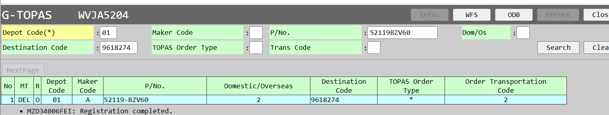

# XD06 RPA Cross Dock Master to GTOPAS: steps of the robot

_Generated by deliverables/user_guide/build_rpa_steps.py from the same content as the Excel file; do not edit by hand._

| Item | Value |
|---|---|
| Function | XD06 IF Cross Dock Master to GTOPAS (desktop flow CDX_XD06_GTOPAS, started by the parent flow CDX_SYNC_PARENT) |
| Started by | Scenario 1 of [Sync] / [Re-send last Sync] (run with GTOPAS rows), or the Period Rollover on day 1 (00:10) |
| Input | SYNC_DT of the run; view V_GTOPAS_CROSSDOCK (rows of TB_H_STG_GTOPAS with SYNC_STATUS 1), rows with that SYNC_DT (read-only DB user) |
| Output | Rows added / deleted on GTOPAS WVJA5204 (Depot 01); STATUS to the parent flow; e-mail |

AP POLE and GTOPAS pictures: screens given by the user (a red mark comes from the original picture). NSP picture: prototype. Query results and files: example data of the full flow simulation (dummy parts DUMMY-00x, [Sync] of 2026-11-10 11:00:00); column name with * = helper column of NSP, not written to the file or the screen.

## Steps

### 1. NSP: D/S clicks [Sync (n)] (or Period Rollover)

The run has GTOPAS rows (a part became Active / Inactive, a destination was added / removed): the parent flow starts XD06 first. The Period Rollover starts XD06 by itself, no screen.

![NSP: D/S clicks [Sync (n)] (or Period Rollover)](img/r01_nsp_sync.png)

### 2. Get data: rows of the run ([Sync])

The robot reads V_GTOPAS_CROSSDOCK with the SYNC_DT of the run: one row per part + destination, ACTION ADD or DELETE. Example: run of 10-Nov, three ADD rows.

```sql
SELECT * FROM V_GTOPAS_CROSSDOCK WHERE SYNC_DT = '2026-11-10 11:00:00' ORDER BY P_NO, DESTINATION_CODE
```

| STG_ID* | PERIOD* | ACTION* | DEPOT_CODE | P_NO | DESTINATION_CODE | MAKER_CODE | DOMESTIC_OVERSEAS | TOPAS_ORDER_TYPE | ORDER_TRANSPORTATION_CODE |
|---|---|---|---|---|---|---|---|---|---|
| 6 | 202611 | ADD | 01 | DUMMY-004 | 9715310 | A | 2 | 3 | 2 |
| 7 | 202611 | ADD | 01 | DUMMY-004 | 9600110 | A | 2 | 3 | 2 |
| 8 | 202611 | ADD | 01 | DUMMY-002 | 9655510 | A | 2 | 3 | 2 |

### 3. Get data: rows of the run (Period Rollover)

Example: rollover of 01-Jan, two DELETE rows (part became Inactive) and one ADD row (part became Active).

```sql
SELECT * FROM V_GTOPAS_CROSSDOCK WHERE SYNC_DT = '2027-01-01 00:10:00' ORDER BY P_NO, DESTINATION_CODE
```

| STG_ID* | PERIOD* | ACTION* | DEPOT_CODE | P_NO | DESTINATION_CODE | MAKER_CODE | DOMESTIC_OVERSEAS | TOPAS_ORDER_TYPE | ORDER_TRANSPORTATION_CODE |
|---|---|---|---|---|---|---|---|---|---|
| 14 | 202701 | DELETE | 01 | DUMMY-004 | 9715310 | A | 2 | 3 | 2 |
| 15 | 202701 | DELETE | 01 | DUMMY-004 | 9600110 | A | 2 | 3 | 2 |
| 16 | 202701 | ADD | 01 | DUMMY-006 | 9811110 | A | 2 | 3 | 2 |

### 4. GTOPAS: open Crossdock Master and search the row

Menu Supply > Master > Crossdock Master (WVJA5204). Depot Code = 01, P/No. and Destination Code of the row, [Search].



### 5. DELETE row: MT = DEL

On the row found, MT = DEL and confirm. GTOPAS shows "MZD34006FEI: Registration completed." = done. Row not found = already gone = OK. Any other message = the row failed: it is listed and the robot goes on with the next row.


### 6. ADD row: register

Register a new row: Depot Code 01, Maker Code A, P/No., Domestic/Overseas 2, Destination Code, TOPAS Order Type 3, Order Transportation Code 2. Message MZD34006FEI = done; row already there = OK. ILLUSTRATION below: no screenshot of the register screen yet.

> ILLUSTRATION, not a screenshot: register row on GTOPAS WVJA5204 (screenshot of the register screen to be added)

| No | MT | R | Depot Code | Maker Code | P/No. | Domestic/Overseas | Destination Code | TOPAS Order Type | Order Transportation Code |
|---|---|---|---|---|---|---|---|---|---|
|  |  |  | 01 | A | DUMMY-004 | 2 | 9715310 | 3 | 2 |

### 7. Result: STATUS and e-mail

SUCCESS when every row is OK, else FAILED with the failed rows. Scenario 1: the parent flow starts XD07 only on SUCCESS. One e-mail per run; nothing is written back to NSP. FAILED: D/S clicks [Re-send last Sync].

## Notes

- The GTOPAS screenshot is the screen given by the user (part 52119-BZV60, destination 9618274, a DEL row), not the dummy data of the example; it shows the search fields and the message of a delete.
- Screenshot of the register (ADD) screen of WVJA5204 to be added; TOPAS Order Type 3 or * is TBC (FB-203).
- GTOPAS has no period: the rows of the Next period go at the Period Rollover, not at [Sync].
