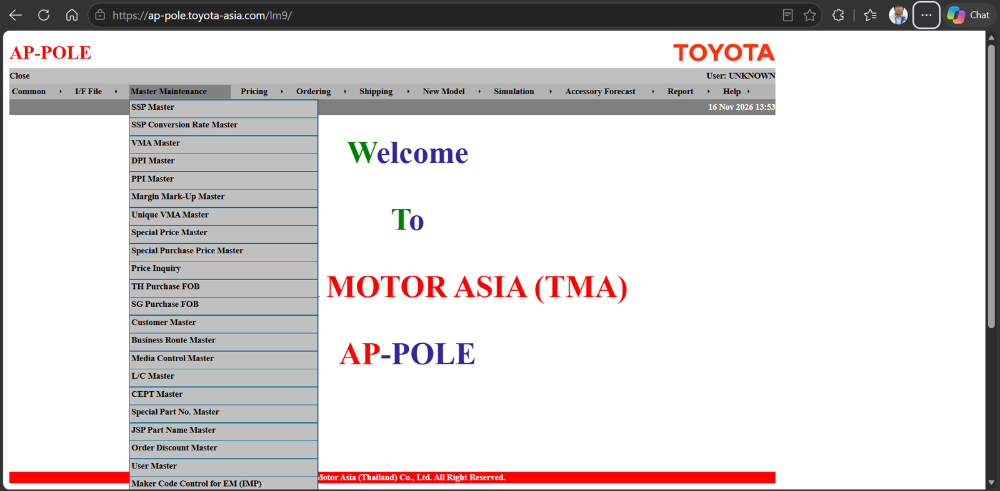
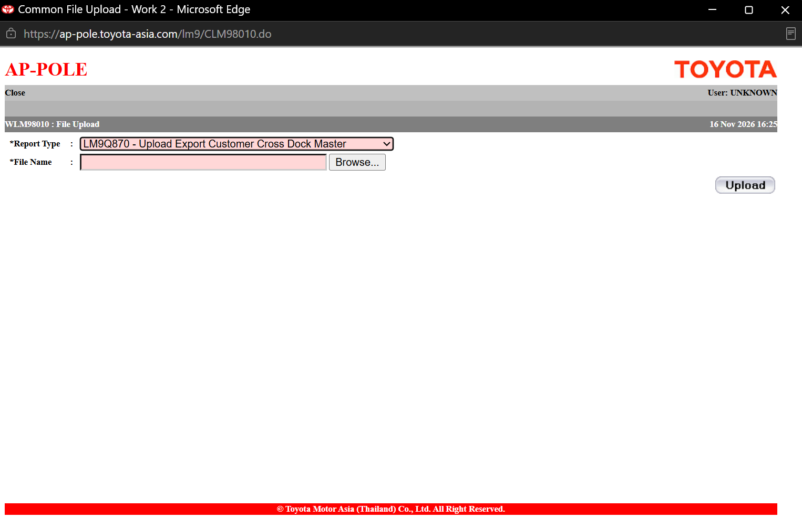
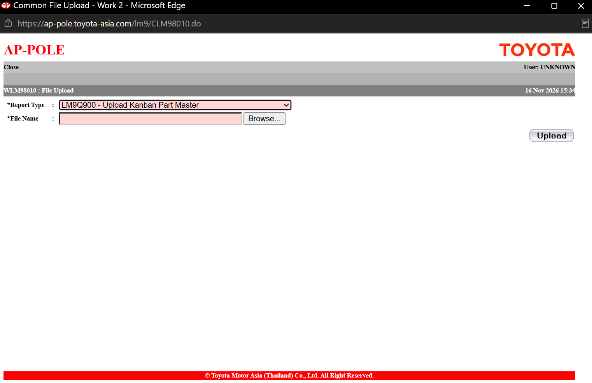
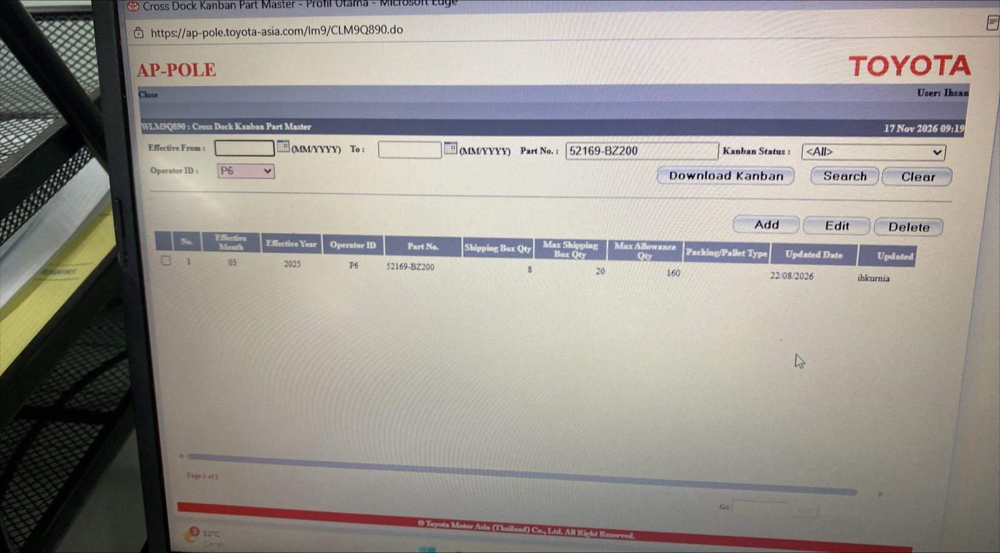
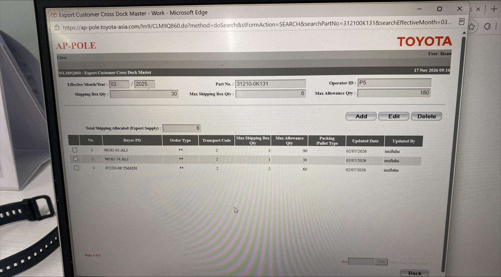

# XD07 RPA Cross Dock Master to AP POLE: steps of the robot

_Generated by deliverables/user_guide/build_rpa_steps.py from the same content as the Excel file; do not edit by hand._

| Item | Value |
|---|---|
| Function | XD07 RPA Cross Dock Master to AP POLE (desktop flow CDX_XD07_APPOLE, started by the parent flow CDX_SYNC_PARENT) |
| Started by | D/S [Sync] or [Re-send last Sync] on NSP. Scenario 1: after XD06 GTOPAS succeeded. Scenario 2: at once. |
| Input | SYNC_DT of the run (time of the [Sync] click, given by the parent flow); views V_APPOLE_UPLOAD_EXPORT / V_APPOLE_UPLOAD_KANBAN, rows with SYNC_STATUS 1 and that SYNC_DT (read-only DB user) |
| Output | Files uploaded on AP POLE in the order 1 EXPORT_PRE, 2 KANBAN, 3 EXPORT_POST; e-mail SUCCESS / FAILED |

AP POLE and GTOPAS pictures: screens given by the user (a red mark comes from the original picture). NSP picture: prototype. Query results and files: example data of the full flow simulation (dummy parts DUMMY-00x, [Sync] of 2026-11-10 11:00:00); column name with * = helper column of NSP, not written to the file or the screen.

## Steps

### 1. NSP: D/S clicks [Sync (n)]

Export Crossdock Master, ongoing period. [Sync] sets the staging rows 0 -> 1 with SYNC_DT = time of the click and starts the parent flow with that SYNC_DT. This is the only manual step; everything below is the robot.

![NSP: D/S clicks [Sync (n)]](img/r01_nsp_sync.png)

### 2. Get data: file 1 EXPORT_PRE

The robot reads the Export rows of the run for file 1: parts whose Max Case/Day goes down (OPERATION_TYPE 1). Per part, ROW_ORDER 1 (down or delete) comes before 2 (up or add).

```sql
SELECT * FROM V_APPOLE_UPLOAD_EXPORT WHERE SYNC_STATUS = '1' AND SYNC_DT = '2026-11-10 11:00:00' AND FILE_NO = 1 ORDER BY PERIOD, NSP_PART_NO, ROW_ORDER, STG_ID
```

| STG_ID* | PERIOD* | NSP_PART_NO* | FILE_NO* | ROW_ORDER* | EFFECTIVE_MONTH_YEAR | PART_NO | BUYER_PD | ORDER_TYPE | TRANSPORT_CODE | MAX_SHIPPING_BOX_RCS |
|---|---|---|---|---|---|---|---|---|---|---|
| 10 | 202611 | DUMMY-002 | 1 | 1 | 11/2026 | DUMMY002 | 98111-10 | \*\* | 2 | 12 |
| 11 | 202611 | DUMMY-002 | 1 | 2 | 11/2026 | DUMMY002 | 96555-10 | \*\* | 2 | 8 |

### 3. Get data: file 2 KANBAN

The Kanban rows of the run with OPERATION_TYPE 1 to 4 (a header with 5 is not uploaded).

```sql
SELECT * FROM V_APPOLE_UPLOAD_KANBAN WHERE SYNC_STATUS = '1' AND SYNC_DT = '2026-11-10 11:00:00' ORDER BY PERIOD, PART_NO
```

| STG_ID* | PERIOD* | OPERATION_TYPE* | EFFECTIVE_MONTH_YEAR | OPERATOR_ID | PART_NO | PART_NAME | SHIPPING_BOX_QTY | MAX_SHIPPING_BOX_QTY | MAX_ALLOWANCE_QTY |
|---|---|---|---|---|---|---|---|---|---|
| 6 | 202611 | 1 | 11/2026 | P6 | DUMMY-002 | DUMMY PART 002 | 12 | 20 | 240 |
| 5 | 202611 | 4 | 11/2026 | P6 | DUMMY-004 | DUMMY PART 004 | 6 | 20 | 120 |

### 4. Get data: file 3 EXPORT_POST

Every other Export row of the run (OPERATION_TYPE 2, 3, 4 or 5 on the Kanban row of the part).

```sql
SELECT * FROM V_APPOLE_UPLOAD_EXPORT WHERE SYNC_STATUS = '1' AND SYNC_DT = '2026-11-10 11:00:00' AND FILE_NO = 3 ORDER BY PERIOD, NSP_PART_NO, ROW_ORDER, STG_ID
```

| STG_ID* | PERIOD* | NSP_PART_NO* | FILE_NO* | ROW_ORDER* | EFFECTIVE_MONTH_YEAR | PART_NO | BUYER_PD | ORDER_TYPE | TRANSPORT_CODE | MAX_SHIPPING_BOX_RCS |
|---|---|---|---|---|---|---|---|---|---|---|
| 8 | 202611 | DUMMY-004 | 3 | 2 | 11/2026 | DUMMY004 | 97153-10 | \*\* | 2 | 12 |
| 9 | 202611 | DUMMY-004 | 3 | 2 | 11/2026 | DUMMY004 | 96001-10 | \*\* | 2 | 8 |

### 5. Fill the template: file 1

Copy of the stored template LLM9Q880, one row per Export row, helper columns left out. A file without rows is not made.

File: `LLM9Q880_20261110110000_1_EXPORT_PRE.xls (template LLM9Q880)`

| Effective Month / Year | Part No. | Buyer-PD | Order Type | Transport Code | Max Shipping Box (RCS) |
|---|---|---|---|---|---|
| 11/2026 | DUMMY002 | 98111-10 | \*\* | 2 | 12 |
| 11/2026 | DUMMY002 | 96555-10 | \*\* | 2 | 8 |

### 6. Fill the template: file 2

Copy of the stored template LLM9Q910, one row per Kanban row.

File: `LLM9Q910_20261110110000_2_KANBAN.xls (template LLM9Q910)`

| Effective Month / Year | Operator ID | Part No. | Part Name | Shipping Box Qty | Max Shipping Box Qty | Max Allowance Qty |
|---|---|---|---|---|---|---|
| 11/2026 | P6 | DUMMY-002 | DUMMY PART 002 | 12 | 20 | 240 |
| 11/2026 | P6 | DUMMY-004 | DUMMY PART 004 | 6 | 20 | 120 |

### 7. Fill the template: file 3

Copy of the stored template LLM9Q880.

File: `LLM9Q880_20261110110000_3_EXPORT_POST.xls (template LLM9Q880)`

| Effective Month / Year | Part No. | Buyer-PD | Order Type | Transport Code | Max Shipping Box (RCS) |
|---|---|---|---|---|---|
| 11/2026 | DUMMY004 | 97153-10 | \*\* | 2 | 12 |
| 11/2026 | DUMMY004 | 96001-10 | \*\* | 2 | 8 |

### 8. AP POLE: log in, menu Master

The robot logs in to AP POLE (https://ap-pole.toyota-asia.com/lm9/) with the robot user and opens the menu Master.



### 9. Upload file 1 EXPORT_PRE

Common File Upload (WLM98010). Report Type = the Export Customer Cross Dock Master upload (LM9Q870), File Name = LLM9Q880_20261110110000_1_EXPORT_PRE.xls, [Upload]. Wait for the result: an error stops the run (next files not uploaded).



### 10. Upload file 2 KANBAN

Report Type = LM9Q900 - Upload Kanban Part Master, File Name = LLM9Q910_20261110110000_2_KANBAN.xls, [Upload]. Wait for the result.



### 11. Upload file 3 EXPORT_POST

Report Type = LM9Q870 again, File Name = LLM9Q880_20261110110000_3_EXPORT_POST.xls, [Upload]. Wait for the result.


### 12. Check: Cross Dock Kanban Part Master

Master > Cross Dock Kanban Part Master (WLM9Q890), search the parts of the run: Shipping Box Qty and Max Shipping Box Qty of the effective month show the uploaded values.



### 13. Check: Export Customer Cross Dock Master

Tick the part, [Maintain Cross Dock] (WLM9Q860): the Buyer-PD rows show the uploaded Max Shipping Box (RCS); 0 = deleted.



### 14. Result: e-mail

The robot gives STATUS back to the parent flow; the parent flow sends one e-mail per run (SUCCESS / FAILED, file and row of an error). Nothing is written back to NSP. FAILED: D/S clicks [Re-send last Sync].

## Notes

- File names follow the templates decided for the staging (LLM9Q910 Kanban, LLM9Q880 Export). The Report Type names on the AP POLE screen are LM9Q900 / LM9Q870: which report type takes which template is TBC with the AP POLE team.
- The AP POLE screens are the screens given by the user (16-Nov), not taken during a robot run.
- Order of the files: EXPORT_PRE before KANBAN when Max goes down, so AP POLE never has destinations above the Max.
- One row per key: a part edited twice before [Sync] has one row with the last value (the unsent row is updated, not added). [Re-send last Sync] reads MAX(SYNC_DT).
