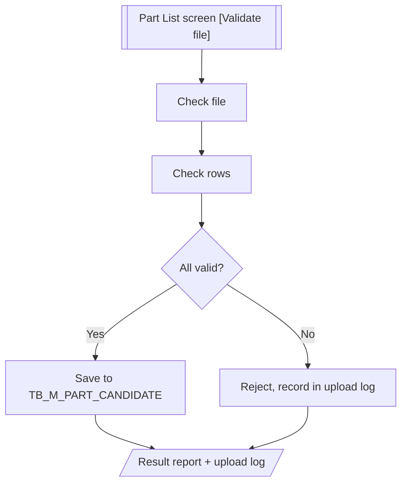
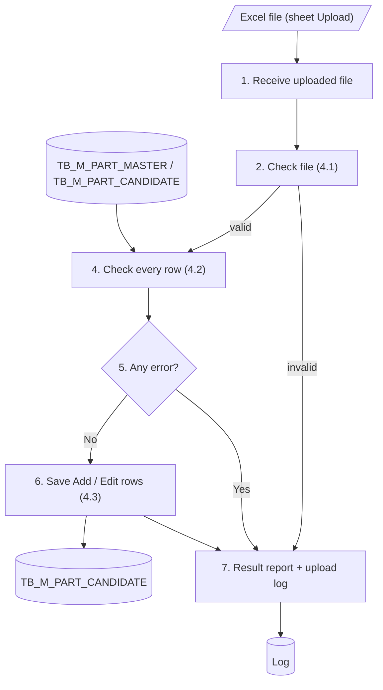

# XD02 – Cross Dock Part Master Upload Batch

> Generated from `deliverables/function_list_v2/specs/XD02_spec.json` (UISS `XD02_UISS_Batch_CrossDockPartMasterUpload.xlsx`). Do not edit by hand: change the spec and run `python3 prepare_code/build_md.py`. Document names: GTOPAS / NSP (prototype: G-System / Supplier System).

| Phase | Project | Block | Function | Created | By | Type |
|---|---|---|---|---|---|---|
| DR | Crossdock Optimization | Batch | XD02 Cross Dock Part Master Upload Batch | 18-Oct-26 | FID Rayhan | batch |

## Revision

| Rev | Author | Date | Reviewed by | Description |
|---|---|---|---|---|
| 0.1 | FID Rayhan | 18-Oct-26 |  | Initial Draft |

## 1. General

### Objective

- To process the Part List file uploaded from the Cross Dock Part Master screen (Part List tab): from the [Validate file] button of the Upload Excel modal until the data is saved to TB_M_PART_CANDIDATE.
- In case any error occurs, nothing is saved to the master. The error is recorded in the upload log and a result report is created.

### Operation flow

### Input

| Name | Type | Description |
|---|---|---|
| Part List file (sheet Upload) | Excel | Uploaded by the user on the Part List screen ([Validate file]). Only sheet Upload is read. Max 5 MB, 5,000 rows. |
| TB_M_PART_MASTER | DB | Part existence check and Part Name |
| TB_M_PART_CANDIDATE | DB | Current data for duplicate check, status rule and Edit comparison |
| TB_M_PART_CANDIDATE_DEST | DB | Total Case/Day already mapped per part in the ongoing calculation period (check 9) |

### Output

| Name | Type | Description |
|---|---|---|
| TB_M_PART_CANDIDATE | DB | if successful |
| TB_H_PART_CANDIDATE | DB | if successful: history record per changed field of each saved part |
| Log | DB | Upload log: one record per upload with status (COMPLETED / REJECTED), counts and errors |
| Result report | Excel | Also if error occurs. Sheets: Summary, Result, Re-upload, Changes |

### Parameters

| Name | Description |
|---|---|
| Uploaded file | File selected by the user on the Part List screen |
| User | Login name of the user who clicks [Validate file] |

### Execution Schedule

| Item | Description |
|---|---|
| Trigger | Starts when the user clicks [Validate file] in the Upload Excel modal of the Part List screen (on demand, no schedule). |

## 2. Function flow

1. User clicks [Validate file] in the Upload Excel modal of the Part List screen. The batch starts and receives the uploaded file.
2. Check the file: format .xlsx, size, number of rows, sheet "Upload" and template columns (see 4.1).
  - If the file is not valid, reject the upload and go to step 7.
3. Read all rows of sheet "Upload".
4. Check every row against the business rules (see 4.2) and collect all errors.
  - Each row is Add (flag A) or Edit (flag E).
5. If any row has an error, reject the whole file. Nothing is saved to the master and the errors are recorded in the upload log.
  - Go to step 7.
6. If all rows are valid, save to master table TB_M_PART_CANDIDATE (see 4.3).
  - Add: register the new part as Candidate.
  - Edit: update the changed values, including status Active <-> Inactive. A row with no change is skipped.
  - Every saved part gets Sync Status = No Sync.
7. Create the result report and record the result (completed or rejected) in the upload log. The Part List screen shows the result to the user. Exit.

## 3. Data edit mapping

#### 1. Insert TB_M_PART_CANDIDATE – Flag A - new part
- Source: Excel file - sheet Upload (valid rows) (keys: upload = 'A')

| Source field | Destination field | Description |
|---|---|---|
| part_no | PART_NO |  |
|  | PART_NAME | TB_M_PART_MASTER.PART_NAME by PART_NO |
| min_mad | MIN_MAD | From the file (mandatory) |
| pcs_case | PCS_CASE |  |
| max_case_day | MAX_CASE_DAY |  |
|  | TOTAL_PCS_DAY | PCS_CASE x MAX_CASE_DAY |
| effective_start_date | EFFECTIVE_START_DATE |  |
|  | PART_STATUS | Default : 'Candidate' (status column must be blank) |
|  | SYNC_STATUS | Default : '0' (No Sync) |
|  | SYNC_DT | Default : NULL |
|  | SYNC_MESSAGE | Default : NULL |
|  | LAST_SOURCE | Default : 'UPLOAD' |
|  | LAST_UPLOAD_ID | UPLOAD_ID of this run |
|  | CREATED_BY | Login name of the user who uploaded |
|  | CREATED_DT | Server system date and time |
|  | CHANGED_BY | Same as CREATED_BY |
|  | CHANGED_DT | Server system date and time |

#### 2. Update TB_M_PART_CANDIDATE – Flag E - only if changed
- Source: Excel file - sheet Upload (valid rows) (keys: upload = 'E')
- Destination keys: PART_NO = PART_NO of the row

| Source field | Destination field | Description |
|---|---|---|
| part_no | PART_NO | Key, not changed |
|  | PART_NAME | Not changed |
| min_mad | MIN_MAD | From the file (mandatory) |
| pcs_case | PCS_CASE |  |
| max_case_day | MAX_CASE_DAY |  |
|  | TOTAL_PCS_DAY | Recalculate : PCS_CASE x MAX_CASE_DAY |
| effective_start_date | EFFECTIVE_START_DATE | Only while PART_STATUS = 'Candidate' |
| status | PART_STATUS | Active <-> Inactive only; blank = not changed |
|  | SYNC_STATUS | Set '0' (No Sync) |
|  | SYNC_DT | Not changed |
|  | SYNC_MESSAGE | Not changed |
|  | LAST_SOURCE | Set 'UPLOAD' |
|  | LAST_UPLOAD_ID | UPLOAD_ID of this run |
|  | CREATED_BY | Not changed |
|  | CREATED_DT | Not changed |
|  | CHANGED_BY | Login name of the user who uploaded |
|  | CHANGED_DT | Server system date and time |

#### 3. Insert TB_H_PART_CANDIDATE – Saved row - history
- Source: Saved rows of this upload

| Source field | Destination field | Description |
|---|---|---|
|  | HIST_ID | Auto (identity) |
|  | PART_NO | Part of the event |
|  | PERIOD | NULL (Part List has no period) |
|  | EVENT_TYPE | 'ADD' (flag A) / 'EDIT' (flag E) |
|  | SOURCE | 'UPLOAD' |
|  | UPLOAD_ID | UPLOAD_ID of this run |
|  | DEST_CODE | NULL |
|  | FIELD_NAME | Changed field, e.g. PCS_CASE, MAX_CASE_DAY, PART_STATUS |
|  | OLD_VALUE | Value before upload (NULL for ADD) |
|  | NEW_VALUE | Value from the file |
|  | REMARK | NULL |
|  | CREATED_BY | Login name of the user who uploaded |
|  | CREATED_DT | Server system date and time |

#### 4. Update Log – Result of the run
- Source: Result of this upload
- Destination keys: UPLOAD_ID = UPLOAD_ID of this run

| Source field | Destination field | Description |
|---|---|---|
|  | STATUS | COMPLETED if all rows saved or skipped, REJECTED if file check or any row failed |
|  | TOTAL_ROWS | Number of rows in sheet Upload |
|  | SAVED_ROWS | Rows inserted or updated |
|  | NO_CHANGE_ROWS | Rows skipped because nothing changed |
|  | ERROR_ROWS | Rows with error |
|  | RESULT_FILE_PATH | Path of the result report .xlsx |
|  | END_DT | Server system date and time |

## 4. Function description

This batch starts when the user clicks [Validate file] in the Upload Excel modal of the Part List screen. It checks the uploaded file and, if everything is valid, saves the data to TB_M_PART_CANDIDATE. If not, the upload is rejected and recorded in the upload log.

- Only sheet "Upload" of the file is read. Parts that are not in the sheet are not changed.
- One run saves all rows or none (all-or-nothing).
- Part Name is retrieved from TB_M_PART_MASTER. Total Pcs/Day is calculated as Pcs/Case x Max Case/Day. Both are saved.

### 4.1 File Check (log message no. 5)

1. File extension is .xlsx.
2. File size is 5 MB or less.
3. Sheet Upload has 1 to 5,000 data rows.
4. Sheet "Upload" exists. Other sheets are ignored.
5. Header has the 7 template columns (see Appendix). Extra columns are ignored.

### 4.2 Row Validation (log message no. 6)

Every row is checked and all errors are collected, so the user can correct the file once.

### 4.3 Saving

- If any row is rejected, nothing is saved to TB_M_PART_CANDIDATE. The upload status and the error of every row are recorded in the upload log (Log).
- If all rows are valid, the data is saved to TB_M_PART_CANDIDATE: flag A inserts a new part (status Candidate), flag E updates the changed values, including status Active <-> Inactive. Rows with no change are skipped.
- The status of a Candidate part is changed only in the Edit part data modal on the screen, not by upload.
- Every inserted or changed part gets a history record per changed field in TB_H_PART_CANDIDATE (event ADD / EDIT, source UPLOAD, UPLOAD_ID of this run; refer Appendix).
- Every saved record gets Sync Status = No Sync. It is sent to GTOPAS and AP POLE by the IF functions (XD06 / XD07) when D/S clicks [Sync] in Mapping per Destination.
- A result report (.xlsx) is created for both cases.

| No | Check | Column |
|---|---|---|
| 1 | Flag is A (Add) or E (Edit). | upload |
| 2 | Part No exists in TB_M_PART_MASTER. | part_no |
| 3 | Flag A: Part No is not yet in TB_M_PART_CANDIDATE. Flag E: it already is. | part_no |
| 4 | Part No appears only once in the file. | part_no |
| 5 | Min MAD is a whole number, 0 or more, and Pcs/Case and Max Case/Day are whole numbers greater than 0; all three are required on every row. | min_mad, pcs_case, max_case_day |
| 6 | Status: flag A must be blank (a new part is always Candidate). Flag E: a Candidate part must stay Candidate (blank or Candidate); an Active part may be changed to Inactive and an Inactive part to Active; no part can be changed to Candidate. | status |
| 7 | Effective Start Date is required when the part status is Candidate (always for flag A) and must be today or later when new or changed. | effective_start_date |
| 8 | Flag E: Effective Start Date can only change while the part status is Candidate. | effective_start_date |
| 9 | Flag E: Max Case/Day is not below the total Case/Day already mapped per destination in the ongoing calculation period of Mapping per Destination (TB_M_PART_CANDIDATE_DEST) (e.g. mapped 100, new Max Case/Day 80 is rejected). The user must first reduce the mapping in the Mapping per Destination sub-menu, then lower Max Case/Day in Part List. | max_case_day |

## 5. Logging messages

| ID | Event | Cause | Type | Message | Action |
|---|---|---|---|---|---|
| LOG1 | Batch start | Batch is called | Info | Upload batch <UPLOAD_ID> started. | system: Write the log.; user: - |
| LOG2 | Batch end | Batch finishes | Info | Upload batch <UPLOAD_ID> ended. Status <STATUS>, total <TOTAL_ROWS>, saved <SAVED_ROWS>, no change <NO_CHANGE_ROWS>, error <ERROR_ROWS>. | system: Write the log.; user: - |
| LOG3 | Receive file | Uploaded file of <UPLOAD_ID> not found | Error | Uploaded file of <UPLOAD_ID> not found. | system: Stop the batch.; user: Upload the file again. |
| LOG4 | File check | Extension, size, row count, sheet Upload or header is invalid | Error | File check failed: <REASON>. | system: Set STATUS = REJECTED. Create the result report.; user: Download the file from the screen again and upload it. |
| LOG5 | Row validation | A validation rule in 4.2 fails | Error | Row <ROW_NO> <COLUMN> : <RULE_MESSAGE>. | system: Reject the whole file. Nothing is saved.; user: Correct the rows in sheet Re-upload of the result report, then upload again. |
| LOG6 | Row skipped | Edit row has the same values as the master | Info | Row <ROW_NO> Part No <PART_NO> has no change. Skipped. | system: Do not update the record.; user: - |
| LOG7 | Save to master | Insert or update TB_M_PART_CANDIDATE fails | Error | Cannot save Part No <PART_NO> to TB_M_PART_CANDIDATE. | system: Roll back. Set STATUS = REJECTED.; user: User contact PIC |
| LOG8 | Result report | Result report cannot be created | Warning | Result report of <UPLOAD_ID> cannot be created. | system: Continue. RESULT_FILE_PATH stays blank.; user: Contact system owner. |
| LOG9 | Unexpected error | Any other system error | Critical | Unexpected error: <ERROR_DETAIL>. | system: Roll back. Set STATUS = REJECTED.; user: User contact PIC |

## 6. Appendix

### Upload template (sheet "Upload")

| Column | Content |
|---|---|
| part_no | Part Number |
| min_mad | Min MAD (mandatory; whole number, 0 or more): reference compared with the MAD result of the calculation |
| pcs_case | Pieces per case |
| max_case_day | Max Case/Day |
| status | Candidate / Active / Inactive. Flag A: blank. Flag E: a Candidate part stays Candidate (blank or Candidate); Active <-> Inactive allowed; never Candidate for an Active or Inactive part. |
| upload | A = Add, E = Edit |
| effective_start_date | DD-Mon-YYYY |

Sample upload scenarios (master data, accepted files, rejected files): see sheet Sample Input.

## 7. Tables

#### TB_M_PART_CANDIDATE (transaction, existing)
Candidate part setting, one record per part (Part List data, no calculation period). Target of a successful upload.

| Column | Type | PK | Null | Description |
|---|---|---|---|---|
| PART_NO | VARCHAR(TBD) | Y | N | Part number; length follows TB_M_PART_MASTER |
| PART_NAME | VARCHAR(TBD) |  | N | Retrieved from TB_M_PART_MASTER by PART_NO |
| MIN_MAD | INT |  | N | Minimum MAD (mandatory); reference compared with the MAD result of the calculation |
| PCS_CASE | INT |  | N | Pieces per case (> 0) |
| MAX_CASE_DAY | INT |  | N | Total Case/Day of the part (> 0) |
| TOTAL_PCS_DAY | INT |  | N | PCS_CASE x MAX_CASE_DAY |
| EFFECTIVE_START_DATE | DATE |  | Y | Effective start date; required while the part is Candidate |
| PART_STATUS | VARCHAR(TBD) |  | N | Candidate / Active / Inactive |
| SYNC_STATUS | CHAR(1) |  | N | 0 = No Sync, 3 = Waiting, 1 = Success, 2 = Failed |
| SYNC_DT | DATETIME |  | Y | Date-time of the last IF function result |
| SYNC_MESSAGE | VARCHAR(TBD) |  | Y | Reason of the last Failed sync |
| LAST_SOURCE | VARCHAR(TBD) |  | N | CALC / SCREEN / UPLOAD |
| LAST_UPLOAD_ID | VARCHAR(TBD) |  | Y | Upload that last changed the record |
| CREATED_BY | VARCHAR(TBD) |  | N | User who created the record |
| CREATED_DT | DATETIME |  | N | Created date and time |
| CHANGED_BY | VARCHAR(TBD) |  | N | User who last changed the record |
| CHANGED_DT | DATETIME |  | N | Last changed date and time |

#### TB_H_PART_CANDIDATE (history, proposed)
History of every change of a crossdock part (Add / Edit by screen or upload, mapping changes, Sync results, status changes and mappings made by the calculation batches). Read by the History setting modal of Part List (index PART_NO, CREATED_DT). Proposed retention: 24 months online by CREATED_DT; a monthly housekeeping job deletes older records (period configurable in system master). To be confirmed.

| Column | Type | PK | Null | Description |
|---|---|---|---|---|
| HIST_ID | BIGINT | Y | N | Running number (identity) |
| PART_NO | VARCHAR(TBD) |  | N | Part number; length follows TB_M_PART_MASTER |
| PERIOD | CHAR(6) |  | Y | Calculation period YYYYMM for MAPPING / SYNC / CALC; NULL for ADD / EDIT (Part List has no period) |
| EVENT_TYPE | VARCHAR(10) |  | N | ADD / EDIT / MAPPING / SYNC / CALC |
| SOURCE | VARCHAR(10) |  | N | SCREEN / UPLOAD / IF / BATCH |
| UPLOAD_ID | VARCHAR(TBD) |  | Y | Upload of the change (Log); NULL when not from an upload |
| DEST_CODE | CHAR(7) |  | Y | Destination code (7 digits) for MAPPING; NULL for other events |
| FIELD_NAME | VARCHAR(30) |  | N | Changed field: PCS_CASE, MAX_CASE_DAY, MIN_MAD, PART_STATUS, EFFECTIVE_START_DATE, CASE_DAY, SYNC_STATUS |
| OLD_VALUE | VARCHAR(255) |  | Y | Value before the change; NULL for ADD or an added destination |
| NEW_VALUE | VARCHAR(255) |  | Y | Value after the change; NULL for a removed destination |
| REMARK | VARCHAR(500) |  | Y | Free text, e.g. SYNC_MESSAGE of a Failed sync |
| CREATED_BY | VARCHAR(20) |  | N | User who made the change (IF batch user ID for SYNC, batch user ID for BATCH) |
| CREATED_DT | DATETIME |  | N | Date and time of the change |

## Sample Input

**Sample upload scenarios - Part List Upload**

- Each scenario is a separate upload file. Today = 13-Sep-2026, mapping of the ongoing calculation period = Sep 2026.
- Input columns follow sheet Upload of the Export Excel; a blank cell is a blank value in the file.

### A. Master data before upload

| Part No | Status | Min MAD | Pcs/Case | Max Case/Day | Effective Date | Mapped 9722D10 | Mapped 9811110 | Mapped 9715310 | Mapped total |
|---|---|---|---|---|---|---|---|---|---|
| PART-A | Active | 800 | 60 | 24 | 01-Aug-2026 | 12 | 8 | 4 | 24 |
| PART-C | Active | 200 | 10 | 30 | 01-Aug-2026 |  | 12 | 18 | 30 |
| PART-G | Active | 150 | 50 | 22 | 01-Aug-2026 |  |  |  | 0 |
| PART-I | Candidate | 300 | 15 | 20 | 15-Sep-2026 |  |  |  | 0 |
| PART-M01 | (not registered) |  |  |  |  |  |  |  |  |
| PART-M02 | (not registered) |  |  |  |  |  |  |  |  |
| PART-M03 | (not registered) |  |  |  |  |  |  |  |  |

### B. Normal scenarios (file accepted)

| No | Scenario | part_no | min_mad | pcs_case | max_case_day | status | upload | effective_start_date | Expected result |
|---|---|---|---|---|---|---|---|---|---|
| N1 | Add a new part | PART-M01 | 300 | 20 | 15 |  | A | 14-Sep-2026 | Inserted. Status Candidate, Total Pcs/Day 300, Sync Status No Sync, Part Name from TB_M_PART_MASTER. |
| N2 | Add another part, later date | PART-M02 | 500 | 12 | 40 |  | A | 16-Sep-2026 | Inserted. Total Pcs/Day 480. Both N1 and N2 can be in one file. |
| N3 | Edit a Candidate part, change values and effective date | PART-I | 300 | 15 | 18 | Candidate | E | 20-Sep-2026 | Updated. Max Case/Day 20 -> 18, effective date changed, Total Pcs/Day 270, Sync Status No Sync. |
| N4 | Edit an Active part, raise Max Case/Day | PART-A | 800 | 60 | 30 |  | E |  | Updated. Max Case/Day 24 -> 30, Total Pcs/Day 1,800, Sync Status Success -> No Sync. Mapping is not changed. |
| N5 | Edit with the same values as the master | PART-A | 800 | 60 | 24 | Active | E |  | NO CHANGE. Row skipped, Sync Status and last update stay. |
| N6 | File with only some parts (one row) | PART-I | 300 | 15 | 18 | Candidate | E | 20-Sep-2026 | Only PART-I is processed. PART-A, C, G are not in the sheet and are not changed. |
| N7 | Lower Max Case/Day after the mapping was reduced to 20 in Mapping per Destination | PART-A | 800 | 60 | 20 |  | E |  | Updated. Max Case/Day 24 -> 20 (not below mapped 20). |
| N8 | Change an Active part to Inactive | PART-G | 150 | 50 | 22 | Inactive | E |  | Updated. Status Active -> Inactive, Sync Status No Sync. Inactive -> Active works the same way. |

### C. Error scenarios (whole file rejected, nothing saved)

| No | Scenario | part_no | min_mad | pcs_case | max_case_day | status | upload | effective_start_date | Error (4.2 check no.) |
|---|---|---|---|---|---|---|---|---|---|
| E1 | Flag is not A or E | PART-I | 300 | 15 | 18 |  | X | 20-Sep-2026 | Check 1: upload must be A or E. |
| E2 | Part not in part master | PART-Z99 | 100 | 10 | 10 |  | E |  | Check 2: Part No not found in TB_M_PART_MASTER. |
| E3 | Add a part that is already registered | PART-A | 800 | 60 | 24 |  | A | 14-Sep-2026 | Check 3: Part No already registered, use flag E. |
| E4 | Edit a part that is not registered | PART-M03 | 300 | 20 | 15 |  | E |  | Check 3: Part No not registered, use flag A. |
| E5 | Same part twice in the file (row 1) | PART-I | 300 | 15 | 18 | Candidate | E | 20-Sep-2026 | Check 4: Part No appears more than once. |
| E5 | Same part twice in the file (row 2) | PART-I | 300 | 15 | 19 | Candidate | E | 20-Sep-2026 | Check 4: Part No appears more than once. |
| E6 | Invalid number | PART-M03 | 300 | 0 | 15 |  | A | 14-Sep-2026 | Check 5: pcs_case must be greater than 0. A blank min_mad, pcs_case or max_case_day is also an error. |
| E7 | Change the status of a Candidate part | PART-I | 300 | 15 | 20 | Active | E | 15-Sep-2026 | Check 6: the status of a Candidate part cannot be changed by upload. Change it in the Edit part data modal. |
| E8 | Change an Active part to Candidate | PART-C | 200 | 10 | 30 | Candidate | E |  | Check 6: no part can be changed to Candidate. |
| E9 | Add with a status | PART-M03 | 300 | 20 | 15 | Active | A | 14-Sep-2026 | Check 6: status of a new part is always Candidate, leave it blank. |
| E10 | Add without effective date | PART-M02 | 500 | 12 | 40 |  | A |  | Check 7: Effective Start Date is required for Candidate. |
| E11 | Effective date in the past | PART-M02 | 500 | 12 | 40 |  | A | 12-Sep-2026 | Check 7: Effective Start Date must be today or later. |
| E12 | Change effective date of an Active part | PART-C | 200 | 10 | 30 |  | E | 20-Sep-2026 | Check 8: effective date can only change while the part is Candidate. |
| E13 | Max Case/Day below existing mapping | PART-A | 800 | 60 | 20 |  | E |  | Check 9: Max Case/Day 20 is below mapped 24. Reduce the mapping first in Mapping per Destination. |
| E14 | Valid row (= N1) mixed with an error row (= E2), row 1 | PART-M01 | 300 | 20 | 15 |  | A | 14-Sep-2026 | Whole file rejected. The valid row is NOT saved. |
| E14 | Valid row mixed with an error row, row 2 | PART-Z99 | 100 | 10 | 10 |  | E |  | Check 2 on this row. Result report sheet Re-upload lists the rows to correct. |
| E15 | Add a new part without Min MAD | PART-M03 |  | 25 | 10 |  | A | 15-Sep-2026 | Check 5: min_mad is required (whole number, 0 or more). |

### D. File-level errors (file check 4.1)

| No | Scenario | Expected result |
|---|---|---|
| F1 | File is .xls or .csv | Rejected: file must be .xlsx. |
| F2 | File larger than 5 MB | Rejected: file size exceeds 5 MB. |
| F3 | More than 5,000 data rows, or no data row | Rejected: row count out of range. |
| F4 | No sheet named Upload (e.g. only sheet Part List) | Rejected: sheet Upload not found. |
| F5 | A template column is missing (e.g. upload deleted) | Rejected: required column not found. |
