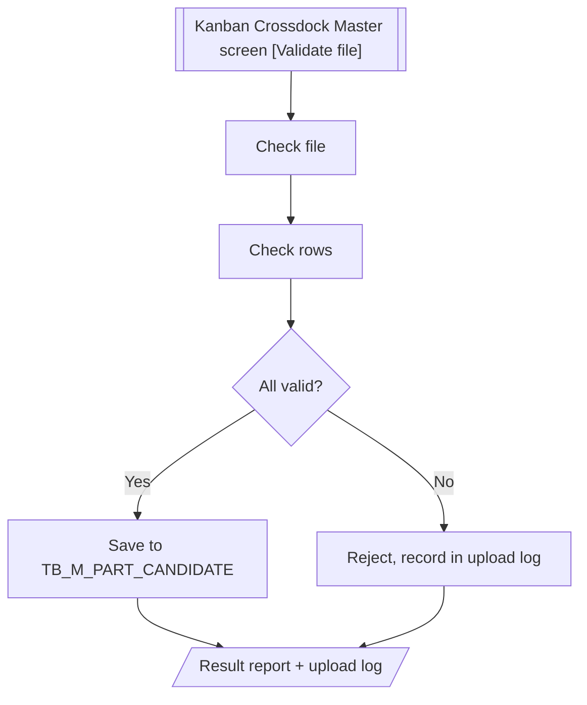
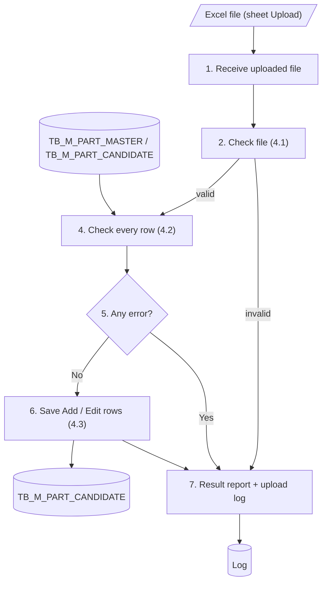

# XD02 – Cross Dock Part Master Upload Batch

> Generated from `deliverables/function_list_v2/specs/XD02_spec.json` (UISS `XD02_UISS_Batch_CrossDockPartMasterUpload.xlsx`). Do not edit by hand: change the spec and run `python3 prepare_code/build_md.py`. Document names: GTOPAS / NSP (prototype: G-System / Supplier System).

| Phase | Project | Block | Function | Created | By | Type |
|---|---|---|---|---|---|---|
| DR | Crossdock Optimization | Batch | XD02 Cross Dock Part Master Upload Batch | 18-Oct-26 | FID Rayhan | batch |

## Revision

| Rev | Author | Date | Reviewed by | Description |
|---|---|---|---|---|
| 0.1 | FID Rayhan | 18-Oct-26 |  | Initial Draft |
| 0.2 | FID Rayhan | 17-Nov-26 |  | Sync Status = No Sync only when a value sent to GTOPAS / AP POLE changed (Status to or from Active, Pcs/Case or Max Case/Day of an Active part); else kept (Sync Status rule of XD01, 17-Nov). |
| 0.3 | FID Rayhan | 18-Nov-26 |  | Sheet "Active to Inactive" removed (18-Nov): Inactive parts with No Sync / Failed are taken by [Sync] by their status. |
| 0.4 | FID Rayhan | 19-Nov-26 |  | Kanban Crossdock Master per period: the upload changes the ongoing period only (19-Nov). |

## 1. General

### Objective

- To process the Kanban Crossdock Master file uploaded from the Cross Dock Part Master screen (Kanban Crossdock Master tab): from the [Validate file] button of the Upload Excel modal until the data is saved to TB_M_PART_CANDIDATE.
- In case any error occurs, nothing is saved to the master. The error is recorded in the upload log and a result report is created.

### Operation flow

### Input

| Name | Type | Description |
|---|---|---|
| Kanban Crossdock Master file (sheet Upload) | Excel | Uploaded by the user on the Kanban Crossdock Master screen ([Validate file]). Only sheet Upload is read. Max 5 MB, 5,000 rows. |
| TB_M_PART_MASTER | DB | Part existence check and Part Name |
| TB_M_PART_CANDIDATE | DB | Current data for duplicate check, status rule and Edit comparison |
| TB_M_PART_CANDIDATE_DEST | DB | Total Case/Day already mapped per part in the ongoing calculation period (check 9) |

### Output

| Name | Type | Description |
|---|---|---|
| TB_M_PART_CANDIDATE | DB | if successful |
| TB_H_PART_CANDIDATE | DB | if successful: history record per changed field of each saved part |
| Log | DB | Upload log: one record per upload with status (COMPLETED / REJECTED), counts and errors |
| Result report | Excel | Also if error occurs. Sheets: Summary, Result, Re-upload, Changes |

### Parameters

| Name | Description |
|---|---|
| Uploaded file | File selected by the user on the Kanban Crossdock Master screen |
| User | Login name of the user who clicks [Validate file] |

### Execution Schedule

| Item | Description |
|---|---|
| Trigger | Starts when the user clicks [Validate file] in the Upload Excel modal of the Kanban Crossdock Master screen (on demand, no schedule). |

## 2. Function flow

1. User clicks [Validate file] in the Upload Excel modal of the Kanban Crossdock Master screen. The batch starts and receives the uploaded file.
2. Check the file: format .xlsx, size, number of rows, sheet "Upload" and template columns (see 4.1).
  - If the file is not valid, reject the upload and go to step 7.
3. Read all rows of sheet "Upload".
4. Check every row against the business rules (see 4.2) and collect all errors.
  - Each row is Add (flag A) or Edit (flag E).
5. If any row has an error, reject the whole file. Nothing is saved to the master and the errors are recorded in the upload log.
  - Go to step 7.
6. If all rows are valid, save to master table TB_M_PART_CANDIDATE (see 4.3).
  - Add: register the new part as Candidate.
  - Edit: update the changed values, including status Active <-> Inactive. A row with no change is skipped.
  - Insert a staging row in TB_H_PART_CANDIDATE_STG_SYNC per changed Pcs/Case or Max Case/Day of an Active part; Active -> Inactive also writes an EXPORT DELETE (0) per destination (refer XD01 5.24). A row without change writes nothing.
7. Create the result report and record the result (completed or rejected) in the upload log. The Kanban Crossdock Master screen shows the result to the user. Exit.

## 3. Data edit mapping

#### 1. Insert TB_M_PART_CANDIDATE – Flag A - new part
- Source: Excel file - sheet Upload (valid rows) (keys: Upload (A/E) = 'A')

| Source field | Destination field | Description |
|---|---|---|
| Part Number | PART_NO |  |
|  | PART_NAME | TB_M_PART_MASTER.PART_NAME by PART_NO |
| Min MAD | MIN_MAD | From the file (mandatory) |
| Pcs/Case | PCS_CASE |  |
| Max Case/Day | MAX_CASE_DAY |  |
|  | TOTAL_PCS_DAY | PCS_CASE x MAX_CASE_DAY |
| Effective Start Date | EFFECTIVE_START_DATE |  |
|  | PART_STATUS | Default : 'Candidate' (status column must be blank) |
|  | LAST_SOURCE | Default : 'UPLOAD' |
|  | LAST_UPLOAD_ID | UPLOAD_ID of this run |
|  | CREATED_BY | Login name of the user who uploaded |
|  | CREATED_DT | Server system date and time |
|  | CHANGED_BY | Same as CREATED_BY |
|  | CHANGED_DT | Server system date and time |

#### 2. Update TB_M_PART_CANDIDATE – Flag E - only if changed
- Source: Excel file - sheet Upload (valid rows) (keys: Upload (A/E) = 'E')
- Destination keys: PART_NO = PART_NO of the row

| Source field | Destination field | Description |
|---|---|---|
| Part Number | PART_NO | Key, not changed |
|  | PART_NAME | Not changed |
| Min MAD | MIN_MAD | From the file (mandatory) |
| Pcs/Case | PCS_CASE |  |
| Max Case/Day | MAX_CASE_DAY |  |
|  | TOTAL_PCS_DAY | Recalculate : PCS_CASE x MAX_CASE_DAY |
| Effective Start Date | EFFECTIVE_START_DATE | Only while PART_STATUS = 'Candidate' |
| Status | PART_STATUS | Active <-> Inactive only; blank = not changed |
|  | LAST_SOURCE | Set 'UPLOAD' |
|  | LAST_UPLOAD_ID | UPLOAD_ID of this run |
|  | CREATED_BY | Not changed |
|  | CREATED_DT | Not changed |
|  | CHANGED_BY | Login name of the user who uploaded |
|  | CHANGED_DT | Server system date and time |

#### 3. Insert TB_H_PART_CANDIDATE – Saved row - history
- Source: Saved rows of this upload

| Source field | Destination field | Description |
|---|---|---|
|  | HIST_ID | Auto (identity) |
|  | PART_NO | Part of the event |
|  | PERIOD | NULL (Kanban Crossdock Master has no period) |
|  | EVENT_TYPE | 'ADD' (flag A) / 'EDIT' (flag E) |
|  | SOURCE | 'UPLOAD' |
|  | UPLOAD_ID | UPLOAD_ID of this run |
|  | DEST_CODE | NULL |
|  | FIELD_NAME | Changed field, e.g. PCS_CASE, MAX_CASE_DAY, PART_STATUS |
|  | OLD_VALUE | Value before upload (NULL for ADD) |
|  | NEW_VALUE | Value from the file |
|  | REMARK | NULL |
|  | CREATED_BY | Login name of the user who uploaded |
|  | CREATED_DT | Server system date and time |

#### 4. Update Log – Result of the run
- Source: Result of this upload
- Destination keys: UPLOAD_ID = UPLOAD_ID of this run

| Source field | Destination field | Description |
|---|---|---|
|  | STATUS | COMPLETED if all rows saved or skipped, REJECTED if file check or any row failed |
|  | TOTAL_ROWS | Number of rows in sheet Upload |
|  | SAVED_ROWS | Rows inserted or updated |
|  | NO_CHANGE_ROWS | Rows skipped because nothing changed |
|  | ERROR_ROWS | Rows with error |
|  | RESULT_FILE_PATH | Path of the result report .xlsx |
|  | END_DT | Server system date and time |

#### 5. Insert TB_H_PART_CANDIDATE_STG_SYNC – One row per changed Pcs/Case, Max Case/Day of an Active part; Active <-> Inactive: EXPORT rows of XD01 5.24
- Source: Upload file (valid rows)

| Source field | Destination field | Description |
|---|---|---|
| - | HIST_ID | Identity |
| PART_NO | PART_NO | Part of the change |
| PART_NAME | PART_NAME | From TB_M_PART_CANDIDATE |
| PERIOD | PERIOD | Period of the changed row |
| PART_STATUS | PART_STATUS | Status of the part in the period |
| - | LEVEL_TYPE | 'KANBAN' |
| - | DEST_CODE | NULL |
| - | ORDER_TYPE | NULL |
| - | FIELD_NAME | 'PCS_CASE' / 'MAX_CASE_DAY' (one row per changed field) |
| - | ACTION | 'ADD' (new part / new period) / 'EDIT' |
| Value before | OLD_VALUE | NULL on ADD |
| Value after | NEW_VALUE | New value |
| - | SOURCE | 'UPLOAD' |
| - | UPLOAD_ID | Upload ID when SOURCE = UPLOAD, else NULL |
| - | GTOPAS_SYNC_STATUS | NULL (not for GTOPAS) |
| - | APPOLE_SYNC_STATUS | '0' (Non Sync) |
| - | APPOLE_SYNC_DT | NULL |
| - | SEND_SEQ | NULL |
| - | APPOLE_SYNC_RUN_ID | NULL |
| - | GTOPAS_SYNC_DT | NULL |
| - | GTOPAS_SYNC_RUN_ID | NULL |
| - | CREATED_BY | Login user (XD05: batch user ID) |
| - | CREATED_DT | System date-time |
| - | CHANGED_BY | NULL |
| - | CHANGED_DT | NULL |

## 4. Function description

This batch starts when the user clicks [Validate file] in the Upload Excel modal of the Kanban Crossdock Master screen. It checks the uploaded file and, if everything is valid, saves the data to TB_M_PART_CANDIDATE. If not, the upload is rejected and recorded in the upload log.

- Only sheet "Upload" of the file is read. Parts that are not in the sheet are not changed.
- One run saves all rows or none (all-or-nothing).
- Part Name is retrieved from TB_M_PART_MASTER. Total Pcs/Day is calculated as Pcs/Case x Max Case/Day. Both are saved.

### 4.1 File Check (log message no. 5)

1. File extension is .xlsx.
2. File size is 5 MB or less.
3. Sheet Upload has 1 to 5,000 data rows.
4. Sheet "Upload" exists. Other sheets are ignored.
5. Header has the 7 template columns (see Appendix), found by column name (case and leading / trailing spaces ignored). Extra columns are ignored.

### 4.2 Row Validation (log message no. 6)

Every row is checked and all errors are collected, so the user can correct the file once.

### 4.3 Saving

- If any row is rejected, nothing is saved to TB_M_PART_CANDIDATE. The upload status and the error of every row are recorded in the upload log (Log).
- If all rows are valid, the data is saved to TB_M_PART_CANDIDATE: flag A inserts a new part (status Candidate), flag E updates the changed values, including status Active <-> Inactive. Rows with no change are skipped.
- The status of a Candidate part is changed only in the Edit part data modal on the screen, not by upload.
- Every inserted or changed part gets a history record per changed field in TB_H_PART_CANDIDATE (event ADD / EDIT, source UPLOAD, UPLOAD_ID of this run; refer Appendix).
- Every changed value of an Active part gets a staging row (TB_H_PART_CANDIDATE_STG_SYNC, SOURCE UPLOAD, UPLOAD_ID); the part is sent by the next [Sync]. A new (Candidate) part gets no staging row.
- A result report (.xlsx) is created for both cases.

| No | Check | Column |
|---|---|---|
| 1 | Flag is A (Add) or E (Edit). | Upload (A/E) |
| 2 | Part No exists in TB_M_PART_MASTER. | Part Number |
| 3 | Flag A: Part No is not yet in TB_M_PART_CANDIDATE. Flag E: it already is. | Part Number |
| 4 | Part No appears only once in the file. | Part Number |
| 5 | Min MAD is a whole number, 0 or more, and Pcs/Case and Max Case/Day are whole numbers greater than 0; all three are required on every row. | Min MAD, Pcs/Case, Max Case/Day |
| 6 | Status: flag A must be blank (a new part is always Candidate). Flag E: a Candidate part must stay Candidate (blank or Candidate); an Active part may be changed to Inactive and an Inactive part to Active; no part can be changed to Candidate. | Status |
| 7 | Effective Start Date is required when the part status is Candidate (always for flag A) and must be today or later when new or changed. | Effective Start Date |
| 8 | Flag E: Effective Start Date can only change while the part status is Candidate. | Effective Start Date |
| 9 | Flag E: Max Case/Day is not below the total Case/Day already mapped per destination in the ongoing calculation period of Export Crossdock Master (TB_M_PART_CANDIDATE_DEST) (e.g. mapped 100, new Max Case/Day 80 is rejected). The user must first reduce the mapping in the Export Crossdock Master sub-menu, then lower Max Case/Day in Kanban Crossdock Master. | Max Case/Day |

### 4.4 Period (19-Nov)

- Kanban Crossdock Master (former Part List) has a period like the Export Crossdock Master: TB_M_PART_CANDIDATE is kept per PART_NO + PERIOD (Status, Pcs/Case, Max Case/Day of that month).
- The upload changes the rows of the ongoing period only; Next (made by XD05) and past periods are not changed.
- Max Case/Day of a period may not be below the mapped total of that period (message 14): to lower it, D/S first reduces the destinations on the Export Crossdock Master, then changes Max Case/Day on the Kanban Crossdock Master.

### 4.9 Staging rows for the sync (22-Nov)

- Every value change inserts a row in TB_H_PART_CANDIDATE_STG_SYNC in the same transaction as the master update (a save without a value change writes no row): PART_NO, PART_NAME, PERIOD, PART_STATUS, LEVEL_TYPE, DEST_CODE / ORDER_TYPE (EXPORT), FIELD_NAME, ACTION, OLD_VALUE, NEW_VALUE, SOURCE, UPLOAD_ID, APPOLE_SYNC_STATUS 0, CREATED_BY / CREATED_DT.
- KANBAN rows (Kanban Crossdock Master): EDIT of PCS_CASE / MAX_CASE_DAY per changed field; GTOPAS_SYNC_STATUS NULL.
- EXPORT rows (Export Crossdock Master): ADD / EDIT / DELETE of CASE_DAY per destination + order type. ADD and DELETE (destination appears / disappears) get GTOPAS_SYNC_STATUS 0; EDIT gets NULL. DELETE: NEW_VALUE 0.
- Status change by Procurement (Kanban Crossdock Master): Active -> Inactive writes a DELETE (NEW 0) for every destination of the part, PART_STATUS column Inactive (no row for the status itself; the part stays in the AP POLE Kanban). Inactive -> Active: Procurement maps the destinations again on the screen (EXPORT ADD rows, PART_STATUS Active).
- Total Case/Day of the destinations > Max Case/Day of the part (same period): error on save, nothing is saved (message no. 14 / 20). To lower Max, the user lowers the destinations first (Export), then Max (Kanban).
- Key of a change = PART_NO + PERIOD + LEVEL_TYPE + DEST_CODE + ORDER_TYPE + FIELD_NAME.
- Decisions and simulation: deliverables/function_list_v2/erd/proposal_staging_sync (Summary_Staging_Sync_Decisions.md, simulation/Full_Sync_Flow_Simulation.xlsx).

## 5. Logging messages

| ID | Event | Cause | Type | Message | Action |
|---|---|---|---|---|---|
| LOG1 | Batch start | Batch is called | Info | Upload batch <UPLOAD_ID> started. | system: Write the log.; user: - |
| LOG2 | Batch end | Batch finishes | Info | Upload batch <UPLOAD_ID> ended. Status <STATUS>, total <TOTAL_ROWS>, saved <SAVED_ROWS>, no change <NO_CHANGE_ROWS>, error <ERROR_ROWS>. | system: Write the log.; user: - |
| LOG3 | Receive file | Uploaded file of <UPLOAD_ID> not found | Error | Uploaded file of <UPLOAD_ID> not found. | system: Stop the batch.; user: Upload the file again. |
| LOG4 | File check | Extension, size, row count, sheet Upload or header is invalid | Error | File check failed: <REASON>. | system: Set STATUS = REJECTED. Create the result report.; user: Download the file from the screen again and upload it. |
| LOG5 | Row validation | A validation rule in 4.2 fails | Error | Row <ROW_NO> <COLUMN> : <RULE_MESSAGE>. | system: Reject the whole file. Nothing is saved.; user: Correct the rows in sheet Re-upload of the result report, then upload again. |
| LOG6 | Row skipped | Edit row has the same values as the master | Info | Row <ROW_NO> Part No <PART_NO> has no change. Skipped. | system: Do not update the record.; user: - |
| LOG7 | Save to master | Insert or update TB_M_PART_CANDIDATE fails | Error | Cannot save Part No <PART_NO> to TB_M_PART_CANDIDATE. | system: Roll back. Set STATUS = REJECTED.; user: User contact PIC |
| LOG8 | Result report | Result report cannot be created | Warning | Result report of <UPLOAD_ID> cannot be created. | system: Continue. RESULT_FILE_PATH stays blank.; user: Contact system owner. |
| LOG9 | Unexpected error | Any other system error | Critical | Unexpected error: <ERROR_DETAIL>. | system: Roll back. Set STATUS = REJECTED.; user: User contact PIC |

## 6. Appendix

### Upload template (sheet "Upload")

| Column | Content |
|---|---|
| Part Number | Part Number |
| Min MAD | Min MAD (mandatory; whole number, 0 or more): reference compared with the MAD result of the calculation |
| Pcs/Case | Pieces per case |
| Max Case/Day | Max Case/Day |
| Status | Candidate / Active / Inactive. Flag A: blank. Flag E: a Candidate part stays Candidate (blank or Candidate); Active <-> Inactive allowed; never Candidate for an Active or Inactive part. |
| Upload (A/E) | A = Add, E = Edit |
| Effective Start Date | DD-Mon-YYYY |

Sample upload scenarios (master data, accepted files, rejected files): see sheet Sample Input.

## 7. Tables

#### TB_M_PART_CANDIDATE (transaction, existing)
Kanban Crossdock Master: one record per part and calculation period (19-Nov; before: one record per part).

| Column | Type | PK | Null | Description |
|---|---|---|---|---|
| PART_NO | VARCHAR(TBD) | Y | N | Part number; length follows TB_M_PART_MASTER |
| PERIOD | CHAR(6) | Y | N | Calculation period YYYYMM (19-Nov): one row per part and period. Current: screen / upload; Next: made by XD05 on day D (view only until day 1); Past: view only |
| PART_NAME | VARCHAR(TBD) |  | N | Retrieved from TB_M_PART_MASTER by PART_NO |
| MIN_MAD | INT |  | N | Minimum MAD (mandatory); reference compared with the MAD result of the calculation |
| PCS_CASE | INT |  | N | Pieces per case (> 0) |
| MAX_CASE_DAY | INT |  | N | Total Case/Day of the part (> 0) |
| TOTAL_PCS_DAY | INT |  | N | PCS_CASE x MAX_CASE_DAY |
| EFFECTIVE_START_DATE | DATE |  | Y | Effective start date; required while the part is Candidate |
| PART_STATUS | VARCHAR(TBD) |  | N | Candidate / Active / Inactive. Candidate -> Active: XD05 (Next period). Active -> Inactive and Inactive -> Active: Procurement on the Kanban Crossdock Master. The sync status of the part is in TB_H_PART_CANDIDATE_STG_SYNC (22-Nov) |
| LAST_SOURCE | VARCHAR(TBD) |  | N | CALC / SCREEN / UPLOAD |
| LAST_UPLOAD_ID | VARCHAR(TBD) |  | Y | Upload that last changed the record |
| CREATED_BY | VARCHAR(TBD) |  | N | User who created the record |
| CREATED_DT | DATETIME |  | N | Created date and time |
| CHANGED_BY | VARCHAR(TBD) |  | N | User who last changed the record |
| CHANGED_DT | DATETIME |  | N | Last changed date and time |

#### TB_H_PART_CANDIDATE (history, proposed)
History of every change of a crossdock part for the History setting of XD01 (Add / Edit by screen or upload, mapping changes, status changes and mappings made by the calculation batches). The sync to GTOPAS / AP POLE is not recorded here: it is in TB_H_PART_CANDIDATE_STG_SYNC (22-Nov). No retention limit.

| Column | Type | PK | Null | Description |
|---|---|---|---|---|
| HIST_ID | BIGINT | Y | N | Running number (identity) |
| PART_NO | VARCHAR(TBD) |  | N | Part number; length follows TB_M_PART_MASTER |
| PERIOD | CHAR(6) |  | N | Calculation period YYYYMM of the changed row (every event; Kanban and Export Crossdock Master are per period, 20-Nov) |
| EVENT_TYPE | VARCHAR(10) |  | N | ADD / EDIT / MAPPING / CALC |
| SOURCE | VARCHAR(10) |  | N | SCREEN / UPLOAD / BATCH |
| UPLOAD_ID | VARCHAR(TBD) |  | Y | Upload of the change (Log); NULL when not from an upload |
| DEST_CODE | CHAR(7) |  | Y | Destination code (7 digits) for MAPPING; NULL for other events |
| ORDER_TYPE | VARCHAR(2) |  | Y | Order Type of the destination row for MAPPING (with DEST_CODE); NULL for other events (20-Nov) |
| FIELD_NAME | VARCHAR(30) |  | N | Changed field: PCS_CASE, MAX_CASE_DAY, MIN_MAD, PART_STATUS, EFFECTIVE_START_DATE, CASE_DAY |
| OLD_VALUE | VARCHAR(255) |  | Y | Value before the change; NULL for ADD or an added destination |
| NEW_VALUE | VARCHAR(255) |  | Y | Value after the change; NULL for a removed destination |
| REMARK | VARCHAR(500) |  | Y | Free text |
| CREATED_BY | VARCHAR(20) |  | N | User who made the change (batch user ID for BATCH) |
| CREATED_DT | DATETIME |  | N | Date and time of the change |

#### TB_H_PART_CANDIDATE_STG_SYNC (history, proposed)
Staging of every value change of the Kanban / Export Crossdock Master for the sync to AP POLE (XD07) and GTOPAS (XD06) (22-Nov). Inserted by XD01 (screen), XD02 / XD03 (upload) and XD05 in the same transaction as the master update; updated only by [Sync], [Re-send last Sync] and the Period Rollover. The RPA reads only this table. TB_H_PART_CANDIDATE (screen history) is kept as it is.

| Column | Type | PK | Null | Description |
|---|---|---|---|---|
| HIST_ID | BIGINT | Y | N | Running number (identity): order of the changes |
| PART_NO | VARCHAR(TBD) |  | N | Part number (NSP format, with "-"); FK1 (PART_NO, PERIOD) -> TB_M_PART_CANDIDATE |
| PART_NAME | VARCHAR(TBD) |  | N | Part Name copied from TB_M_PART_CANDIDATE at the insert (Part Name of the Kanban upload file) |
| PERIOD | CHAR(6) |  | N | Calculation period YYYYMM; Effective Month / Year of the AP POLE upload |
| PART_STATUS | VARCHAR(10) |  | N | Status of the part in this period when the row is written (Active / Inactive). Inactive: the part stays in the AP POLE Kanban, its Export rows are DELETE with NEW_VALUE 0 |
| LEVEL_TYPE | VARCHAR(6) |  | N | KANBAN = parent (Kanban Crossdock Master), EXPORT = destination (Export Crossdock Master) |
| DEST_CODE | CHAR(7) |  | Y | EXPORT only: destination code. No FK (a DELETE row points to a removed destination) |
| ORDER_TYPE | VARCHAR(2) |  | Y | EXPORT only: '**', 'C', '9', 'V' |
| FIELD_NAME | VARCHAR(30) |  | N | KANBAN: PCS_CASE, MAX_CASE_DAY. EXPORT: CASE_DAY |
| ACTION | VARCHAR(6) |  | N | ADD / EDIT / DELETE |
| OLD_VALUE | VARCHAR(10) |  | Y | Value before the change; NULL on ADD |
| NEW_VALUE | VARCHAR(10) |  | Y | Value after the change; 0 on DELETE |
| SOURCE | VARCHAR(6) |  | N | BATCH (XD05) / SCREEN / UPLOAD |
| UPLOAD_ID | VARCHAR(TBD) |  | Y | Upload of the Kanban or Export Excel (Log); NULL when SOURCE is not UPLOAD |
| APPOLE_SYNC_STATUS | CHAR(1) |  | N | 0 = Non Sync (default), 1 = Sync, 2 = Superseded (an earlier row of the same key, not sent). The part + period is AP POLE Non Sync while it has a row with 0 |
| APPOLE_SYNC_DT | DATETIME |  | Y | Time of the [Sync] that sent the row to AP POLE (status 1 and 2); Last Sent AP POLE = latest value |
| SEND_SEQ | NUMBER(1) |  | Y | Upload file: 1 = Export (LLM9Q880) before the Kanban file, only for a part whose Max goes down; 2 = Kanban (LLM9Q910); 3 = Export after the Kanban file (every other part). Set at [Sync] on the last row of each key; NULL for 2 and for a key that ends on its first value |
| APPOLE_SYNC_RUN_ID | VARCHAR(14) |  | Y | AP POLE run ID YYYYMMDDHHMMSS; [Re-send last Sync] takes the rows of the last run |
| GTOPAS_SYNC_STATUS | CHAR(1) |  | Y | NULL = not for GTOPAS (KANBAN rows, EXPORT EDIT). 0 = Non Sync: EXPORT ADD / DELETE (destination appears / disappears). 1 = Sync: [Sync] for the Current period, the Period Rollover for the new period |
| GTOPAS_SYNC_DT | DATETIME |  | Y | Time of the [Sync] / Period Rollover that sent the row to GTOPAS; Last Sent GTOPAS = latest value |
| GTOPAS_SYNC_RUN_ID | VARCHAR(14) |  | Y | GTOPAS run ID ([Sync], [Re-send last Sync] or the Period Rollover) |
| CREATED_BY | VARCHAR(20) |  | N | User of the save / upload, or XD05BATCH |
| CREATED_DT | DATETIME |  | N | Time of the insert (same transaction as the master update) |
| CHANGED_BY | VARCHAR(20) |  | Y | User of [Sync] / [Re-send last Sync], XD05BATCH for the Period Rollover |
| CHANGED_DT | DATETIME |  | Y | Time of that update |

## Sample Input

**Sample upload scenarios - Kanban Crossdock Master Upload**

- Each scenario is a separate upload file. Today = 13-Sep-2026, mapping of the ongoing calculation period = Sep 2026.
- Input columns follow sheet Upload of the Export Excel; a blank cell is a blank value in the file.

### A. Master data before upload

| Part No | Status | Min MAD | Pcs/Case | Max Case/Day | Effective Date | Mapped 9722D10 | Mapped 9811110 | Mapped 9715310 | Mapped total |
|---|---|---|---|---|---|---|---|---|---|
| PART-A | Active | 800 | 60 | 24 | 01-Aug-2026 | 12 | 8 | 4 | 24 |
| PART-C | Active | 200 | 10 | 30 | 01-Aug-2026 |  | 12 | 18 | 30 |
| PART-G | Active | 150 | 50 | 22 | 01-Aug-2026 |  |  |  | 0 |
| PART-I | Candidate | 300 | 15 | 20 | 15-Sep-2026 |  |  |  | 0 |
| PART-M01 | (not registered) |  |  |  |  |  |  |  |  |
| PART-M02 | (not registered) |  |  |  |  |  |  |  |  |
| PART-M03 | (not registered) |  |  |  |  |  |  |  |  |

### B. Normal scenarios (file accepted)

| No | Scenario | Part Number | Min MAD | Pcs/Case | Max Case/Day | Status | Upload (A/E) | Effective Start Date | Expected result |
|---|---|---|---|---|---|---|---|---|---|
| N1 | Add a new part | PART-M01 | 300 | 20 | 15 |  | A | 14-Sep-2026 | Inserted. Status Candidate, Total Pcs/Day 300, no staging row (Candidate), Part Name from TB_M_PART_MASTER. |
| N2 | Add another part, later date | PART-M02 | 500 | 12 | 40 |  | A | 16-Sep-2026 | Inserted. Total Pcs/Day 480. Both N1 and N2 can be in one file. |
| N3 | Edit a Candidate part, change values and effective date | PART-I | 300 | 15 | 18 | Candidate | E | 20-Sep-2026 | Updated. Max Case/Day 20 -> 18, effective date changed, Total Pcs/Day 270, staging rows MAX_CASE_DAY (AP POLE Non Sync). |
| N4 | Edit an Active part, raise Max Case/Day | PART-A | 800 | 60 | 30 |  | E |  | Updated. Max Case/Day 24 -> 30, Total Pcs/Day 1,800, staging row MAX_CASE_DAY 24 -> 30 (AP POLE Non Sync). Mapping is not changed. |
| N5 | Edit with the same values as the master | PART-A | 800 | 60 | 24 | Active | E |  | NO CHANGE. Row skipped, no staging row. |
| N6 | File with only some parts (one row) | PART-I | 300 | 15 | 18 | Candidate | E | 20-Sep-2026 | Only PART-I is processed. PART-A, C, G are not in the sheet and are not changed. |
| N7 | Lower Max Case/Day after the mapping was reduced to 20 in Export Crossdock Master | PART-A | 800 | 60 | 20 |  | E |  | Updated. Max Case/Day 24 -> 20 (not below mapped 20). |
| N8 | Change an Active part to Inactive | PART-G | 150 | 50 | 22 | Inactive | E |  | Updated. Status Active -> Inactive, staging rows MAX_CASE_DAY (AP POLE Non Sync). Inactive -> Active works the same way. |

### C. Error scenarios (whole file rejected, nothing saved)

| No | Scenario | Part Number | Min MAD | Pcs/Case | Max Case/Day | Status | Upload (A/E) | Effective Start Date | Error (4.2 check no.) |
|---|---|---|---|---|---|---|---|---|---|
| E1 | Flag is not A or E | PART-I | 300 | 15 | 18 |  | X | 20-Sep-2026 | Check 1: upload must be A or E. |
| E2 | Part not in part master | PART-Z99 | 100 | 10 | 10 |  | E |  | Check 2: Part No not found in TB_M_PART_MASTER. |
| E3 | Add a part that is already registered | PART-A | 800 | 60 | 24 |  | A | 14-Sep-2026 | Check 3: Part No already registered, use flag E. |
| E4 | Edit a part that is not registered | PART-M03 | 300 | 20 | 15 |  | E |  | Check 3: Part No not registered, use flag A. |
| E5 | Same part twice in the file (row 1) | PART-I | 300 | 15 | 18 | Candidate | E | 20-Sep-2026 | Check 4: Part No appears more than once. |
| E5 | Same part twice in the file (row 2) | PART-I | 300 | 15 | 19 | Candidate | E | 20-Sep-2026 | Check 4: Part No appears more than once. |
| E6 | Invalid number | PART-M03 | 300 | 0 | 15 |  | A | 14-Sep-2026 | Check 5: Pcs/Case must be greater than 0. A blank Min MAD, Pcs/Case or Max Case/Day is also an error. |
| E7 | Change the status of a Candidate part | PART-I | 300 | 15 | 20 | Active | E | 15-Sep-2026 | Check 6: the status of a Candidate part cannot be changed by upload. Change it in the Edit part data modal. |
| E8 | Change an Active part to Candidate | PART-C | 200 | 10 | 30 | Candidate | E |  | Check 6: no part can be changed to Candidate. |
| E9 | Add with a status | PART-M03 | 300 | 20 | 15 | Active | A | 14-Sep-2026 | Check 6: status of a new part is always Candidate, leave it blank. |
| E10 | Add without effective date | PART-M02 | 500 | 12 | 40 |  | A |  | Check 7: Effective Start Date is required for Candidate. |
| E11 | Effective date in the past | PART-M02 | 500 | 12 | 40 |  | A | 12-Sep-2026 | Check 7: Effective Start Date must be today or later. |
| E12 | Change effective date of an Active part | PART-C | 200 | 10 | 30 |  | E | 20-Sep-2026 | Check 8: effective date can only change while the part is Candidate. |
| E13 | Max Case/Day below existing mapping | PART-A | 800 | 60 | 20 |  | E |  | Check 9: Max Case/Day 20 is below mapped 24. Reduce the mapping first in Export Crossdock Master. |
| E14 | Valid row (= N1) mixed with an error row (= E2), row 1 | PART-M01 | 300 | 20 | 15 |  | A | 14-Sep-2026 | Whole file rejected. The valid row is NOT saved. |
| E14 | Valid row mixed with an error row, row 2 | PART-Z99 | 100 | 10 | 10 |  | E |  | Check 2 on this row. Result report sheet Re-upload lists the rows to correct. |
| E15 | Add a new part without Min MAD | PART-M03 |  | 25 | 10 |  | A | 15-Sep-2026 | Check 5: Min MAD is required (whole number, 0 or more). |

### D. File-level errors (file check 4.1)

| No | Scenario | Expected result |
|---|---|---|
| F1 | File is .xls or .csv | Rejected: file must be .xlsx. |
| F2 | File larger than 5 MB | Rejected: file size exceeds 5 MB. |
| F3 | More than 5,000 data rows, or no data row | Rejected: row count out of range. |
| F4 | No sheet named Upload (e.g. only sheet Kanban Crossdock Master) | Rejected: sheet Upload not found. |
| F5 | A template column is missing (e.g. upload deleted) | Rejected: required column not found. |
