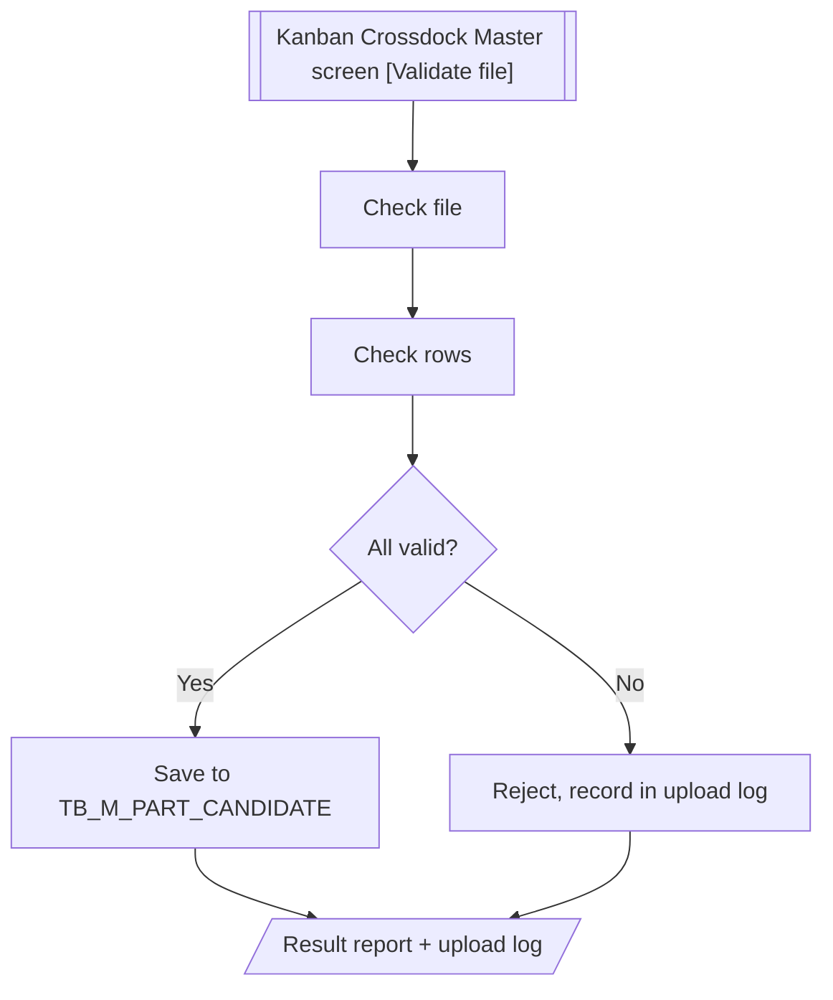
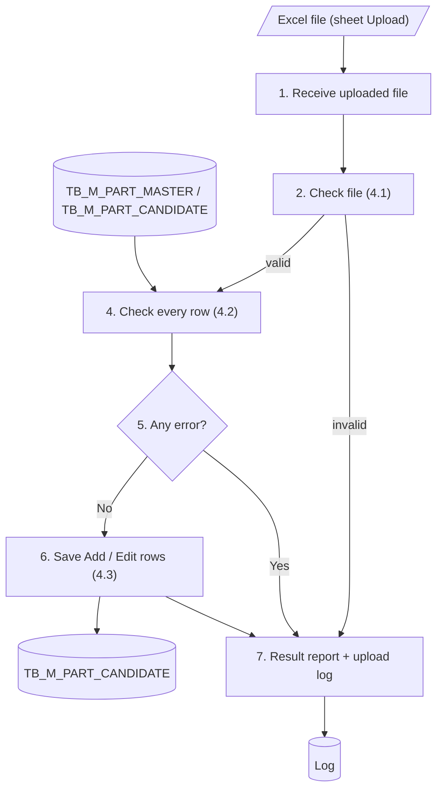

# XD02 – Cross Dock Part Master Upload Batch

> Generated from `deliverables/function_list_v2/specs/XD02_spec.json` (UISS `XD02_UISS_Batch_CrossDockPartMasterUpload.xlsx`). Do not edit by hand: change the spec and run `python3 prepare_code/build_md.py`. Document names: GTOPAS / NSP (prototype: G-System / Supplier System).

| Phase | Project | Block | Function | Created | By | Type |
|---|---|---|---|---|---|---|
| DR | Crossdock Optimization | Batch | XD02 Cross Dock Part Master Upload Batch | 18-Oct-26 | FID Rayhan | batch |

## Revision

| Rev | Author | Date | Reviewed by | Description |
|---|---|---|---|---|
| 0.1 | FID Rayhan | 18-Oct-26 |  | Initial Draft |
| 0.2 | FID Rayhan | 17-Nov-26 |  | Sync Status = No Sync only when a value sent to GTOPAS / AP POLE changed (Status to or from Active, Pcs/Case or Max Case/Day of an Active part); else kept (Sync Status rule of XD01, 17-Nov). |
| 0.3 | FID Rayhan | 18-Nov-26 |  | Sheet "Active to Inactive" removed (18-Nov): Inactive parts with No Sync / Failed are taken by [Sync] by their status. |
| 0.4 | FID Rayhan | 19-Nov-26 |  | Kanban Crossdock Master per period: the upload changes the ongoing period only (19-Nov). |
| 0.5 | FID Rayhan | 23-Nov-26 |  | Staging per target through SP_STG_WRITE (4.9). Column Period replaces Effective Start Date: flag A ongoing or next period, flag E ongoing period (checks 7, 8). |
| 0.6 | FID Rayhan | 24-Nov-26 |  | Data Map: ORDER_TYPE on TB_H_PART_CANDIDATE / TB_M_PART_CANDIDATE_DEST (Order Type per destination row). |
| 0.7 | FID Rayhan | 26-Nov-26 |  | Staging: no SYNC_RUN_ID, the run is SYNC_DT (one value per [Sync] click / rollover); one unsent row per key (a new change updates it, back to the sent value deletes it); SYNC_STATUS 0 / 1. SQL: prepare_code/sql/crossdock_staging_sync.sql. |

## 1. General

### Objective

- To process the Kanban Crossdock Master file uploaded from the Cross Dock Part Master screen (Kanban Crossdock Master tab): from the [Validate file] button of the Upload Excel modal until the data is saved to TB_M_PART_CANDIDATE.
- In case any error occurs, nothing is saved to the master. The error is recorded in the upload log and a result report is created.

### Operation flow

### Input

| Name | Type | Description |
|---|---|---|
| Kanban Crossdock Master file (sheet Upload) | Excel | Uploaded by the user on the Kanban Crossdock Master screen ([Validate file]). Only sheet Upload is read. Max 5 MB, 5,000 rows. |
| TB_M_PART_MASTER | DB | Part existence check and Part Name |
| TB_M_PART_CANDIDATE | DB | Current data for duplicate check, status rule and Edit comparison |
| TB_M_PART_CANDIDATE_DEST | DB | Total Case/Day already mapped per part in the ongoing calculation period (check 9) |

### Output

| Name | Type | Description |
|---|---|---|
| TB_M_PART_CANDIDATE | DB | if successful |
| TB_H_PART_CANDIDATE | DB | if successful: history record per changed field of each saved part |
| Log | DB | Upload log: one record per upload with status (COMPLETED / REJECTED), counts and errors |
| Result report | Excel | Also if error occurs. Sheets: Summary, Result, Re-upload, Changes |

### Parameters

| Name | Description |
|---|---|
| Uploaded file | File selected by the user on the Kanban Crossdock Master screen |
| User | Login name of the user who clicks [Validate file] |

### Execution Schedule

| Item | Description |
|---|---|
| Trigger | Starts when the user clicks [Validate file] in the Upload Excel modal of the Kanban Crossdock Master screen (on demand, no schedule). |

## 2. Function flow

1. User clicks [Validate file] in the Upload Excel modal of the Kanban Crossdock Master screen. The batch starts and receives the uploaded file.
2. Check the file: format .xlsx, size, number of rows, sheet "Upload" and template columns (see 4.1).
  - If the file is not valid, reject the upload and go to step 7.
3. Read all rows of sheet "Upload".
4. Check every row against the business rules (see 4.2) and collect all errors.
  - Each row is Add (flag A) or Edit (flag E).
5. If any row has an error, reject the whole file. Nothing is saved to the master and the errors are recorded in the upload log.
  - Go to step 7.
6. If all rows are valid, save to master table TB_M_PART_CANDIDATE (see 4.3).
  - Add: register the new part as Candidate.
  - Edit: update the changed values, including status Active <-> Inactive. A row with no change is skipped.
  - Call SP_STG_WRITE per changed value: Kanban EDIT of an Active part (OPERATION_TYPE 1 / 2 / 3); Active -> Inactive: the mapping of the period is deleted, Export DELETE (0) per destination, GTOPAS DELETE and the Kanban header (refer XD01 5.24). A row without change writes nothing.
7. Create the result report and record the result (completed or rejected) in the upload log. The Kanban Crossdock Master screen shows the result to the user. Exit.

## 3. Data edit mapping

#### 1. Insert TB_M_PART_CANDIDATE – Flag A - new part
- Source: Excel file - sheet Upload (valid rows) (keys: Upload (A/E) = 'A')

| Source field | Destination field | Description |
|---|---|---|
| Part Number | PART_NO |  |
| Period (file) | PERIOD | Selected period: the ongoing period (default) or the next one |
|  | PART_NAME | TB_M_PART_MASTER.PART_NAME by PART_NO |
| Min MAD | MIN_MAD | From the file (mandatory) |
| Pcs/Case | PCS_CASE |  |
| Max Case/Day | MAX_CASE_DAY |  |
|  | TOTAL_PCS_DAY | PCS_CASE x MAX_CASE_DAY |
|  | PART_STATUS | Default : 'Candidate' (status column must be blank) |
|  | LAST_SOURCE | Default : 'UPLOAD' |
|  | LAST_UPLOAD_ID | UPLOAD_ID of this run |
|  | CREATED_BY | Login name of the user who uploaded |
|  | CREATED_DT | Server system date and time |
|  | CHANGED_BY | Same as CREATED_BY |
|  | CHANGED_DT | Server system date and time |

#### 2. Update TB_M_PART_CANDIDATE – Flag E - only if changed
- Source: Excel file - sheet Upload (valid rows) (keys: Upload (A/E) = 'E')
- Destination keys: PART_NO = PART_NO of the row

| Source field | Destination field | Description |
|---|---|---|
| Part Number | PART_NO | Key, not changed |
|  | PART_NAME | Not changed |
| Min MAD | MIN_MAD | From the file (mandatory) |
| Pcs/Case | PCS_CASE |  |
| Max Case/Day | MAX_CASE_DAY |  |
|  | TOTAL_PCS_DAY | Recalculate : PCS_CASE x MAX_CASE_DAY |
| Status | PART_STATUS | Active <-> Inactive only; blank = not changed |
|  | LAST_SOURCE | Set 'UPLOAD' |
|  | LAST_UPLOAD_ID | UPLOAD_ID of this run |
|  | CREATED_BY | Not changed |
|  | CREATED_DT | Not changed |
|  | CHANGED_BY | Login name of the user who uploaded |
|  | CHANGED_DT | Server system date and time |

#### 3. Insert TB_H_PART_CANDIDATE – Saved row - history
- Source: Saved rows of this upload

| Source field | Destination field | Description |
|---|---|---|
|  | HIST_ID | Auto (identity) |
|  | PART_NO | Part of the event |
|  | PERIOD | NULL (Kanban Crossdock Master has no period) |
|  | EVENT_TYPE | 'ADD' (flag A) / 'EDIT' (flag E) |
|  | SOURCE | 'UPLOAD' |
|  | UPLOAD_ID | UPLOAD_ID of this run |
|  | DEST_CODE | NULL |
| ORDER_TYPE | ORDER_TYPE | Order Type of the destination row for MAPPING; NULL for other events |
|  | FIELD_NAME | Changed field, e.g. PCS_CASE, MAX_CASE_DAY, PART_STATUS |
|  | OLD_VALUE | Value before upload (NULL for ADD) |
|  | NEW_VALUE | Value from the file |
|  | REMARK | NULL |
|  | CREATED_BY | Login name of the user who uploaded |
|  | CREATED_DT | Server system date and time |

#### 4. Update Log – Result of the run
- Source: Result of this upload
- Destination keys: UPLOAD_ID = UPLOAD_ID of this run

| Source field | Destination field | Description |
|---|---|---|
|  | STATUS | COMPLETED if all rows saved or skipped, REJECTED if file check or any row failed |
|  | TOTAL_ROWS | Number of rows in sheet Upload |
|  | SAVED_ROWS | Rows inserted or updated |
|  | NO_CHANGE_ROWS | Rows skipped because nothing changed |
|  | ERROR_ROWS | Rows with error |
|  | RESULT_FILE_PATH | Path of the result report .xlsx |
|  | END_DT | Server system date and time |

#### 5. Insert TB_H_STG_APPOLE_KANBAN – SP_STG_WRITE (KANBAN): changed Pcs/Case or Max Case/Day of an Active part, Candidate -> Active, part of a new period; header 5 when only the destinations changed (when the key has no unsent row yet)
- Source: Upload file (SP_STG_WRITE, SOURCE UPLOAD)

| Source field | Destination field | Description |
|---|---|---|
| - | STG_ID | Identity |
| PERIOD | PERIOD | Period of the part row |
| - | ACTION | 'ADD' (new part, new period) / 'EDIT' / 'KEEP' (header 5) |
| PART_STATUS | PART_STATUS | Status of the part in the period |
| PERIOD | EFFECTIVE_MONTH_YEAR | MM/YYYY |
| - | OPERATOR_ID | 'P6' |
| PART_NO | PART_NO | With "-" |
| PART_NAME | PART_NAME | From TB_M_PART_CANDIDATE |
| PCS_CASE | SHIPPING_BOX_QTY | Value after the change |
| MAX_CASE_DAY | MAX_SHIPPING_BOX_QTY | Value after the change |
| - | MAX_ALLOWANCE_QTY | PCS_CASE x MAX_CASE_DAY |
| - | OPERATION_TYPE | 1 Max down / 2 up / 3 same / 4 never sent, against the last Max sent (same period, else the latest earlier period); 5 header |
| - | SOURCE | 'SCREEN' / 'UPLOAD' / 'BATCH' (caller) |
| - | UPLOAD_ID | Upload ID when SOURCE = UPLOAD, else NULL |
| - | SYNC_STATUS | '0' |
| - | SYNC_DT | NULL |
| - | CREATED_BY | Login user (XD05: batch user ID) |
| - | CREATED_DT | Server date-time |
| - | CHANGED_BY | NULL |
| - | CHANGED_DT | NULL |

#### 6. Insert TB_H_STG_APPOLE_EXPORT – SP_STG_WRITE (EXPORT): one row per added, changed or removed destination + order type (when the key has no unsent row yet)
- Source: Upload file (SP_STG_WRITE, SOURCE UPLOAD)

| Source field | Destination field | Description |
|---|---|---|
| - | STG_ID | Identity |
| PERIOD | PERIOD |  |
| PART_NO | NSP_PART_NO | With "-" |
| DEST_CODE | DEST_CODE | 7 digits |
| - | ACTION | 'ADD' / 'EDIT' / 'DELETE' |
| PERIOD | EFFECTIVE_MONTH_YEAR | MM/YYYY |
| PART_NO | PART_NO | Without "-" |
| DEST_CODE | BUYER_PD | 5-2 format |
| ORDER_TYPE | ORDER_TYPE |  |
| - | TRANSPORT_CODE | '2' |
| CASE_DAY | MAX_SHIPPING_BOX_RCS | Value after the change; 0 for DELETE |
| - | SOURCE | 'SCREEN' / 'UPLOAD' / 'BATCH' (caller) |
| - | UPLOAD_ID | Upload ID when SOURCE = UPLOAD, else NULL |
| - | SYNC_STATUS | '0' |
| - | SYNC_DT | NULL |
| - | CREATED_BY | Login user (XD05: batch user ID) |
| - | CREATED_DT | Server date-time |
| - | CHANGED_BY | NULL |
| - | CHANGED_DT | NULL |

#### 7. Insert TB_H_STG_GTOPAS – SP_STG_WRITE (EXPORT branch): the destination appears or disappears for the part and GTOPAS does not have that state yet (when the key has no unsent row yet)
- Source: Upload file (SP_STG_WRITE, SOURCE UPLOAD)

| Source field | Destination field | Description |
|---|---|---|
| - | STG_ID | Identity |
| PERIOD | PERIOD |  |
| - | ACTION | 'ADD' / 'DELETE' |
| - | DEPOT_CODE | '01' |
| PART_NO | P_NO | With "-" |
| DEST_CODE | DESTINATION_CODE |  |
| - | MAKER_CODE | 'A' |
| - | DOMESTIC_OVERSEAS | '2' |
| - | TOPAS_ORDER_TYPE | '3' |
| - | ORDER_TRANSPORTATION_CODE | '2' |
| - | SOURCE | 'SCREEN' / 'UPLOAD' / 'BATCH' (caller) |
| - | UPLOAD_ID | Upload ID when SOURCE = UPLOAD, else NULL |
| - | SYNC_STATUS | '0' |
| - | SYNC_DT | NULL |
| - | CREATED_BY | Login user (XD05: batch user ID) |
| - | CREATED_DT | Server date-time |
| - | CHANGED_BY | NULL |
| - | CHANGED_DT | NULL |

#### 8. Update TB_H_STG_APPOLE_KANBAN – SP_STG_WRITE: a new change of a key that already has an unsent row (SYNC_STATUS 0) updates that row
- Source: Upload file (SP_STG_WRITE, SOURCE UPLOAD)

| Source field | Destination field | Description |
|---|---|---|
| - | ACTION | 'EDIT' (ADD when the key was not sent in the period) |
| - | PART_STATUS | Status of the part |
| - | SHIPPING_BOX_QTY | New Pcs/Case |
| - | MAX_SHIPPING_BOX_QTY | New Max Case/Day |
| - | MAX_ALLOWANCE_QTY | Pcs/Case x Max Case/Day |
| - | OPERATION_TYPE | Again against the last Max sent (a header 5 becomes 1 to 4) |
| - | SOURCE | Caller of the last change |
| - | UPLOAD_ID | Upload ID when SOURCE = UPLOAD |
| - | CHANGED_BY | Login user (XD05: batch user ID) |
| - | CHANGED_DT | Server date-time |

#### 9. Delete TB_H_STG_APPOLE_KANBAN – SP_STG_WRITE: the unsent row of the key when the value is back to the value already sent for the period (Kanban: also the header 5 when no Export row of the part + period waits)
- Source: Upload file (SP_STG_WRITE, SOURCE UPLOAD)

| Source field | Destination field | Description |
|---|---|---|
| - | STG_ID | Unsent row (SYNC_STATUS 0) of the key |

#### 10. Update TB_H_STG_APPOLE_EXPORT – SP_STG_WRITE: a new change of a key that already has an unsent row (SYNC_STATUS 0) updates that row
- Source: Upload file (SP_STG_WRITE, SOURCE UPLOAD)

| Source field | Destination field | Description |
|---|---|---|
| - | ACTION | 'ADD' / 'EDIT' / 'DELETE' against the last value sent |
| - | MAX_SHIPPING_BOX_RCS | New Case/Day; 0 for DELETE |
| - | SOURCE | Caller of the last change |
| - | UPLOAD_ID | Upload ID when SOURCE = UPLOAD |
| - | CHANGED_BY | Login user (XD05: batch user ID) |
| - | CHANGED_DT | Server date-time |

#### 11. Delete TB_H_STG_APPOLE_EXPORT – SP_STG_WRITE: the unsent row of the key when the value is back to the value already sent for the period
- Source: Upload file (SP_STG_WRITE, SOURCE UPLOAD)

| Source field | Destination field | Description |
|---|---|---|
| - | STG_ID | Unsent row (SYNC_STATUS 0) of the key |

#### 12. Update TB_H_STG_GTOPAS – SP_STG_WRITE: a new change of a key that already has an unsent row (SYNC_STATUS 0) updates that row
- Source: Upload file (SP_STG_WRITE, SOURCE UPLOAD)

| Source field | Destination field | Description |
|---|---|---|
| - | ACTION | 'ADD' / 'DELETE' (what the master needs) |
| - | SOURCE | Caller of the last change |
| - | UPLOAD_ID | Upload ID when SOURCE = UPLOAD |
| - | CHANGED_BY | Login user (XD05: batch user ID) |
| - | CHANGED_DT | Server date-time |

#### 13. Delete TB_H_STG_GTOPAS – SP_STG_WRITE: the unsent row of the key when the value is back to the value already sent for the period
- Source: Upload file (SP_STG_WRITE, SOURCE UPLOAD)

| Source field | Destination field | Description |
|---|---|---|
| - | STG_ID | Unsent row (SYNC_STATUS 0) of the key |

## 4. Function description

This batch starts when the user clicks [Validate file] in the Upload Excel modal of the Kanban Crossdock Master screen. It checks the uploaded file and, if everything is valid, saves the data to TB_M_PART_CANDIDATE. If not, the upload is rejected and recorded in the upload log.

- Only sheet "Upload" of the file is read. Parts that are not in the sheet are not changed.
- One run saves all rows or none (all-or-nothing).
- Part Name is retrieved from TB_M_PART_MASTER. Total Pcs/Day is calculated as Pcs/Case x Max Case/Day. Both are saved.

### 4.1 File Check (log message no. 5)

1. File extension is .xlsx.
2. File size is 5 MB or less.
3. Sheet Upload has 1 to 5,000 data rows.
4. Sheet "Upload" exists. Other sheets are ignored.
5. Header has the 7 template columns (see Appendix), found by column name (case and leading / trailing spaces ignored). Extra columns are ignored.

### 4.2 Row Validation (log message no. 6)

Every row is checked and all errors are collected, so the user can correct the file once.

### 4.3 Saving

- If any row is rejected, nothing is saved to TB_M_PART_CANDIDATE. The upload status and the error of every row are recorded in the upload log (Log).
- If all rows are valid, the data is saved to TB_M_PART_CANDIDATE: flag A inserts a new part (status Candidate), flag E updates the changed values, including status Active <-> Inactive. Rows with no change are skipped.
- The status of a Candidate part is changed only in the Edit part data modal on the screen, not by upload.
- Every inserted or changed part gets a history record per changed field in TB_H_PART_CANDIDATE (event ADD / EDIT, source UPLOAD, UPLOAD_ID of this run; refer Appendix).
- Every changed value of an Active part goes to the staging tables through SP_STG_WRITE (SOURCE UPLOAD, UPLOAD_ID); the part is sent by the next [Sync]. A new (Candidate) part gets no staging row.
- A result report (.xlsx) is created for both cases.

| No | Check | Column |
|---|---|---|
| 1 | Flag is A (Add) or E (Edit). | Upload (A/E) |
| 2 | Part No exists in TB_M_PART_MASTER. | Part Number |
| 3 | Flag A: Part No is not yet in TB_M_PART_CANDIDATE. Flag E: it already is. | Part Number |
| 4 | Part No appears only once in the file. | Part Number |
| 5 | Min MAD is a whole number, 0 or more, and Pcs/Case and Max Case/Day are whole numbers greater than 0; all three are required on every row. | Min MAD, Pcs/Case, Max Case/Day |
| 6 | Status: flag A must be blank (a new part is always Candidate). Flag E: a Candidate part must stay Candidate (blank or Candidate); an Active part may be changed to Inactive and an Inactive part to Active; no part can be changed to Candidate. | Status |
| 7 | Period is required for flag A and must be the ongoing period or the next period (YYYYMM). The part takes effect from it; when the ongoing period is given after day D, the row is also written for the next period. | Period |
| 8 | Flag E: Period must be the ongoing period (the period of the export). A part registered for the next period cannot be changed until its period becomes the ongoing period. | Period |
| 9 | Flag E: Max Case/Day is not below the total Case/Day already mapped per destination in the ongoing calculation period of Export Crossdock Master (TB_M_PART_CANDIDATE_DEST) (e.g. mapped 100, new Max Case/Day 80 is rejected). The user must first reduce the mapping in the Export Crossdock Master sub-menu, then lower Max Case/Day in Kanban Crossdock Master. | Max Case/Day |

### 4.4 Period (19-Nov)

- Kanban Crossdock Master (former Part List) has a period like the Export Crossdock Master: TB_M_PART_CANDIDATE is kept per PART_NO + PERIOD (Status, Pcs/Case, Max Case/Day of that month).
- The upload changes the rows of the ongoing period only; Next (made by XD05) and past periods are not changed.
- Max Case/Day of a period may not be below the mapped total of that period (message 14): to lower it, D/S first reduces the destinations on the Export Crossdock Master, then changes Max Case/Day on the Kanban Crossdock Master.

### 4.9 Staging rows for the sync

- Every save calls the stored procedure SP_STG_WRITE once per changed value, in the same transaction and after the master tables are updated. A save without a changed value writes nothing.
- Kanban (TB_H_STG_APPOLE_KANBAN): a change of Pcs/Case or Max Case/Day of an Active part writes a row with the values after the change (ACTION EDIT); Candidate -> Active and a part of a new period write ACTION ADD. OPERATION_TYPE compares the new Max with the last Max sent to AP POLE (same period, else the latest earlier period): 1 = Max down, 2 = Max up, 3 = Max same, 4 = never sent.
- Export (TB_H_STG_APPOLE_EXPORT): one row per added (ADD), changed (EDIT) or removed (DELETE, Max Shipping Box (RCS) 0) destination + order type. Active -> Inactive writes DELETE (0) for every destination of the part.
- GTOPAS (TB_H_STG_GTOPAS): a row only when the destination appears or disappears for the part (any order type) and GTOPAS does not have that state yet. A Case/Day change or an order type change of a destination that stays writes no GTOPAS row.
- Header: an Export change of a part + period without an unsent Kanban row writes the Kanban header with ACTION KEEP and OPERATION_TYPE 5 (current Kanban values, not uploaded). So every part of a run has one Kanban row that sets its upload order. The header is deleted when no Export row of the part + period waits any more.
- One unsent row per key: a key has at most one row with SYNC_STATUS 0. A new change of the key updates that row (value, ACTION, OPERATION_TYPE, CHANGED_BY / CHANGED_DT); a change back to the value already sent for the period deletes it (nothing to send); a sent row (SYNC_STATUS 1) is never changed, the next change inserts a new row. Keys: Kanban PERIOD + PART_NO; Export PERIOD + NSP_PART_NO + DEST_CODE + ORDER_TYPE; GTOPAS PERIOD + P_NO + DESTINATION_CODE. TB_H_PART_CANDIDATE keeps every change.
- SOURCE UPLOAD, UPLOAD_ID of the upload. The part is sent by the next [Sync] (refer XD01 5.24).
- Rules and simulation: deliverables/function_list_v2/erd/proposal_staging_sync (Proposal_Tables_Staging_Per_Target.xlsx, simulation/Staging_Header_Order.html, simulation/Staging_Per_Target_Full_Flow_Simulation.xlsx).

## 5. Logging messages

| ID | Event | Cause | Type | Message | Action |
|---|---|---|---|---|---|
| LOG1 | Batch start | Batch is called | Info | Upload batch <UPLOAD_ID> started. | system: Write the log.; user: - |
| LOG2 | Batch end | Batch finishes | Info | Upload batch <UPLOAD_ID> ended. Status <STATUS>, total <TOTAL_ROWS>, saved <SAVED_ROWS>, no change <NO_CHANGE_ROWS>, error <ERROR_ROWS>. | system: Write the log.; user: - |
| LOG3 | Receive file | Uploaded file of <UPLOAD_ID> not found | Error | Uploaded file of <UPLOAD_ID> not found. | system: Stop the batch.; user: Upload the file again. |
| LOG4 | File check | Extension, size, row count, sheet Upload or header is invalid | Error | File check failed: <REASON>. | system: Set STATUS = REJECTED. Create the result report.; user: Download the file from the screen again and upload it. |
| LOG5 | Row validation | A validation rule in 4.2 fails | Error | Row <ROW_NO> <COLUMN> : <RULE_MESSAGE>. | system: Reject the whole file. Nothing is saved.; user: Correct the rows in sheet Re-upload of the result report, then upload again. |
| LOG6 | Row skipped | Edit row has the same values as the master | Info | Row <ROW_NO> Part No <PART_NO> has no change. Skipped. | system: Do not update the record.; user: - |
| LOG7 | Save to master | Insert or update TB_M_PART_CANDIDATE fails | Error | Cannot save Part No <PART_NO> to TB_M_PART_CANDIDATE. | system: Roll back. Set STATUS = REJECTED.; user: User contact PIC |
| LOG8 | Result report | Result report cannot be created | Warning | Result report of <UPLOAD_ID> cannot be created. | system: Continue. RESULT_FILE_PATH stays blank.; user: Contact system owner. |
| LOG9 | Unexpected error | Any other system error | Critical | Unexpected error: <ERROR_DETAIL>. | system: Roll back. Set STATUS = REJECTED.; user: User contact PIC |

## 6. Appendix

### Upload template (sheet "Upload")

| Column | Content |
|---|---|
| Part Number | Part Number |
| Min MAD | Min MAD (mandatory; whole number, 0 or more): reference compared with the MAD result of the calculation |
| Pcs/Case | Pieces per case |
| Max Case/Day | Max Case/Day |
| Status | Candidate / Active / Inactive. Flag A: blank. Flag E: a Candidate part stays Candidate (blank or Candidate); Active <-> Inactive allowed; never Candidate for an Active or Inactive part. |
| Upload (A/E) | A = Add, E = Edit |
| Period | YYYYMM: the ongoing period or the next period (flag A); the ongoing period (flag E) |

Sample upload scenarios (master data, accepted files, rejected files): see sheet Sample Input.

## 7. Tables

#### TB_M_PART_CANDIDATE (transaction, existing)
Kanban Crossdock Master: one record per part and calculation period (19-Nov; before: one record per part).

| Column | Type | PK | Null | Description |
|---|---|---|---|---|
| PART_NO | VARCHAR(TBD) | Y | N | Part number; length follows TB_M_PART_MASTER |
| PERIOD | CHAR(6) | Y | N | Calculation period YYYYMM: one row per part and period. The first row of a part is the period it is registered in (Add Part: the ongoing period or the next one); the part takes effect from it. Current: screen and upload; Next: made by XD05 on day D, view only until day 1; Past: view only |
| PART_NAME | VARCHAR(TBD) |  | N | Retrieved from TB_M_PART_MASTER by PART_NO |
| MIN_MAD | INT |  | N | Minimum MAD (mandatory); reference compared with the MAD result of the calculation |
| PCS_CASE | INT |  | N | Pieces per case (> 0) |
| MAX_CASE_DAY | INT |  | N | Total Case/Day of the part (> 0) |
| TOTAL_PCS_DAY | INT |  | N | PCS_CASE x MAX_CASE_DAY |
| PART_STATUS | VARCHAR(TBD) |  | N | Candidate / Active / Inactive. Candidate -> Active: XD05 (new period) or Procurement on the screen (ongoing period). Active <-> Inactive: XD05 or Procurement (screen, upload). No part goes back to Candidate |
| LAST_SOURCE | VARCHAR(TBD) |  | N | CALC / SCREEN / UPLOAD |
| LAST_UPLOAD_ID | VARCHAR(TBD) |  | Y | Upload that last changed the record |
| CREATED_BY | VARCHAR(TBD) |  | N | User who created the record |
| CREATED_DT | DATETIME |  | N | Created date and time |
| CHANGED_BY | VARCHAR(TBD) |  | N | User who last changed the record |
| CHANGED_DT | DATETIME |  | N | Last changed date and time |

#### TB_H_PART_CANDIDATE (history, proposed)
History of every change of a crossdock part for the History setting of XD01 (Add / Edit by screen or upload, mapping changes, status changes and mappings made by the calculation batches). The sync to GTOPAS / AP POLE is not recorded here: it is in the staging tables (TB_H_STG_APPOLE_KANBAN, TB_H_STG_APPOLE_EXPORT, TB_H_STG_GTOPAS) (22-Nov). No retention limit.

| Column | Type | PK | Null | Description |
|---|---|---|---|---|
| HIST_ID | BIGINT | Y | N | Running number (identity) |
| PART_NO | VARCHAR(TBD) |  | N | Part number; length follows TB_M_PART_MASTER |
| PERIOD | CHAR(6) |  | N | Calculation period YYYYMM of the changed row (every event; Kanban and Export Crossdock Master are per period, 20-Nov) |
| EVENT_TYPE | VARCHAR(10) |  | N | ADD / EDIT / MAPPING / CALC |
| SOURCE | VARCHAR(10) |  | N | SCREEN / UPLOAD / BATCH |
| UPLOAD_ID | VARCHAR(TBD) |  | Y | Upload of the change (Log); NULL when not from an upload |
| DEST_CODE | CHAR(7) |  | Y | Destination code (7 digits) for MAPPING; NULL for other events |
| ORDER_TYPE | VARCHAR(2) |  | Y | Order Type of the destination row for MAPPING (with DEST_CODE); NULL for other events (20-Nov) |
| FIELD_NAME | VARCHAR(30) |  | N | Changed field: PCS_CASE, MAX_CASE_DAY, MIN_MAD, PART_STATUS, CASE_DAY |
| OLD_VALUE | VARCHAR(255) |  | Y | Value before the change; NULL for ADD or an added destination |
| NEW_VALUE | VARCHAR(255) |  | Y | Value after the change; NULL for a removed destination |
| REMARK | VARCHAR(500) |  | Y | Free text |
| CREATED_BY | VARCHAR(20) |  | N | User who made the change (batch user ID for BATCH) |
| CREATED_DT | DATETIME |  | N | Date and time of the change |

#### TB_H_STG_APPOLE_KANBAN (history, proposed)
AP POLE Kanban rows in the format of the upload file LLM9Q910, one row per Kanban change of a part + period (one unsent row at a time: a new change updates it), plus the header row (OPERATION_TYPE 5) when only the destinations changed. Written by SP_STG_WRITE (XD01, XD02, XD05); SYNC_STATUS and SYNC_DT set by SP_STG_SYNC. Read by XD07 through V_APPOLE_UPLOAD_KANBAN and V_APPOLE_UPLOAD_EXPORT.

| Column | Type | PK | Null | Description |
|---|---|---|---|---|
| STG_ID | BIGINT | Y | N | Running number: order of the inserts |
| PERIOD | CHAR(6) |  | N | Calculation period YYYYMM. FK1 (PART_NO, PERIOD) -> TB_M_PART_CANDIDATE |
| ACTION | VARCHAR(6) |  | N | ADD (new part, new period) / EDIT (Pcs/Case or Max changed) / KEEP (header written by an Export save, Kanban unchanged) |
| PART_STATUS | VARCHAR(10) |  | N | Active / Inactive in the period when the row is written (an Inactive part stays in the AP POLE Kanban) |
| EFFECTIVE_MONTH_YEAR | CHAR(7) |  | N | MM/YYYY of PERIOD. File / screen column: Effective Month / Year |
| OPERATOR_ID | CHAR(2) |  | N | Always P6. File / screen column: Operator ID. Default 'P6' |
| PART_NO | VARCHAR(TBD) |  | N | Part number with "-" (NSP format); FK1. File / screen column: Part No. |
| PART_NAME | VARCHAR(TBD) |  | N | From TB_M_PART_CANDIDATE at the insert. File / screen column: Part Name |
| SHIPPING_BOX_QTY | NUMBER(5) |  | N | Pcs/Case. File / screen column: Shipping Box Qty |
| MAX_SHIPPING_BOX_QTY | NUMBER(5) |  | N | Max Case/Day. File / screen column: Max Shipping Box Qty |
| MAX_ALLOWANCE_QTY | NUMBER(9) |  | N | Shipping Box Qty x Max Shipping Box Qty. File / screen column: Max Allowance Qty |
| OPERATION_TYPE | NUMBER(1) |  | N | Header of the part, set by SP_STG_WRITE at the save: 1 = Max down, 2 = Max up, 3 = Max same (only Pcs/Case changed, or a new period with the same Max), 4 = never sent, 5 = Kanban unchanged, only the destinations changed (ACTION KEEP). 1 to 4 against the last Max sent: same period, else the latest earlier period. Upload: 1 -> the Export rows of the part in EXPORT_PRE before KANBAN; 2, 3, 4 -> KANBAN then EXPORT_POST; 5 -> EXPORT_POST only, the row is not in the KANBAN file |
| SOURCE | VARCHAR(6) |  | N | SCREEN / UPLOAD / BATCH (XD05) |
| UPLOAD_ID | VARCHAR(TBD) |  | Y | Upload of the Kanban or Export Excel (Log); NULL when SOURCE is not UPLOAD |
| SYNC_STATUS | CHAR(1) |  | N | 0 = to send (written or updated by SP_STG_WRITE), 1 = sent (SP_STG_SYNC at [Sync], SP_STG_ROLLOVER for GTOPAS). One row with 0 per key at a time: a new change of the key updates it. Default '0' |
| SYNC_DT | DATETIME2(0) |  | Y | Time of the [Sync] click (or of the Period Rollover), the same value for every row of that click: the RPA reads the rows of a run by SYNC_DT; [Re-send last Sync] = MAX(SYNC_DT); Last Sent on the screen = latest value |
| CREATED_BY | VARCHAR(20) |  | N | User of the save / upload, or XD05BATCH |
| CREATED_DT | DATETIME |  | N | Time of the insert (same transaction as the master update) |
| CHANGED_BY | VARCHAR(20) |  | Y | User of the save that updated the unsent row, of [Sync], or XD05BATCH (Period Rollover) |
| CHANGED_DT | DATETIME |  | Y | Time of that update |

#### TB_H_STG_APPOLE_EXPORT (history, proposed)
AP POLE Export rows in the format of the upload file LLM9Q880, one row per added, changed or removed destination + order type of a part + period (one unsent row per key: a new change updates it). Written by SP_STG_WRITE (XD01, XD03, XD05); SYNC_STATUS and SYNC_DT set by SP_STG_SYNC. Read by XD07 through V_APPOLE_UPLOAD_EXPORT.

| Column | Type | PK | Null | Description |
|---|---|---|---|---|
| STG_ID | BIGINT | Y | N | Running number: order of the inserts |
| PERIOD | CHAR(6) |  | N | Calculation period YYYYMM. FK1 (NSP_PART_NO, PERIOD) -> TB_M_PART_CANDIDATE |
| NSP_PART_NO | VARCHAR(TBD) |  | N | Part number with "-" (key back to NSP); FK1 |
| DEST_CODE | CHAR(7) |  | N | Destination code, 7 digits. No FK: a DELETE row points to a removed destination |
| ACTION | VARCHAR(6) |  | N | ADD / EDIT / DELETE (DELETE = Max Shipping Box (RCS) 0) |
| EFFECTIVE_MONTH_YEAR | CHAR(7) |  | N | MM/YYYY of PERIOD. File / screen column: Effective Month / Year |
| PART_NO | VARCHAR(TBD) |  | N | Part number without "-". File / screen column: Part No. |
| BUYER_PD | CHAR(8) |  | N | DEST_CODE in 5-2 format. File / screen column: Buyer-PD |
| ORDER_TYPE | VARCHAR(2) |  | N | '**', 'C', '9', 'V' (system master). File / screen column: Order Type |
| TRANSPORT_CODE | CHAR(1) |  | N | Always 2. File / screen column: Transport Code. Default '2' |
| MAX_SHIPPING_BOX_RCS | NUMBER(5) |  | N | Case/Day of the destination; 0 = delete. File / screen column: Max Shipping Box (RCS) |
| SOURCE | VARCHAR(6) |  | N | SCREEN / UPLOAD / BATCH (XD05) |
| UPLOAD_ID | VARCHAR(TBD) |  | Y | Upload of the Kanban or Export Excel (Log); NULL when SOURCE is not UPLOAD |
| SYNC_STATUS | CHAR(1) |  | N | 0 = to send (written or updated by SP_STG_WRITE), 1 = sent (SP_STG_SYNC at [Sync], SP_STG_ROLLOVER for GTOPAS). One row with 0 per key at a time: a new change of the key updates it. Default '0' |
| SYNC_DT | DATETIME2(0) |  | Y | Time of the [Sync] click (or of the Period Rollover), the same value for every row of that click: the RPA reads the rows of a run by SYNC_DT; [Re-send last Sync] = MAX(SYNC_DT); Last Sent on the screen = latest value |
| CREATED_BY | VARCHAR(20) |  | N | User of the save / upload, or XD05BATCH |
| CREATED_DT | DATETIME |  | N | Time of the insert (same transaction as the master update) |
| CHANGED_BY | VARCHAR(20) |  | Y | User of the save that updated the unsent row, of [Sync], or XD05BATCH (Period Rollover) |
| CHANGED_DT | DATETIME |  | Y | Time of that update |

#### TB_H_STG_GTOPAS (history, proposed)
GTOPAS WVJA5204 rows: a part + destination to add or delete, written by SP_STG_WRITE only when the destination appears or disappears for the part (any order type) and GTOPAS does not have that state yet (one unsent row per key). Sent by [Sync] (Current period) or the Period Rollover (new Current period). Read by XD06.

| Column | Type | PK | Null | Description |
|---|---|---|---|---|
| STG_ID | BIGINT | Y | N | Running number: order of the inserts |
| PERIOD | CHAR(6) |  | N | Calculation period YYYYMM (GTOPAS has no period: [Sync] sends the Current period, the Period Rollover the new Current). FK1 (P_NO, PERIOD) -> TB_M_PART_CANDIDATE |
| ACTION | VARCHAR(6) |  | N | ADD / DELETE: the destination appears or disappears for the part (any order type). No row for a Case/Day change or for a state GTOPAS already has. File / screen column: Add / Delete (MT = DEL) |
| DEPOT_CODE | CHAR(2) |  | N | Always 01. File / screen column: Depot Code. Default '01' |
| P_NO | VARCHAR(TBD) |  | N | Part number with "-"; FK1. File / screen column: P/No. |
| DESTINATION_CODE | CHAR(7) |  | N | 7-digit code, the same in NSP and GTOPAS. File / screen column: Destination Code |
| MAKER_CODE | CHAR(1) |  | N | Always A. File / screen column: Maker Code. Default 'A' |
| DOMESTIC_OVERSEAS | CHAR(1) |  | N | Always 2. File / screen column: Domestic/Overseas. Default '2' |
| TOPAS_ORDER_TYPE | CHAR(1) |  | N | Always 3. File / screen column: TOPAS Order Type. Default '3' |
| ORDER_TRANSPORTATION_CODE | CHAR(1) |  | N | Always 2. File / screen column: Order Transportation Code. Default '2' |
| SOURCE | VARCHAR(6) |  | N | SCREEN / UPLOAD / BATCH (XD05) |
| UPLOAD_ID | VARCHAR(TBD) |  | Y | Upload of the Kanban or Export Excel (Log); NULL when SOURCE is not UPLOAD |
| SYNC_STATUS | CHAR(1) |  | N | 0 = to send (written or updated by SP_STG_WRITE), 1 = sent (SP_STG_SYNC at [Sync], SP_STG_ROLLOVER for GTOPAS). One row with 0 per key at a time: a new change of the key updates it. Default '0' |
| SYNC_DT | DATETIME2(0) |  | Y | Time of the [Sync] click (or of the Period Rollover), the same value for every row of that click: the RPA reads the rows of a run by SYNC_DT; [Re-send last Sync] = MAX(SYNC_DT); Last Sent on the screen = latest value |
| CREATED_BY | VARCHAR(20) |  | N | User of the save / upload, or XD05BATCH |
| CREATED_DT | DATETIME |  | N | Time of the insert (same transaction as the master update) |
| CHANGED_BY | VARCHAR(20) |  | Y | User of the save that updated the unsent row, of [Sync], or XD05BATCH (Period Rollover) |
| CHANGED_DT | DATETIME |  | Y | Time of that update |

## Sample Input

**Sample upload scenarios - Kanban Crossdock Master Upload**

- Each scenario is a separate upload file. Today = 13-Sep-2026, ongoing period = 202609 (Sep 2026), next period = 202610.
- Input columns follow sheet Upload of the Export Excel; a blank cell is a blank value in the file.

### A. Master data before upload

| Part No | Status | Min MAD | Pcs/Case | Max Case/Day | Period | Mapped 9722D10 | Mapped 9811110 | Mapped 9715310 | Mapped total |
|---|---|---|---|---|---|---|---|---|---|
| PART-A | Active | 800 | 60 | 24 | 202609 | 12 | 8 | 4 | 24 |
| PART-C | Active | 200 | 10 | 30 | 202609 |  | 12 | 18 | 30 |
| PART-G | Active | 150 | 50 | 22 | 202609 |  |  |  | 0 |
| PART-I | Candidate | 300 | 15 | 20 | 202609 |  |  |  | 0 |
| PART-M01 | (not registered) |  |  |  |  |  |  |  |  |
| PART-M02 | (not registered) |  |  |  |  |  |  |  |  |
| PART-M03 | (not registered) |  |  |  |  |  |  |  |  |

### B. Normal scenarios (file accepted)

| No | Scenario | Part Number | Min MAD | Pcs/Case | Max Case/Day | Status | Upload (A/E) | Period | Expected result |
|---|---|---|---|---|---|---|---|---|---|
| N1 | Add a new part | PART-M01 | 300 | 20 | 15 |  | A | 202609 | Inserted in 202609. Status Candidate, Total Pcs/Day 300, no staging row (Candidate), Part Name from TB_M_PART_MASTER. |
| N2 | Add another part into the next period | PART-M02 | 500 | 12 | 40 |  | A | 202610 | Inserted in 202610 (next period, view only until 1-Oct). Total Pcs/Day 480. N1 and N2 can be in one file. |
| N3 | Edit a Candidate part, change values | PART-I | 300 | 15 | 18 | Candidate | E | 202609 | Updated. Max Case/Day 20 -> 18, Total Pcs/Day 270. No staging row (Candidate part). |
| N4 | Edit an Active part, raise Max Case/Day | PART-A | 800 | 60 | 30 |  | E |  | Updated. Max Case/Day 24 -> 30, Total Pcs/Day 1,800. Kanban staging row EDIT, OPERATION_TYPE 2 (AP POLE Non Sync). Mapping is not changed. |
| N5 | Edit with the same values as the master | PART-A | 800 | 60 | 24 | Active | E |  | NO CHANGE. Row skipped, no staging row. |
| N6 | File with only some parts (one row) | PART-I | 300 | 15 | 18 | Candidate | E | 202609 | Only PART-I is processed. PART-A, C, G are not in the sheet and are not changed. |
| N7 | Lower Max Case/Day after the mapping was reduced to 20 in Export Crossdock Master | PART-A | 800 | 60 | 20 |  | E |  | Updated. Max Case/Day 24 -> 20 (not below mapped 20). Kanban staging row EDIT, OPERATION_TYPE 1: its Export rows go before the Kanban file. |
| N8 | Change an Active part to Inactive | PART-G | 150 | 50 | 22 | Inactive | E |  | Updated. Status Active -> Inactive, the mapping of the period is deleted: Export DELETE (0) per destination, GTOPAS DELETE, Kanban header 5 (AP POLE and GTOPAS Non Sync). Inactive -> Active: no staging row until the destinations are mapped again. |

### C. Error scenarios (whole file rejected, nothing saved)

| No | Scenario | Part Number | Min MAD | Pcs/Case | Max Case/Day | Status | Upload (A/E) | Period | Error (4.2 check no.) |
|---|---|---|---|---|---|---|---|---|---|
| E1 | Flag is not A or E | PART-I | 300 | 15 | 18 |  | X | 202609 | Check 1: upload must be A or E. |
| E2 | Part not in part master | PART-Z99 | 100 | 10 | 10 |  | E |  | Check 2: Part No not found in TB_M_PART_MASTER. |
| E3 | Add a part that is already registered | PART-A | 800 | 60 | 24 |  | A | 202609 | Check 3: Part No already registered, use flag E. |
| E4 | Edit a part that is not registered | PART-M03 | 300 | 20 | 15 |  | E |  | Check 3: Part No not registered, use flag A. |
| E5 | Same part twice in the file (row 1) | PART-I | 300 | 15 | 18 | Candidate | E | 202609 | Check 4: Part No appears more than once. |
| E5 | Same part twice in the file (row 2) | PART-I | 300 | 15 | 19 | Candidate | E | 202609 | Check 4: Part No appears more than once. |
| E6 | Invalid number | PART-M03 | 300 | 0 | 15 |  | A | 202609 | Check 5: Pcs/Case must be greater than 0. A blank Min MAD, Pcs/Case or Max Case/Day is also an error. |
| E7 | Change the status of a Candidate part | PART-I | 300 | 15 | 20 | Active | E | 202609 | Check 6: the status of a Candidate part cannot be changed by upload. Change it in the Edit part data modal. |
| E8 | Change an Active part to Candidate | PART-C | 200 | 10 | 30 | Candidate | E |  | Check 6: no part can be changed to Candidate. |
| E9 | Add with a status | PART-M03 | 300 | 20 | 15 | Active | A | 202609 | Check 6: status of a new part is always Candidate, leave it blank. |
| E10 | Add without period | PART-M02 | 500 | 12 | 40 |  | A |  | Check 7: Period is required for flag A. |
| E11 | Add into a past period | PART-M02 | 500 | 12 | 40 |  | A | 202608 | Check 7: Period must be the ongoing or the next period. |
| E12 | Edit with the next period | PART-C | 200 | 10 | 30 |  | E | 202610 | Check 8: flag E uses the ongoing period (202609). |
| E13 | Max Case/Day below existing mapping | PART-A | 800 | 60 | 20 |  | E |  | Check 9: Max Case/Day 20 is below mapped 24. Reduce the mapping first in Export Crossdock Master. |
| E14 | Valid row (= N1) mixed with an error row (= E2), row 1 | PART-M01 | 300 | 20 | 15 |  | A | 202609 | Whole file rejected. The valid row is NOT saved. |
| E14 | Valid row mixed with an error row, row 2 | PART-Z99 | 100 | 10 | 10 |  | E |  | Check 2 on this row. Result report sheet Re-upload lists the rows to correct. |
| E15 | Add a new part without Min MAD | PART-M03 |  | 25 | 10 |  | A | 202609 | Check 5: Min MAD is required (whole number, 0 or more). |

### D. File-level errors (file check 4.1)

| No | Scenario | Expected result |
|---|---|---|
| F1 | File is .xls or .csv | Rejected: file must be .xlsx. |
| F2 | File larger than 5 MB | Rejected: file size exceeds 5 MB. |
| F3 | More than 5,000 data rows, or no data row | Rejected: row count out of range. |
| F4 | No sheet named Upload (e.g. only sheet Kanban Crossdock Master) | Rejected: sheet Upload not found. |
| F5 | A template column is missing (e.g. upload deleted) | Rejected: required column not found. |
