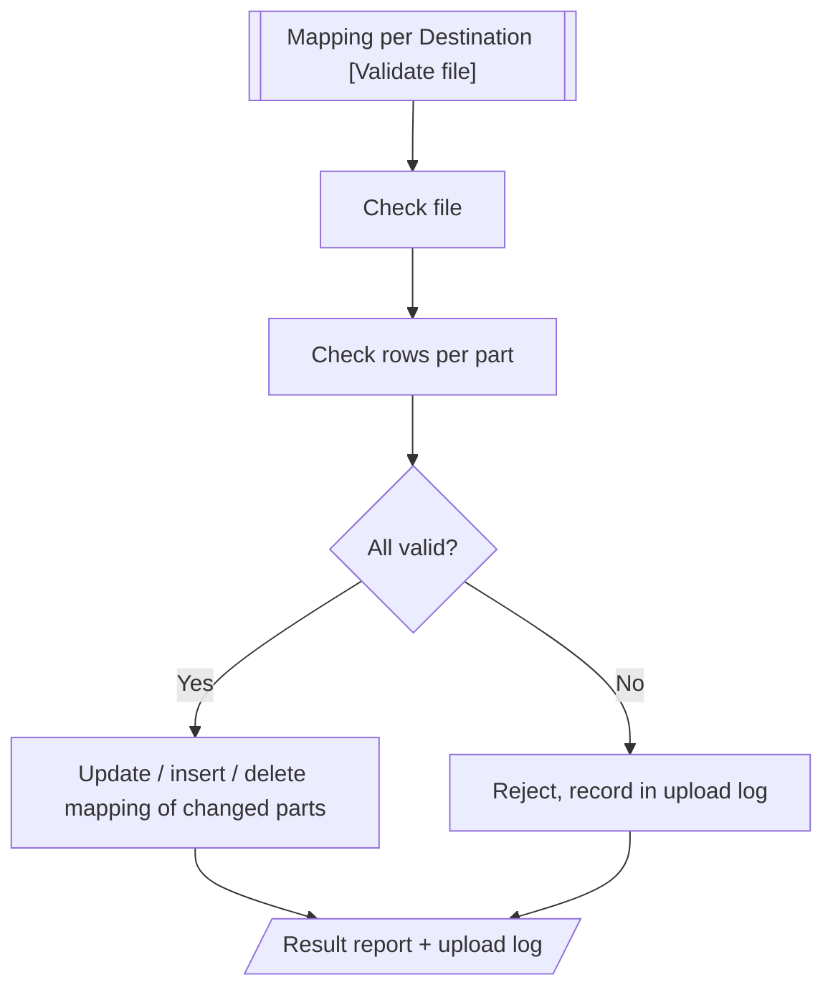
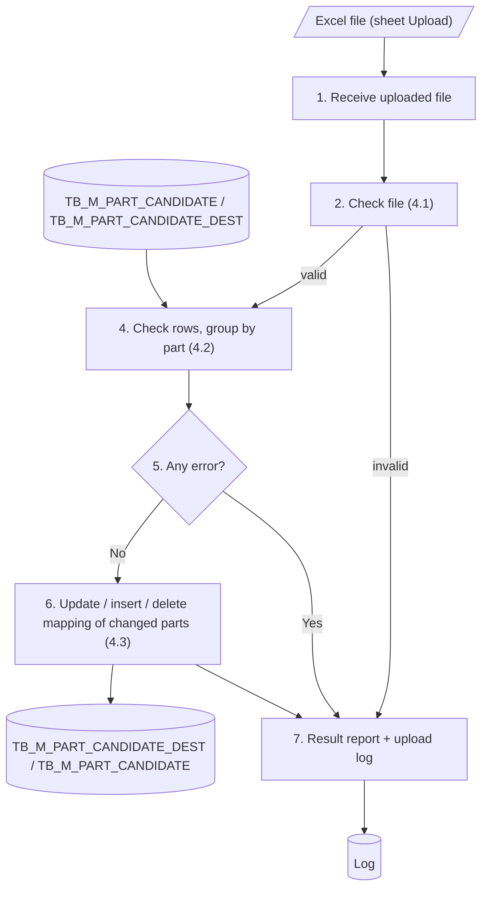

# XD03 – Part and Destination Mapping Upload Batch

> Generated from `deliverables/function_list_v2/specs/XD03_spec.json` (UISS `XD03_UISS_Batch_PartDestinationMappingUpload.xlsx`). Do not edit by hand: change the spec and run `python3 prepare_code/build_md.py`. Document names: GTOPAS / NSP (prototype: G-System / Supplier System).

| Phase | Project | Block | Function | Created | By | Type |
|---|---|---|---|---|---|---|
| DR | Crossdock Optimization | Batch | XD03 Part and Destination Mapping Upload Batch | 18-Oct-26 | FID Rayhan | batch |

## Revision

| Rev | Author | Date | Reviewed by | Description |
|---|---|---|---|---|
| 0.1 | FID Rayhan | 18-Oct-26 |  | Initial Draft |

## 1. General

### Objective

- To process the destination mapping file uploaded from the Cross Dock Part Master screen (Mapping per Destination tab): from the [Validate file] button of the Upload Excel modal until the mapping of the ongoing calculation period is saved to TB_M_PART_CANDIDATE_DEST.
- In case any error occurs, nothing is saved. The error is recorded in the upload log and a result report is created.

### Operation flow

### Input

| Name | Type | Description |
|---|---|---|
| Mapping file (sheet Upload) | Excel | Uploaded by the D/S user on the Mapping per Destination screen ([Validate file]). Only sheet Upload is read. Max 5 MB, 5,000 rows. |
| TB_M_PART_CANDIDATE | DB | Part status (must be Active) and Max Case/Day of each part |
| TB_M_PART_CANDIDATE_DEST | DB | Current mapping of the ongoing period, to detect parts with no change |
| TB_M_H0125_DESTINATION (Destination Master) | DB | Valid destination codes (9722D10 Thailand, 9811110 Philippines, 9715310 Vietnam) |

### Output

| Name | Type | Description |
|---|---|---|
| TB_M_PART_CANDIDATE_DEST | DB | if successful: mapping of each changed part updated per destination (ongoing period) |
| TB_M_PART_CANDIDATE | DB | if successful: Sync Status = No Sync for each changed part |
| TB_H_PART_CANDIDATE | DB | if successful: history record per added, changed or removed destination |
| Log | DB | Upload log: one record per upload with status (COMPLETED / REJECTED), counts and errors |
| Result report | Excel | Also if error occurs. Sheets: Summary, Result, Re-upload, Changes |

### Parameters

| Name | Description |
|---|---|
| Uploaded file | File selected by the user on the Mapping per Destination screen |
| User | Login name of the user who clicks [Validate file] |

### Grouping Keys

| Field Name |
|---|
| part_no |

### Execution Schedule

| Item | Description |
|---|---|
| Trigger | Starts when the user clicks [Validate file] in the Upload Excel modal of the Mapping per Destination screen (on demand, no schedule). The button is enabled only for the ongoing period. |

## 2. Function flow

1. User clicks [Validate file] in the Upload Excel modal of the Mapping per Destination screen (ongoing period). The batch starts and receives the uploaded file.
2. Check the file: format .xlsx, size, number of rows, sheet "Upload" and template columns (see 4.1).
  - If the file is not valid, reject the upload and go to step 7.
3. Read all rows of sheet "Upload" and group them by part_no.
4. Check every row and every part against the business rules (see 4.2) and collect all errors.
  - A placeholder row (dest_code and case_day both blank) is skipped.
5. If any row has an error, reject the whole file. Nothing is saved and the errors are recorded in the upload log.
  - Go to step 7.
6. If all rows are valid, compare each part with its current mapping of the ongoing period (see 4.3).
  - Same destinations and Case/Day: skip the part (no change).
  - Otherwise: update / insert / delete the destinations of the part so that its mapping matches the rows of the file, and set Sync Status = No Sync.
  - A part whose rows are all blank is not changed.
7. Create the result report and record the result (completed or rejected) in the upload log. The Mapping per Destination screen shows the result to the user. Exit.

## 3. Data edit mapping

#### 1. Update TB_M_PART_CANDIDATE_DEST – Changed part - Case/Day changed
- Source: Excel file - sheet Upload (valid rows) (keys: part_no = Changed part, dest_code = Not blank)
- Destination keys: PART_NO = Changed part, PERIOD = Ongoing period, DEST_CODE = In both, Case/Day differs

| Source field | Destination field | Description |
|---|---|---|
| case_day | CASE_DAY |  |
|  | CHANGED_BY | Login name of the user who uploaded |
|  | CHANGED_DT | Server system date and time |
|  | CREATED_BY | Not changed |
|  | CREATED_DT | Not changed |

#### 2. Insert TB_M_PART_CANDIDATE_DEST – Changed part - new destination
- Source: Excel file - sheet Upload (valid rows) (keys: part_no = Changed part, dest_code = Not blank)

| Source field | Destination field | Description |
|---|---|---|
| part_no | PART_NO |  |
|  | PERIOD | Ongoing calculation period |
| dest_code | DEST_CODE | Destination not yet in the table for the part and period |
| case_day | CASE_DAY |  |
|  | CREATED_BY | Login name of the user who uploaded |
|  | CREATED_DT | Server system date and time |
|  | CHANGED_BY | Same as CREATED_BY |
|  | CHANGED_DT | Server system date and time |

#### 3. Delete TB_M_PART_CANDIDATE_DEST – Changed part - removed destination
- Source: TB_M_PART_CANDIDATE_DEST (keys: PART_NO = Changed part, PERIOD = Ongoing period, DEST_CODE = Not in the file)
- Destination keys: PART_NO = Changed part, PERIOD = Ongoing period, DEST_CODE = Not in the file

| Source field | Destination field | Description |
|---|---|---|
|  | PART_NO | Row is deleted |
|  | PERIOD | Row is deleted |
|  | DEST_CODE | Row is deleted |
|  | CASE_DAY | Row is deleted |

#### 4. Update TB_M_PART_CANDIDATE – Changed part - Sync Status
- Source: Changed part of this upload
- Destination keys: PART_NO = Changed part

| Source field | Destination field | Description |
|---|---|---|
|  | PART_NO | Key, not changed |
|  | PART_NAME | Not changed |
|  | MIN_MAD | Not changed |
|  | PCS_CASE | Not changed |
|  | MAX_CASE_DAY | Not changed |
|  | TOTAL_PCS_DAY | Not changed |
|  | EFFECTIVE_START_DATE | Not changed |
|  | PART_STATUS | Not changed |
|  | SYNC_DT | Not changed |
|  | SYNC_MESSAGE | Not changed |
|  | SYNC_STATUS | Set '0' (No Sync) |
|  | LAST_SOURCE | Set 'UPLOAD' |
|  | LAST_UPLOAD_ID | UPLOAD_ID of this run |
|  | CREATED_BY | Not changed |
|  | CREATED_DT | Not changed |
|  | CHANGED_BY | Login name of the user who uploaded |
|  | CHANGED_DT | Server system date and time |

#### 5. Insert TB_H_PART_CANDIDATE – Changed part - history
- Source: Changed parts of this upload

| Source field | Destination field | Description |
|---|---|---|
|  | HIST_ID | Auto (identity) |
|  | PART_NO | Part of the event |
|  | PERIOD | Ongoing calculation period |
|  | EVENT_TYPE | 'MAPPING' |
|  | SOURCE | 'UPLOAD' |
|  | UPLOAD_ID | UPLOAD_ID of this run |
|  | DEST_CODE | Destination added, changed or removed |
|  | FIELD_NAME | 'CASE_DAY' |
|  | OLD_VALUE | Case/Day before (NULL when added) |
|  | NEW_VALUE | Case/Day after (NULL when removed) |
|  | REMARK | NULL |
|  | CREATED_BY | Login name of the user who uploaded |
|  | CREATED_DT | Server system date and time |

#### 6. Update Log – Result of the run
- Source: Result of this upload
- Destination keys: UPLOAD_ID = UPLOAD_ID of this run

| Source field | Destination field | Description |
|---|---|---|
|  | STATUS | COMPLETED if all parts saved or skipped, REJECTED if file check or any row failed |
|  | TOTAL_ROWS | Number of rows in sheet Upload |
|  | SAVED_ROWS | Parts whose mapping was changed |
|  | NO_CHANGE_ROWS | Parts skipped because nothing changed |
|  | ERROR_ROWS | Rows with error |
|  | RESULT_FILE_PATH | Path of the result report .xlsx |
|  | END_DT | Server system date and time |

## 4. Function description

This batch starts when the user clicks [Validate file] in the Upload Excel modal of the Mapping per Destination screen. It checks the uploaded file and, if everything is valid, updates the mapping of the changed parts for the ongoing calculation period. If not, the upload is rejected and recorded in the upload log.

- Only sheet "Upload" of the file is read. Parts that are not in the sheet are not changed.
- Only the ongoing calculation period is changed; past periods are read only.
- One run saves all parts or none (all-or-nothing).
- The column total_case_day is for reference only and is not read; the limit is Max Case/Day of the part in TB_M_PART_CANDIDATE.

### 4.1 File Check (log message no. 5)

1. File extension is .xlsx.
2. File size is 5 MB or less.
3. Sheet Upload has 1 to 5,000 data rows.
4. Sheet "Upload" exists. Other sheets are ignored.
5. Header has the 5 template columns (see Appendix). Extra columns are ignored.

### 4.2 Row Validation (log message no. 6)

Every row is checked and all errors are collected, so the user can correct the file once. Checks 4 and 6 are done per part (all rows with the same part_no).

### 4.3 Saving

- If any row is rejected, nothing is saved. The upload status and the error of every row are recorded in the upload log (Log).
- If all rows are valid, each part in the file is compared with its current mapping of the ongoing period. A part with the same destinations and Case/Day is skipped (no change); its Sync Status and last update stay.
- For a changed part, its rows of the ongoing period in TB_M_PART_CANDIDATE_DEST are compared with the rows of the file by destination code (key PART_NO + PERIOD + DEST_CODE): a destination in both with a different Case/Day is updated (CASE_DAY, CHANGED_BY, CHANGED_DT; CREATED_BY / CREATED_DT are kept), a destination only in the file is inserted, a destination only in the table is deleted, and a destination with the same Case/Day is not touched. All changes are saved in one transaction.
- A part whose rows are all blank (placeholder) is not changed, so a mapping cannot be removed completely by upload (same as the screen: at least one destination).
- Every changed part gets a history record per added, changed or removed destination in TB_H_PART_CANDIDATE (event MAPPING, source UPLOAD, DEST_CODE and FIELD_NAME CASE_DAY; refer Appendix).
- Every changed part gets Sync Status = No Sync in TB_M_PART_CANDIDATE. It is sent to GTOPAS and AP POLE by the IF functions (XD06 / XD07) when D/S clicks [Sync] on the screen.
- A result report (.xlsx) is created for both cases.

| No | Check | Column |
|---|---|---|
| 1 | Part No exists in TB_M_PART_CANDIDATE and its status is Active. | part_no |
| 2 | Destination code exists in TB_M_H0125_DESTINATION (Destination Master, DESTINATION_CD). | dest_code |
| 3 | case_day is a whole number greater than 0 when dest_code is filled. | case_day |
| 4 | A destination code appears only once per part in the file. | dest_code |
| 5 | dest_code and case_day are both filled, or both blank (placeholder row). Only one of the two filled is an error. | dest_code, case_day |
| 6 | The total case_day of all rows of a part does not exceed the Max Case/Day of the part in TB_M_PART_CANDIDATE (total_case_day of the file is ignored). Below or equal is allowed. | case_day |
| 7 | The upload is for the ongoing calculation period only (the screen enables [Validate file] only for that period). | - |
| 8 | upload is A or E. A only for a destination that is not yet mapped for the part, E only for a destination that is already mapped (ongoing period). A placeholder row left blank is skipped. | upload |

## 5. Logging messages

| ID | Event | Cause | Type | Message | Action |
|---|---|---|---|---|---|
| LOG1 | Batch start | Batch is called | Info | Mapping upload batch <UPLOAD_ID> started. | system: Write the log.; user: - |
| LOG2 | Batch end | Batch finishes | Info | Mapping upload batch <UPLOAD_ID> ended. Status <STATUS>, total <TOTAL_ROWS>, saved parts <SAVED_ROWS>, no change <NO_CHANGE_ROWS>, error <ERROR_ROWS>. | system: Write the log.; user: - |
| LOG3 | Receive file | Uploaded file of <UPLOAD_ID> not found | Error | Uploaded file of <UPLOAD_ID> not found. | system: Stop the batch.; user: Upload the file again. |
| LOG4 | File check | Extension, size, row count, sheet Upload or header is invalid | Error | File check failed: <REASON>. | system: Set STATUS = REJECTED. Create the result report.; user: Download the file from the screen again and upload it. |
| LOG5 | Row validation | A validation rule in 4.2 fails | Error | Row <ROW_NO> <COLUMN> : <RULE_MESSAGE>. | system: Reject the whole file. Nothing is saved.; user: Correct the rows in sheet Re-upload of the result report, then upload again. |
| LOG6 | Part skipped | Rows of the part equal the current mapping, or all rows are blank | Info | Part No <PART_NO> has no mapping change. Skipped. | system: Do not change the mapping or the part.; user: - |
| LOG7 | Save mapping | Save (update / insert / delete) of TB_M_PART_CANDIDATE_DEST or update of TB_M_PART_CANDIDATE fails | Error | Cannot save the mapping of Part No <PART_NO>. | system: Roll back. Set STATUS = REJECTED.; user: User contact PIC |
| LOG8 | Result report | Result report cannot be created | Warning | Result report of <UPLOAD_ID> cannot be created. | system: Continue. RESULT_FILE_PATH stays blank.; user: Contact system owner. |
| LOG9 | Unexpected error | Any other system error | Critical | Unexpected error: <ERROR_DETAIL>. | system: Roll back. Set STATUS = REJECTED.; user: User contact PIC |

## 6. Appendix

### Upload template (sheet "Upload")

| Column | Content |
|---|---|
| part_no | Part Number of an Active part. One row per destination; all rows of a part together form its new mapping. |
| dest_code | Destination code (9722D10 / 9811110 / 9715310). Once per part. Blank together with case_day = placeholder row. |
| case_day | Case/Day of the destination, whole number greater than 0. |
| upload | A = Add (destination not yet mapped for the part in the ongoing period), E = Edit (destination already mapped; case_day can be changed). Export Excel pre-fills E, and A for the blank row of a part without mapping. |
| total_case_day | Max Case/Day of the part, for reference only (not read by the batch). |

Sample upload scenarios (master data, accepted files, rejected files): see sheet Sample Input.

## 7. Tables

#### TB_M_PART_CANDIDATE (transaction, existing)
Candidate part setting, one record per part (Part List data, no calculation period). Read for status and Max Case/Day; Sync Status updated.

| Column | Type | PK | Null | Description |
|---|---|---|---|---|
| PART_NO | VARCHAR(TBD) | Y | N | Part number; length follows TB_M_PART_MASTER |
| PART_NAME | VARCHAR(TBD) |  | N | Retrieved from TB_M_PART_MASTER by PART_NO |
| MIN_MAD | INT |  | N | Minimum MAD (mandatory); reference compared with the MAD result of the calculation |
| PCS_CASE | INT |  | N | Pieces per case (> 0) |
| MAX_CASE_DAY | INT |  | N | Total Case/Day of the part (> 0); limit of the mapping |
| TOTAL_PCS_DAY | INT |  | N | PCS_CASE x MAX_CASE_DAY |
| EFFECTIVE_START_DATE | DATE |  | Y | Effective start date |
| PART_STATUS | VARCHAR(TBD) |  | N | Candidate / Active / Inactive |
| SYNC_STATUS | CHAR(1) |  | N | 0 = No Sync, 3 = Waiting, 1 = Success, 2 = Failed |
| SYNC_DT | DATETIME |  | Y | Date-time of the last IF function result |
| SYNC_MESSAGE | VARCHAR(TBD) |  | Y | Reason of the last Failed sync |
| LAST_SOURCE | VARCHAR(TBD) |  | N | CALC / SCREEN / UPLOAD |
| LAST_UPLOAD_ID | VARCHAR(TBD) |  | Y | Upload that last changed the record |
| CREATED_BY | VARCHAR(TBD) |  | N | User who created the record |
| CREATED_DT | DATETIME |  | N | Created date and time |
| CHANGED_BY | VARCHAR(TBD) |  | N | User who last changed the record |
| CHANGED_DT | DATETIME |  | N | Last changed date and time |

#### TB_M_PART_CANDIDATE_DEST (transaction, existing)
Destination mapping, one record per part, calculation period and destination (Mapping per Destination data). Target of a successful upload.

| Column | Type | PK | Null | Description |
|---|---|---|---|---|
| PART_NO | VARCHAR(TBD) | Y | N | Part number; FK to TB_M_PART_CANDIDATE |
| PERIOD | CHAR(6) | Y | N | Calculation period, YYYYMM e.g. 202609; displayed as Sep 2026 |
| DEST_CODE | CHAR(7) | Y | N | Destination code (buyer code + PD code, 7 digits); exists in TB_M_H0125_DESTINATION (Destination Master) |
| CASE_DAY | INT |  | N | Allocated Case/Day of the destination (> 0) |
| CREATED_BY | VARCHAR(TBD) |  | N | User who created the record |
| CREATED_DT | DATETIME |  | N | Created date and time |
| CHANGED_BY | VARCHAR(TBD) |  | N | User who last changed the record |
| CHANGED_DT | DATETIME |  | N | Last changed date and time |

#### TB_H_PART_CANDIDATE (history, proposed)
History of every change of a crossdock part (Add / Edit by screen or upload, mapping changes, Sync results, status changes and mappings made by the calculation batches). Read by the History setting modal of Part List (index PART_NO, CREATED_DT). Retention: 24 months, counted from the later of CREATED_DT and the Effective Start Date of the part; a monthly housekeeping job deletes older records (period configurable in system master; job TBC).

| Column | Type | PK | Null | Description |
|---|---|---|---|---|
| HIST_ID | BIGINT | Y | N | Running number (identity) |
| PART_NO | VARCHAR(TBD) |  | N | Part number; length follows TB_M_PART_MASTER |
| PERIOD | CHAR(6) |  | Y | Calculation period YYYYMM for MAPPING / SYNC / CALC; NULL for ADD / EDIT (Part List has no period) |
| EVENT_TYPE | VARCHAR(10) |  | N | ADD / EDIT / MAPPING / SYNC / CALC |
| SOURCE | VARCHAR(10) |  | N | SCREEN / UPLOAD / IF / BATCH |
| UPLOAD_ID | VARCHAR(TBD) |  | Y | Upload of the change (Log); NULL when not from an upload |
| DEST_CODE | CHAR(7) |  | Y | Destination code (7 digits) for MAPPING; NULL for other events |
| FIELD_NAME | VARCHAR(30) |  | N | Changed field: PCS_CASE, MAX_CASE_DAY, MIN_MAD, PART_STATUS, EFFECTIVE_START_DATE, CASE_DAY, SYNC_STATUS |
| OLD_VALUE | VARCHAR(255) |  | Y | Value before the change; NULL for ADD or an added destination |
| NEW_VALUE | VARCHAR(255) |  | Y | Value after the change; NULL for a removed destination |
| REMARK | VARCHAR(500) |  | Y | Free text, e.g. SYNC_MESSAGE of a Failed sync |
| CREATED_BY | VARCHAR(20) |  | N | User who made the change (IF batch user ID for SYNC, batch user ID for BATCH) |
| CREATED_DT | DATETIME |  | N | Date and time of the change |

#### TB_M_H0125_DESTINATION (master, existing)
Destination Master (existing NSP table, read only). Only the listed columns are relevant; full structure: XD13 Destination Master (H0125) Sync.

| Column | Type | PK | Null | Description |
|---|---|---|---|---|
| DESTINATION_CD | VARCHAR(7) | Y | N | Destination code, e.g. 123. Used by Crossdock: destination list, upload check 2, DEST_CODE |
| CUSTOMER_CD | VARCHAR(7) |  | N | Customer code (reference only) |
| ORDER_TRANSPORTATION_CD | VARCHAR(1) |  | N | Order transportation code (reference only) |
| BO_INSTRUCTION_CD | VARCHAR(1) |  | N | B/O instruction code (reference only) |
| DESTINATION_NAME_ENG | VARCHAR(50) |  | N | Destination name, e.g. Thailand. Used by Crossdock: shown with the code ('9722D10 - Thailand') and in Export Excel |
| REGION_CD | VARCHAR(2) |  | N | Region code (reference only) |
| COUNTRY_NAME_ENG | VARCHAR(36) |  | Y | Country name (reference only) |
| POSTAL_CD_ENG | VARCHAR(10) |  | Y | Postal code (reference only) |
| STATE_CD_ENG | VARCHAR(6) |  | Y | State code (reference only) |
| DESTINATION_ADDR1_ENG | VARCHAR(50) |  | N | Destination address 1 (reference only) |
| DESTINATION_ADDR2_ENG | VARCHAR(50) |  | Y | Destination address 2 (reference only) |
| CREATE_BY | VARCHAR(TBD) |  | Y | User who created the record |
| CREATE_DT | TIMESTAMP |  | Y | Created date and time |
| UPDATE_BY | VARCHAR(TBD) |  | Y | User who last updated the record |
| UPDATE_DT | TIMESTAMP |  | Y | Last updated date and time |

## Sample Input

**Sample upload scenarios - Mapping per Destination Upload**

- Each scenario is a separate upload file. Ongoing period = Sep 2026. One row per destination; a scenario with several rows uses one Excel row per destination.
- Input columns follow sheet Upload of the Export Excel; a blank cell is a blank value in the file.

### A. Master data before upload (ongoing period)

| Part No | Status | Max Case/Day | Mapped 9722D10 | Mapped 9811110 | Mapped 9715310 | Mapped total | Remark |
|---|---|---|---|---|---|---|---|
| PART-A | Active | 24 | 12 | 8 | 4 | 24 |  |
| PART-C | Active | 30 |  |  | 18 | 18 |  |
| PART-G | Active | 22 |  |  |  | 0 | No mapping: placeholder row in the export |
| PART-I | Candidate | 20 |  |  |  |  | Not in Mapping per Destination |

### B. Normal scenarios (file accepted)

| No | Scenario | part_no | dest_code | case_day | upload | total_case_day | Expected result |
|---|---|---|---|---|---|---|---|
| N1 | Change Case/Day | PART-A | 9722D10 | 10 | E | 24 | Changed. Total 24 (equal to Max). Sync Status No Sync. |
| N1 | Change Case/Day | PART-A | 9811110 | 8 | E | 24 |  |
| N1 | Change Case/Day | PART-A | 9715310 | 6 | E | 24 |  |
| N2 | Remove a destination | PART-A | 9722D10 | 12 | E | 24 | Changed. 9715310 deleted. Total 20, 4 case/day left (below Max is allowed). |
| N2 | Remove a destination | PART-A | 9811110 | 8 | E | 24 |  |
| N3 | Add a destination | PART-C | 9715310 | 18 | E | 30 | Changed. 9811110 inserted. Total 30 (equal to Max). |
| N3 | Add a destination | PART-C | 9811110 | 12 | A | 30 |  |
| N4 | First mapping from the placeholder row | PART-G | 9722D10 | 22 | A | 22 | Inserted. Total 22. Sync Status No Sync. |
| N5 | Placeholder row left blank | PART-G |  |  | A | 22 | NO CHANGE. PART-G stays without mapping. |
| N6 | Same values as the master | PART-A | 9722D10 | 12 | E | 24 | NO CHANGE. Sync Status and last update stay. |
| N6 | Same values as the master | PART-A | 9811110 | 8 | E | 24 |  |
| N6 | Same values as the master | PART-A | 9715310 | 4 | E | 24 |  |
| N7 | File with only some parts (PART-C only) | PART-C | 9715310 | 18 | E | 30 | Only PART-C is processed (here NO CHANGE). PART-A and PART-G are not changed. |

### C. Error scenarios (whole file rejected, nothing saved)

| No | Scenario | part_no | dest_code | case_day | upload | total_case_day | Error (4.2 check no.) |
|---|---|---|---|---|---|---|---|
| E1 | Part not registered | PART-Z99 | 9722D10 | 10 | A |  | Check 1: Part No is not registered or its status is not Active. |
| E2 | Part is not Active | PART-I | 9722D10 | 10 | A | 20 | Check 1: Part No is not registered or its status is not Active. |
| E3 | Unknown destination | PART-A | ZZZZZ99 | 10 | A | 24 | Check 2: Destination code ZZZZZ99 not found in the destination master (TB_M_H0125_DESTINATION). |
| E4 | Invalid Case/Day | PART-A | 9722D10 | 0 | E | 24 | Check 3: case_day must be a whole number greater than 0. |
| E5 | Same destination twice | PART-A | 9722D10 | 10 | E | 24 | Check 4: Destination 9722D10 appears more than once for this part. |
| E5 | Same destination twice | PART-A | 9722D10 | 4 | E | 24 |  |
| E6 | Only one of dest_code / case_day | PART-G | 9722D10 |  | A | 22 | Check 5: dest_code and case_day must both be filled or both blank. |
| E7 | Total above Max Case/Day | PART-A | 9722D10 | 12 | E | 24 | Check 6: Total allocation of 30 case/day exceeds Max Case/Day (24). Reduce one of the destinations. |
| E7 | Total above Max Case/Day | PART-A | 9811110 | 8 | E | 24 |  |
| E7 | Total above Max Case/Day | PART-A | 9715310 | 10 | E | 24 |  |
| E8 | Valid row (= N4) mixed with an error row (= E3) | PART-G | 9722D10 | 22 | A | 22 | Whole file rejected. The valid row is NOT saved. |
| E8 | Valid row mixed with an error row | PART-A | ZZZZZ99 | 10 | A | 24 | Check 2 on this row. Result report sheet Re-upload lists the rows to correct. |
| E9 | upload E for a destination that is not mapped yet | PART-C | 9811110 | 12 | E | 30 | Check 8: Destination 9811110 is not mapped for PART-C yet; use upload A. |

### D. File-level errors (file check 4.1)

| No | Scenario | Expected result |
|---|---|---|
| F1 | File is .xls or .csv | Rejected: file must be .xlsx. |
| F2 | File larger than 5 MB | Rejected: file size exceeds 5 MB. |
| F3 | More than 5,000 data rows, or no data row | Rejected: row count out of range. |
| F4 | No sheet named Upload (e.g. only sheet Mapping per Destination) | Rejected: sheet Upload not found. |
| F5 | A template column is missing (e.g. case_day deleted) | Rejected: required column not found. |
