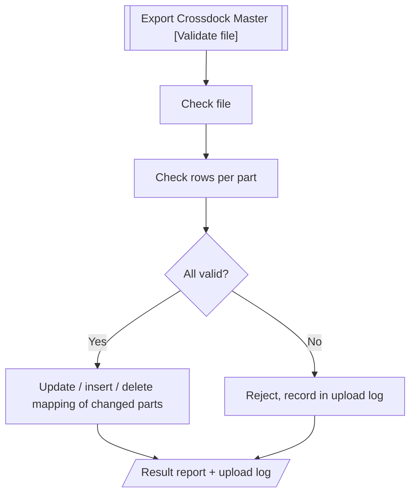
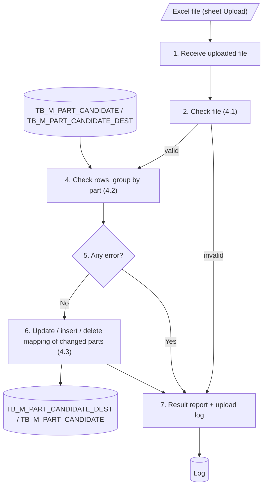

# XD03 – Part and Destination Mapping Upload Batch

> Generated from `deliverables/function_list_v2/specs/XD03_spec.json` (UISS `XD03_UISS_Batch_PartDestinationMappingUpload.xlsx`). Do not edit by hand: change the spec and run `python3 prepare_code/build_md.py`. Document names: GTOPAS / NSP (prototype: G-System / Supplier System).

| Phase | Project | Block | Function | Created | By | Type |
|---|---|---|---|---|---|---|
| DR | Crossdock Optimization | Batch | XD03 Part and Destination Mapping Upload Batch | 18-Oct-26 | FID Rayhan | batch |

## Revision

| Rev | Author | Date | Reviewed by | Description |
|---|---|---|---|---|
| 0.1 | FID Rayhan | 18-Oct-26 |  | Initial Draft |
| 0.2 | FID Rayhan | 17-Nov-26 |  | Sync Status = No Sync only when the destinations or Case/Day of the part changed (Sync Status rule of XD01, 17-Nov). |
| 0.3 | FID Rayhan | 19-Nov-26 |  | Column Order Type in the template; key part + destination + order type; ongoing period only (19-Nov). |
| 0.4 | FID Rayhan | 22-Nov-26 |  | Staging rows in TB_H_PART_CANDIDATE_STG_SYNC instead of the Sync Status of TB_M_PART_CANDIDATE (22-Nov). |
| 0.5 | FID Rayhan | 23-Nov-26 |  | Staging per target through SP_STG_WRITE: Export rows, GTOPAS rows, Kanban header 5 (4.9). |
| 0.6 | FID Rayhan | 24-Nov-26 |  | Order Type column in the upload template (after Destination Code); check 4 = destination + order type once per part; Sample Input with Order Type. |

## 1. General

### Objective

- To process the destination mapping file uploaded from the Cross Dock Part Master screen (Export Crossdock Master tab): from the [Validate file] button of the Upload Excel modal until the mapping of the ongoing calculation period is saved to TB_M_PART_CANDIDATE_DEST.
- In case any error occurs, nothing is saved. The error is recorded in the upload log and a result report is created.

### Operation flow

### Input

| Name | Type | Description |
|---|---|---|
| Mapping file (sheet Upload) | Excel | Uploaded by the D/S user on the Export Crossdock Master screen ([Validate file]). Only sheet Upload is read. Max 5 MB, 5,000 rows. |
| TB_M_PART_CANDIDATE | DB | Part status (must be Active) and Max Case/Day of each part |
| TB_M_PART_CANDIDATE_DEST | DB | Current mapping of the ongoing period, to detect parts with no change |
| TB_M_H0125_DESTINATION (Destination Master) | DB | Valid destination codes (9722D10 Japan, 9811110 Taiwan, 9715310 Korea) |

### Output

| Name | Type | Description |
|---|---|---|
| TB_M_PART_CANDIDATE_DEST | DB | if successful: mapping of each changed part updated per destination (ongoing period) |
| TB_M_PART_CANDIDATE | DB | if successful: staging rows (Export, GTOPAS when a destination appears or disappears, Kanban header 5) for each changed destination |
| TB_H_PART_CANDIDATE | DB | if successful: history record per added, changed or removed destination |
| Log | DB | Upload log: one record per upload with status (COMPLETED / REJECTED), counts and errors |
| Result report | Excel | Also if error occurs. Sheets: Summary, Result, Re-upload, Changes |

### Parameters

| Name | Description |
|---|---|
| Uploaded file | File selected by the user on the Export Crossdock Master screen |
| User | Login name of the user who clicks [Validate file] |

### Grouping Keys

| Field Name |
|---|
| Part Number |

### Execution Schedule

| Item | Description |
|---|---|
| Trigger | Starts when the user clicks [Validate file] in the Upload Excel modal of the Export Crossdock Master screen (on demand, no schedule). The button is enabled only for the ongoing period. |

## 2. Function flow

1. User clicks [Validate file] in the Upload Excel modal of the Export Crossdock Master screen (ongoing period). The batch starts and receives the uploaded file.
2. Check the file: format .xlsx, size, number of rows, sheet "Upload" and template columns (see 4.1).
  - If the file is not valid, reject the upload and go to step 7.
3. Read all rows of sheet "Upload" and group them by Part Number.
4. Check every row and every part against the business rules (see 4.2) and collect all errors.
  - A placeholder row (Destination Code and Dest Case/Day both blank) is skipped.
5. If any row has an error, reject the whole file. Nothing is saved and the errors are recorded in the upload log.
  - Go to step 7.
6. If all rows are valid, compare each part with its current mapping of the ongoing period (see 4.3).
  - Same destinations and Case/Day: skip the part (no change).
  - Otherwise: update / insert / delete the destinations of the part so that its mapping matches the rows of the file, and call SP_STG_WRITE per added / changed / removed destination (Export ADD / EDIT / DELETE).
  - A part whose rows are all blank is not changed.
7. Create the result report and record the result (completed or rejected) in the upload log. The Export Crossdock Master screen shows the result to the user. Exit.

## 3. Data edit mapping

#### 1. Update TB_M_PART_CANDIDATE_DEST – Changed part - Case/Day changed
- Source: Excel file - sheet Upload (valid rows) (keys: Part Number = Changed part, Destination Code = Not blank)
- Destination keys: PART_NO = Changed part, PERIOD = Ongoing period, DEST_CODE = In both, Case/Day differs

| Source field | Destination field | Description |
|---|---|---|
| ORDER_TYPE | ORDER_TYPE | Key of the row (not changed) |
| Dest Case/Day | CASE_DAY |  |
|  | CHANGED_BY | Login name of the user who uploaded |
|  | CHANGED_DT | Server system date and time |
|  | CREATED_BY | Not changed |
|  | CREATED_DT | Not changed |

#### 2. Insert TB_M_PART_CANDIDATE_DEST – Changed part - new destination
- Source: Excel file - sheet Upload (valid rows) (keys: Part Number = Changed part, Destination Code = Not blank)

| Source field | Destination field | Description |
|---|---|---|
| Part Number | PART_NO |  |
|  | PERIOD | Ongoing calculation period |
| Destination Code | DEST_CODE | Destination not yet in the table for the part and period |
| Order Type | ORDER_TYPE | Order Type of the row ('**', 'C', '9', 'V'; default '**') |
| Dest Case/Day | CASE_DAY |  |
|  | CREATED_BY | Login name of the user who uploaded |
|  | CREATED_DT | Server system date and time |
|  | CHANGED_BY | Same as CREATED_BY |
|  | CHANGED_DT | Server system date and time |

#### 3. Delete TB_M_PART_CANDIDATE_DEST – Changed part - removed destination
- Source: TB_M_PART_CANDIDATE_DEST (keys: PART_NO = Changed part, PERIOD = Ongoing period, DEST_CODE = Not in the file)
- Destination keys: PART_NO = Changed part, PERIOD = Ongoing period, DEST_CODE = Not in the file

| Source field | Destination field | Description |
|---|---|---|
|  | PART_NO | Row is deleted |
|  | PERIOD | Row is deleted |
|  | DEST_CODE | Row is deleted |
| ORDER_TYPE | ORDER_TYPE | Key of the row to delete |
|  | CASE_DAY | Row is deleted |

#### 4. Update TB_M_PART_CANDIDATE – Changed part - Sync Status
- Source: Changed part of this upload
- Destination keys: PART_NO = Changed part

| Source field | Destination field | Description |
|---|---|---|
|  | PART_NO | Key, not changed |
|  | PART_NAME | Not changed |
|  | MIN_MAD | Not changed |
|  | PCS_CASE | Not changed |
|  | MAX_CASE_DAY | Not changed |
|  | TOTAL_PCS_DAY | Not changed |
|  | PART_STATUS | Not changed |
|  | LAST_SOURCE | Set 'UPLOAD' |
|  | LAST_UPLOAD_ID | UPLOAD_ID of this run |
|  | CREATED_BY | Not changed |
|  | CREATED_DT | Not changed |
|  | CHANGED_BY | Login name of the user who uploaded |
|  | CHANGED_DT | Server system date and time |

#### 5. Insert TB_H_PART_CANDIDATE – Changed part - history
- Source: Changed parts of this upload

| Source field | Destination field | Description |
|---|---|---|
|  | HIST_ID | Auto (identity) |
|  | PART_NO | Part of the event |
|  | PERIOD | Ongoing calculation period |
|  | EVENT_TYPE | 'MAPPING' |
|  | SOURCE | 'UPLOAD' |
|  | UPLOAD_ID | UPLOAD_ID of this run |
|  | DEST_CODE | Destination added, changed or removed |
| ORDER_TYPE | ORDER_TYPE | Order Type of the destination row for MAPPING; NULL for other events |
|  | FIELD_NAME | 'CASE_DAY' |
|  | OLD_VALUE | Case/Day before (NULL when added) |
|  | NEW_VALUE | Case/Day after (NULL when removed) |
|  | REMARK | NULL |
|  | CREATED_BY | Login name of the user who uploaded |
|  | CREATED_DT | Server system date and time |

#### 6. Update Log – Result of the run
- Source: Result of this upload
- Destination keys: UPLOAD_ID = UPLOAD_ID of this run

| Source field | Destination field | Description |
|---|---|---|
|  | STATUS | COMPLETED if all parts saved or skipped, REJECTED if file check or any row failed |
|  | TOTAL_ROWS | Number of rows in sheet Upload |
|  | SAVED_ROWS | Parts whose mapping was changed |
|  | NO_CHANGE_ROWS | Parts skipped because nothing changed |
|  | ERROR_ROWS | Rows with error |
|  | RESULT_FILE_PATH | Path of the result report .xlsx |
|  | END_DT | Server system date and time |

#### 7. Insert TB_H_STG_APPOLE_KANBAN – SP_STG_WRITE (KANBAN): changed Pcs/Case or Max Case/Day of an Active part, Candidate -> Active, part of a new period; header 5 when only the destinations changed
- Source: Upload file (SP_STG_WRITE, SOURCE UPLOAD)

| Source field | Destination field | Description |
|---|---|---|
| - | STG_ID | Identity |
| PERIOD | PERIOD | Period of the part row |
| - | ACTION | 'ADD' (new part, new period) / 'EDIT' / 'KEEP' (header 5) |
| PART_STATUS | PART_STATUS | Status of the part in the period |
| PERIOD | EFFECTIVE_MONTH_YEAR | MM/YYYY |
| - | OPERATOR_ID | 'P6' |
| PART_NO | PART_NO | With "-" |
| PART_NAME | PART_NAME | From TB_M_PART_CANDIDATE |
| PCS_CASE | SHIPPING_BOX_QTY | Value after the change |
| MAX_CASE_DAY | MAX_SHIPPING_BOX_QTY | Value after the change |
| - | MAX_ALLOWANCE_QTY | PCS_CASE x MAX_CASE_DAY |
| - | OPERATION_TYPE | 1 Max down / 2 up / 3 same / 4 never sent, against the last Max sent (same period, else the latest earlier period); 5 header |
| - | SOURCE | 'SCREEN' / 'UPLOAD' / 'BATCH' (caller) |
| - | UPLOAD_ID | Upload ID when SOURCE = UPLOAD, else NULL |
| - | SYNC_STATUS | '0'; '2' when the value equals the value already sent for the period |
| - | SYNC_DT | NULL |
| - | SYNC_RUN_ID | NULL |
| - | CREATED_BY | Login user (XD05: batch user ID) |
| - | CREATED_DT | Server date-time |
| - | CHANGED_BY | NULL |
| - | CHANGED_DT | NULL |

#### 8. Insert TB_H_STG_APPOLE_EXPORT – SP_STG_WRITE (EXPORT): one row per added, changed or removed destination + order type
- Source: Upload file (SP_STG_WRITE, SOURCE UPLOAD)

| Source field | Destination field | Description |
|---|---|---|
| - | STG_ID | Identity |
| PERIOD | PERIOD |  |
| PART_NO | NSP_PART_NO | With "-" |
| DEST_CODE | DEST_CODE | 7 digits |
| - | ACTION | 'ADD' / 'EDIT' / 'DELETE' |
| PERIOD | EFFECTIVE_MONTH_YEAR | MM/YYYY |
| PART_NO | PART_NO | Without "-" |
| DEST_CODE | BUYER_PD | 5-2 format |
| ORDER_TYPE | ORDER_TYPE |  |
| - | TRANSPORT_CODE | '2' |
| CASE_DAY | MAX_SHIPPING_BOX_RCS | Value after the change; 0 for DELETE |
| - | SOURCE | 'SCREEN' / 'UPLOAD' / 'BATCH' (caller) |
| - | UPLOAD_ID | Upload ID when SOURCE = UPLOAD, else NULL |
| - | SYNC_STATUS | '0'; '2' when the value equals the value already sent for the period |
| - | SYNC_DT | NULL |
| - | SYNC_RUN_ID | NULL |
| - | CREATED_BY | Login user (XD05: batch user ID) |
| - | CREATED_DT | Server date-time |
| - | CHANGED_BY | NULL |
| - | CHANGED_DT | NULL |

#### 9. Insert TB_H_STG_GTOPAS – SP_STG_WRITE (EXPORT branch): the destination appears or disappears for the part and GTOPAS does not have that state yet
- Source: Upload file (SP_STG_WRITE, SOURCE UPLOAD)

| Source field | Destination field | Description |
|---|---|---|
| - | STG_ID | Identity |
| PERIOD | PERIOD |  |
| - | ACTION | 'ADD' / 'DELETE' |
| - | DEPOT_CODE | '01' |
| PART_NO | P_NO | With "-" |
| DEST_CODE | DESTINATION_CODE |  |
| - | MAKER_CODE | 'A' |
| - | DOMESTIC_OVERSEAS | '2' |
| - | TOPAS_ORDER_TYPE | '3' |
| - | ORDER_TRANSPORTATION_CODE | '2' |
| - | SOURCE | 'SCREEN' / 'UPLOAD' / 'BATCH' (caller) |
| - | UPLOAD_ID | Upload ID when SOURCE = UPLOAD, else NULL |
| - | SYNC_STATUS | '0' |
| - | SYNC_DT | NULL |
| - | SYNC_RUN_ID | NULL |
| - | CREATED_BY | Login user (XD05: batch user ID) |
| - | CREATED_DT | Server date-time |
| - | CHANGED_BY | NULL |
| - | CHANGED_DT | NULL |

#### 10. Update TB_H_STG_APPOLE_KANBAN – SP_STG_WRITE: Older unsent row of the same key -> Superseded
- Source: Upload file (SP_STG_WRITE, SOURCE UPLOAD)

| Source field | Destination field | Description |
|---|---|---|
| - | SYNC_STATUS | '2' |
| - | CHANGED_BY | Login user (XD05: batch user ID) |
| - | CHANGED_DT | Server date-time |

#### 11. Update TB_H_STG_APPOLE_EXPORT – SP_STG_WRITE: Older unsent row of the same key -> Superseded
- Source: Upload file (SP_STG_WRITE, SOURCE UPLOAD)

| Source field | Destination field | Description |
|---|---|---|
| - | SYNC_STATUS | '2' |
| - | CHANGED_BY | Login user (XD05: batch user ID) |
| - | CHANGED_DT | Server date-time |

#### 12. Update TB_H_STG_GTOPAS – SP_STG_WRITE: Unsent row of the same part + destination -> Superseded
- Source: Upload file (SP_STG_WRITE, SOURCE UPLOAD)

| Source field | Destination field | Description |
|---|---|---|
| - | SYNC_STATUS | '2' |
| - | CHANGED_BY | Login user (XD05: batch user ID) |
| - | CHANGED_DT | Server date-time |

## 4. Function description

This batch starts when the user clicks [Validate file] in the Upload Excel modal of the Export Crossdock Master screen. It checks the uploaded file and, if everything is valid, updates the mapping of the changed parts for the ongoing calculation period. If not, the upload is rejected and recorded in the upload log.

- Only sheet "Upload" of the file is read. Parts that are not in the sheet are not changed.
- Only the ongoing calculation period is changed; past periods are read only.
- One run saves all parts or none (all-or-nothing).
- The columns Total Case/Day (used) and Max Case/Day (quota) are for reference only and are not read; the limit is Max Case/Day of the part in TB_M_PART_CANDIDATE and used is calculated from Dest Case/Day.

### 4.1 File Check (log message no. 5)

1. File extension is .xlsx.
2. File size is 5 MB or less.
3. Sheet Upload has 1 to 5,000 data rows.
4. Sheet "Upload" exists. Other sheets are ignored.
5. Header has the 6 template columns (see Appendix), found by column name (case and leading / trailing spaces ignored). Extra columns are ignored.

### 4.2 Row Validation (log message no. 6)

Every row is checked and all errors are collected, so the user can correct the file once. Checks 4 and 6 are done per part (all rows with the same Part Number).

### 4.3 Saving

- If any row is rejected, nothing is saved. The upload status and the error of every row are recorded in the upload log (Log).
- If all rows are valid, each part in the file is compared with its current mapping of the ongoing period. A part with the same destinations and Case/Day is skipped (no change); its Sync Status and last update stay.
- For a changed part, its rows of the ongoing period in TB_M_PART_CANDIDATE_DEST are compared with the rows of the file by destination code (key PART_NO + PERIOD + DEST_CODE): a destination in both with a different Case/Day is updated (CASE_DAY, CHANGED_BY, CHANGED_DT; CREATED_BY / CREATED_DT are kept), a destination only in the file is inserted, a destination only in the table is deleted, and a destination with the same Case/Day is not touched. All changes are saved in one transaction.
- A part whose rows are all blank (placeholder) is not changed, so a mapping cannot be removed completely by upload (same as the screen: at least one destination).
- Every changed part gets a history record per added, changed or removed destination in TB_H_PART_CANDIDATE (event MAPPING, source UPLOAD, DEST_CODE and FIELD_NAME CASE_DAY; refer Appendix).
- Every added / changed / removed destination goes to the staging through SP_STG_WRITE (SOURCE UPLOAD, UPLOAD_ID): an Export row, a GTOPAS row when the destination appears or disappears for the part, and the Kanban header (OPERATION_TYPE 5) when the Kanban did not change. File rows equal to the current mapping write nothing. The part is sent by the next [Sync].
- A result report (.xlsx) is created for both cases.

| No | Check | Column |
|---|---|---|
| 1 | Part No exists in TB_M_PART_CANDIDATE and its status is Active. | Part Number |
| 2 | Destination code exists in TB_M_H0125_DESTINATION (Destination Master, DESTINATION_CD). | Destination Code |
| 3 | Dest Case/Day is a whole number greater than 0 when Destination Code is filled. | Dest Case/Day |
| 4 | A destination code + order type appears only once per part in the file (the same destination with another order type is allowed). | Destination Code, Order Type |
| 5 | Destination Code and Dest Case/Day are both filled, or both blank (placeholder row). Only one of the two filled is an error. | Destination Code, Dest Case/Day |
| 6 | The total Dest Case/Day of all rows of a part does not exceed the Max Case/Day of the part in TB_M_PART_CANDIDATE (Max Case/Day (quota) of the file is ignored). Below or equal is allowed. | Dest Case/Day |
| 7 | The upload is for the ongoing calculation period only (the screen enables [Validate file] only for that period). | - |
| 8 | upload is A or E. A only for a destination that is not yet mapped for the part, E only for a destination that is already mapped (ongoing period). A placeholder row left blank is skipped. | Upload (A/E) |

### 4.4 Order Type and Period (19-Nov)

- Order Type per destination row (system master '**', 'C', '9', 'V'): the same destination may have two rows in a period when the order type differs; key PART_NO + PERIOD + DEST_CODE + ORDER_TYPE.
- Template: new column Order Type after Destination Code (mandatory, '**', 'C', '9' or 'V'). A destination + order type twice for a part in the file = row error (message of the duplicate check).
- The upload changes the ongoing period only; Next (made by XD05) and past periods are not changed.

### 4.9 Staging rows for the sync

- Every save calls the stored procedure SP_STG_WRITE once per changed value, in the same transaction and after the master tables are updated. A save without a changed value writes nothing.
- Export (TB_H_STG_APPOLE_EXPORT): one row per added (ADD), changed (EDIT) or removed (DELETE, Max Shipping Box (RCS) 0) destination + order type. Active -> Inactive writes DELETE (0) for every destination of the part.
- GTOPAS (TB_H_STG_GTOPAS): a row only when the destination appears or disappears for the part (any order type) and GTOPAS does not have that state yet. A Case/Day change or an order type change of a destination that stays writes no GTOPAS row.
- Header: an Export change of a part + period without an unsent Kanban row writes the Kanban header with ACTION KEEP and OPERATION_TYPE 5 (current Kanban values, not uploaded). So every part of a run has one Kanban row that sets its upload order.
- Superseded: a new row of a key marks the older unsent row of the same key SYNC_STATUS 2. A value set back to the value already sent for the period gets SYNC_STATUS 2 too (nothing to send). Keys: Kanban PERIOD + PART_NO; Export PERIOD + NSP_PART_NO + DEST_CODE + ORDER_TYPE; GTOPAS PERIOD + P_NO + DESTINATION_CODE.
- NSP keeps the end state valid before the save: total Case/Day of the destinations <= Max Case/Day of the part in the period (XD01 messages 14 and 20, XD02 / XD03 checks).
- SOURCE UPLOAD, UPLOAD_ID of the upload. The part is sent by the next [Sync] (refer XD01 5.24).
- Rules and simulation: deliverables/function_list_v2/erd/proposal_staging_sync (Proposal_Tables_Staging_Per_Target.xlsx, simulation/Staging_Header_Order.html, simulation/Staging_Per_Target_Full_Flow_Simulation.xlsx).

## 5. Logging messages

| ID | Event | Cause | Type | Message | Action |
|---|---|---|---|---|---|
| LOG1 | Batch start | Batch is called | Info | Mapping upload batch <UPLOAD_ID> started. | system: Write the log.; user: - |
| LOG2 | Batch end | Batch finishes | Info | Mapping upload batch <UPLOAD_ID> ended. Status <STATUS>, total <TOTAL_ROWS>, saved parts <SAVED_ROWS>, no change <NO_CHANGE_ROWS>, error <ERROR_ROWS>. | system: Write the log.; user: - |
| LOG3 | Receive file | Uploaded file of <UPLOAD_ID> not found | Error | Uploaded file of <UPLOAD_ID> not found. | system: Stop the batch.; user: Upload the file again. |
| LOG4 | File check | Extension, size, row count, sheet Upload or header is invalid | Error | File check failed: <REASON>. | system: Set STATUS = REJECTED. Create the result report.; user: Download the file from the screen again and upload it. |
| LOG5 | Row validation | A validation rule in 4.2 fails | Error | Row <ROW_NO> <COLUMN> : <RULE_MESSAGE>. | system: Reject the whole file. Nothing is saved.; user: Correct the rows in sheet Re-upload of the result report, then upload again. |
| LOG6 | Part skipped | Rows of the part equal the current mapping, or all rows are blank | Info | Part No <PART_NO> has no mapping change. Skipped. | system: Do not change the mapping or the part.; user: - |
| LOG7 | Save mapping | Save (update / insert / delete) of TB_M_PART_CANDIDATE_DEST or update of TB_M_PART_CANDIDATE fails | Error | Cannot save the mapping of Part No <PART_NO>. | system: Roll back. Set STATUS = REJECTED.; user: User contact PIC |
| LOG8 | Result report | Result report cannot be created | Warning | Result report of <UPLOAD_ID> cannot be created. | system: Continue. RESULT_FILE_PATH stays blank.; user: Contact system owner. |
| LOG9 | Unexpected error | Any other system error | Critical | Unexpected error: <ERROR_DETAIL>. | system: Roll back. Set STATUS = REJECTED.; user: User contact PIC |

## 6. Appendix

### Upload template (sheet "Upload")

| Column | Content |
|---|---|
| Part Number | Part Number of an Active part. One row per destination; all rows of a part together form its new mapping. |
| Destination Code | Destination code (9722D10 / 9811110 / 9715310). Destination + Order Type once per part. Blank together with Dest Case/Day = placeholder row. |
| Order Type | '**', 'C', '9' or 'V' (system master), mandatory when Destination Code is filled. The same destination may have two rows when the order type differs. |
| Dest Case/Day | Case/Day of the destination, whole number greater than 0. |
| Total Case/Day (used) | Sum of Dest Case/Day of the part when the file is exported, for reference only (not read by the batch; the batch calculates it from Dest Case/Day). |
| Max Case/Day (quota) | Max Case/Day of the part in Kanban Crossdock Master, for reference only (not read by the batch). |
| Upload (A/E) | A = Add (destination not yet mapped for the part in the ongoing period), E = Edit (destination already mapped; Dest Case/Day can be changed). Export Excel pre-fills E, and A for the blank row of a part without mapping. |

Sample upload scenarios (master data, accepted files, rejected files): see sheet Sample Input.

## 7. Tables

#### TB_M_PART_CANDIDATE (transaction, existing)
Kanban Crossdock Master: one record per part and calculation period (19-Nov; before: one record per part).

| Column | Type | PK | Null | Description |
|---|---|---|---|---|
| PART_NO | VARCHAR(TBD) | Y | N | Part number; length follows TB_M_PART_MASTER |
| PERIOD | CHAR(6) | Y | N | Calculation period YYYYMM: one row per part and period. The first row of a part is the period it is registered in (Add Part: the ongoing period or the next one); the part takes effect from it. Current: screen and upload; Next: made by XD05 on day D, view only until day 1; Past: view only |
| PART_NAME | VARCHAR(TBD) |  | N | Retrieved from TB_M_PART_MASTER by PART_NO |
| MIN_MAD | INT |  | N | Minimum MAD (mandatory); reference compared with the MAD result of the calculation |
| PCS_CASE | INT |  | N | Pieces per case (> 0) |
| MAX_CASE_DAY | INT |  | N | Total Case/Day of the part (> 0); limit of the mapping |
| TOTAL_PCS_DAY | INT |  | N | PCS_CASE x MAX_CASE_DAY |
| PART_STATUS | VARCHAR(TBD) |  | N | Candidate / Active / Inactive. Candidate -> Active: XD05 (new period) or Procurement on the screen (ongoing period). Active <-> Inactive: XD05 or Procurement (screen, upload). No part goes back to Candidate |
| LAST_SOURCE | VARCHAR(TBD) |  | N | CALC / SCREEN / UPLOAD |
| LAST_UPLOAD_ID | VARCHAR(TBD) |  | Y | Upload that last changed the record |
| CREATED_BY | VARCHAR(TBD) |  | N | User who created the record |
| CREATED_DT | DATETIME |  | N | Created date and time |
| CHANGED_BY | VARCHAR(TBD) |  | N | User who last changed the record |
| CHANGED_DT | DATETIME |  | N | Last changed date and time |

#### TB_M_PART_CANDIDATE_DEST (transaction, existing)
Export Crossdock Master: one record per part, calculation period, destination and order type.

| Column | Type | PK | Null | Description |
|---|---|---|---|---|
| PART_NO | VARCHAR(TBD) | Y | N | Part number; FK to TB_M_PART_CANDIDATE |
| PERIOD | CHAR(6) | Y | N | Calculation period, YYYYMM e.g. 202609; displayed as Sep 2026 |
| DEST_CODE | CHAR(7) | Y | N | Destination code (buyer code + PD code, 7 digits); exists in TB_M_H0125_DESTINATION (Destination Master) |
| ORDER_TYPE | VARCHAR(2) | Y | N | Order Type of the row (system master: '**', 'C', '9', 'V'; default '**'). One row per part, period, destination and order type (19-Nov) |
| CASE_DAY | INT |  | N | Allocated Case/Day of the destination (> 0). Every add / change / removal calls SP_STG_WRITE (Export staging row) in the same transaction |
| CREATED_BY | VARCHAR(TBD) |  | N | User who created the record |
| CREATED_DT | DATETIME |  | N | Created date and time |
| CHANGED_BY | VARCHAR(TBD) |  | N | User who last changed the record |
| CHANGED_DT | DATETIME |  | N | Last changed date and time |

#### TB_H_PART_CANDIDATE (history, proposed)
History of every change of a crossdock part for the History setting of XD01 (Add / Edit by screen or upload, mapping changes, status changes and mappings made by the calculation batches). The sync to GTOPAS / AP POLE is not recorded here: it is in the staging tables (TB_H_STG_APPOLE_KANBAN, TB_H_STG_APPOLE_EXPORT, TB_H_STG_GTOPAS) (22-Nov). No retention limit.

| Column | Type | PK | Null | Description |
|---|---|---|---|---|
| HIST_ID | BIGINT | Y | N | Running number (identity) |
| PART_NO | VARCHAR(TBD) |  | N | Part number; length follows TB_M_PART_MASTER |
| PERIOD | CHAR(6) |  | N | Calculation period YYYYMM of the changed row (every event; Kanban and Export Crossdock Master are per period, 20-Nov) |
| EVENT_TYPE | VARCHAR(10) |  | N | ADD / EDIT / MAPPING / CALC |
| SOURCE | VARCHAR(10) |  | N | SCREEN / UPLOAD / BATCH |
| UPLOAD_ID | VARCHAR(TBD) |  | Y | Upload of the change (Log); NULL when not from an upload |
| DEST_CODE | CHAR(7) |  | Y | Destination code (7 digits) for MAPPING; NULL for other events |
| ORDER_TYPE | VARCHAR(2) |  | Y | Order Type of the destination row for MAPPING (with DEST_CODE); NULL for other events (20-Nov) |
| FIELD_NAME | VARCHAR(30) |  | N | Changed field: PCS_CASE, MAX_CASE_DAY, MIN_MAD, PART_STATUS, CASE_DAY |
| OLD_VALUE | VARCHAR(255) |  | Y | Value before the change; NULL for ADD or an added destination |
| NEW_VALUE | VARCHAR(255) |  | Y | Value after the change; NULL for a removed destination |
| REMARK | VARCHAR(500) |  | Y | Free text |
| CREATED_BY | VARCHAR(20) |  | N | User who made the change (batch user ID for BATCH) |
| CREATED_DT | DATETIME |  | N | Date and time of the change |

#### TB_H_STG_APPOLE_KANBAN (history, proposed)
AP POLE Kanban rows in the format of the upload file LLM9Q910, one row per Kanban change of a part + period, plus the header row (OPERATION_TYPE 5) when only the destinations changed. Written by SP_STG_WRITE (XD01, XD02, XD05); SYNC_STATUS set by SP_STG_SYNC. Read by XD07 through V_APPOLE_UPLOAD_KANBAN and V_APPOLE_UPLOAD_EXPORT.

| Column | Type | PK | Null | Description |
|---|---|---|---|---|
| STG_ID | BIGINT | Y | N | Running number: order of the inserts |
| PERIOD | CHAR(6) |  | N | Calculation period YYYYMM. FK1 (PART_NO, PERIOD) -> TB_M_PART_CANDIDATE |
| ACTION | VARCHAR(6) |  | N | ADD (new part, new period) / EDIT (Pcs/Case or Max changed) / KEEP (header written by an Export save, Kanban unchanged) |
| PART_STATUS | VARCHAR(10) |  | N | Active / Inactive in the period when the row is written (an Inactive part stays in the AP POLE Kanban) |
| EFFECTIVE_MONTH_YEAR | CHAR(7) |  | N | MM/YYYY of PERIOD. File / screen column: Effective Month / Year |
| OPERATOR_ID | CHAR(2) |  | N | Always P6. File / screen column: Operator ID. Default 'P6' |
| PART_NO | VARCHAR(TBD) |  | N | Part number with "-" (NSP format); FK1. File / screen column: Part No. |
| PART_NAME | VARCHAR(TBD) |  | N | From TB_M_PART_CANDIDATE at the insert. File / screen column: Part Name |
| SHIPPING_BOX_QTY | NUMBER(5) |  | N | Pcs/Case. File / screen column: Shipping Box Qty |
| MAX_SHIPPING_BOX_QTY | NUMBER(5) |  | N | Max Case/Day. File / screen column: Max Shipping Box Qty |
| MAX_ALLOWANCE_QTY | NUMBER(9) |  | N | Shipping Box Qty x Max Shipping Box Qty. File / screen column: Max Allowance Qty |
| OPERATION_TYPE | NUMBER(1) |  | N | Header of the part, set by SP_STG_WRITE at the save: 1 = Max down, 2 = Max up, 3 = Max same (only Pcs/Case changed, or a new period with the same Max), 4 = never sent, 5 = Kanban unchanged, only the destinations changed (ACTION KEEP). 1 to 4 against the last Max sent: same period, else the latest earlier period. Upload: 1 -> the Export rows of the part in EXPORT_PRE before KANBAN; 2, 3, 4 -> KANBAN then EXPORT_POST; 5 -> EXPORT_POST only, the row is not in the KANBAN file |
| SOURCE | VARCHAR(6) |  | N | SCREEN / UPLOAD / BATCH (XD05) |
| UPLOAD_ID | VARCHAR(TBD) |  | Y | Upload of the Kanban or Export Excel (Log); NULL when SOURCE is not UPLOAD |
| SYNC_STATUS | CHAR(1) |  | N | 0 = to send, 1 = sent, 2 = Superseded at the save (a newer row of the key, or back to the value already sent). Set by SP_STG_WRITE (0, 2) and SP_STG_SYNC / Period Rollover (1). Default '0' |
| SYNC_DT | DATETIME |  | Y | Time of the [Sync] / Period Rollover that sent the row; Last Sent on the screen = latest value |
| SYNC_RUN_ID | VARCHAR(14) |  | Y | Run ID YYYYMMDDHHMMSS; [Re-send last Sync] sends the rows of the last run again |
| CREATED_BY | VARCHAR(20) |  | N | User of the save / upload, or XD05BATCH |
| CREATED_DT | DATETIME |  | N | Time of the insert (same transaction as the master update) |
| CHANGED_BY | VARCHAR(20) |  | Y | User of the save that made the row Superseded, of [Sync], or XD05BATCH (Period Rollover) |
| CHANGED_DT | DATETIME |  | Y | Time of that update |

#### TB_H_STG_APPOLE_EXPORT (history, proposed)
AP POLE Export rows in the format of the upload file LLM9Q880, one row per added, changed or removed destination + order type of a part + period. Written by SP_STG_WRITE (XD01, XD03, XD05); SYNC_STATUS set by SP_STG_SYNC. Read by XD07 through V_APPOLE_UPLOAD_EXPORT.

| Column | Type | PK | Null | Description |
|---|---|---|---|---|
| STG_ID | BIGINT | Y | N | Running number: order of the inserts |
| PERIOD | CHAR(6) |  | N | Calculation period YYYYMM. FK1 (NSP_PART_NO, PERIOD) -> TB_M_PART_CANDIDATE |
| NSP_PART_NO | VARCHAR(TBD) |  | N | Part number with "-" (key back to NSP); FK1 |
| DEST_CODE | CHAR(7) |  | N | Destination code, 7 digits. No FK: a DELETE row points to a removed destination |
| ACTION | VARCHAR(6) |  | N | ADD / EDIT / DELETE (DELETE = Max Shipping Box (RCS) 0) |
| EFFECTIVE_MONTH_YEAR | CHAR(7) |  | N | MM/YYYY of PERIOD. File / screen column: Effective Month / Year |
| PART_NO | VARCHAR(TBD) |  | N | Part number without "-". File / screen column: Part No. |
| BUYER_PD | CHAR(8) |  | N | DEST_CODE in 5-2 format. File / screen column: Buyer-PD |
| ORDER_TYPE | VARCHAR(2) |  | N | '**', 'C', '9', 'V' (system master). File / screen column: Order Type |
| TRANSPORT_CODE | CHAR(1) |  | N | Always 2. File / screen column: Transport Code. Default '2' |
| MAX_SHIPPING_BOX_RCS | NUMBER(5) |  | N | Case/Day of the destination; 0 = delete. File / screen column: Max Shipping Box (RCS) |
| SOURCE | VARCHAR(6) |  | N | SCREEN / UPLOAD / BATCH (XD05) |
| UPLOAD_ID | VARCHAR(TBD) |  | Y | Upload of the Kanban or Export Excel (Log); NULL when SOURCE is not UPLOAD |
| SYNC_STATUS | CHAR(1) |  | N | 0 = to send, 1 = sent, 2 = Superseded at the save (a newer row of the key, or back to the value already sent). Set by SP_STG_WRITE (0, 2) and SP_STG_SYNC / Period Rollover (1). Default '0' |
| SYNC_DT | DATETIME |  | Y | Time of the [Sync] / Period Rollover that sent the row; Last Sent on the screen = latest value |
| SYNC_RUN_ID | VARCHAR(14) |  | Y | Run ID YYYYMMDDHHMMSS; [Re-send last Sync] sends the rows of the last run again |
| CREATED_BY | VARCHAR(20) |  | N | User of the save / upload, or XD05BATCH |
| CREATED_DT | DATETIME |  | N | Time of the insert (same transaction as the master update) |
| CHANGED_BY | VARCHAR(20) |  | Y | User of the save that made the row Superseded, of [Sync], or XD05BATCH (Period Rollover) |
| CHANGED_DT | DATETIME |  | Y | Time of that update |

#### TB_H_STG_GTOPAS (history, proposed)
GTOPAS WVJA5204 rows: a part + destination to add or delete, written by SP_STG_WRITE only when the destination appears or disappears for the part (any order type) and GTOPAS does not have that state yet. Sent by [Sync] (Current period) or the Period Rollover (new Current period). Read by XD06.

| Column | Type | PK | Null | Description |
|---|---|---|---|---|
| STG_ID | BIGINT | Y | N | Running number: order of the inserts |
| PERIOD | CHAR(6) |  | N | Calculation period YYYYMM (GTOPAS has no period: [Sync] sends the Current period, the Period Rollover the new Current). FK1 (P_NO, PERIOD) -> TB_M_PART_CANDIDATE |
| ACTION | VARCHAR(6) |  | N | ADD / DELETE: the destination appears or disappears for the part (any order type). No row for a Case/Day change or for a state GTOPAS already has. File / screen column: Add / Delete (MT = DEL) |
| DEPOT_CODE | CHAR(2) |  | N | Always 01. File / screen column: Depot Code. Default '01' |
| P_NO | VARCHAR(TBD) |  | N | Part number with "-"; FK1. File / screen column: P/No. |
| DESTINATION_CODE | CHAR(7) |  | N | 7-digit code, the same in NSP and GTOPAS. File / screen column: Destination Code |
| MAKER_CODE | CHAR(1) |  | N | Always A. File / screen column: Maker Code. Default 'A' |
| DOMESTIC_OVERSEAS | CHAR(1) |  | N | Always 2. File / screen column: Domestic/Overseas. Default '2' |
| TOPAS_ORDER_TYPE | CHAR(1) |  | N | Always 3. File / screen column: TOPAS Order Type. Default '3' |
| ORDER_TRANSPORTATION_CODE | CHAR(1) |  | N | Always 2. File / screen column: Order Transportation Code. Default '2' |
| SOURCE | VARCHAR(6) |  | N | SCREEN / UPLOAD / BATCH (XD05) |
| UPLOAD_ID | VARCHAR(TBD) |  | Y | Upload of the Kanban or Export Excel (Log); NULL when SOURCE is not UPLOAD |
| SYNC_STATUS | CHAR(1) |  | N | 0 = to send, 1 = sent, 2 = Superseded at the save (a newer row of the key, or back to the value already sent). Set by SP_STG_WRITE (0, 2) and SP_STG_SYNC / Period Rollover (1). Default '0' |
| SYNC_DT | DATETIME |  | Y | Time of the [Sync] / Period Rollover that sent the row; Last Sent on the screen = latest value |
| SYNC_RUN_ID | VARCHAR(14) |  | Y | Run ID YYYYMMDDHHMMSS; [Re-send last Sync] sends the rows of the last run again |
| CREATED_BY | VARCHAR(20) |  | N | User of the save / upload, or XD05BATCH |
| CREATED_DT | DATETIME |  | N | Time of the insert (same transaction as the master update) |
| CHANGED_BY | VARCHAR(20) |  | Y | User of the save that made the row Superseded, of [Sync], or XD05BATCH (Period Rollover) |
| CHANGED_DT | DATETIME |  | Y | Time of that update |

#### TB_M_H0125_DESTINATION (master, existing)
Destination Master (existing NSP table, read only). Only the listed columns are relevant; full structure: XD13 Destination Master (H0125) Sync.

| Column | Type | PK | Null | Description |
|---|---|---|---|---|
| DESTINATION_CD | VARCHAR(7) | Y | N | Destination code, e.g. 123. Used by Crossdock: destination list, upload check 2, DEST_CODE |
| CUSTOMER_CD | VARCHAR(7) |  | N | Customer code (reference only) |
| ORDER_TRANSPORTATION_CD | VARCHAR(1) |  | N | Order transportation code (reference only) |
| BO_INSTRUCTION_CD | VARCHAR(1) |  | N | B/O instruction code (reference only) |
| DESTINATION_NAME_ENG | VARCHAR(50) |  | N | Destination name, e.g. Japan. Used by Crossdock: shown with the code ('9722D10 - Japan') and in Export Excel |
| REGION_CD | VARCHAR(2) |  | N | Region code (reference only) |
| COUNTRY_NAME_ENG | VARCHAR(36) |  | Y | Country name (reference only) |
| POSTAL_CD_ENG | VARCHAR(10) |  | Y | Postal code (reference only) |
| STATE_CD_ENG | VARCHAR(6) |  | Y | State code (reference only) |
| DESTINATION_ADDR1_ENG | VARCHAR(50) |  | N | Destination address 1 (reference only) |
| DESTINATION_ADDR2_ENG | VARCHAR(50) |  | Y | Destination address 2 (reference only) |
| CREATE_BY | VARCHAR(TBD) |  | Y | User who created the record |
| CREATE_DT | TIMESTAMP |  | Y | Created date and time |
| UPDATE_BY | VARCHAR(TBD) |  | Y | User who last updated the record |
| UPDATE_DT | TIMESTAMP |  | Y | Last updated date and time |

## Sample Input

**Sample upload scenarios - Export Crossdock Master Upload**

- Each scenario is a separate upload file. Ongoing period = Sep 2026. One row per destination; a scenario with several rows uses one Excel row per destination.
- Input columns follow sheet Upload of the Export Excel; a blank cell is a blank value in the file.

### A. Master data before upload (ongoing period)

| Part No | Status | Max Case/Day | Mapped 9722D10 | Mapped 9811110 | Mapped 9715310 | Mapped total | Remark |
|---|---|---|---|---|---|---|---|
| PART-A | Active | 24 | 12 | 8 | 4 | 24 |  |
| PART-C | Active | 30 |  |  | 18 | 18 |  |
| PART-G | Active | 22 |  |  |  | 0 | No mapping: placeholder row in the export |
| PART-I | Candidate | 20 |  |  |  |  | Not in Export Crossdock Master |

### B. Normal scenarios (file accepted)

| No | Scenario | Part Number | Destination Code | Order Type | Dest Case/Day | Total Case/Day (used) | Max Case/Day (quota) | Upload (A/E) | Expected result |
|---|---|---|---|---|---|---|---|---|---|
| N1 | Change Case/Day | PART-A | 9722D10 | ** | 10 | 24 | 24 | E | Changed. Total 24 (equal to Max). Export staging rows and Kanban header 5 (AP POLE Non Sync). |
| N1 | Change Case/Day | PART-A | 9811110 | ** | 8 | 24 | 24 | E |  |
| N1 | Change Case/Day | PART-A | 9715310 | ** | 6 | 24 | 24 | E |  |
| N2 | Remove a destination | PART-A | 9722D10 | ** | 12 | 20 | 24 | E | Changed. 9715310 deleted. Total 20, 4 case/day left (below Max is allowed). |
| N2 | Remove a destination | PART-A | 9811110 | ** | 8 | 20 | 24 | E |  |
| N3 | Add a destination | PART-C | 9715310 | ** | 18 | 30 | 30 | E | Changed. 9811110 inserted. Total 30 (equal to Max). |
| N3 | Add a destination | PART-C | 9811110 | ** | 12 | 30 | 30 | A |  |
| N4 | First mapping from the placeholder row | PART-G | 9722D10 | ** | 22 | 22 | 22 | A | Inserted. Total 22. Export staging rows and Kanban header 5 (AP POLE Non Sync). |
| N5 | Placeholder row left blank | PART-G |  |  |  |  | 22 | A | NO CHANGE. PART-G stays without mapping. |
| N6 | Same values as the master | PART-A | 9722D10 | ** | 12 | 24 | 24 | E | NO CHANGE. no staging row. |
| N6 | Same values as the master | PART-A | 9811110 | ** | 8 | 24 | 24 | E |  |
| N6 | Same values as the master | PART-A | 9715310 | ** | 4 | 24 | 24 | E |  |
| N7 | File with only some parts (PART-C only) | PART-C | 9715310 | ** | 18 | 18 | 30 | E | Only PART-C is processed (here NO CHANGE). PART-A and PART-G are not changed. |
| N9 | Same destination, another order type | PART-C | 9715310 | C | 6 | 24 | 30 | A | Accepted: 9715310 ** 18 stays, a second row 9715310 C 6 is added (total 24 ≤ 30). Export staging ADD for 9715310 C; no GTOPAS row (the destination is already there). |

### C. Error scenarios (whole file rejected, nothing saved)

| No | Scenario | Part Number | Destination Code | Order Type | Dest Case/Day | Total Case/Day (used) | Max Case/Day (quota) | Upload (A/E) | Error (4.2 check no.) |
|---|---|---|---|---|---|---|---|---|---|
| E1 | Part not registered | PART-Z99 | 9722D10 | ** | 10 | 10 |  | A | Check 1: Part No is not registered or its status is not Active. |
| E2 | Part is not Active | PART-I | 9722D10 | ** | 10 | 10 | 20 | A | Check 1: Part No is not registered or its status is not Active. |
| E3 | Unknown destination | PART-A | ZZZZZ99 | ** | 10 | 10 | 24 | A | Check 2: Destination code ZZZZZ99 not found in the destination master (TB_M_H0125_DESTINATION). |
| E4 | Invalid Case/Day | PART-A | 9722D10 | ** | 0 | 0 | 24 | E | Check 3: Dest Case/Day must be a whole number greater than 0. |
| E5 | Same destination + order type twice | PART-A | 9722D10 | ** | 10 | 14 | 24 | E | Check 4: Destination 9722D10 with order type ** appears more than once for this part. |
| E5 | Same destination + order type twice | PART-A | 9722D10 | ** | 4 | 14 | 24 | E |  |
| E6 | Only one of Destination Code / Dest Case/Day | PART-G | 9722D10 | ** |  |  | 22 | A | Check 5: Destination Code and Dest Case/Day must both be filled or both blank. |
| E7 | Total above Max Case/Day | PART-A | 9722D10 | ** | 12 | 30 | 24 | E | Check 6: Total allocation of 30 case/day exceeds Max Case/Day (24). Reduce one of the destinations. |
| E7 | Total above Max Case/Day | PART-A | 9811110 | ** | 8 | 30 | 24 | E |  |
| E7 | Total above Max Case/Day | PART-A | 9715310 | ** | 10 | 30 | 24 | E |  |
| E8 | Valid row (= N4) mixed with an error row (= E3) | PART-G | 9722D10 | ** | 22 | 22 | 22 | A | Whole file rejected. The valid row is NOT saved. |
| E8 | Valid row mixed with an error row | PART-A | ZZZZZ99 | ** | 10 | 10 | 24 | A | Check 2 on this row. Result report sheet Re-upload lists the rows to correct. |
| E9 | Upload (A/E) E for a destination that is not mapped yet | PART-C | 9811110 | ** | 12 | 12 | 30 | E | Check 8: Destination 9811110 is not mapped for PART-C yet; use Upload (A/E) A. |

### D. File-level errors (file check 4.1)

| No | Scenario | Expected result |
|---|---|---|
| F1 | File is .xls or .csv | Rejected: file must be .xlsx. |
| F2 | File larger than 5 MB | Rejected: file size exceeds 5 MB. |
| F3 | More than 5,000 data rows, or no data row | Rejected: row count out of range. |
| F4 | No sheet named Upload (e.g. only sheet Export Crossdock Master) | Rejected: sheet Upload not found. |
| F5 | A template column is missing (e.g. Dest Case/Day deleted) | Rejected: required column not found. |
