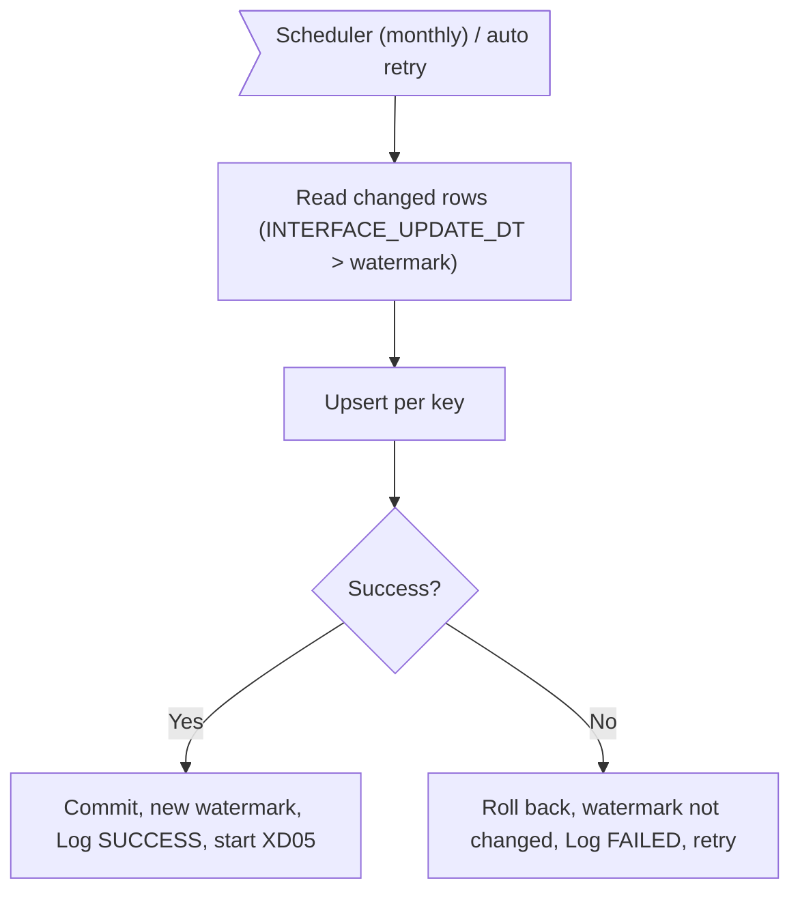
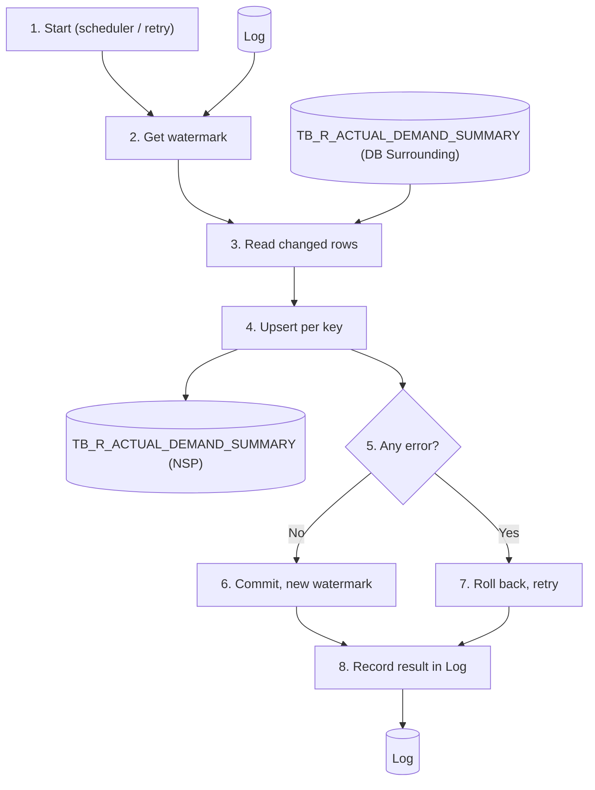

# XD04 – Actual Demand Summary Synch to NSP

> Generated from `deliverables/function_list_v2/specs/XD04_spec.json` (UISS `XD04_UISS_Batch_ActualDemandSummarySync.xlsx`). Do not edit by hand: change the spec and run `python3 prepare_code/build_md.py`. Document names: GTOPAS / NSP (prototype: G-System / Supplier System).

| Phase | Project | Block | Function | Created | By | Type |
|---|---|---|---|---|---|---|
| DR | Crossdock Optimization | Batch | XD04 Actual Demand Summary Synch to NSP | 18-Oct-26 | FID Rayhan | batch |

## Revision

| Rev | Author | Date | Reviewed by | Description |
|---|---|---|---|---|
| 0.1 | FID Rayhan | 18-Oct-26 |  | Initial Draft |

## 1. General

### Objective

- To replicate TB_R_ACTUAL_DEMAND_SUMMARY from DB Surrounding to the table with the same name in NSP, so the XD05 DAD Volume Calculation (process 1 and 2) reads the actual demand inside NSP.
- Only the rows changed since the last successful run are read (INTERFACE_UPDATE_DT > watermark) and upserted per key; the whole table is not read every run (decided 6-Nov).
- In case any error occurs, the run is rolled back and the watermark is not changed, so the next run reads the same rows again. A failed run is retried automatically up to 3 times.
- All columns are replicated as they are, including DAD (not used by the calculation) (decided 19-Oct).

### Operation flow

### Input

| Name | Type | Description |
|---|---|---|
| TB_R_ACTUAL_DEMAND_SUMMARY (DB Surrounding) | DB | Rows with INTERFACE_UPDATE_DT > watermark |
| Log | DB | Watermark of the last successful run |

### Output

| Name | Type | Description |
|---|---|---|
| TB_R_ACTUAL_DEMAND_SUMMARY (NSP) | DB | if successful: changed rows inserted (new key) or updated (existing key) |
| Log | DB | One record per run attempt (SUCCESS / FAILED); new watermark only when SUCCESS |

### Parameters

| Name | Description |
|---|---|
| Watermark | Last INTERFACE_UPDATE_DT taken by the previous successful run of this batch (kept in the Log); first run: all rows |

### Execution Schedule

| Item | Description |
|---|---|
| Trigger | Monthly scheduler (set in the system master; not detailed in this document). |
| Auto retry | A failed run is retried automatically up to 3 times. After the 3rd failed retry the run is handled manually outside NSP (no screen in NSP, not part of this function) (decided 6-Nov). |
| Order | Runs before XD05. XD05 starts only after XD04 has succeeded (scheduled run or retry) and uses the data just synced. When XD04 still fails after 3 retries, XD05 is not started (decided 6-Nov). |

## 2. Function flow

1. The scheduler starts the batch (monthly, set in the system master) or an automatic retry starts it. Write LOG1.
2. Get the watermark: WATERMARK of the latest SUCCESS record of this batch in the Log.
  - No SUCCESS record yet (first run): all rows are read.
3. Read the rows of TB_R_ACTUAL_DEMAND_SUMMARY (DB Surrounding) with INTERFACE_UPDATE_DT > watermark.
  - No row: nothing to upsert; the run ends with SUCCESS, 0 rows, and the watermark stays the same.
4. Upsert into TB_R_ACTUAL_DEMAND_SUMMARY (NSP) per key (GROUPING_BUYER_CD + GROUPING_PD_CD + ORDER_TYPE_GROUP + DEMAND_MONTH_YEAR + PART_NO):
  - New key: insert the row with all source columns.
  - Existing key: update all other columns with the source values.
5. Check whether any error occurred during steps 2 to 4.
6. No error: commit. The new watermark = max INTERFACE_UPDATE_DT of the rows read. Start XD05 DAD Volume Calculation.
7. Error: roll back step 4; the watermark is not changed, so the next run reads the same rows again.
  - The scheduler retries automatically up to 3 times (RUN_TYPE = RETRY, RETRY_NO 1-3).
  - After the 3rd failed retry: LOG6, XD05 is not started; the run is handled manually outside NSP.
8. Record the result (SUCCESS / FAILED, inserted / updated rows, watermark, error message) in the Log. Exit.

## 3. Data edit mapping

#### 1. Insert / Update TB_R_ACTUAL_DEMAND_SUMMARY (NSP) – Upsert per key (insert when the key is new, else update)
- Source: TB_R_ACTUAL_DEMAND_SUMMARY (DB Surrounding) (keys: INTERFACE_UPDATE_DT = > watermark)
- Destination keys: GROUPING_BUYER_CD + GROUPING_PD_CD + ORDER_TYPE_GROUP + DEMAND_MONTH_YEAR + PART_NO = Key of the source row

| Source field | Destination field | Description |
|---|---|---|
| GROUPING_BUYER_CD | GROUPING_BUYER_CD | Same value as the source (key: insert only) |
| GROUPING_PD_CD | GROUPING_PD_CD | Same value as the source (key: insert only) |
| ORDER_TYPE_GROUP | ORDER_TYPE_GROUP | Same value as the source (key: insert only) |
| DEMAND_MONTH_YEAR | DEMAND_MONTH_YEAR | Same value as the source (key: insert only) |
| PART_NO | PART_NO | Same value as the source (key: insert only) |
| MAD | MAD | Same value as the source (insert and update) |
| DAD | DAD | Same value as the source (insert and update) |
| CREATE_DT | CREATE_DT | Same value as the source (insert and update) |
| CREATE_BY | CREATE_BY | Same value as the source (insert and update) |
| UPDATE_DT | UPDATE_DT | Same value as the source (insert and update) |
| UPDATE_BY | UPDATE_BY | Same value as the source (insert and update) |
| N01_QTY | N01_QTY | Same value as the source (insert and update) |
| N02_QTY | N02_QTY | Same value as the source (insert and update) |
| N03_QTY | N03_QTY | Same value as the source (insert and update) |
| N04_QTY | N04_QTY | Same value as the source (insert and update) |
| N05_QTY | N05_QTY | Same value as the source (insert and update) |
| N06_QTY | N06_QTY | Same value as the source (insert and update) |
| NUM_OF_OLD_PART_NO | NUM_OF_OLD_PART_NO | Same value as the source (insert and update) |
| NUM_OF_WORKINGDAY_6M | NUM_OF_WORKINGDAY_6M | Same value as the source (insert and update) |
| EM_MS_FLAG | EM_MS_FLAG | Same value as the source (insert and update) |
| INTERFACE_UPDATE_DT | INTERFACE_UPDATE_DT | Same value as the source (insert and update) |

#### 2. Insert Log – One record per run attempt
- Source: Result of this run

| Source field | Destination field | Description |
|---|---|---|
|  | BATCH_ID | 'ADS_SYNC' |
|  | RUN_TYPE | SCHEDULE / RETRY |
|  | RETRY_NO | 0 for the scheduled run, 1-3 for the auto retries |
|  | STATUS | SUCCESS / FAILED |
|  | ROW_COUNT | Rows inserted / updated (0 when FAILED) |
|  | WATERMARK | Max INTERFACE_UPDATE_DT read in this run (next watermark; only when SUCCESS, else NULL) |
|  | MESSAGE | Error message when FAILED |
|  | START_DT / END_DT | Start and end date-time |

## 4. Function description

This batch copies the actual demand summary from DB Surrounding into NSP once a month. The schedule is set in the system master (not explained in this document).

- Delta: only the rows with INTERFACE_UPDATE_DT later than the watermark (max INTERFACE_UPDATE_DT taken by the last successful run) are read; the whole table is not read.
- Upsert per key (GROUPING_BUYER_CD + GROUPING_PD_CD + ORDER_TYPE_GROUP + DEMAND_MONTH_YEAR + PART_NO): a new key is inserted, an existing key is updated. All columns are copied with the same names and values; no conversion is done.
- Upsert runs in one transaction (all-or-nothing). When the run fails it is rolled back and the watermark is not changed, so no changed row is skipped.
- Auto retry up to 3 times. After that the run is handled manually outside NSP (no NSP screen).
- XD05 DAD Volume Calculation starts only after XD04 has succeeded and calculates with the data just synced. XD04 failed after the retries: XD05 is not started.
- A row deleted in DB Surrounding is not deleted in NSP (delta read; to be confirmed).

### Columns used by Crossdock

| Column | Used by |
|---|---|
| GROUPING_BUYER_CD + GROUPING_PD_CD | XD05 process 2 (mapping destination) (7-digit destination code) |
| ORDER_TYPE_GROUP | N and S are summed |
| DEMAND_MONTH_YEAR | Range of months (system master) |
| PART_NO | Join to TB_M_PART_CANDIDATE |
| MAD | XD05 DAD Volume Calculation (process 1 and 2) |

## 5. Logging messages

| ID | Event | Cause | Type | Message | Action |
|---|---|---|---|---|---|
| LOG1 | Batch start | Batch is called | Info | Actual demand summary sync started (<RUN_TYPE>, retry <RETRY_NO>). Watermark <WATERMARK>. | system: Write the log.; user: - |
| LOG2 | Batch end | Batch finishes | Info | Actual demand summary sync ended. Status <STATUS>, inserted <INS>, updated <UPD>, new watermark <WATERMARK>. | system: Write the log.; user: - |
| LOG3 | Read source | DB Surrounding cannot be reached or read | Error | Cannot read TB_R_ACTUAL_DEMAND_SUMMARY from DB Surrounding: <ERROR_DETAIL>. | system: Roll back. STATUS = FAILED. Watermark not changed. Retry.; user: - |
| LOG4 | Upsert | Insert / update of the NSP table fails | Error | Cannot save TB_R_ACTUAL_DEMAND_SUMMARY into NSP: <ERROR_DETAIL>. | system: Roll back. STATUS = FAILED. Watermark not changed. Retry.; user: - |
| LOG5 | Unexpected error | Any other system error | Critical | Unexpected error: <ERROR_DETAIL>. | system: Roll back. STATUS = FAILED. Watermark not changed. Retry.; user: - |
| LOG6 | Retry exhausted | Scheduled run and 3 retries failed | Warning | Actual demand summary sync failed 3 times. DAD volume calculation is not started. | system: Do not start XD05.; user: PIC handles the run manually outside NSP, then XD05 is run. |

## 6. Appendix

Sample rows and scenarios: see sheet Sample Input.

## 7. Tables

#### TB_R_ACTUAL_DEMAND_SUMMARY (transaction, existing)
Actual demand summary replicated from DB Surrounding to NSP (same columns). Key (PK) proposed from the data; types follow the source table.

| Column | Type | PK | Null | Description |
|---|---|---|---|---|
| GROUPING_BUYER_CD | VARCHAR(5) | Y | N | Grouping buyer code, e.g. 9722D. With GROUPING_PD_CD it forms the 7-digit destination code |
| GROUPING_PD_CD | VARCHAR(2) | Y | N | Grouping PD code, e.g. 10 |
| ORDER_TYPE_GROUP | CHAR(1) | Y | N | Order type group: N / S (both are summed by Crossdock) |
| DEMAND_MONTH_YEAR | CHAR(6) | Y | N | Demand month YYYYMM, e.g. 202604 |
| PART_NO | VARCHAR(TBD) | Y | N | Part number |
| MAD | NUMBER(TBD,2) |  | Y | Monthly average demand of the row; used by Crossdock |
| DAD | NUMBER(TBD,2) |  | Y | Daily average demand (not used by Crossdock) |
| CREATE_DT | TIMESTAMP |  | Y | Created date and time (from source) |
| CREATE_BY | VARCHAR(TBD) |  | Y | Created by (from source) |
| UPDATE_DT | TIMESTAMP |  | Y | Updated date and time (from source) |
| UPDATE_BY | VARCHAR(TBD) |  | Y | Updated by (from source) |
| N01_QTY | NUMBER |  | Y | Quantity month N-1 (not used by Crossdock) |
| N02_QTY | NUMBER |  | Y | Quantity month N-2 (not used by Crossdock) |
| N03_QTY | NUMBER |  | Y | Quantity month N-3 (not used by Crossdock) |
| N04_QTY | NUMBER |  | Y | Quantity month N-4 (not used by Crossdock) |
| N05_QTY | NUMBER |  | Y | Quantity month N-5 (not used by Crossdock) |
| N06_QTY | NUMBER |  | Y | Quantity month N-6 (not used by Crossdock) |
| NUM_OF_OLD_PART_NO | NUMBER |  | Y | Number of old part numbers (not used by Crossdock) |
| NUM_OF_WORKINGDAY_6M | NUMBER |  | Y | Working days in 6 months (not used by Crossdock) |
| EM_MS_FLAG | CHAR(1) |  | Y | EM / MS flag (not used by Crossdock) |
| INTERFACE_UPDATE_DT | TIMESTAMP |  | N | Interface update date and time of the row in DB Surrounding; XD04 reads only rows changed since the last successful run (watermark) |

## Sample Input

**Sample data - Actual Demand Summary Sync to NSP**

- Rows taken from the reference file 20261013_tb_r_actual_demand_summary_since_january-2026.xlsx (part 52119BZV60); INTERFACE_UPDATE_DT is an example value.
- Watermark of the last successful run = 2026-09-01 02:15:00: only rows with a later INTERFACE_UPDATE_DT are read and upserted.

### A. Source rows in DB Surrounding (excerpt)

| GROUPING_BUYER_CD | GROUPING_PD_CD | ORDER_TYPE_GROUP | DEMAND_MONTH_YEAR | PART_NO | MAD | DAD | INTERFACE_UPDATE_DT | Read? |
|---|---|---|---|---|---|---|---|---|
| 9722D | 10 | N | 202604 | 52119BZV60 | 239 | - | 2026-10-01 01:10:00 | Yes: new key -> insert |
| 98111 | 10 | N | 202604 | 52119BZV60 | 156.17 | - | 2026-10-01 01:10:00 | Yes: new key -> insert |
| 96182 | 01 | N | 202604 | 52119BZV60 | 77.33 | - | 2026-10-01 01:10:00 | Yes: new key -> insert |
| 97153 | 10 | N | 202604 | 52119BZV60 | 23.17 | - | 2026-10-01 01:10:00 | Yes: MAD changed -> update |
| 98111 | 10 | S | 202604 | 52119BZV60 | 2 | - | 2026-08-01 01:05:00 | No (not changed since watermark) |
| 9722D | 10 | S | 202604 | 52119BZV60 | 1 | - | 2026-08-01 01:05:00 | No (not changed since watermark) |

### B. Scenarios

| No | Scenario | Expected result |
|---|---|---|
| N1 | Monthly run, 4 rows changed since the watermark 2026-09-01 02:15:00 | 4 rows read: 3 inserted, 1 updated. Log SUCCESS, new watermark 2026-10-01 01:10:00. XD05 starts. |
| N2 | First run (no SUCCESS record in the Log) | All rows of the source are read and inserted. Log SUCCESS with the max INTERFACE_UPDATE_DT as watermark. |
| N3 | No row changed since the watermark | 0 rows. Log SUCCESS, watermark unchanged. XD05 starts. |
| E1 | DB Surrounding cannot be reached | Rolled back, watermark unchanged. Log FAILED, auto retry (max 3). |
| E2 | Upsert fails in the middle of the run | Rolled back (one transaction), watermark unchanged; the retry reads the same rows again. |
| E3 | Scheduled run and 3 retries failed | LOG6: XD05 is not started; PIC handles the run manually outside NSP. |
