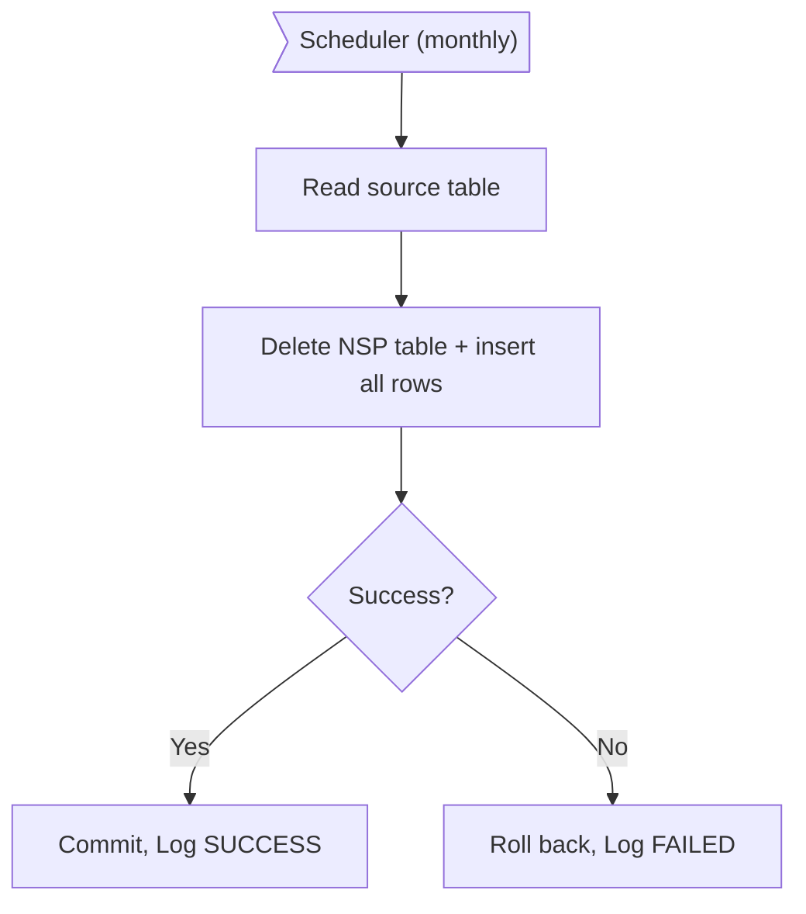
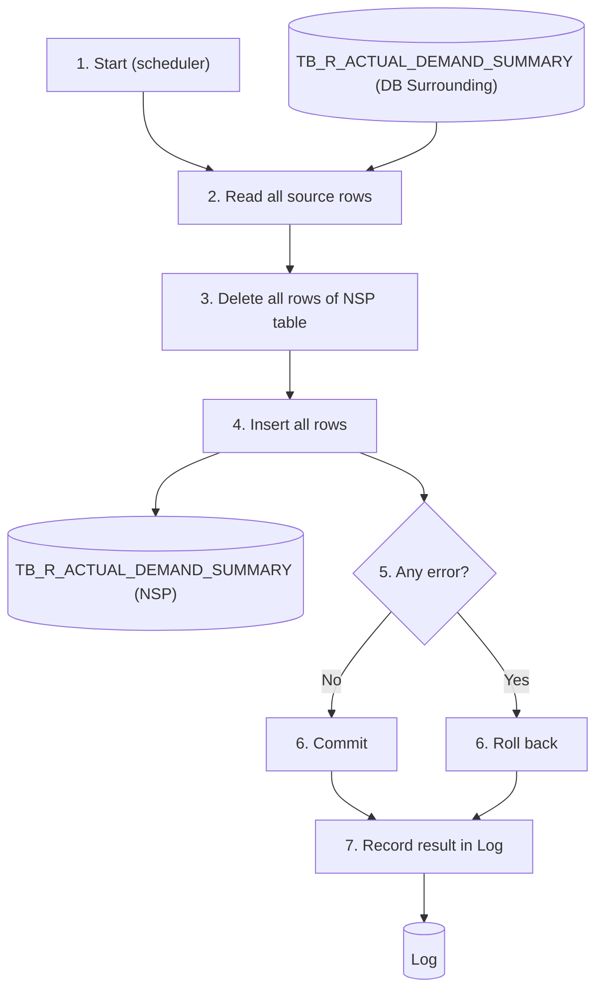

# XD04 – Actual Demand Summary Synch to NSP

> Generated from `deliverables/function_list_v2/specs/XD04_spec.json` (UISS `XD04_UISS_Batch_ActualDemandSummarySync.xlsx`). Do not edit by hand: change the spec and run `python3 prepare_code/build_md.py`. Document names: GTOPAS / NSP (prototype: G-System / Supplier System).

| Phase | Project | Block | Function | Created | By | Type |
|---|---|---|---|---|---|---|
| DR | Crossdock Optimization | Batch | XD04 Actual Demand Summary Synch to NSP | 18-Oct-26 | FID Rayhan | batch |

## Revision

| Rev | Author | Date | Reviewed by | Description |
|---|---|---|---|---|
| 0.1 | FID Rayhan | 18-Oct-26 |  | Initial Draft |

## 1. General

### Objective

- To replicate TB_R_ACTUAL_DEMAND_SUMMARY from DB Surrounding to the table with the same name in NSP, so the XD05 DAD Volume Calculation (process 1 and 2) read the actual demand inside NSP.
- The NSP table is fully replaced every run (delete - insert). In case any error occurs, the run is rolled back and NSP keeps the data of the last successful run.
- All columns are replicated as they are, including DAD (not used by the calculation) (decided 19-Oct).

### Operation flow

### Input

| Name | Type | Description |
|---|---|---|
| TB_R_ACTUAL_DEMAND_SUMMARY (DB Surrounding) | DB | All rows of the actual demand summary |

### Output

| Name | Type | Description |
|---|---|---|
| TB_R_ACTUAL_DEMAND_SUMMARY (NSP) | DB | if successful: same rows as the source (delete - insert) |
| Log | DB | One record per run with status SUCCESS / FAILED |

### Parameters

| Name | Description |
|---|---|
| - | No parameter. All rows of the source table are copied. |

### Execution Schedule

| Item | Description |
|---|---|
| Trigger | Monthly scheduler (set in the system master; not detailed in this document). |
| Order | Runs before XD05. A failure of XD04 does not stop XD05 (decided 19-Oct). |

## 2. Function flow

1. The scheduler starts the batch (monthly, set in the system master).
2. Read all rows of TB_R_ACTUAL_DEMAND_SUMMARY (DB Surrounding).
3. Delete all rows of TB_R_ACTUAL_DEMAND_SUMMARY (NSP).
4. Insert every source row with the same column values (see Data Map).
5. Check whether any error occurred during steps 2 to 4.
6. No error: commit. Error: roll back steps 3 and 4.
  - Delete and insert run in one transaction, so a failed run never leaves the NSP table empty or half filled.
7. Record the result (SUCCESS / FAILED, row count, error message) in the Log. Exit.

## 3. Data edit mapping

#### 1. Delete TB_R_ACTUAL_DEMAND_SUMMARY (NSP) – All rows (full replace)
- Source: TB_R_ACTUAL_DEMAND_SUMMARY (NSP)

| Source field | Destination field | Description |
|---|---|---|
|  | GROUPING_BUYER_CD | Row is deleted |
|  | GROUPING_PD_CD | Row is deleted |
|  | ORDER_TYPE_GROUP | Row is deleted |
|  | DEMAND_MONTH_YEAR | Row is deleted |
|  | PART_NO | Row is deleted |
|  | MAD | Row is deleted |
|  | DAD | Row is deleted |
|  | CREATE_DT | Row is deleted |
|  | CREATE_BY | Row is deleted |
|  | UPDATE_DT | Row is deleted |
|  | UPDATE_BY | Row is deleted |
|  | N01_QTY | Row is deleted |
|  | N02_QTY | Row is deleted |
|  | N03_QTY | Row is deleted |
|  | N04_QTY | Row is deleted |
|  | N05_QTY | Row is deleted |
|  | N06_QTY | Row is deleted |
|  | NUM_OF_OLD_PART_NO | Row is deleted |
|  | NUM_OF_WORKINGDAY_6M | Row is deleted |
|  | EM_MS_FLAG | Row is deleted |

#### 2. Insert TB_R_ACTUAL_DEMAND_SUMMARY (NSP) – Every source row
- Source: TB_R_ACTUAL_DEMAND_SUMMARY (DB Surrounding)

| Source field | Destination field | Description |
|---|---|---|
| GROUPING_BUYER_CD | GROUPING_BUYER_CD | Same value as the source |
| GROUPING_PD_CD | GROUPING_PD_CD | Same value as the source |
| ORDER_TYPE_GROUP | ORDER_TYPE_GROUP | Same value as the source |
| DEMAND_MONTH_YEAR | DEMAND_MONTH_YEAR | Same value as the source |
| PART_NO | PART_NO | Same value as the source |
| MAD | MAD | Same value as the source |
| DAD | DAD | Same value as the source |
| CREATE_DT | CREATE_DT | Same value as the source |
| CREATE_BY | CREATE_BY | Same value as the source |
| UPDATE_DT | UPDATE_DT | Same value as the source |
| UPDATE_BY | UPDATE_BY | Same value as the source |
| N01_QTY | N01_QTY | Same value as the source |
| N02_QTY | N02_QTY | Same value as the source |
| N03_QTY | N03_QTY | Same value as the source |
| N04_QTY | N04_QTY | Same value as the source |
| N05_QTY | N05_QTY | Same value as the source |
| N06_QTY | N06_QTY | Same value as the source |
| NUM_OF_OLD_PART_NO | NUM_OF_OLD_PART_NO | Same value as the source |
| NUM_OF_WORKINGDAY_6M | NUM_OF_WORKINGDAY_6M | Same value as the source |
| EM_MS_FLAG | EM_MS_FLAG | Same value as the source |

#### 3. Insert Log – One record per run
- Source: Result of this run

| Source field | Destination field | Description |
|---|---|---|
|  | BATCH_ID | 'ADS_SYNC' |
|  | STATUS | SUCCESS / FAILED |
|  | ROW_COUNT | Rows inserted (0 when FAILED) |
|  | MESSAGE | Error message when FAILED |
|  | START_DT | Start date and time |
|  | END_DT | End date and time |

## 4. Function description

This batch copies the actual demand summary from DB Surrounding into NSP once a month. Range of months and schedule are set in the system master (not explained in this document).

- Full replace: all rows of the NSP table are deleted and all source rows are inserted (delete - insert). No row is compared or merged.
- All columns are copied with the same names and values; no conversion is done.
- Delete and insert run in one transaction (all-or-nothing). When the run fails, NSP keeps the data of the last successful run.
- The batch must finish before the DAD Volume Calculation starts.

### Columns used by Crossdock

| Column | Used by |
|---|---|
| GROUPING_BUYER_CD + GROUPING_PD_CD | XD05 process 2 (mapping destination) (7-digit destination code) |
| ORDER_TYPE_GROUP | N and S are summed |
| DEMAND_MONTH_YEAR | Range of months (system master) |
| PART_NO | Join to TB_M_PART_CANDIDATE |
| MAD | XD05 DAD Volume Calculation (process 1 and 2) |

## 5. Logging messages

| ID | Event | Cause | Type | Message | Action |
|---|---|---|---|---|---|
| LOG1 | Batch start | Batch is called | Info | Actual demand summary sync started. | system: Write the log.; user: - |
| LOG2 | Batch end | Batch finishes | Info | Actual demand summary sync ended. Status <STATUS>, rows <ROW_COUNT>. | system: Write the log.; user: - |
| LOG3 | Read source | DB Surrounding cannot be reached or read | Error | Cannot read TB_R_ACTUAL_DEMAND_SUMMARY from DB Surrounding: <ERROR_DETAIL>. | system: Roll back. STATUS = FAILED.; user: User contact PIC |
| LOG4 | Insert | Insert into the NSP table fails | Error | Cannot insert TB_R_ACTUAL_DEMAND_SUMMARY into NSP: <ERROR_DETAIL>. | system: Roll back. STATUS = FAILED.; user: User contact PIC |
| LOG5 | Unexpected error | Any other system error | Critical | Unexpected error: <ERROR_DETAIL>. | system: Roll back. STATUS = FAILED.; user: User contact PIC |

## 6. Appendix

Sample rows and scenarios: see sheet Sample Input.

## 7. Tables

#### TB_R_ACTUAL_DEMAND_SUMMARY (transaction, existing)
Actual demand summary replicated from DB Surrounding to NSP (same columns). Key (PK) proposed from the data; types follow the source table.

| Column | Type | PK | Null | Description |
|---|---|---|---|---|
| GROUPING_BUYER_CD | VARCHAR(5) | Y | N | Grouping buyer code, e.g. 9722D. With GROUPING_PD_CD it forms the 7-digit destination code |
| GROUPING_PD_CD | VARCHAR(2) | Y | N | Grouping PD code, e.g. 10 |
| ORDER_TYPE_GROUP | CHAR(1) | Y | N | Order type group: N / S (both are summed by Crossdock) |
| DEMAND_MONTH_YEAR | CHAR(6) | Y | N | Demand month YYYYMM, e.g. 202604 |
| PART_NO | VARCHAR(TBD) | Y | N | Part number |
| MAD | NUMBER(TBD,2) |  | Y | Monthly average demand of the row; used by Crossdock |
| DAD | NUMBER(TBD,2) |  | Y | Daily average demand (not used by Crossdock) |
| CREATE_DT | TIMESTAMP |  | Y | Created date and time (from source) |
| CREATE_BY | VARCHAR(TBD) |  | Y | Created by (from source) |
| UPDATE_DT | TIMESTAMP |  | Y | Updated date and time (from source) |
| UPDATE_BY | VARCHAR(TBD) |  | Y | Updated by (from source) |
| N01_QTY | NUMBER |  | Y | Quantity month N-1 (not used by Crossdock) |
| N02_QTY | NUMBER |  | Y | Quantity month N-2 (not used by Crossdock) |
| N03_QTY | NUMBER |  | Y | Quantity month N-3 (not used by Crossdock) |
| N04_QTY | NUMBER |  | Y | Quantity month N-4 (not used by Crossdock) |
| N05_QTY | NUMBER |  | Y | Quantity month N-5 (not used by Crossdock) |
| N06_QTY | NUMBER |  | Y | Quantity month N-6 (not used by Crossdock) |
| NUM_OF_OLD_PART_NO | NUMBER |  | Y | Number of old part numbers (not used by Crossdock) |
| NUM_OF_WORKINGDAY_6M | NUMBER |  | Y | Working days in 6 months (not used by Crossdock) |
| EM_MS_FLAG | CHAR(1) |  | Y | EM / MS flag (not used by Crossdock) |

## Sample Input

**Sample data - Actual Demand Summary Sync to NSP**

- Rows taken from the reference file 20261013_tb_r_actual_demand_summary_since_january-2026.xlsx (part 52119BZV60).
- The batch copies every row of the source table; the NSP table is emptied first (delete - insert).

### A. Source rows in DB Surrounding (excerpt)

| GROUPING_BUYER_CD | GROUPING_PD_CD | ORDER_TYPE_GROUP | DEMAND_MONTH_YEAR | PART_NO | MAD | DAD |
|---|---|---|---|---|---|---|
| 9722D | 10 | N | 202604 | 52119BZV60 | 239 | - |
| 98111 | 10 | N | 202604 | 52119BZV60 | 156.17 | - |
| 96182 | 01 | N | 202604 | 52119BZV60 | 77.33 | - |
| 97153 | 10 | N | 202604 | 52119BZV60 | 23.17 | - |
| 98111 | 10 | S | 202604 | 52119BZV60 | 2 | - |
| 9722D | 10 | S | 202604 | 52119BZV60 | 1 | - |

### B. Scenarios

| No | Scenario | Expected result |
|---|---|---|
| N1 | Monthly run, source has 349,225 rows | NSP table emptied, 349,225 rows inserted. Log STATUS = SUCCESS. |
| N2 | A row was deleted in the source since the last run | The row no longer exists in NSP (full replace). |
| E1 | DB Surrounding cannot be reached | Rolled back: NSP keeps the data of the last successful run. Log STATUS = FAILED. |
| E2 | Insert fails in the middle of the run | Rolled back (delete and insert in one transaction). Log STATUS = FAILED. |
