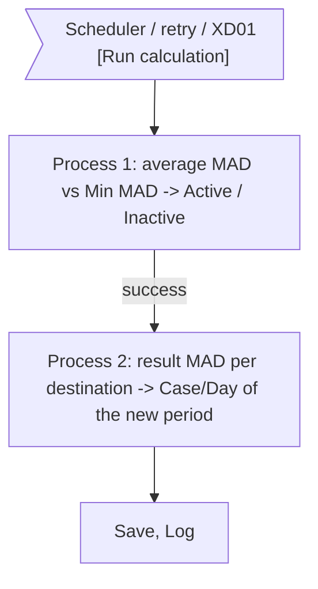
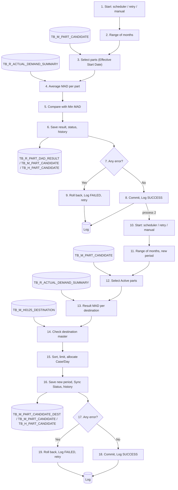

# XD05 – DAD Volume Calculation Batch

> Generated from `deliverables/function_list_v2/specs/XD05_spec.json` (UISS `XD05_UISS_Batch_DADVolumeCalculation.xlsx`). Do not edit by hand: change the spec and run `python3 prepare_code/build_md.py`. Document names: GTOPAS / NSP (prototype: G-System / Supplier System).

| Phase | Project | Block | Function | Created | By | Type |
|---|---|---|---|---|---|---|
| DR | Crossdock Optimization | Batch | XD05 DAD Volume Calculation Batch | 18-Oct-26 | FID Rayhan | batch |

## Revision

| Rev | Author | Date | Reviewed by | Description |
|---|---|---|---|---|
| 0.1 | FID Rayhan | 18-Oct-26 |  | Initial Draft |

## 1. General

### Objective

- Process 1: To calculate the average MAD of every crossdock part over the range of months set in the system master and to set the part status in TB_M_PART_CANDIDATE: Active when the average MAD is equal to or above Min MAD, Inactive when it is below.
- Process 2: To create the new calculation period of Mapping per Destination and split the Max Case/Day of every Active part over its destinations in proportion to the actual demand (MAD) of each destination (buyer code + PD code) over the range of months set in the system master.
- Each process is all-or-nothing and is retried automatically up to 3 times; after that it can be started manually from the Cross Dock Part Master screen (XD01).

### Operation flow

### Input

| Name | Type | Description |
|---|---|---|
| TB_R_ACTUAL_DEMAND_SUMMARY (NSP) | DB | MAD per part, buyer code, PD code, order type and month (replicated by the Actual Demand Summary Sync) |
| TB_M_PART_CANDIDATE | DB | Registered parts: Min MAD, Effective Start Date and current status |
| System master | DB | Range of months and schedule (not explained in this document) |
| TB_M_H0125_DESTINATION (Destination Master) | DB | Valid 7-digit destination codes |
| TB_M_PART_CANDIDATE_DEST | DB | Mapping of the previous period (to detect changes) |

### Output

| Name | Type | Description |
|---|---|---|
| TB_R_PART_DAD_RESULT | DB | if successful: average MAD and calculated status of every calculated part |
| TB_M_PART_CANDIDATE | DB | if successful: PART_STATUS of the parts whose status changes |
| TB_H_PART_CANDIDATE | DB | if successful: history record per status change (event CALC, source BATCH) |
| Log | DB | One record per run attempt (SUCCESS / FAILED); last success date |
| TB_M_PART_CANDIDATE_DEST | DB | if successful: mapping of the new period (run month) |

### Parameters

| Name | Description |
|---|---|
| Range of months (N) | Number of months before the run month, from the system master (e.g. 6) |
| Run month | Month of the run date, YYYYMM; = calculation period |
| User | Batch user ID (scheduler / retry) or login user (manual trigger) |
| New period | Run month YYYYMM (e.g. 202610) |

### Grouping Keys

| Field Name |
|---|
| PART_NO (process 1 and 2) |
| GROUPING_BUYER_CD + GROUPING_PD_CD (process 2) |

### Execution Schedule

| Item | Description |
|---|---|
| Trigger | Monthly scheduler (set in the system master; not detailed in this document). One run = process 1, then process 2. |
| Auto retry | A failed process is retried automatically up to 3 times; process 2 starts only after process 1 has succeeded. |
| Manual trigger | [Run calculation (Part List)] on XD01 runs process 1 and then process 2; [Run calculation (Mapping)] on XD01 runs process 2 only. Each button is enabled only when its process and the 3 retries have failed. |
| Last success date | One date per process in the Log; process 1 shown on the Part List tab, process 2 on the Mapping per Destination tab. |
| Order | Runs after XD04. If XD04 failed, XD05 still runs (with the actual demand data available in NSP) (decided 19-Oct). |

## 2. Function flow

1. Process 1 (part status) starts from the scheduler, an automatic retry, or [Run calculation (Part List)] on XD01.
2. Get the range of months N from the system master.
  - MONTH_TO = month before the run month; MONTH_FROM = N months back. Example: run in Oct 2026, N = 6 -> 202604 to 202609.
3. Select every part of TB_M_PART_CANDIDATE (Candidate, Active and Inactive).
  - Skip a part whose EFFECTIVE_START_DATE is after the run date (not calculated yet).
4. For each selected part, read TB_R_ACTUAL_DEMAND_SUMMARY rows of the part within the range and calculate (see 4.1):
  - TOTAL_MAD = sum of MAD of all buyer code / PD code / order type (N + S) rows in the range.
  - AVG_MAD = TOTAL_MAD / N. The divisor is always N; a month without data counts as 0.
5. Compare AVG_MAD with MIN_MAD of the part (see 4.2):
  - AVG_MAD >= MIN_MAD -> Active.
  - AVG_MAD < MIN_MAD -> Inactive.
6. Save (see 4.3):
  - Insert one result record per calculated part into TB_R_PART_DAD_RESULT.
  - When the calculated status differs from the current one: update PART_STATUS in TB_M_PART_CANDIDATE and insert a history record (event CALC, source BATCH).
7. Check whether any error occurred during steps 2 to 6.
8. No error: commit process 1, record SUCCESS of process 1 in the Log (END_DT = last success date). Continue with step 10 (process 2).
9. Error: roll back process 1, record FAILED in the Log; process 2 is not started.
  - The scheduler retries automatically up to 3 times. After the 3rd failed retry, [Run calculation (Part List)] is enabled on XD01. Exit.
10. Process 2 (destination mapping) starts after process 1 has succeeded, from an automatic retry of process 2, or [Run calculation (Mapping)] on XD01 (process 2 only). It uses the part status just set by process 1.
11. Get the range of months N from the system master; the new period = run month.
  - Example: run in Oct 2026, N = 6 -> months 202604 to 202609, new period 202610.
12. Select every part of TB_M_PART_CANDIDATE with PART_STATUS = Active.
13. For each part, read TB_R_ACTUAL_DEMAND_SUMMARY rows within the range and group them by GROUPING_BUYER_CD + GROUPING_PD_CD:
  - Destination code = GROUPING_BUYER_CD + GROUPING_PD_CD (7 digits, e.g. 9722D + 10 = 9722D10).
  - Result MAD = sum of MAD of the group (order types N + S). Groups with result MAD 0 are not used.
  - A part without any result MAD gets no destination (listed with Total Case/Day 0 on the screen).
14. Check every destination code in TB_M_H0125_DESTINATION (DESTINATION_CD).
  - Not found: error -> go to step 19 (all-or-nothing).
15. Allocate Case/Day per part (see 4.6):
  - Sort the destinations by result MAD, largest first, and keep at most Max Case/Day destinations.
  - Target = result MAD / sum of result MAD of the kept destinations x Max Case/Day.
  - Round down with a minimum of 1; adjust so the total equals Max Case/Day.
16. Save the new period in TB_M_PART_CANDIDATE_DEST (see 4.7):
  - Delete the rows of the new period if they exist (manual re-run), then insert the calculated rows.
  - A part whose mapping differs from the previous period: SYNC_STATUS = 0 (No Sync) and a history record per added / changed / removed destination (event MAPPING, source BATCH).
17. Check whether any error occurred during steps 11 to 16.
18. No error: commit, record SUCCESS in the Log (END_DT = last success date). The new period becomes the ongoing period; the previous period becomes past (read only). Exit.
19. Error: roll back process 2, record FAILED of process 2 in the Log.
  - The scheduler retries process 2 automatically up to 3 times. After the 3rd failed retry, [Run calculation (Mapping)] is enabled on XD01. Process 1 stays committed. Exit.

## 3. Data edit mapping

#### 1. Insert TB_R_PART_DAD_RESULT – Process 1: Every calculated part
- Source: TB_R_ACTUAL_DEMAND_SUMMARY (keys: PART_NO = Selected part, DEMAND_MONTH_YEAR = MONTH_FROM to MONTH_TO)

| Source field | Destination field | Description |
|---|---|---|
|  | PERIOD | Run month YYYYMM |
| PART_NO | PART_NO |  |
|  | MONTH_FROM | First month of the range |
|  | MONTH_TO | Month before the run month |
|  | NUM_OF_MONTH | N (system master) |
| MAD | TOTAL_MAD | SUM(MAD) of the part within the range (all buyer / PD / order type rows) |
|  | AVG_MAD | TOTAL_MAD / NUM_OF_MONTH (2 decimals) |
|  | MIN_MAD | TB_M_PART_CANDIDATE.MIN_MAD |
|  | OLD_STATUS | TB_M_PART_CANDIDATE.PART_STATUS before the run |
|  | NEW_STATUS | 'Active' if AVG_MAD >= MIN_MAD, otherwise 'Inactive' |
|  | CREATED_BY | Batch user ID (login user when manual) |
|  | CREATED_DT | Server system date and time |

#### 2. Update TB_M_PART_CANDIDATE – Process 1: Parts whose status changes
- Source: TB_R_PART_DAD_RESULT (keys: NEW_STATUS = <> OLD_STATUS)
- Destination keys: PART_NO = Calculated part

| Source field | Destination field | Description |
|---|---|---|
|  | PART_NO | Key, not changed |
|  | PART_NAME | Not changed |
|  | MIN_MAD | Not changed |
|  | PCS_CASE | Not changed |
|  | MAX_CASE_DAY | Not changed |
|  | TOTAL_PCS_DAY | Not changed |
|  | EFFECTIVE_START_DATE | Not changed |
| NEW_STATUS | PART_STATUS | Active / Inactive |
|  | SYNC_STATUS | Not changed (a status change does not need a new Sync) |
|  | SYNC_DT | Not changed |
|  | SYNC_MESSAGE | Not changed |
|  | LAST_SOURCE | Set 'CALC' |
|  | LAST_UPLOAD_ID | Not changed |
|  | CREATED_BY | Not changed |
|  | CREATED_DT | Not changed |
|  | CHANGED_BY | Batch user ID (login user when manual) |
|  | CHANGED_DT | Server system date and time |

#### 3. Insert TB_H_PART_CANDIDATE – Process 1: Status change - history
- Source: TB_R_PART_DAD_RESULT (keys: NEW_STATUS = <> OLD_STATUS)

| Source field | Destination field | Description |
|---|---|---|
|  | HIST_ID | Auto (identity) |
|  | PART_NO | Part of the event |
|  | PERIOD | Run month YYYYMM |
|  | EVENT_TYPE | 'CALC' |
|  | SOURCE | 'BATCH' |
|  | UPLOAD_ID | NULL |
|  | DEST_CODE | NULL |
|  | FIELD_NAME | 'PART_STATUS' |
|  | OLD_VALUE | OLD_STATUS |
|  | NEW_VALUE | NEW_STATUS |
|  | REMARK | 'Average MAD <AVG_MAD> vs Min MAD <MIN_MAD>' |
|  | CREATED_BY | Batch user ID (login user when manual) |
|  | CREATED_DT | Server system date and time |

#### 4. Insert Log – Process 1: One record per run attempt
- Source: Result of this run

| Source field | Destination field | Description |
|---|---|---|
|  | BATCH_ID | 'DAD_CALC' |
|  | RUN_TYPE | SCHEDULE / RETRY / MANUAL |
|  | RETRY_NO | 0 for the scheduled run, 1-3 for the auto retries |
|  | STATUS | SUCCESS / FAILED |
|  | MESSAGE | Error message when FAILED |
|  | START_DT | Start date and time |
|  | END_DT | End date and time; END_DT of the latest SUCCESS = last success date |

#### 5. Delete TB_M_PART_CANDIDATE_DEST – Process 2: Rows of the new period, if any
- Source: TB_M_PART_CANDIDATE_DEST (keys: PERIOD = New period (manual re-run only))
- Destination keys: PERIOD = New period

| Source field | Destination field | Description |
|---|---|---|
|  | PART_NO | Row is deleted |
|  | PERIOD | Row is deleted |
|  | DEST_CODE | Row is deleted |
|  | CASE_DAY | Row is deleted |
|  | CREATED_BY | Row is deleted |
|  | CREATED_DT | Row is deleted |
|  | CHANGED_BY | Row is deleted |
|  | CHANGED_DT | Row is deleted |

#### 6. Insert TB_M_PART_CANDIDATE_DEST – Process 2: One row per kept destination
- Source: TB_R_ACTUAL_DEMAND_SUMMARY (keys: PART_NO = Active part, DEMAND_MONTH_YEAR = Range of months)

| Source field | Destination field | Description |
|---|---|---|
| PART_NO | PART_NO |  |
|  | PERIOD | New period (run month YYYYMM) |
| GROUPING_BUYER_CD + GROUPING_PD_CD | DEST_CODE | 7-digit destination code; must exist in TB_M_H0125_DESTINATION |
| MAD | CASE_DAY | Allocated Case/Day from SUM(MAD) of the destination (see 4.6) |
|  | CREATED_BY | Batch user ID (login user when manual) |
|  | CREATED_DT | Server system date and time |
|  | CHANGED_BY | Same as CREATED_BY |
|  | CHANGED_DT | Server system date and time |

#### 7. Update TB_M_PART_CANDIDATE – Process 2: Sync Status
- Source: Parts whose mapping differs from the previous period
- Destination keys: PART_NO = Changed part

| Source field | Destination field | Description |
|---|---|---|
|  | PART_NO | Key, not changed |
|  | PART_NAME | Not changed |
|  | MIN_MAD | Not changed |
|  | PCS_CASE | Not changed |
|  | MAX_CASE_DAY | Not changed |
|  | TOTAL_PCS_DAY | Not changed |
|  | EFFECTIVE_START_DATE | Not changed |
|  | PART_STATUS | Not changed |
|  | SYNC_STATUS | Set '0' (No Sync) |
|  | SYNC_DT | Not changed |
|  | SYNC_MESSAGE | Not changed |
|  | LAST_SOURCE | Set 'CALC' |
|  | LAST_UPLOAD_ID | Not changed |
|  | CREATED_BY | Not changed |
|  | CREATED_DT | Not changed |
|  | CHANGED_BY | Batch user ID (login user when manual) |
|  | CHANGED_DT | Server system date and time |

#### 8. Insert TB_H_PART_CANDIDATE – Process 2: Mapping change - history
- Source: Parts whose mapping differs from the previous period

| Source field | Destination field | Description |
|---|---|---|
|  | HIST_ID | Auto (identity) |
|  | PART_NO | Part of the event |
|  | PERIOD | New period |
|  | EVENT_TYPE | 'MAPPING' |
|  | SOURCE | 'BATCH' |
|  | UPLOAD_ID | NULL |
|  | DEST_CODE | Destination added, changed or removed |
|  | FIELD_NAME | 'CASE_DAY' |
|  | OLD_VALUE | Case/Day of the previous period (NULL when added) |
|  | NEW_VALUE | Calculated Case/Day (NULL when removed) |
|  | REMARK | NULL |
|  | CREATED_BY | Batch user ID (login user when manual) |
|  | CREATED_DT | Server system date and time |

#### 9. Insert Log – Process 2: One record per run attempt
- Source: Result of this run

| Source field | Destination field | Description |
|---|---|---|
|  | BATCH_ID | 'MAPPING_CALC' |
|  | RUN_TYPE | SCHEDULE / RETRY / MANUAL |
|  | RETRY_NO | 0 for the scheduled run, 1-3 for the auto retries |
|  | STATUS | SUCCESS / FAILED |
|  | MESSAGE | Error message when FAILED |
|  | START_DT | Start date and time |
|  | END_DT | End date and time; END_DT of the latest SUCCESS = last success date |

## 4. Function description

One batch with two processes run in sequence: process 1 sets the part status from the average MAD (4.1 - 4.4); process 2 creates the destination mapping of the new period for the Active parts (4.5 - 4.8). Range of months and schedule are set in the system master (not explained in this document).

### 4.1 Process 1 - Average MAD

- Range: the N months before the run month (N from the system master). Example: run in Oct 2026 with N = 6 -> 202604 to 202609.
- Monthly MAD of a part = sum of MAD of all its rows in that month (all buyer codes, PD codes and order types N + S).
- AVG_MAD = total MAD of the range / N. The divisor is always N, whatever the data: a month without data counts as 0.
- A part without any demand row in the range gets AVG_MAD = 0.
- AVG_MAD is kept with 2 decimals and compared as it is (no rounding).

### 4.2 Process 1 - Status Rule

| Condition | New status |
|---|---|
| AVG_MAD >= MIN_MAD | Active |
| AVG_MAD < MIN_MAD | Inactive |

- Possible changes: Candidate -> Active / Inactive, Inactive -> Active, Active -> Inactive.
- Parts whose EFFECTIVE_START_DATE is after the run date are not calculated.
- The batch may overwrite a status changed manually by the user. The user may still change the status again afterwards by screen or upload.

### 4.3 Process 1 - Saving

- One record per calculated part is inserted into TB_R_PART_DAD_RESULT (also when the status does not change).
- Only parts whose status changes are updated in TB_M_PART_CANDIDATE (PART_STATUS, LAST_SOURCE = CALC, CHANGED_BY / CHANGED_DT) and get a history record (event CALC, source BATCH).
- SYNC_STATUS: a part that changes from Active to Inactive gets SYNC_STATUS = 0 (No Sync), so the next [Sync] sends it to GTOPAS and AP POLE with CROSSDOCK_FLAG 'N' (decided 19-Oct). Other status changes do not change SYNC_STATUS.
- All-or-nothing: any error rolls back the whole run.

### 4.4 Process 1 - Retry and Manual Trigger

- A failed run is retried automatically up to 3 times by the scheduler (RUN_TYPE = RETRY, RETRY_NO 1-3 in the Log).
- After the 3rd failed retry, [Run calculation] is enabled on the Part List tab of XD01 (RUN_TYPE = MANUAL).
- The last success date (END_DT of the latest SUCCESS record in the Log) is shown on the Part List tab of XD01.

### 4.5 Process 2 - Destinations and Result MAD

- Only Active parts of TB_M_PART_CANDIDATE are calculated.
- Range: the N months before the run month (N from the system master).
- Destination code = GROUPING_BUYER_CD + GROUPING_PD_CD (7 digits). It must exist in TB_M_H0125_DESTINATION; otherwise the run fails (all-or-nothing).
- Result MAD = sum of MAD of the part for that destination within the range; order types N and S are summed. Destinations with result MAD 0 are not used.

### 4.6 Process 2 - Case/Day Allocation

1. Sort the destinations of the part by result MAD, largest first.
2. Keep at most Max Case/Day destinations (the ones with the largest result MAD); the others are not mapped.
3. Target = result MAD / sum of result MAD of the kept destinations x Max Case/Day. Same as the corrected formula of the simulation file: P10 / SUM(P10:P13) x N10 with fixed ranges.
4. Case/Day = target rounded down, with a minimum of 1 per destination.
5. While the total is below Max Case/Day: +1 to the destination with the largest fraction (equal fraction: higher result MAD first).
6. While the total is above Max Case/Day (because of the minimum 1): -1 from the destination with the smallest fraction that still has more than 1 case.
7. Result: every kept destination has at least 1 case and the total equals Max Case/Day.

### 4.7 Process 2 - Saving

- The new period = run month. On a manual re-run in the same month, the rows of that period are replaced.
- After a successful run the new period is the ongoing period; the previous period becomes past (read only).
- Each part is compared with its mapping of the previous period. When destinations or Case/Day differ: SYNC_STATUS = 0 (No Sync), LAST_SOURCE = CALC, and a history record per added / changed / removed destination (event MAPPING, source BATCH). When equal: no update and no history.
- An Active part without result MAD has no row in the new period; the D/S user assigns it on the screen or by upload.
- All-or-nothing: any error rolls back the whole run; the previous period stays the ongoing period.

### 4.8 Process 2 - Retry and Manual Trigger

- The batch has its own scheduler (system master). A failed run is retried automatically up to 3 times (RUN_TYPE = RETRY, RETRY_NO 1-3 in the Log).
- After the 3rd failed retry, [Run calculation] is enabled on the Mapping per Destination tab of XD01 (RUN_TYPE = MANUAL).
- The last success date (END_DT of the latest SUCCESS record in the Log) is shown on the Mapping per Destination tab of XD01.

## 5. Logging messages

| ID | Event | Cause | Type | Message | Action |
|---|---|---|---|---|---|
| LOG1 | Process 1: Batch start | Batch is called | Info | DAD volume calculation started (<RUN_TYPE>, retry <RETRY_NO>). Range <MONTH_FROM> - <MONTH_TO>. | system: Write the log.; user: - |
| LOG2 | Process 1: Batch end | Batch finishes | Info | DAD volume calculation ended. Status <STATUS>, calculated <COUNT>, status changed <CHANGED>. | system: Write the log.; user: - |
| LOG3 | Process 1: Range of months | Range is not set in the system master | Error | Range of months for the DAD volume calculation is not set. | system: Stop. STATUS = FAILED.; user: User contact PIC |
| LOG4 | Process 1: Part skipped | Effective Start Date after the run date | Info | Part No <PART_NO> skipped: effective start date <DATE>. | system: Continue.; user: - |
| LOG5 | Process 1: Save | Insert / update fails | Error | Cannot save the calculation of Part No <PART_NO>: <ERROR_DETAIL>. | system: Roll back. STATUS = FAILED. Retry.; user: User contact PIC |
| LOG6 | Process 1: Retry exhausted | Scheduled run and 3 retries failed | Warning | DAD volume calculation failed 3 times. Manual run is enabled on Part List. | system: Enable [Run calculation] on Part List.; user: Check the cause, then click [Run calculation]. |
| LOG7 | Process 1: Unexpected error | Any other system error | Critical | Unexpected error: <ERROR_DETAIL>. | system: Roll back. STATUS = FAILED. Retry.; user: User contact PIC |
| LOG8 | Process 2: Batch start | Batch is called | Info | Mapping destination calculation started (<RUN_TYPE>, retry <RETRY_NO>). Period <PERIOD>, range <MONTH_FROM> - <MONTH_TO>. | system: Write the log.; user: - |
| LOG9 | Process 2: Batch end | Batch finishes | Info | Mapping destination calculation ended. Status <STATUS>, parts <COUNT>, mapping changed <CHANGED>. | system: Write the log.; user: - |
| LOG10 | Process 2: Range of months | Range is not set in the system master | Error | Range of months for the mapping destination calculation is not set. | system: Stop. STATUS = FAILED.; user: User contact PIC |
| LOG11 | Process 2: Destination check | Destination code not in TB_M_H0125_DESTINATION | Error | Destination code <DEST_CODE> of Part No <PART_NO> not found in TB_M_H0125_DESTINATION. | system: Roll back. STATUS = FAILED. Retry.; user: Register the destination in TB_M_H0125_DESTINATION, then run again. |
| LOG12 | Process 2: Destinations limited | More destinations than Max Case/Day | Info | Part No <PART_NO>: <COUNT> destinations, limited to Max Case/Day <MAX>. | system: Continue.; user: - |
| LOG13 | Process 2: Save | Insert / update fails | Error | Cannot save the mapping of Part No <PART_NO>, period <PERIOD>: <ERROR_DETAIL>. | system: Roll back. STATUS = FAILED. Retry.; user: User contact PIC |
| LOG14 | Process 2: Retry exhausted | Scheduled run and 3 retries failed | Warning | Mapping destination calculation failed 3 times. Manual run is enabled on Mapping per Destination. | system: Enable [Run calculation] on Mapping per Destination.; user: Check the cause, then click [Run calculation]. |
| LOG15 | Process 2: Unexpected error | Any other system error | Critical | Unexpected error: <ERROR_DETAIL>. | system: Roll back. STATUS = FAILED. Retry.; user: User contact PIC |

## 6. Appendix

Calculation examples (process 1 and process 2), rounding and limit examples: see sheet Sample Input.

## 7. Tables

#### TB_R_PART_DAD_RESULT (transaction, proposed)
Result of the DAD Volume Calculation, one record per calculated part and period. Name and columns proposed.

| Column | Type | PK | Null | Description |
|---|---|---|---|---|
| PERIOD | CHAR(6) | Y | N | Calculation period YYYYMM (month of the run) |
| PART_NO | VARCHAR(TBD) | Y | N | Part number |
| MONTH_FROM | CHAR(6) |  | N | First month of the range, YYYYMM |
| MONTH_TO | CHAR(6) |  | N | Last month of the range, YYYYMM |
| NUM_OF_MONTH | INT |  | N | Number of months of the range (divisor of the average) |
| TOTAL_MAD | NUMBER(TBD,2) |  | N | Sum of MAD of the part over the range |
| AVG_MAD | NUMBER(TBD,2) |  | N | TOTAL_MAD / NUM_OF_MONTH |
| MIN_MAD | INT |  | N | Min MAD of the part at calculation time (snapshot) |
| OLD_STATUS | VARCHAR(TBD) |  | N | Part status before the calculation |
| NEW_STATUS | VARCHAR(TBD) |  | N | Active (AVG_MAD >= MIN_MAD) / Inactive (AVG_MAD < MIN_MAD) |
| CREATED_BY | VARCHAR(TBD) |  | N | Batch user ID |
| CREATED_DT | DATETIME |  | N | Date and time of the calculation |

#### TB_M_PART_CANDIDATE (transaction, existing)
Candidate part setting, one record per part (Part List data, no calculation period).

| Column | Type | PK | Null | Description |
|---|---|---|---|---|
| PART_NO | VARCHAR(TBD) | Y | N | Part number; length follows TB_M_PART_MASTER |
| PART_NAME | VARCHAR(TBD) |  | N | Retrieved from TB_M_PART_MASTER by PART_NO |
| MIN_MAD | INT |  | N | Minimum MAD (mandatory); reference compared with the average MAD of the DAD Volume Calculation |
| PCS_CASE | INT |  | N | Pieces per case (> 0) |
| MAX_CASE_DAY | INT |  | N | Total Case/Day of the part (> 0); limit of the mapping |
| TOTAL_PCS_DAY | INT |  | N | PCS_CASE x MAX_CASE_DAY |
| EFFECTIVE_START_DATE | DATE |  | Y | Effective start date; a part is calculated only from this date |
| PART_STATUS | VARCHAR(TBD) |  | N | Candidate / Active / Inactive |
| SYNC_STATUS | CHAR(1) |  | N | 0 = No Sync, 3 = Waiting, 1 = Success, 2 = Failed |
| SYNC_DT | DATETIME |  | Y | Date-time of the last IF function result |
| SYNC_MESSAGE | VARCHAR(TBD) |  | Y | Reason of the last Failed sync |
| LAST_SOURCE | VARCHAR(TBD) |  | N | CALC / SCREEN / UPLOAD |
| LAST_UPLOAD_ID | VARCHAR(TBD) |  | Y | Upload that last changed the record |
| CREATED_BY | VARCHAR(TBD) |  | N | User who created the record |
| CREATED_DT | DATETIME |  | N | Created date and time |
| CHANGED_BY | VARCHAR(TBD) |  | N | User who last changed the record |
| CHANGED_DT | DATETIME |  | N | Last changed date and time |

#### TB_R_ACTUAL_DEMAND_SUMMARY (transaction, existing)
Actual demand summary replicated from DB Surrounding to NSP (same columns). Key (PK) proposed from the data; types follow the source table.

| Column | Type | PK | Null | Description |
|---|---|---|---|---|
| GROUPING_BUYER_CD | VARCHAR(5) | Y | N | Grouping buyer code, e.g. 9722D. With GROUPING_PD_CD it forms the 7-digit destination code |
| GROUPING_PD_CD | VARCHAR(2) | Y | N | Grouping PD code, e.g. 10 |
| ORDER_TYPE_GROUP | CHAR(1) | Y | N | Order type group: N / S (both are summed by Crossdock) |
| DEMAND_MONTH_YEAR | CHAR(6) | Y | N | Demand month YYYYMM, e.g. 202604 |
| PART_NO | VARCHAR(TBD) | Y | N | Part number |
| MAD | NUMBER(TBD,2) |  | Y | Monthly average demand of the row; used by Crossdock |
| DAD | NUMBER(TBD,2) |  | Y | Daily average demand (not used by Crossdock) |
| CREATE_DT | TIMESTAMP |  | Y | Created date and time (from source) |
| CREATE_BY | VARCHAR(TBD) |  | Y | Created by (from source) |
| UPDATE_DT | TIMESTAMP |  | Y | Updated date and time (from source) |
| UPDATE_BY | VARCHAR(TBD) |  | Y | Updated by (from source) |
| N01_QTY | NUMBER |  | Y | Quantity month N-1 (not used by Crossdock) |
| N02_QTY | NUMBER |  | Y | Quantity month N-2 (not used by Crossdock) |
| N03_QTY | NUMBER |  | Y | Quantity month N-3 (not used by Crossdock) |
| N04_QTY | NUMBER |  | Y | Quantity month N-4 (not used by Crossdock) |
| N05_QTY | NUMBER |  | Y | Quantity month N-5 (not used by Crossdock) |
| N06_QTY | NUMBER |  | Y | Quantity month N-6 (not used by Crossdock) |
| NUM_OF_OLD_PART_NO | NUMBER |  | Y | Number of old part numbers (not used by Crossdock) |
| NUM_OF_WORKINGDAY_6M | NUMBER |  | Y | Working days in 6 months (not used by Crossdock) |
| EM_MS_FLAG | CHAR(1) |  | Y | EM / MS flag (not used by Crossdock) |

#### TB_H_PART_CANDIDATE (history, proposed)
History of every change of a crossdock part (Add / Edit by screen or upload, mapping changes, Sync results, status changes and mappings made by the calculation batches). Read by the History setting modal of Part List (index PART_NO, CREATED_DT). Proposed retention: 24 months online by CREATED_DT; a monthly housekeeping job deletes older records (period configurable in system master). To be confirmed.

| Column | Type | PK | Null | Description |
|---|---|---|---|---|
| HIST_ID | BIGINT | Y | N | Running number (identity) |
| PART_NO | VARCHAR(TBD) |  | N | Part number; length follows TB_M_PART_MASTER |
| PERIOD | CHAR(6) |  | Y | Calculation period YYYYMM for MAPPING / SYNC / CALC; NULL for ADD / EDIT (Part List has no period) |
| EVENT_TYPE | VARCHAR(10) |  | N | ADD / EDIT / MAPPING / SYNC / CALC |
| SOURCE | VARCHAR(10) |  | N | SCREEN / UPLOAD / IF / BATCH |
| UPLOAD_ID | VARCHAR(TBD) |  | Y | Upload of the change (Log); NULL when not from an upload |
| DEST_CODE | CHAR(7) |  | Y | Destination code (7 digits) for MAPPING; NULL for other events |
| FIELD_NAME | VARCHAR(30) |  | N | Changed field: PCS_CASE, MAX_CASE_DAY, MIN_MAD, PART_STATUS, EFFECTIVE_START_DATE, CASE_DAY, SYNC_STATUS |
| OLD_VALUE | VARCHAR(255) |  | Y | Value before the change; NULL for ADD or an added destination |
| NEW_VALUE | VARCHAR(255) |  | Y | Value after the change; NULL for a removed destination |
| REMARK | VARCHAR(500) |  | Y | Free text, e.g. SYNC_MESSAGE of a Failed sync |
| CREATED_BY | VARCHAR(20) |  | N | User who made the change (IF batch user ID for SYNC, batch user ID for BATCH) |
| CREATED_DT | DATETIME |  | N | Date and time of the change |

#### TB_M_PART_CANDIDATE_DEST (transaction, existing)
Destination mapping, one record per part, calculation period and destination (Mapping per Destination data).

| Column | Type | PK | Null | Description |
|---|---|---|---|---|
| PART_NO | VARCHAR(TBD) | Y | N | Part number (FK to TB_M_PART_CANDIDATE) |
| PERIOD | CHAR(6) | Y | N | Calculation period YYYYMM, e.g. 202610; displayed as 'Oct 2026' |
| DEST_CODE | CHAR(7) | Y | N | Destination code (buyer code + PD code, 7 digits); exists in TB_M_H0125_DESTINATION |
| CASE_DAY | INT |  | N | Allocated Case/Day of the destination (> 0) |
| CREATED_BY | VARCHAR(TBD) |  | N | User who created the record |
| CREATED_DT | DATETIME |  | N | Created date and time |
| CHANGED_BY | VARCHAR(TBD) |  | N | User who last changed the record |
| CHANGED_DT | DATETIME |  | N | Last changed date and time |

#### TB_M_H0125_DESTINATION (master, existing)
Destination Master (existing NSP table, read only). Only the listed columns are relevant; full structure: XD13 Destination Master (H0125) Sync.

| Column | Type | PK | Null | Description |
|---|---|---|---|---|
| DESTINATION_CD | VARCHAR(7) | Y | N | Destination code, 7 digits (buyer code + PD code), e.g. 9722D10. Used by Crossdock |
| CUSTOMER_CD | VARCHAR(7) |  | N | Customer code (reference only) |
| ORDER_TRANSPORTATION_CD | VARCHAR(1) |  | N | Order transportation code (reference only) |
| BO_INSTRUCTION_CD | VARCHAR(1) |  | N | B/O instruction code (reference only) |
| DESTINATION_NAME_ENG | VARCHAR(50) |  | N | Destination name. Used by Crossdock (shown with the code) |
| REGION_CD | VARCHAR(2) |  | N | Region code (reference only) |
| COUNTRY_NAME_ENG | VARCHAR(36) |  | Y | Country name (reference only) |
| POSTAL_CD_ENG | VARCHAR(10) |  | Y | Postal code (reference only) |
| STATE_CD_ENG | VARCHAR(6) |  | Y | State code (reference only) |
| DESTINATION_ADDR1_ENG | VARCHAR(50) |  | N | Destination address 1 (reference only) |
| DESTINATION_ADDR2_ENG | VARCHAR(50) |  | Y | Destination address 2 (reference only) |
| CREATE_BY | VARCHAR(TBD) |  | Y | User who created the record |
| CREATE_DT | TIMESTAMP |  | Y | Created date and time |
| UPDATE_BY | VARCHAR(TBD) |  | Y | User who last updated the record |
| UPDATE_DT | TIMESTAMP |  | Y | Last updated date and time |

## Sample Input

**Sample calculation - DAD Volume Calculation (process 1 and process 2)**

- Process 1: Run in Oct 2026 with range = 6 months (system master) -> months 202604 to 202609, divisor 6.
- Process 1: Monthly MAD of a part = sum of MAD of all buyer code / PD code / order type (N + S) rows of the part in that month (TB_R_ACTUAL_DEMAND_SUMMARY).
- Process 2: Run in Oct 2026 with range = 6 months (system master) -> months 202604 to 202609; new period = 202610.
- Process 2: Result MAD of a destination = sum of MAD of the part for that buyer code + PD code (order types N + S) within the range (TB_R_ACTUAL_DEMAND_SUMMARY).
- Process 2: Target = result MAD / sum of result MAD of the destinations used x Max Case/Day.

### Process 1 - A. Monthly MAD per part (from TB_R_ACTUAL_DEMAND_SUMMARY)

| Part No | 202604 | 202605 | 202606 | 202607 | 202608 | 202609 | Total | Average (/6) |
|---|---|---|---|---|---|---|---|---|
| 52119BZV60 | 498.67 | 473.83 | 498.32 | 521.17 | 572.16 | 526.34 | 3090.49 | 515.08 |
| PART-B | 600 | 600 | 0 | 600 | 0 | 600 | 2400 | 400 |
| PART-C | 0 | 0 | 0 | 0 | 0 | 0 | 0 | 0 |

### Process 1 - B. Scenarios

| No | Part No | Status before | Min MAD | Effective Start Date | Average MAD | Result |
|---|---|---|---|---|---|---|
| N1 | 52119BZV60 | Candidate | 500 | 01-Apr-2026 | 515.08 | 515.08 >= 500 -> Active. History CALC/BATCH. Sync Status not changed. |
| N2 | 52119BZV60 | Active | 600 | 01-Apr-2026 | 515.08 | 515.08 < 600 -> Inactive. |
| N3 | 52119BZV60 | Inactive | 515 | 01-Apr-2026 | 515.08 | 515.08 >= 515 -> Active. |
| N4 | 52119BZV60 | Active | 500 | 01-Apr-2026 | 515.08 | Already Active: status not changed; result record still inserted, no history. |
| N5 | PART-B | Active | 500 | 01-Jan-2026 | 400 | Missing months count as 0 (divisor stays 6): 400 < 500 -> Inactive. |
| N6 | PART-C | Candidate | 0 | 01-Jan-2026 | 0 | No demand: average 0 >= Min MAD 0 -> Active. |
| N7 | PART-D | Candidate | 300 | 01-Nov-2026 |  | Effective Start Date after the run date: not calculated, no result record. |
| N8 | PART-E | Inactive | 300 | 01-Jan-2026 |  | Status was set to Inactive manually last week: the batch may overwrite it with the calculated status. |
| E1 | (all) |  |  |  |  | Database error while updating one part: whole run rolled back, Log FAILED, auto retry (max 3). |
| E2 | (all) |  |  |  |  | Scheduled run and 3 retries failed: [Run calculation] enabled in Part List; last success date unchanged. |

### Process 2 - A. Part 52119BZV60 (Active, Max Case/Day 16)

| Rank | Buyer code | PD code | Destination code | Result MAD | Ratio | Target | Rounded down (min 1) | +1 remainder | Case/Day |
|---|---|---|---|---|---|---|---|---|---|
| 1 | 9722D | 10 | 9722D10 | 1536.16 | 49.7% | 7.95 | 7 | +1 (0.95) | 8 |
| 2 | 98111 | 10 | 9811110 | 999.83 | 32.4% | 5.18 | 5 |  | 5 |
| 3 | 96182 | 01 | 9618201 | 448.66 | 14.5% | 2.32 | 2 |  | 2 |
| 4 | 97153 | 10 | 9715310 | 105.84 | 3.4% | 0.55 | 1 |  | 1 |
| Total |  |  |  | 3090.49 | 100% | 16.0 | 15 | 1 | 16 |

### Process 2 - B. Rounding and limit examples

| No | Case | Targets | Case/Day | Rule |
|---|---|---|---|---|
| R1 | Max 10, 4 destinations with equal MAD | 2.5 / 2.5 / 2.5 / 2.5 | 3 / 3 / 2 / 2 | Rounded down 2 each = 8; 2 left go +1 to the first two (equal fraction: higher result MAD / rank first). |
| R2 | Max 3, 5 destinations (MAD 500 / 300 / 100 / 60 / 40) | top 3 only: 1.67 / 1.00 / 0.33 | 1 / 1 / 1 | Limited to Max Case/Day destinations (top 3 by result MAD); each gets at least 1. |
| R3 | Max 5, 4 destinations (MAD 900 / 50 / 30 / 20) | 4.50 / 0.25 / 0.15 / 0.10 | 2 / 1 / 1 / 1 | Rounded down with min 1 = 4 + 1 + 1 + 1 = 7 > 5: take 1 from the destination with the smallest fraction that still has more than 1 case (repeat). |

### Process 2 - C. Scenarios

| No | Scenario | Expected result |
|---|---|---|
| N1 | Part 52119BZV60 (section A) | Period 202610 created: 9722D10 = 8, 9811110 = 5, 9618201 = 2, 9715310 = 1. Mapping differs from 202609 -> Sync Status No Sync; history MAPPING/BATCH per destination. |
| N2 | Active part without demand in the range | No destination row for 202610; the part is listed on Mapping per Destination with Total Case/Day 0 (to be assigned by D/S). |
| N3 | Candidate or Inactive part | Not calculated (Active parts only). |
| N4 | Result equal to the mapping of the previous period | Rows inserted for the new period; Sync Status not changed; no history record. |
| N5 | Manual re-run in the same month | Rows of period 202610 deleted and calculated again (replace). |
| E1 | Destination code 9715310 not in TB_M_H0125_DESTINATION | Error: whole run rolled back (no new period), Log FAILED, auto retry (max 3). |
| E2 | Scheduled run and 3 retries failed | [Run calculation] enabled on Mapping per Destination; last success date unchanged. |
