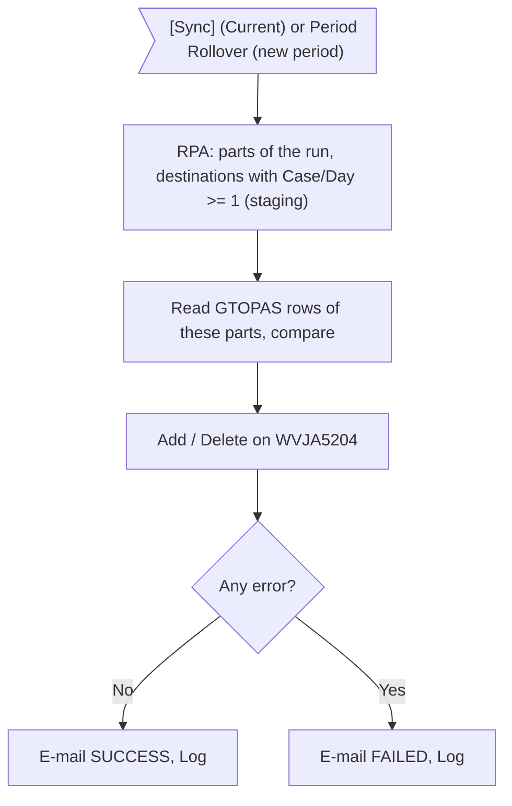
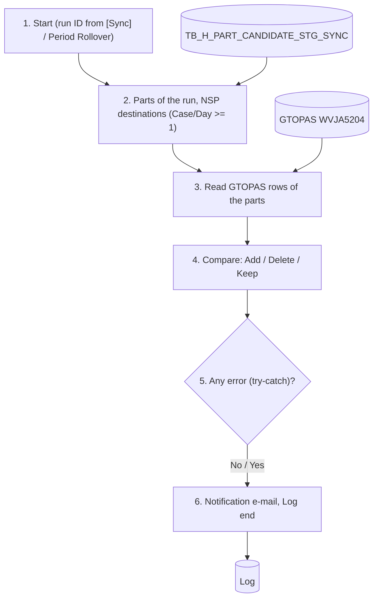

# XD06 – IF Cross Dock Master to GTOPAS

> Generated from `deliverables/function_list_v2/specs/XD06_spec.json` (UISS `XD06_UISS_Batch_IFCrossDockMasterToGTOPAS.xlsx`). Do not edit by hand: change the spec and run `python3 prepare_code/build_md.py`. Document names: GTOPAS / NSP (prototype: G-System / Supplier System).

| Phase | Project | Block | Function | Created | By | Type |
|---|---|---|---|---|---|---|
| DR | Crossdock Optimization | Batch | XD06 IF Cross Dock Master to GTOPAS | 18-Oct-26 | FID Rayhan | batch |

## Revision

| Rev | Author | Date | Reviewed by | Description |
|---|---|---|---|---|
| 0.1 | FID Rayhan | 18-Oct-26 |  | Initial Draft |
| 0.2 | FID Rayhan | 17-Nov-26 |  | [Sync] runs the RPA from the download: the bot downloads the XD01 Export Excel (no direct read of the NSP database), fills the work sheet GTOPAS Compare and then adds / deletes on WVJA5204. User guide Crossdock_User_Guide_GTOPAS.xlsx. |
| 0.3 | FID Rayhan | 17-Nov-26 |  | Sync Status rule of XD01 (No Sync only for a value sent to the target); a manual Active -> Inactive is also listed in Active to Inactive and deleted. |
| 0.4 | FID Rayhan | 18-Nov-26 |  | Waiting parts follow the [Sync] definition of XD01: every part with status Active (ongoing period) or Inactive whose Sync Status is No Sync or Failed, whatever the filter (Candidate never); table of the part status in 4.2. |
| 0.5 | FID Rayhan | 18-Nov-26 |  | Sheet "Active to Inactive" removed (18-Nov): Inactive parts with No Sync / Failed are taken by [Sync] by their status. Inactive parts are not in sheet Export Crossdock Master, so their rows are deleted by the compare. |
| 0.6 | FID Rayhan | 19-Nov-26 |  | Notification email of the RPA (Power Automate): cases SUCCESS / FAILED / bot not started, recipients, subject, body, attachment, retry (4.4); LOG6. |
| 0.7 | FID Rayhan | 19-Nov-26 |  | GTOPAS = Current period; automatic run after the Period Rollover; several order types of a destination = one GTOPAS row (19-Nov). |
| 0.8 | FID Rayhan | 20-Nov-26 |  | No response to NSP: the bot does not write TB_M_PART_CANDIDATE / TB_M_PART_CANDIDATE / TB_H_PART_CANDIDATE; the result is the notification e-mail; [Re-send last Sync] (20-Nov). |
| 0.9 | FID Rayhan | 20-Nov-26 |  | TB_R_CROSSDOCK_IF_RESULT removed; the parts of the run come from the send time on TB_M_PART_CANDIDATE (GTOPAS_SYNC_DT / APPOLE_SYNC_DT) and SYNC_RUN_ID (20-Nov). |
| 1.0 | FID Rayhan | 22-Nov-26 |  | Source = TB_H_PART_CANDIDATE_STG_SYNC only; parts of the run by GTOPAS_SYNC_STATUS 0 + PERIOD ([Sync] Current, Period Rollover new period), no date condition (22-Nov). |

## 1. General

### Objective

- To make the GTOPAS Crossdock Master (WVJA5204, Depot 01) equal to NSP by an RPA, per part of the run: destination in NSP and not in GTOPAS -> Add; in both -> Keep; in GTOPAS and not in NSP -> Delete.
- Source data: only TB_H_PART_CANDIDATE_STG_SYNC (read-only DB user), parts of the run ID: [Sync] (Current period) or the Period Rollover (new Current period, started by XD05 process 3).
- GTOPAS has no period: it always shows the Current month, so the Next period is sent only at the Period Rollover.
- The bot writes nothing back to NSP; the result comes by the notification e-mail.

### Operation flow

### Input

| Name | Type | Description |
|---|---|---|
| TB_H_PART_CANDIDATE_STG_SYNC | DB | Parts with GTOPAS_SYNC_RUN_ID = run ID; destinations = latest EXPORT value per destination + order type of the part + period (CREATED_DT <= GTOPAS_SYNC_DT) >= 1 |
| GTOPAS WVJA5204 | System | Current rows of the parts (Depot 01), read by the bot |

### Output

| Name | Type | Description |
|---|---|---|
| GTOPAS WVJA5204 | System | Rows added / deleted by the bot (not in NSP scope) |
| Log | DB | One record per run; notification e-mail |

### Parameters

| Name | Description |
|---|---|
| Target system | 'GTOPAS' |
| Method | RPA bot only (no interface file): [Sync] on XD01 starts it; it downloads the XD01 Export Excel, fills the work sheet GTOPAS Compare and works on GTOPAS screen Crossdock Master (decided 11-Nov, source 17-Nov) |
| User | RPA bot user (NSP login for the download, GTOPAS login) |
| Depot Code | '01' (mandatory search condition of the GTOPAS screen) |
| Compare key | P/No. (without "-") + Destination Code |

### GTOPAS Screen Crossdock Master (WVJA5204)

| Item | Use by the bot |
|---|---|
| Menu | Supply > Master > Crossdock Master |
| Search: Depot Code (*) | '01' |
| Search: P/No., Destination Code, Maker Code, Dom/Os, TOPAS Order Type, Trans Code | Blank to read all rows; P/No. + Destination Code to find one row |
| [Search] / [NextPage] | Read all pages of the list |
| List columns | No, MT, R, Depot Code, Maker Code, P/No. (e.g. 52119-BZV60), Domestic/Overseas, Destination Code, TOPAS Order Type, Order Transportation Code |
| MT (maintenance type) | 'DEL' on a row = delete; register = new row: Depot Code 01, Maker Code A, P/No., Dom/Os 2, Destination Code, TOPAS Order Type 3, Trans Code 2 |
| Message | MZD34006FEI: Registration completed. Any other error message = error (try-catch) |

### RPA work sheet GTOPAS Compare (added by the bot to the downloaded file)

| Column | Content |
|---|---|
| P/No. | Part Number (NSP) / P/No. without "-" (GTOPAS) |
| Destination Code | Destination Code, 7 characters |
| In NSP | Y when the key is in sheet Export Crossdock Master |
| In GTOPAS | Y when the key is in the GTOPAS list (Depot 01) |
| Action | Keep (Y / Y), Add (Y / N), Delete (N / Y) |
| Result | OK when the GTOPAS message is MZD34006FEI or Keep; Error otherwise (the run stops) |
| GTOPAS message | Message of the screen after the action |
| Done date-time | Date-time of the action |

## 2. Function flow

1. NSP starts the flow with the run ID: after [Sync] (rows of the Current period) or after the Period Rollover (XD05 process 3, rows of the new Current period). The staging is already updated (GTOPAS_SYNC_STATUS 1). Write LOG1. The whole run is inside one try-catch.
2. Read TB_H_PART_CANDIDATE_STG_SYNC (read-only DB user): parts = distinct PART_NO + PERIOD with GTOPAS_SYNC_RUN_ID = run ID.
  - NSP destinations of a part: latest EXPORT row (largest HIST_ID, CREATED_DT <= GTOPAS_SYNC_DT) per destination + order type of the part + period with NEW_VALUE >= 1; order types together (one GTOPAS row per P/No. + Destination Code).
3. Search the parts on WVJA5204 (Depot 01) and read their rows.
4. Compare per P/No. (without "-") + Destination Code and fill the work sheet GTOPAS Compare:
  - In NSP only: Add (Depot 01, Maker A, Dom/Os 2, TOPAS Order Type *, Trans 2). In GTOPAS only: Delete. In both: Keep (nothing).
5. Any error (try-catch): stop, write LOG4; rows done before the error stay. [Re-send last Sync] or the next run compares again.
6. Send the notification e-mail (SUCCESS / FAILED), write LOG6 and LOG2. The bot writes nothing to NSP.

## 3. Data edit mapping

#### 1. Insert GTOPAS Crossdock Master (WVJA5204, by RPA) – Part + destination in NSP and not in GTOPAS (not in NSP scope; done on the screen)
- Source: TB_H_PART_CANDIDATE_STG_SYNC (keys: GTOPAS_SYNC_RUN_ID = Run ID (parts of the run), NEW_VALUE (latest EXPORT row per destination) = >= 1)
- Destination keys: P/No. + Destination Code = Not found in GTOPAS

| Source field | Destination field | Description |
|---|---|---|
| - | Depot Code | '01' |
| Part Number | P/No. | Part number (GTOPAS shows it with "-") |
| Destination Code | Destination Code | 7-digit destination code = buyer code + PD code, exactly the same in NSP and GTOPAS (no conversion, decided 11-Nov) |
| - | Maker Code | Always 'A' (decided 11-Nov) |
| - | Domestic/Overseas | Always '2' (decided 11-Nov) |
| - | TOPAS Order Type | Always '3' (decided 11-Nov) |
| - | Order Transportation Code | Always '2' (decided 11-Nov) |

#### 2. Delete GTOPAS Crossdock Master (WVJA5204, by RPA) – Row in GTOPAS and not in the NSP list (not in NSP scope; MT = DEL on the screen)
- Source: GTOPAS Crossdock Master (read by the bot) (keys: GTOPAS_SYNC_RUN_ID = Run ID (parts of the run), NEW_VALUE (latest EXPORT row per destination) = >= 1)
- Destination keys: P/No. + Destination Code = Not in the NSP list (Active part + destination)

| Source field | Destination field | Description |
|---|---|---|
|  | MT | 'DEL' |
|  | Row | Deleted: destination removed in NSP, part Inactive (all its rows), Active part without destination, part not in NSP |

#### 3. Insert Log – Messages of the run
- Source: Result of this run

| Source field | Destination field | Description |
|---|---|---|
|  | BATCH_ID | 'XD06_RPA_GTOPAS' |
|  | RUN_ID | Run ID |
|  | STATUS | SUCCESS / ERROR |
|  | MESSAGE | LOG1 - LOG6 |
|  | START_DT / END_DT | Start and end date-time |

## 4. Function description

### 4.1 Business Process

- Every value change of the Kanban / Export Crossdock Master is a row of TB_H_PART_CANDIDATE_STG_SYNC (refer XD01 5.24). GTOPAS_SYNC_STATUS 0 only for an EXPORT ADD / DELETE (a destination appears or disappears); quantities are not sent to GTOPAS.
- [Sync]: the GTOPAS rows of the Current period (GTOPAS_SYNC_STATUS 0 + PERIOD = Current, no date) are set to 1 and this bot starts. The rows of the Next period wait.
- Period Rollover (XD05 process 3, day 1 00:10): the rows of the new Current period with GTOPAS_SYNC_STATUS 0 are set to 1 and this bot starts. XD05 writes EXPORT rows for every destination of the new period, so every part of the period is compared.
- Decisions and simulation: deliverables/function_list_v2/erd/proposal_staging_sync (Summary_Staging_Sync_Decisions.md, simulation/Full_Sync_Flow_Simulation.xlsx).

### 4.2 Comparison Rules

| In NSP (Active part + destination, ongoing period) | In GTOPAS | Action of the bot |
|---|---|---|
| Y | Y | Skip (no change) |
| Y | N | Register the row (Depot 01, Maker Code A, P/No., Dom/Os 2, Destination Code, TOPAS Order Type 3, Trans Code 2) |
| N | Y | Delete the row (MT = DEL) |
| Part Inactive (not in the list) | Y | All rows of the part are deleted |
| Active part without destination | Y | All rows of the part are deleted |

- Compare key: P/No. (without "-") + Destination Code; the order types of a destination are one GTOPAS row.
- NSP destinations = latest staging value >= 1 of the part + period of the run; only the parts of the run are compared.
- Why the rollover: WVJA5204 has no period. Sending the Next period on day D would change GTOPAS for the month still running; AP POLE has an Effective Month, so it gets the Next period earlier by [Sync].

### 4.3 Try-Catch and Re-send

- The whole run is in one try-catch; any error stops the run (LOG4). Rows added / deleted before the error stay in GTOPAS.
- NSP does not receive the result; the staging stays Sync. [Re-send last Sync] (or the next run) compares again and completes the rest.

### 4.4 Notification Email (Power Automate, 19-Nov)

- The cloud flow of the RPA sends one email per run of XD06 (GTOPAS), so the user knows the result without opening NSP.
- One email per target: XD06 (GTOPAS) and XD07 (AP POLE) run as separate bots, so a [Sync] gives two emails.
- One email per run: the retries of the same run do not send an email; only the final result does.

| No | Case | When the email is sent | Subject result |
|---|---|---|---|
| E1 | Run without error | End of the run, after the last part | SUCCESS |
| E2 | Run stopped by an error (try-catch) | After the automatic retries of the cloud flow are used up (retry count and interval in the flow settings, proposal 2 times, 10 minutes) | FAILED |
| E3 | Bot could not start (machine offline, login of NSP / GTOPAS failed, desktop flow time out) | Cloud flow branch "run after = failed / timed out" of the desktop flow action | FAILED |
| - | Nothing to send (no part in the run) | No email | - |

| Item | Content |
|---|---|
| Sender | Shared mailbox of the RPA (Office 365 Outlook connector "Send an email (V2)"), TBC |
| To | User who clicked [Sync] (e-mail sent by NSP in the request of the flow) + D/S team mailing list |
| Cc | RPA PIC; for FAILED also the NSP PIC |
| Subject | [Crossdock Sync][GTOPAS][SUCCESS \| FAILED] Run <RUN_ID> - <n> part(s) |
| Body 1. Run | RUN_ID, target GTOPAS, started / ended, [Sync] by <user> at <date-time>, period(s) sent |
| Body 2. Summary | Parts processed; registered / kept / deleted rows per P/No. + Destination Code |
| Body 3. Error (FAILED) | Step, part, destination and message of the error (LOG4 / LOG5); parts not processed |
| Body 4. Action | SUCCESS: no action. FAILED: click [Re-send last Sync] on Crossdock Master Setting; contact the RPA PIC when it fails again |
| Body 5. Links | Folder of the RPA work file (SharePoint / OneDrive, TBC); link to the run in Power Automate (for the RPA PIC) |
| Attachment | The downloaded Excel with the work sheet GTOPAS Compare (action, result and message per row). Above the mail size limit: link only |
| Language | English |

- Example subject: [Crossdock Sync][GTOPAS][FAILED] Run 20261127103000 - 12 part(s).
- Recipients (mailing list, RPA PIC, NSP PIC) are set in the flow settings, not in the code of the bot.
- LOG6 is written when the email is sent; when sending fails, the run result stays and the RPA PIC sees it in the Power Automate run history.

### 4.5 Open Points

- FB-176: rows of GTOPAS (Depot 01) of parts outside the run are not compared (decided 21-Nov: only the parts of the run).

## 5. Logging messages

| ID | Event | Cause | Type | Message | Action |
|---|---|---|---|---|---|
| LOG1 | Batch start | [Sync] / Period Rollover | Info | RPA cross dock master to GTOPAS started. Run <RUN_ID>, <n> part(s). | system: Write the log.; user: - |
| LOG2 | Batch end | Bot finishes | Info | RPA cross dock master to GTOPAS ended. Run <RUN_ID>, added <a>, deleted <d>, kept <k>, status <STATUS>. | system: Write the log.; user: - |
| LOG3 | Row changed | Add / Delete on WVJA5204 | Info | <ADD / DELETE> <P_NO> <DEST_CODE>. | system: Write the log.; user: - |
| LOG4 | Error (try-catch) | Login, screen, timeout or GTOPAS error message | Error | RPA to GTOPAS stopped at <STEP> <P_NO> <DEST_CODE>: <ERROR_DETAIL>. | system: Stop the bot.; user: Click [Re-send last Sync]; contact PIC if it persists. |
| LOG5 | Unexpected error | Any other system error | Critical | Unexpected error: <ERROR_DETAIL>. | system: Stop. STATUS = ERROR.; user: User contact PIC |
| LOG6 | Notification email | End of the run (SUCCESS / FAILED) | Info | Notification email <SUCCESS / FAILED> of run <RUN_ID> sent to <recipients>. | system: Write the log.; user: Read the email; FAILED: click [Re-send last Sync]. |

## 7. Tables

#### TB_H_PART_CANDIDATE_STG_SYNC (history, proposed)
Staging of every value change of the Kanban / Export Crossdock Master for the sync to AP POLE (XD07) and GTOPAS (XD06) (22-Nov). Inserted by XD01 (screen), XD02 / XD03 (upload) and XD05 in the same transaction as the master update; updated only by [Sync], [Re-send last Sync] and the Period Rollover. The RPA reads only this table. TB_H_PART_CANDIDATE (screen history) is kept as it is.

| Column | Type | PK | Null | Description |
|---|---|---|---|---|
| HIST_ID | BIGINT | Y | N | Running number (identity): order of the changes |
| PART_NO | VARCHAR(TBD) |  | N | Part number (NSP format, with "-"); FK1 (PART_NO, PERIOD) -> TB_M_PART_CANDIDATE |
| PART_NAME | VARCHAR(TBD) |  | N | Part Name copied from TB_M_PART_CANDIDATE at the insert (Part Name of the Kanban upload file) |
| PERIOD | CHAR(6) |  | N | Calculation period YYYYMM; Effective Month / Year of the AP POLE upload |
| PART_STATUS | VARCHAR(10) |  | N | Status of the part in this period when the row is written (Active / Inactive). Inactive: the part stays in the AP POLE Kanban, its Export rows are DELETE with NEW_VALUE 0 |
| LEVEL_TYPE | VARCHAR(6) |  | N | KANBAN = parent (Kanban Crossdock Master), EXPORT = destination (Export Crossdock Master) |
| DEST_CODE | CHAR(7) |  | Y | EXPORT only: destination code. No FK (a DELETE row points to a removed destination) |
| ORDER_TYPE | VARCHAR(2) |  | Y | EXPORT only: '**', 'C', '9', 'V' |
| FIELD_NAME | VARCHAR(30) |  | N | KANBAN: PCS_CASE, MAX_CASE_DAY. EXPORT: CASE_DAY |
| ACTION | VARCHAR(6) |  | N | ADD / EDIT / DELETE |
| OLD_VALUE | VARCHAR(10) |  | Y | Value before the change; NULL on ADD |
| NEW_VALUE | VARCHAR(10) |  | Y | Value after the change; 0 on DELETE |
| SOURCE | VARCHAR(6) |  | N | BATCH (XD05) / SCREEN / UPLOAD |
| UPLOAD_ID | VARCHAR(TBD) |  | Y | Upload of the Kanban or Export Excel (Log); NULL when SOURCE is not UPLOAD |
| APPOLE_SYNC_STATUS | CHAR(1) |  | N | 0 = Non Sync (default), 1 = Sync, 2 = Superseded (an earlier row of the same key, not sent). The part + period is AP POLE Non Sync while it has a row with 0 |
| APPOLE_SYNC_DT | DATETIME |  | Y | Time of the [Sync] that sent the row to AP POLE (status 1 and 2); Last Sent AP POLE = latest value |
| SEND_SEQ | NUMBER(1) |  | Y | Upload file: 1 = Export (LLM9Q880) before the Kanban file, only for a part whose Max goes down; 2 = Kanban (LLM9Q910); 3 = Export after the Kanban file (every other part). Set at [Sync] on the last row of each key; NULL for 2 and for a key that ends on its first value |
| APPOLE_SYNC_RUN_ID | VARCHAR(14) |  | Y | AP POLE run ID YYYYMMDDHHMMSS; [Re-send last Sync] takes the rows of the last run |
| GTOPAS_SYNC_STATUS | CHAR(1) |  | Y | NULL = not for GTOPAS (KANBAN rows, EXPORT EDIT). 0 = Non Sync: EXPORT ADD / DELETE (destination appears / disappears). 1 = Sync: [Sync] for the Current period, the Period Rollover for the new period |
| GTOPAS_SYNC_DT | DATETIME |  | Y | Time of the [Sync] / Period Rollover that sent the row to GTOPAS; Last Sent GTOPAS = latest value |
| GTOPAS_SYNC_RUN_ID | VARCHAR(14) |  | Y | GTOPAS run ID ([Sync], [Re-send last Sync] or the Period Rollover) |
| CREATED_BY | VARCHAR(20) |  | N | User of the save / upload, or XD05BATCH |
| CREATED_DT | DATETIME |  | N | Time of the insert (same transaction as the master update) |
| CHANGED_BY | VARCHAR(20) |  | Y | User of [Sync] / [Re-send last Sync], XD05BATCH for the Period Rollover |
| CHANGED_DT | DATETIME |  | Y | Time of that update |
