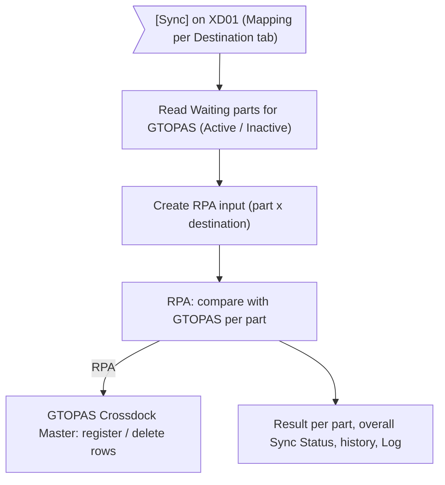
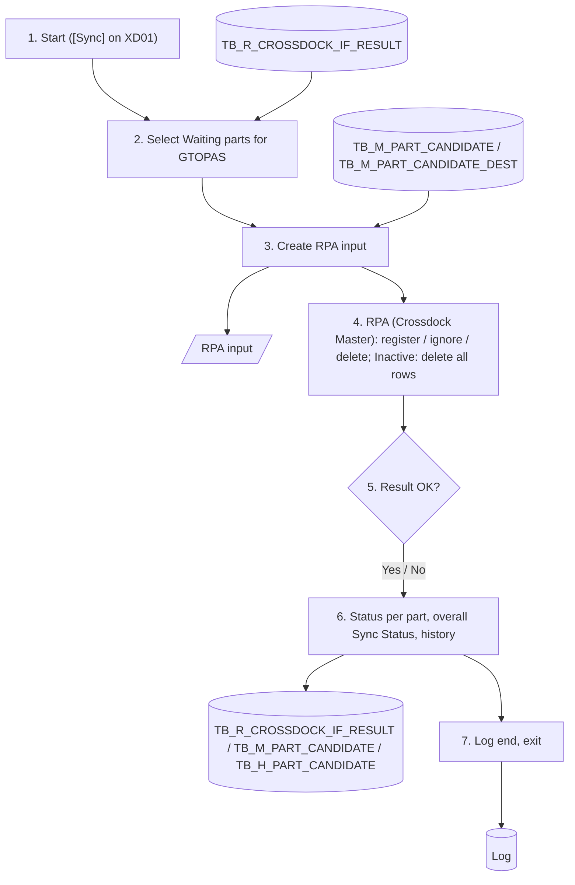

# XD06 – IF Cross Dock Master to GTOPAS

> Generated from `deliverables/function_list_v2/specs/XD06_spec.json` (UISS `XD06_UISS_Batch_IFCrossDockMasterToGTOPAS.xlsx`). Do not edit by hand: change the spec and run `python3 prepare_code/build_md.py`. Document names: GTOPAS / NSP (prototype: G-System / Supplier System).

| Phase | Project | Block | Function | Created | By | Type |
|---|---|---|---|---|---|---|
| DR | Crossdock Optimization | Batch | XD06 IF Cross Dock Master to GTOPAS | 18-Oct-26 | FID Rayhan | batch |

## Revision

| Rev | Author | Date | Reviewed by | Description |
|---|---|---|---|---|
| 0.1 | FID Rayhan | 18-Oct-26 |  | Initial Draft |

## 1. General

### Objective

- To keep the cross dock destinations of each part in GTOPAS equal to NSP, by RPA: for every Active part waiting for synchronisation, the destinations of the ongoing period in Part Mapping per Destination (TB_M_PART_CANDIDATE_DEST) are compared with the destinations of the part in GTOPAS.
- Per destination: in NSP and not in GTOPAS -> registered in GTOPAS; in both -> ignored (no change); in GTOPAS and not in NSP -> deleted in GTOPAS. Only the destination list is maintained: Pcs/Case, Max Case/Day, Effective Start Date and Case/Day are not sent (GTOPAS keeps no Case/Day per destination).
- Parts that became Inactive: the bot deletes all rows of the part in GTOPAS (one row per part + destination, e.g. 10 destinations -> 10 rows deleted). In AP POLE they are deleted at part level by XD07 (SFTP file, CROSSDOCK_FLAG 'N').
- Method: RPA bot on GTOPAS (menu Supply > Master > Crossdock Master, search by Part No). XD06 prepares the RPA input (part x destination) and receives the result per part; the status per part is kept in TB_R_CROSSDOCK_IF_RESULT (dummy table) and, together with XD07 (AP POLE), gives the overall Sync Status shown on the Cross Dock Part Master screen (XD01).

### Operation flow

### Input

| Name | Type | Description |
|---|---|---|
| TB_R_CROSSDOCK_IF_RESULT | DB | Rows TARGET_SYSTEM = 'GTOPAS' with IF_STATUS = '3' (Waiting), set by [Sync] on XD01 |
| TB_M_PART_CANDIDATE | DB | Part List: PART_NO, PART_STATUS (Active, or Inactive since the last send), CHANGED_DT |
| TB_M_PART_CANDIDATE_DEST | DB | Part Mapping per Destination: PERIOD, DEST_CODE of the ongoing period |
| GTOPAS: destinations of the part | System | menu Supply > Master > Crossdock Master: rows of the part (one per part + destination), read by the bot after search by Part No |

### Output

| Name | Type | Description |
|---|---|---|
| RPA input | File | XD_CDMASTER_GTOPAS_<YYYYMMDDHHMMSS>.csv: one record per part x destination (see RPA Input Data) |
| GTOPAS: destinations of the part | System | Registered / deleted by the RPA bot (not in NSP scope) |
| TB_R_CROSSDOCK_IF_RESULT | DB | Dummy table: result of 'GTOPAS' per part (1 / 2), input file name, message |
| TB_M_PART_CANDIDATE | DB | Overall SYNC_STATUS, SYNC_DT, SYNC_MESSAGE of the part |
| TB_H_PART_CANDIDATE | DB | History record per part (event SYNC, source IF) |
| Log | DB | Start, RPA, result and end messages |

### Parameters

| Name | Description |
|---|---|
| Target system | 'GTOPAS' (GTOPAS) |
| User | IF batch user ID (NSP); RPA bot user of GTOPAS |
| Interface method | RPA bot on GTOPAS (menu Supply > Master > Crossdock Master); the steps of the bot are detailed in the RPA design (not in this document). |

### RPA Input Data

| Field | Source | Format | M | Business rule |
|---|---|---|---|---|
| SEND_ID | Generated | CHAR(14) | Y | Run of XD06 (YYYYMMDDHHMMSS); all records of one input have the same SEND_ID |
| PART_NO | TB_M_PART_CANDIDATE.PART_NO | VARCHAR(TBD) | Y | Part with Sync Status Waiting for GTOPAS: Active, or became Inactive since the last send |
| CROSSDOCK_FLAG | TB_M_PART_CANDIDATE.PART_STATUS | CHAR(1) | Y | 'Y' = Active: make the destinations equal to NSP / 'N' = Inactive: delete all rows of the part in GTOPAS |
| PERIOD | TB_M_PART_CANDIDATE_DEST.PERIOD | CHAR(6) | Y | Ongoing calculation period (YYYYMM) |
| DEST_CODE | TB_M_PART_CANDIDATE_DEST.DEST_CODE | CHAR(7) | N | Destination code (buyer code + PD code); one record per destination. Blank for an Inactive part (one record) or an Active part without destination (all its destinations in GTOPAS are deleted) |
| SEND_DT | Generated | DATETIME | Y | Date-time the input is created |

### RPA Result Data

| Field | Format | Business rule |
|---|---|---|
| SEND_ID | CHAR(14) | SEND_ID of the input |
| PART_NO | VARCHAR(TBD) | One result per part of the input |
| RESULT | CHAR(2) | 'OK' = GTOPAS equal to NSP after the run / 'NG' = not done |
| ADDED | VARCHAR(TBD) | Destination codes registered in GTOPAS (comma separated; blank when none) |
| DELETED | VARCHAR(TBD) | Destination codes deleted in GTOPAS (comma separated; blank when none) |
| MESSAGE | VARCHAR(255) | Reason when 'NG' (e.g. part not found in GTOPAS, screen error) |

## 2. Function flow

1. [Sync] on XD01 sets the parts to Waiting (SYNC_STATUS = '3' in TB_M_PART_CANDIDATE, IF_STATUS = '3' for 'GTOPAS' and 'APPOLE' in TB_R_CROSSDOCK_IF_RESULT) and starts XD06. Write LOG1.
2. Select the parts with TARGET_SYSTEM = 'GTOPAS' and IF_STATUS = '3' in TB_R_CROSSDOCK_IF_RESULT. Keep CHANGED_DT of each part.
  - PART_STATUS Active: sent with its destinations (CROSSDOCK_FLAG 'Y').
  - PART_STATUS Inactive: sent with CROSSDOCK_FLAG 'N' to delete the part in GTOPAS.
  - No part: write LOG2 and exit.
3. Create the RPA input XD_CDMASTER_GTOPAS_<YYYYMMDDHHMMSS>.csv (see RPA Input Data):
  - Active part: one record per destination of the ongoing period in TB_M_PART_CANDIDATE_DEST (PART_NO, CROSSDOCK_FLAG 'Y', PERIOD, DEST_CODE); without destination: one record with DEST_CODE blank.
  - Inactive part: one record with CROSSDOCK_FLAG 'N' and DEST_CODE blank.
  - Same SEND_ID and SEND_DT on every record. Error: LOG3, all parts of the run Failed (step 6).
4. Start the RPA bot with the input. Per part the bot opens GTOPAS menu Supply > Master > Crossdock Master, searches the Part No (one row per part + destination) and:
  - CROSSDOCK_FLAG 'Y': compares the rows with the input by DEST_CODE - in the input and not in GTOPAS: register; in both: ignore; in GTOPAS and not in the input: delete.
  - CROSSDOCK_FLAG 'N' (Inactive): deletes all rows of the part (e.g. 10 destinations -> 10 rows deleted).
  - The bot returns one result per part (see RPA Result Data). Part NG: LOG6. Bot not available or no result within the time limit: LOG4, all parts of the run Failed.
5. Set the status of every part of the run in TB_R_CROSSDOCK_IF_RESULT:
  - RESULT 'OK': IF_STATUS = '1', IF_DT = now, IF_FILE_NAME = input file name, IF_MESSAGE = 'added <ADDED>; deleted <DELETED>' (blank when nothing changed).
  - RESULT 'NG', input or bot error: IF_STATUS = '2', IF_DT = now, IF_MESSAGE = reason (LOG3 / LOG4 / LOG6).
6. Update the overall Sync Status of each part in TB_M_PART_CANDIDATE and record the history:
  - CHANGED_DT differs from step 2 (part changed while sending): SYNC_STATUS = '0' (No Sync).
  - Else, status of 'GTOPAS' and of 'APPOLE' in TB_R_CROSSDOCK_IF_RESULT: one still '3' -> SYNC_STATUS stays '3'; both '1' -> '1' (Success); one '2' -> '2' (Failed, SYNC_MESSAGE = target + reason).
  - SYNC_DT = now when SYNC_STATUS becomes 1 or 2.
  - Insert TB_H_PART_CANDIDATE: event SYNC, source IF, FIELD_NAME SYNC_STATUS, REMARK = 'GTOPAS: ' + IF_MESSAGE.
7. Write LOG2 with the input file name and the number of parts sent, destinations added / deleted and parts failed. Exit.

## 3. Data edit mapping

#### 1. Insert RPA input – One record per part x destination
- Source: TB_M_PART_CANDIDATE + TB_M_PART_CANDIDATE_DEST (keys: PART_NO = Waiting part, PART_STATUS = Active / Inactive, PERIOD = Ongoing period)

| Source field | Destination field | Description |
|---|---|---|
| - | SEND_ID | Run of XD06 (YYYYMMDDHHMMSS); same on every record |
| PART_NO | PART_NO | Same value |
| PART_STATUS | CROSSDOCK_FLAG | 'Y' Active / 'N' Inactive |
| PERIOD | PERIOD | Same value |
| DEST_CODE | DEST_CODE | Same value; blank for an Inactive part or a part without destination |
| - | SEND_DT | Date-time the input is created |

#### 2. Insert / Delete GTOPAS Crossdock Master (by RPA) – Not in NSP scope; done by the RPA bot
- Source: RPA input (keys: PART_NO = Part of the input)
- Destination keys: PART_NO + DEST_CODE = Part + destination

| Source field | Destination field | Description |
|---|---|---|
| PART_NO | PART_NO | Part of the input |
| DEST_CODE | DEST_CODE | Registered when in the input and not in GTOPAS |
|  |  | No change when in the input and in GTOPAS |
|  |  | Deleted when in GTOPAS and not in the input |
|  |  | All rows of the part deleted when CROSSDOCK_FLAG 'N' (Inactive) |

#### 3. Update TB_R_CROSSDOCK_IF_RESULT – Dummy table: rows of the parts of the file for 'GTOPAS'
- Source: Result of the send
- Destination keys: PART_NO + TARGET_SYSTEM = Part of the file + 'GTOPAS'

| Source field | Destination field | Description |
|---|---|---|
|  | IF_STATUS | '1' RPA OK / '2' input, bot or part error |
|  | IF_DT | Date-time of the result |
|  | IF_FILE_NAME | Name of the RPA input file |
|  | IF_MESSAGE | 'added ...; deleted ...' when '1' (Inactive part: 'deleted all <n> rows'); reason when '2' |
|  | CHANGED_BY | IF batch user ID |
|  | CHANGED_DT | Server system date-time |
|  | PART_NO | Not changed |
|  | TARGET_SYSTEM | Not changed |
|  | PERIOD | Not changed |
|  | CREATED_BY | Not changed |
|  | CREATED_DT | Not changed |

#### 4. Update TB_M_PART_CANDIDATE – Overall Sync Status of the part
- Source: TB_R_CROSSDOCK_IF_RESULT (keys: PART_NO = Part of the file (both target rows))
- Destination keys: PART_NO = Part of the file

| Source field | Destination field | Description |
|---|---|---|
|  | SYNC_STATUS | '0' when CHANGED_DT changed; else '3' while a target is Waiting, '1' when both '1', '2' when a target is '2' |
|  | SYNC_DT | Date-time when SYNC_STATUS becomes 1 or 2; else not changed |
|  | SYNC_MESSAGE | Target + reason when Failed; blank when Success |
|  | PART_NO | Not changed |
|  | PART_NAME | Not changed |
|  | MIN_MAD | Not changed |
|  | PCS_CASE | Not changed |
|  | MAX_CASE_DAY | Not changed |
|  | TOTAL_PCS_DAY | Not changed |
|  | EFFECTIVE_START_DATE | Not changed |
|  | PART_STATUS | Not changed |
|  | LAST_SOURCE | Not changed |
|  | LAST_UPLOAD_ID | Not changed |
|  | CREATED_BY | Not changed |
|  | CREATED_DT | Not changed |
|  | CHANGED_BY | Not changed |
|  | CHANGED_DT | Not changed |

#### 5. Insert TB_H_PART_CANDIDATE – One record per part of the file
- Source: Result of the part

| Source field | Destination field | Description |
|---|---|---|
|  | HIST_ID | Auto (identity) |
|  | PART_NO | Part sent |
|  | PERIOD | Ongoing calculation period |
|  | EVENT_TYPE | 'SYNC' |
|  | SOURCE | 'IF' |
|  | UPLOAD_ID | NULL |
|  | DEST_CODE | NULL |
|  | FIELD_NAME | 'SYNC_STATUS' |
|  | OLD_VALUE | 'Waiting' |
|  | NEW_VALUE | New overall status (Waiting / Success / Failed / No Sync) |
|  | REMARK | 'GTOPAS: ' + IF_MESSAGE |
|  | CREATED_BY | IF batch user ID |
|  | CREATED_DT | Server system date-time |

#### 6. Insert Log – Messages of the run
- Source: Result of this run

| Source field | Destination field | Description |
|---|---|---|
|  | BATCH_ID | 'XD06_IF_GTOPAS' |
|  | STATUS | SUCCESS / ERROR |
|  | MESSAGE | LOG1 - LOG5 |
|  | START_DT / END_DT | Start and end date-time |

## 4. Function description

### 4.1 Business Process

- The D/S team maintains the destinations of each part on XD01 (Mapping per Destination of the ongoing period, created by XD05 process 2 and adjusted by screen or upload XD03).
- Every change sets the part to No Sync. The D/S team clicks [Sync] when the changes are complete; Active parts and parts that became Inactive are sent to GTOPAS.
- GTOPAS keeps the list of cross dock destinations per part (no Case/Day). The RPA bot makes this list equal to NSP: register a missing destination, ignore an existing one, delete one that is no longer in NSP.

- Method: RPA bot on GTOPAS menu Supply > Master > Crossdock Master (decided 30-Oct): search by Part No; the list has one row per part + destination. The steps of the bot are detailed in the RPA design.
- Parts that became Inactive (XD05 process 1) are sent with CROSSDOCK_FLAG 'N': the bot deletes all rows of the part in GTOPAS (e.g. 10 destinations -> 10 rows deleted) (decided 30-Oct). In AP POLE they are deleted at part level by XD07 (SFTP file, CROSSDOCK_FLAG 'N').

### 4.2 Comparison Rules

| In NSP | In GTOPAS | Action of the bot |
|---|---|---|
| Y | N | Register the destination in GTOPAS |
| Y | Y | Ignore (no change) |
| N | Y | Delete the destination in GTOPAS |
| Inactive part | Y | Delete all rows of the part |

- Compared per part by DEST_CODE; PERIOD is always the ongoing period, past periods are never sent.
- Pcs/Case, Max Case/Day, Effective Start Date and Case/Day are not sent. A change of Case/Day only gives no change in GTOPAS; the part still gets RESULT 'OK' (Success).
- An Active part without destination: all its destinations in GTOPAS are deleted (decided 30-Oct).

### 4.3 Status and Dummy Table

- TB_R_CROSSDOCK_IF_RESULT is a dummy table that keeps the result per part and target; the real output of XD06 is the change made by the bot in GTOPAS.
- Overall SYNC_STATUS: Waiting while a target is Waiting, Success when both targets are done, Failed when one target failed (the next [Sync] sends the part again; the comparison is repeatable, a part without difference gives no change).
- A part changed on XD01 or by upload while it is being sent gets SYNC_STATUS = No Sync, so the newer data is sent by the next [Sync].

### 4.4 Open Points

- RPA design: start of the bot by XD06, time limit, and how the result is returned (file or table) - TBC.

## 5. Logging messages

| ID | Event | Cause | Type | Message | Action |
|---|---|---|---|---|---|
| LOG1 | Batch start | [Sync] on XD01 | Info | RPA cross dock destinations to GTOPAS started. <n> part(s). | system: Write the log.; user: - |
| LOG2 | Batch end | Batch finishes | Info | RPA cross dock destinations to GTOPAS ended. Input <FILE_NAME>, parts <n>, added <a>, deleted <d>, failed <f>, status <STATUS>. | system: Write the log.; user: - |
| LOG3 | Create input | RPA input cannot be created | Error | Cannot create the RPA input to GTOPAS: <ERROR_DETAIL>. | system: All parts of the run IF_STATUS = 2. Stop.; user: Click [Sync] again; contact PIC if it persists. |
| LOG4 | RPA run | RPA bot not available / no result within the time limit | Error | RPA run of <SEND_ID> to GTOPAS failed: <ERROR_DETAIL>. | system: All parts of the run IF_STATUS = 2. Keep the input file.; user: Click [Sync] again later; contact PIC if it persists. |
| LOG5 | Unexpected error | Any other system error | Critical | Unexpected error: <ERROR_DETAIL>. | system: Stop. STATUS = ERROR.; user: User contact PIC |
| LOG6 | RPA result | The bot returns RESULT 'NG' for a part | Error | GTOPAS not updated for part <PART_NO>: <MESSAGE>. | system: IF_STATUS = 2 for the part; other parts continue.; user: Click [Sync] again; contact PIC if it persists |

## 7. Tables

#### TB_R_CROSSDOCK_IF_RESULT (transaction, proposed)
Dummy table (proposed): send status of the cross dock master per part and target system (XD06 GTOPAS, XD07 AP POLE). The real output is the interface data sent to the target (AP POLE: file by SFTP; GTOPAS: RPA). The overall Sync Status of the part stays in TB_M_PART_CANDIDATE.

| Column | Type | PK | Null | Description |
|---|---|---|---|---|
| PART_NO | VARCHAR(TBD) | Y | N | Part number (TB_M_PART_CANDIDATE) |
| TARGET_SYSTEM | VARCHAR(10) | Y | N | 'GTOPAS' (XD06) / 'APPOLE' (XD07) |
| PERIOD | CHAR(6) |  | N | Calculation period of the mapping sent (YYYYMM) |
| IF_STATUS | VARCHAR(1) |  | N | '3' Waiting / '1' Success / '2' Failed |
| IF_DT | DATETIME |  | Y | Date-time of the result of the target system |
| IF_FILE_NAME | VARCHAR(100) |  | Y | Name of the interface file (AP POLE) or RPA input file (GTOPAS) |
| IF_MESSAGE | VARCHAR(500) |  | Y | Reason when Failed; blank when Success |
| CREATED_BY | VARCHAR(TBD) |  | N | User who created the record |
| CREATED_DT | DATETIME |  | N | Created date and time |
| CHANGED_BY | VARCHAR(TBD) |  | N | User who last changed the record |
| CHANGED_DT | DATETIME |  | N | Last changed date and time |

#### TB_M_PART_CANDIDATE (transaction, existing)
Candidate part setting, one record per part (Part List data, no calculation period). Target of a successful upload.

| Column | Type | PK | Null | Description |
|---|---|---|---|---|
| PART_NO | VARCHAR(TBD) | Y | N | Part number; length follows TB_M_PART_MASTER |
| PART_NAME | VARCHAR(TBD) |  | N | Retrieved from TB_M_PART_MASTER by PART_NO |
| MIN_MAD | INT |  | N | Minimum MAD (mandatory); reference compared with the MAD result of the calculation |
| PCS_CASE | INT |  | N | Pieces per case (> 0) |
| MAX_CASE_DAY | INT |  | N | Total Case/Day of the part (> 0) |
| TOTAL_PCS_DAY | INT |  | N | PCS_CASE x MAX_CASE_DAY |
| EFFECTIVE_START_DATE | DATE |  | Y | Effective start date; required while the part is Candidate |
| PART_STATUS | VARCHAR(TBD) |  | N | Candidate / Active / Inactive |
| SYNC_STATUS | CHAR(1) |  | N | 0 = No Sync, 3 = Waiting, 1 = Success, 2 = Failed |
| SYNC_DT | DATETIME |  | Y | Date-time of the last IF function result |
| SYNC_MESSAGE | VARCHAR(TBD) |  | Y | Reason of the last Failed sync |
| LAST_SOURCE | VARCHAR(TBD) |  | N | CALC / SCREEN / UPLOAD |
| LAST_UPLOAD_ID | VARCHAR(TBD) |  | Y | Upload that last changed the record |
| CREATED_BY | VARCHAR(TBD) |  | N | User who created the record |
| CREATED_DT | DATETIME |  | N | Created date and time |
| CHANGED_BY | VARCHAR(TBD) |  | N | User who last changed the record |
| CHANGED_DT | DATETIME |  | N | Last changed date and time |

#### TB_M_PART_CANDIDATE_DEST (transaction, existing)
Destination mapping, one record per part, calculation period and destination (Mapping per Destination data). Target of a successful upload.

| Column | Type | PK | Null | Description |
|---|---|---|---|---|
| PART_NO | VARCHAR(TBD) | Y | N | Part number; FK to TB_M_PART_CANDIDATE |
| PERIOD | CHAR(6) | Y | N | Calculation period, YYYYMM e.g. 202609; displayed as Sep 2026 |
| DEST_CODE | CHAR(7) | Y | N | Destination code (buyer code + PD code, 7 digits); exists in TB_M_H0125_DESTINATION (Destination Master) |
| CASE_DAY | INT |  | N | Allocated Case/Day of the destination (> 0) |
| CREATED_BY | VARCHAR(TBD) |  | N | User who created the record |
| CREATED_DT | DATETIME |  | N | Created date and time |
| CHANGED_BY | VARCHAR(TBD) |  | N | User who last changed the record |
| CHANGED_DT | DATETIME |  | N | Last changed date and time |

#### TB_H_PART_CANDIDATE (history, proposed)
History of every change of a crossdock part (Add / Edit by screen or upload, mapping changes, Sync results, status changes and mappings made by the calculation batches). Read by the History setting modal of Part List (index PART_NO, CREATED_DT). No retention limit: the history is kept (no housekeeping job, decided 30-Oct).

| Column | Type | PK | Null | Description |
|---|---|---|---|---|
| HIST_ID | BIGINT | Y | N | Running number (identity) |
| PART_NO | VARCHAR(TBD) |  | N | Part number; length follows TB_M_PART_MASTER |
| PERIOD | CHAR(6) |  | Y | Calculation period YYYYMM for MAPPING / SYNC / CALC; NULL for ADD / EDIT (Part List has no period) |
| EVENT_TYPE | VARCHAR(10) |  | N | ADD / EDIT / MAPPING / SYNC / CALC |
| SOURCE | VARCHAR(10) |  | N | SCREEN / UPLOAD / IF / BATCH |
| UPLOAD_ID | VARCHAR(TBD) |  | Y | Upload of the change (Log); NULL when not from an upload |
| DEST_CODE | CHAR(7) |  | Y | Destination code (7 digits) for MAPPING; NULL for other events |
| FIELD_NAME | VARCHAR(30) |  | N | Changed field: PCS_CASE, MAX_CASE_DAY, MIN_MAD, PART_STATUS, EFFECTIVE_START_DATE, CASE_DAY, SYNC_STATUS |
| OLD_VALUE | VARCHAR(255) |  | Y | Value before the change; NULL for ADD or an added destination |
| NEW_VALUE | VARCHAR(255) |  | Y | Value after the change; NULL for a removed destination |
| REMARK | VARCHAR(500) |  | Y | Free text, e.g. SYNC_MESSAGE of a Failed sync |
| CREATED_BY | VARCHAR(20) |  | N | User who made the change (IF batch user ID for SYNC, batch user ID for BATCH) |
| CREATED_DT | DATETIME |  | N | Date and time of the change |
