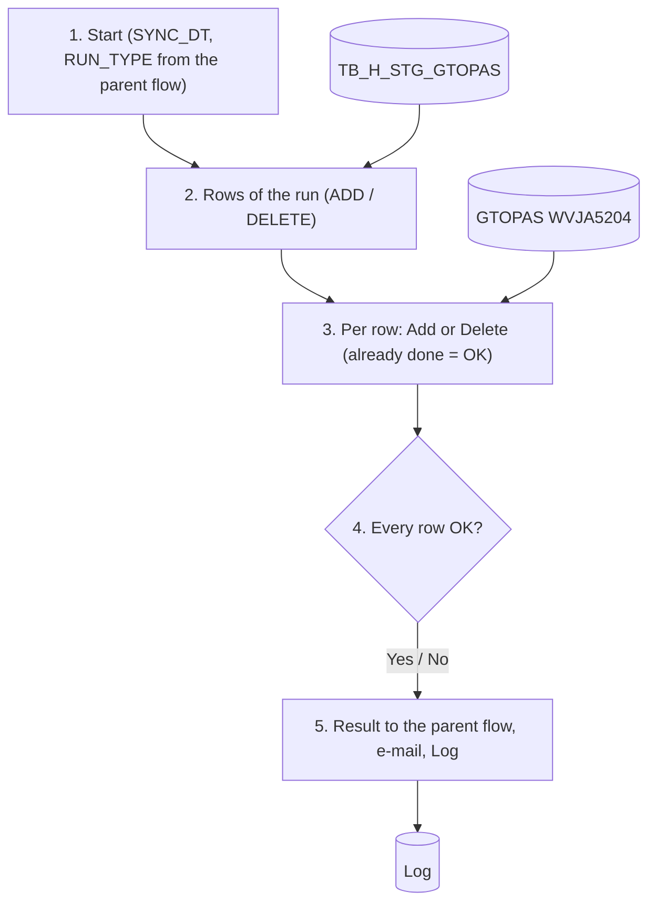

# XD06 – IF Cross Dock Master to GTOPAS

> Generated from `deliverables/function_list_v2/specs/XD06_spec.json` (UISS `XD06_UISS_Batch_IFCrossDockMasterToGTOPAS.xlsx`). Do not edit by hand: change the spec and run `python3 prepare_code/build_md.py`. Document names: GTOPAS / NSP (prototype: G-System / Supplier System).

| Phase | Project | Block | Function | Created | By | Type |
|---|---|---|---|---|---|---|
| DR | Crossdock Optimization | Batch | XD06 IF Cross Dock Master to GTOPAS | 18-Oct-26 | FID Rayhan | batch |

## Revision

| Rev | Author | Date | Reviewed by | Description |
|---|---|---|---|---|
| 0.1 | FID Rayhan | 18-Oct-26 |  | Initial Draft |
| 0.2 | FID Rayhan | 17-Nov-26 |  | [Sync] runs the RPA from the download: the bot downloads the XD01 Export Excel (no direct read of the NSP database), fills the work sheet GTOPAS Compare and then adds / deletes on WVJA5204. User guide Crossdock_User_Guide_GTOPAS.xlsx. |
| 0.3 | FID Rayhan | 17-Nov-26 |  | Sync Status rule of XD01 (No Sync only for a value sent to the target); a manual Active -> Inactive is also listed in Active to Inactive and deleted. |
| 0.4 | FID Rayhan | 18-Nov-26 |  | Waiting parts follow the [Sync] definition of XD01: every part with status Active (ongoing period) or Inactive whose Sync Status is No Sync or Failed, whatever the filter (Candidate never); table of the part status in 4.2. |
| 0.5 | FID Rayhan | 18-Nov-26 |  | Sheet "Active to Inactive" removed (18-Nov): Inactive parts with No Sync / Failed are taken by [Sync] by their status. Inactive parts are not in sheet Export Crossdock Master, so their rows are deleted by the compare. |
| 0.6 | FID Rayhan | 19-Nov-26 |  | Notification email of the RPA (Power Automate): cases SUCCESS / FAILED / bot not started, recipients, subject, body, attachment, retry (4.4); LOG6. |
| 0.7 | FID Rayhan | 19-Nov-26 |  | GTOPAS = Current period; automatic run after the Period Rollover; several order types of a destination = one GTOPAS row (19-Nov). |
| 0.8 | FID Rayhan | 20-Nov-26 |  | No response to NSP: the bot does not write TB_M_PART_CANDIDATE / TB_M_PART_CANDIDATE / TB_H_PART_CANDIDATE; the result is the notification e-mail; [Re-send last Sync] (20-Nov). |
| 0.9 | FID Rayhan | 20-Nov-26 |  | TB_R_CROSSDOCK_IF_RESULT removed; the parts of the run come from the send time on TB_M_PART_CANDIDATE (GTOPAS_SYNC_DT / APPOLE_SYNC_DT) and SYNC_RUN_ID (20-Nov). |
| 1.0 | FID Rayhan | 22-Nov-26 |  | Source = TB_H_PART_CANDIDATE_STG_SYNC only; parts of the run by GTOPAS_SYNC_STATUS 0 + PERIOD ([Sync] Current, Period Rollover new period), no date condition (22-Nov). |
| 1.1 | FID Rayhan | 23-Nov-26 |  | Source TB_H_STG_GTOPAS (rows ADD / DELETE of the run); started by the RPA parent flow: scenario 1 GTOPAS before AP POLE, a failed GTOPAS stops AP POLE; Period Rollover XD06 only (23-Nov). |
| 1.2 | FID Rayhan | 26-Nov-26 |  | Staging: no SYNC_RUN_ID, the run is SYNC_DT (one value per [Sync] click / rollover); one unsent row per key (a new change updates it, back to the sent value deletes it); SYNC_STATUS 0 / 1. SQL: prepare_code/sql/crossdock_staging_sync.sql. |

## 1. General

### Objective

- To make the GTOPAS Crossdock Master (WVJA5204, Depot 01) follow NSP by an RPA: add the part + destination rows that appear in NSP and delete the rows that disappear.
- Source data: only TB_H_STG_GTOPAS (read-only DB user), rows of the run (SYNC_DT): [Sync] (Current period), [Re-send last Sync] or the Period Rollover (new Current period, XD05 process 3).
- Started by the RPA parent flow: in scenario 1 XD06 runs before XD07 and its result decides whether XD07 starts (refer 4.1).
- GTOPAS has no period: it always shows the Current month, so the Next period reaches GTOPAS only at the Period Rollover.
- The robot writes nothing back to NSP; the result comes by the notification e-mail.

### Operation flow

*Operation flow* (no image)

### Input

| Name | Type | Description |
|---|---|---|
| TB_H_STG_GTOPAS | DB | Rows with SYNC_STATUS '1' and SYNC_DT = SYNC_DT of the run: ACTION ADD / DELETE per part + destination |
| GTOPAS WVJA5204 | System | Rows of the parts of the run (Depot 01), read by the robot |

### Output

| Name | Type | Description |
|---|---|---|
| GTOPAS WVJA5204 | System | Rows added / deleted by the robot (not in NSP scope) |
| Result to the parent flow | Variable | STATUS SUCCESS / FAILED and the failed rows |
| Log | DB | One record per run; notification e-mail |

### Parameters

| Name | Description |
|---|---|
| Target system | 'GTOPAS' |
| Method | RPA desktop flow CDX_XD06_GTOPAS started by the Power Automate parent flow CDX_SYNC_PARENT ([Sync], [Re-send last Sync], Period Rollover); it works on GTOPAS screen Crossdock Master |
| User | RPA bot user (GTOPAS login); read-only DB user on NSP |
| Depot Code | '01' (mandatory search condition of the GTOPAS screen) |
| Row key | P/No. + Destination Code (one GTOPAS row per part + destination, whatever the order type) |

### GTOPAS Screen Crossdock Master (WVJA5204)

| Item | Use by the bot |
|---|---|
| Menu | Supply > Master > Crossdock Master |
| Search: Depot Code (*) | '01' |
| Search: P/No., Destination Code, Maker Code, Dom/Os, TOPAS Order Type, Trans Code | P/No. + Destination Code to find the row of the run |
| [Search] / [NextPage] | Check whether the row is there before the Add / Delete |
| List columns | No, MT, R, Depot Code, Maker Code, P/No. (e.g. 52119-BZV60), Domestic/Overseas, Destination Code, TOPAS Order Type, Order Transportation Code |
| MT (maintenance type) | 'DEL' on a row = delete; register = new row: Depot Code 01, Maker Code A, P/No., Dom/Os 2, Destination Code, TOPAS Order Type 3, Trans Code 2 |
| Message | MZD34006FEI: Registration completed. Any other message = the row failed (listed, next row continues) |

## 2. Function flow

1. The parent flow starts XD06 with SYNC_DT and RUN_TYPE (SYNC / RESEND: scenario 1; ROLLOVER). NSP has already set the rows to SYNC_STATUS 1 with this SYNC_DT. Write LOG1.
2. Read TB_H_STG_GTOPAS (read-only DB user): rows with SYNC_STATUS '1' and SYNC_DT = SYNC_DT of the run, ordered by P_NO, DESTINATION_CODE.
  - ACTION ADD: Depot 01, P/No., Destination Code, Maker A, Domestic/Overseas 2, TOPAS Order Type 3, Order Transportation Code 2.
  - ACTION DELETE: the row of P/No. + Destination Code (MT = DEL on the screen).
3. Process every row on WVJA5204 (Depot 01). Write LOG3 per row.
  - A row already in the wanted state (Add of an existing row, Delete of a missing row) counts as OK, so a re-send is safe.
  - A failed row is listed (LOG4) and the next rows are still processed: GTOPAS rows do not depend on each other.
4. Return STATUS to the parent flow: SUCCESS when every row is OK, else FAILED with the failed rows. In scenario 1 the parent flow starts XD07 only on SUCCESS.
5. The parent flow sends one notification e-mail per run (GTOPAS result, and AP POLE result when XD07 ran). Write LOG6 and LOG2. The robot writes nothing to NSP.

## 3. Data edit mapping

#### 1. Insert GTOPAS Crossdock Master (WVJA5204, by RPA) – Part + destination added (not in NSP scope; done on the screen)
- Source: TB_H_STG_GTOPAS (keys: SYNC_DT = SYNC_DT of the run (SYNC_STATUS 1), ACTION = 'ADD')

| Source field | Destination field | Description |
|---|---|---|
| DEPOT_CODE | Depot Code | '01' |
| P_NO | P/No. | With "-" |
| DESTINATION_CODE | Destination Code | 7 digits, the same in NSP and GTOPAS |
| MAKER_CODE | Maker Code | 'A' |
| DOMESTIC_OVERSEAS | Domestic/Overseas | '2' |
| TOPAS_ORDER_TYPE | TOPAS Order Type | '3' |
| ORDER_TRANSPORTATION_CODE | Order Transportation Code | '2' |

#### 2. Delete GTOPAS Crossdock Master (WVJA5204, by RPA) – Row of P/No. + Destination Code (MT = DEL)
- Source: TB_H_STG_GTOPAS (keys: SYNC_DT = SYNC_DT of the run (SYNC_STATUS 1), ACTION = 'DELETE')

| Source field | Destination field | Description |
|---|---|---|
| P_NO | P/No. | Row to delete |
| DESTINATION_CODE | Destination Code | Row to delete |
| - | MT | 'DEL' |

#### 3. Insert Log – Messages of the run
- Source: RPA run

| Source field | Destination field | Description |
|---|---|---|
| - | BATCH_ID | 'XD06_RPA_GTOPAS' |
| - | SYNC_DT | SYNC_DT of the run |
| - | STATUS | SUCCESS / FAILED |
| - | MESSAGE | LOG1 - LOG6 |
| - | START_DT / END_DT | Start and end date-time |

## 4. Function description

### 4.1 Parent Flow and Scenarios

- One Power Automate parent flow per run (CDX_SYNC_PARENT), started by NSP with SYNC_DT (the run) and RUN_TYPE (SYNC, RESEND, ROLLOVER).
- Scenario 1 (run with GTOPAS rows: a part becomes Active or Inactive, a destination is added or removed): XD06 GTOPAS first; XD07 AP POLE starts only when every GTOPAS row succeeded. When GTOPAS fails, AP POLE stops: XD07 does not start and the e-mail says FAILED.
- Scenario 2 (run without GTOPAS rows: Max Case/Day, Pcs/Case, Case/Day, order type of a destination that stays): XD07 only.
- Period Rollover (RUN_TYPE ROLLOVER): XD06 only, for the GTOPAS rows of the new Current period.
- Choice of the scenario: SELECT COUNT(*) FROM TB_H_STG_GTOPAS WHERE SYNC_STATUS = '1' AND SYNC_DT = <SYNC_DT of the run> (> 0: scenario 1).

### 4.2 Rows and Rules

- XD06 reads only TB_H_STG_GTOPAS: one row per part + destination that appears (ADD) or disappears (DELETE) for the part, whatever the order type. NSP writes the row at the save (SP_STG_WRITE) and sends it with SP_STG_SYNC (Current period) or the Period Rollover.
- A Case/Day change or an order type change of a destination that stays writes no GTOPAS row.
- Rows of the parts outside the run are not touched.
- Rules and simulation: deliverables/function_list_v2/erd/proposal_staging_sync (Proposal_Tables_Staging_Per_Target.xlsx, simulation/Staging_Header_Order.html, simulation/Staging_Per_Target_Full_Flow_Simulation.xlsx).

### 4.3 Errors and Re-send

- A failed row is listed and the next rows are processed. The result goes back to the parent flow: FAILED stops AP POLE in scenario 1.
- When the e-mail says FAILED, the D/S team clicks [Re-send last Sync] before the next [Sync]: the same SYNC_DT; rows done before are OK again (already in GTOPAS / already gone).

| Case | GTOPAS (XD06) | AP POLE (XD07) | D/S does |
|---|---|---|---|
| Scenario 1, GTOPAS fails on a row | Other rows still done; failed rows listed | Not started | [Re-send last Sync]: GTOPAS again, then AP POLE |
| Scenario 1, GTOPAS OK, AP POLE rejects a row | Done | Stops at that row; next files not sent | [Re-send last Sync] |
| Scenario 2, AP POLE rejects a row | Skipped | Stops at that row | [Re-send last Sync] |
| Period Rollover, GTOPAS fails | Failed rows listed | Not part of the rollover | Re-send the rollover run |
| Robot or PC down before the start | Not started | Not started | [Re-send last Sync] |

### 4.4 Notification Email (Power Automate)

- The parent flow sends one email per run, so the user knows the result without opening NSP.
- The email holds the result of every target of the run: GTOPAS and AP POLE in scenario 1 (AP POLE 'not started' when GTOPAS failed), AP POLE only in scenario 2, GTOPAS only for the Period Rollover.
- One email per run: the retries of the same run send no email; only the final result does.

| No | Case | When the email is sent | Subject result |
|---|---|---|---|
| E1 | Run without error | End of the run, after the last row / file of every target | SUCCESS |
| E2 | Run stopped by an error (try-catch) | After the automatic retries of the cloud flow are used up (retry count and interval in the flow settings, proposal 2 times, 10 minutes) | FAILED |
| E3 | Bot could not start (machine offline, login of NSP / GTOPAS failed, desktop flow time out) | Cloud flow branch "run after = failed / timed out" of the desktop flow action | FAILED |
| - | No GTOPAS row in the run (scenario 2) | XD06 is not started; the email shows AP POLE only | - |

| Item | Content |
|---|---|
| Sender | Shared mailbox of the RPA (Office 365 Outlook connector "Send an email (V2)"), TBC |
| To | User who clicked [Sync] (e-mail sent by NSP in the request of the flow) + D/S team mailing list |
| Cc | RPA PIC; for FAILED also the NSP PIC |
| Subject | [Crossdock Sync][SYNC \| RESEND \| ROLLOVER][SUCCESS \| FAILED] Run <SYNC_DT> - <n> part(s) |
| Body 1. Run | SYNC_DT, RUN_TYPE, scenario, targets run, started / ended, [Sync] by <user> at <date-time>, period(s) sent |
| Body 2. Summary | Parts processed; registered / kept / deleted rows per P/No. + Destination Code |
| Body 3. Error (FAILED) | Step, part, destination and message of the error (LOG4 / LOG5); parts not processed |
| Body 4. Action | SUCCESS: no action. FAILED: click [Re-send last Sync] on Crossdock Master Setting; contact the RPA PIC when it fails again |
| Body 5. Links | Folder of the RPA work file (SharePoint / OneDrive, TBC); link to the run in Power Automate (for the RPA PIC) |
| Attachment | The downloaded Excel with the work sheet GTOPAS Compare (action, result and message per row). Above the mail size limit: link only |
| Language | English |

- Example subject: [Crossdock Sync][SYNC][FAILED] Run 20261127103000 - 12 part(s).
- Recipients (mailing list, RPA PIC, NSP PIC) are set in the flow settings, not in the code of the bot.
- LOG6 is written when the email is sent; when sending fails, the run result stays and the RPA PIC sees it in the Power Automate run history.

## 5. Logging messages

| ID | Event | Cause | Type | Message | Action |
|---|---|---|---|---|---|
| LOG1 | Batch start | Parent flow: scenario 1 or Period Rollover | Info | RPA cross dock master to GTOPAS started. Run <SYNC_DT>, <n> row(s). | system: Write the log.; user: - |
| LOG2 | Batch end | Bot finishes | Info | RPA cross dock master to GTOPAS ended. Run <SYNC_DT>, added <a>, deleted <d>, already done <k>, failed <f>, status <STATUS>. | system: Write the log.; user: - |
| LOG3 | Row changed | Add / Delete on WVJA5204 | Info | <ADD / DELETE> <P_NO> <DEST_CODE>. | system: Write the log.; user: - |
| LOG4 | Row failed / error (try-catch) | Login, screen, timeout or GTOPAS error message | Error | RPA to GTOPAS failed at <STEP> <P_NO> <DEST_CODE>: <ERROR_DETAIL>. | system: Row error: list the row and go to the next row. Login or screen error: stop. STATUS FAILED; in scenario 1 the parent flow does not start XD07.; user: Click [Re-send last Sync]; contact PIC if it persists. |
| LOG5 | Unexpected error | Any other system error | Critical | Unexpected error: <ERROR_DETAIL>. | system: Stop. STATUS = ERROR.; user: User contact PIC |
| LOG6 | Notification email | End of the run (SUCCESS / FAILED) | Info | Notification email <SUCCESS / FAILED> of run <SYNC_DT> sent to <recipients>. | system: Write the log.; user: Read the email; FAILED: click [Re-send last Sync]. |

## 7. Tables

#### TB_H_STG_GTOPAS (history, proposed)
GTOPAS WVJA5204 rows: a part + destination to add or delete, written by SP_STG_WRITE only when the destination appears or disappears for the part (any order type) and GTOPAS does not have that state yet (one unsent row per key). Sent by [Sync] (Current period) or the Period Rollover (new Current period). Read by XD06.

| Column | Type | PK | Null | Description |
|---|---|---|---|---|
| STG_ID | BIGINT | Y | N | Running number: order of the inserts |
| PERIOD | CHAR(6) |  | N | Calculation period YYYYMM (GTOPAS has no period: [Sync] sends the Current period, the Period Rollover the new Current). FK1 (P_NO, PERIOD) -> TB_M_PART_CANDIDATE |
| ACTION | VARCHAR(6) |  | N | ADD / DELETE: the destination appears or disappears for the part (any order type). No row for a Case/Day change or for a state GTOPAS already has. File / screen column: Add / Delete (MT = DEL) |
| DEPOT_CODE | CHAR(2) |  | N | Always 01. File / screen column: Depot Code. Default '01' |
| P_NO | VARCHAR(TBD) |  | N | Part number with "-"; FK1. File / screen column: P/No. |
| DESTINATION_CODE | CHAR(7) |  | N | 7-digit code, the same in NSP and GTOPAS. File / screen column: Destination Code |
| MAKER_CODE | CHAR(1) |  | N | Always A. File / screen column: Maker Code. Default 'A' |
| DOMESTIC_OVERSEAS | CHAR(1) |  | N | Always 2. File / screen column: Domestic/Overseas. Default '2' |
| TOPAS_ORDER_TYPE | CHAR(1) |  | N | Always 3. File / screen column: TOPAS Order Type. Default '3' |
| ORDER_TRANSPORTATION_CODE | CHAR(1) |  | N | Always 2. File / screen column: Order Transportation Code. Default '2' |
| SOURCE | VARCHAR(6) |  | N | SCREEN / UPLOAD / BATCH (XD05) |
| UPLOAD_ID | VARCHAR(TBD) |  | Y | Upload of the Kanban or Export Excel (Log); NULL when SOURCE is not UPLOAD |
| SYNC_STATUS | CHAR(1) |  | N | 0 = to send (written or updated by SP_STG_WRITE), 1 = sent (SP_STG_SYNC at [Sync], SP_STG_ROLLOVER for GTOPAS). One row with 0 per key at a time: a new change of the key updates it. Default '0' |
| SYNC_DT | DATETIME2(0) |  | Y | Time of the [Sync] click (or of the Period Rollover), the same value for every row of that click: the RPA reads the rows of a run by SYNC_DT; [Re-send last Sync] = MAX(SYNC_DT); Last Sent on the screen = latest value |
| CREATED_BY | VARCHAR(20) |  | N | User of the save / upload, or XD05BATCH |
| CREATED_DT | DATETIME |  | N | Time of the insert (same transaction as the master update) |
| CHANGED_BY | VARCHAR(20) |  | Y | User of the save that updated the unsent row, of [Sync], or XD05BATCH (Period Rollover) |
| CHANGED_DT | DATETIME |  | Y | Time of that update |
