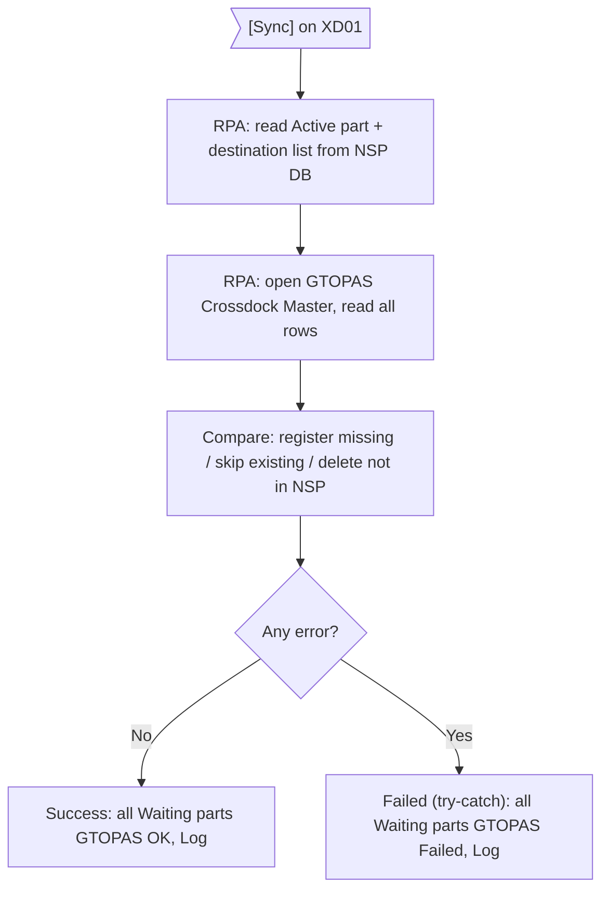
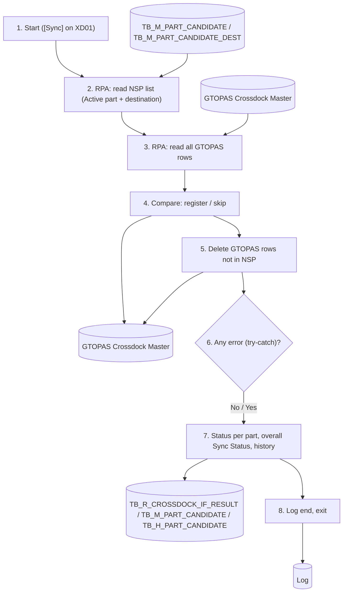

# XD06 – IF Cross Dock Master to GTOPAS

> Generated from `deliverables/function_list_v2/specs/XD06_spec.json` (UISS `XD06_UISS_Batch_IFCrossDockMasterToGTOPAS.xlsx`). Do not edit by hand: change the spec and run `python3 prepare_code/build_md.py`. Document names: GTOPAS / NSP (prototype: G-System / Supplier System).

| Phase | Project | Block | Function | Created | By | Type |
|---|---|---|---|---|---|---|
| DR | Crossdock Optimization | Batch | XD06 IF Cross Dock Master to GTOPAS | 18-Oct-26 | FID Rayhan | batch |

## Revision

| Rev | Author | Date | Reviewed by | Description |
|---|---|---|---|---|
| 0.1 | FID Rayhan | 18-Oct-26 |  | Initial Draft |

## 1. General

### Objective

- To keep the Crossdock Master of GTOPAS equal to NSP by an RPA process (no interface file, decided 11-Nov): the bot reads the Active parts and their destinations of the ongoing period directly from the NSP database and maintains GTOPAS screen Crossdock Master (WVJA5204, menu Supply > Master > Crossdock Master).
- Per part + destination: in NSP (Active) and not in GTOPAS -> registered; in both -> skipped (no change); in GTOPAS and not in NSP -> deleted. Parts that became Inactive are no longer in the NSP list, so their rows in GTOPAS are deleted.
- Only the part + destination list is maintained; Pcs/Case, Max Case/Day, Effective Start Date and Case/Day are not sent (GTOPAS keeps no Case/Day).
- The bot runs with try-catch: any error stops the run and the whole run is Failed (one fails, all fail). The result is kept per part in TB_R_CROSSDOCK_IF_RESULT and, together with XD07 (AP POLE), gives the overall Sync Status on XD01.

### Operation flow

### Input

| Name | Type | Description |
|---|---|---|
| TB_M_PART_CANDIDATE | DB | Read by the bot: parts with PART_STATUS = Active; CHANGED_DT |
| TB_M_PART_CANDIDATE_DEST | DB | Read by the bot: DEST_CODE of the ongoing period of the Active parts |
| TB_R_CROSSDOCK_IF_RESULT | DB | Parts Waiting for 'GTOPAS' (IF_STATUS = '3'), set by [Sync] on XD01 |
| GTOPAS Crossdock Master (WVJA5204) | System | All rows of Depot Code 01 (one row per part + destination), read by the bot page by page |

### Output

| Name | Type | Description |
|---|---|---|
| GTOPAS Crossdock Master (WVJA5204) | System | Rows registered / deleted by the bot (not in NSP scope) |
| TB_R_CROSSDOCK_IF_RESULT | DB | Result of 'GTOPAS' per Waiting part (1 / 2), run ID, message |
| TB_M_PART_CANDIDATE | DB | Overall SYNC_STATUS, SYNC_DT, SYNC_MESSAGE of the part |
| TB_H_PART_CANDIDATE | DB | History record per part (event SYNC, source RPA) |
| Log | DB | Start, counts (registered / skipped / deleted), error and end messages |

### Parameters

| Name | Description |
|---|---|
| Target system | 'GTOPAS' |
| Method | RPA bot only (no interface file); reads the NSP database and works on GTOPAS screen Crossdock Master (decided 11-Nov) |
| User | RPA bot user (NSP database read, GTOPAS login) |
| Depot Code | '01' (mandatory search condition of the GTOPAS screen) |
| Compare key | P/No. (without "-") + Destination Code |

### GTOPAS Screen Crossdock Master (WVJA5204)

| Item | Use by the bot |
|---|---|
| Menu | Supply > Master > Crossdock Master |
| Search: Depot Code (*) | '01' |
| Search: P/No., Destination Code, Maker Code, Dom/Os, TOPAS Order Type, Trans Code | Blank to read all rows; P/No. + Destination Code to find one row |
| [Search] / [NextPage] | Read all pages of the list |
| List columns | No, MT, R, Depot Code, Maker Code, P/No. (e.g. 52119-BZV60), Domestic/Overseas, Destination Code, TOPAS Order Type, Order Transportation Code |
| MT (maintenance type) | 'DEL' on a row = delete; register = new row (values TBC, see 4.4) |
| Message | MZD34006FEI: Registration completed. Any other error message = error (try-catch) |

## 2. Function flow

1. [Sync] on XD01 sets the parts to Waiting (SYNC_STATUS = '3', IF_STATUS = '3' for 'GTOPAS' and 'APPOLE' in TB_R_CROSSDOCK_IF_RESULT) and starts the RPA bot. Write LOG1. The whole bot run is inside one try-catch (step 6).
2. The bot reads the NSP list from the database: every part with PART_STATUS = Active and its DEST_CODE of the ongoing period (TB_M_PART_CANDIDATE_DEST).
  - One record per part + destination. Candidate and Inactive parts are not in the list. Keep CHANGED_DT of the Waiting parts.
3. The bot opens GTOPAS menu Supply > Master > Crossdock Master (WVJA5204), enters Depot Code 01 (other conditions blank), clicks [Search] and reads every page ([NextPage]).
  - GTOPAS list = one row per P/No. + Destination Code. P/No. is shown with "-" (52119-BZV60): the bot removes "-" before comparing (52119BZV60).
4. Compare per P/No. (without "-") + Destination Code:
  - In NSP and in GTOPAS: skip (no change).
  - In NSP and not in GTOPAS: register the row on the screen (Depot Code 01, P/No., Destination Code and the other values of 4.4); message MZD34006FEI = done.
5. In GTOPAS and not in NSP: delete the row (MT = DEL); message MZD34006FEI = done.
  - This covers destinations removed in NSP, parts that became Inactive (all their rows) and Active parts without destination.
6. Try-catch: any error (login, screen not available, timeout, error message instead of MZD34006FEI, NSP database not available) stops the bot at once.
  - The whole run is Failed (one fails, all fail): LOG4 with the step and the row of the error. The rows already registered / deleted before the error stay in GTOPAS (no rollback on the screen); the next [Sync] compares again and completes them.
7. Set the result of every Waiting part for 'GTOPAS' in TB_R_CROSSDOCK_IF_RESULT and the overall Sync Status:
  - No error: IF_STATUS = '1', IF_MESSAGE = 'registered <n>, deleted <n>' of the part. Error: IF_STATUS = '2' for every Waiting part, IF_MESSAGE = error of LOG4.
  - TB_M_PART_CANDIDATE: CHANGED_DT changed since step 2 -> '0' (No Sync); else 'GTOPAS' and 'APPOLE' both '1' -> '1' (Success), one '2' -> '2' (Failed), one still '3' -> stays '3'. SYNC_DT = now when 1 or 2.
  - Insert TB_H_PART_CANDIDATE: event SYNC, source RPA, FIELD_NAME SYNC_STATUS, REMARK = 'GTOPAS: ' + IF_MESSAGE.
8. Write LOG2 with the counts (NSP rows, GTOPAS rows, registered, skipped, deleted) and the status. Exit.

## 3. Data edit mapping

#### 1. Insert GTOPAS Crossdock Master (WVJA5204, by RPA) – Part + destination in NSP and not in GTOPAS (not in NSP scope; done on the screen)
- Source: TB_M_PART_CANDIDATE + TB_M_PART_CANDIDATE_DEST (read by the bot) (keys: PART_STATUS = Active, PERIOD = Ongoing period)
- Destination keys: P/No. + Destination Code = Not found in GTOPAS

| Source field | Destination field | Description |
|---|---|---|
| - | Depot Code | '01' |
| PART_NO | P/No. | Part number (GTOPAS shows it with "-") |
| DEST_CODE | Destination Code | 7-digit destination code (code system TBC, see 4.4) |
| - | Maker Code | TBC (existing rows: A) |
| - | Domestic/Overseas | TBC (existing rows: 2) |
| - | TOPAS Order Type | TBC (existing rows: *) |
| - | Order Transportation Code | TBC (existing rows: 2) |

#### 2. Delete GTOPAS Crossdock Master (WVJA5204, by RPA) – Row in GTOPAS and not in the NSP list (not in NSP scope; MT = DEL on the screen)
- Source: GTOPAS Crossdock Master (read by the bot) (keys: Depot Code = '01')
- Destination keys: P/No. + Destination Code = Not in the NSP list (Active part + destination)

| Source field | Destination field | Description |
|---|---|---|
|  | MT | 'DEL' |
|  | Row | Deleted: destination removed in NSP, part Inactive (all its rows), Active part without destination, part not in NSP |

#### 3. Update TB_R_CROSSDOCK_IF_RESULT – Rows of the Waiting parts for 'GTOPAS'
- Source: Result of the send
- Destination keys: PART_NO + TARGET_SYSTEM = Waiting part + 'GTOPAS'

| Source field | Destination field | Description |
|---|---|---|
|  | IF_STATUS | '1' run without error / '2' run stopped by an error (try-catch, all parts) |
|  | IF_DT | Date-time of the result |
|  | IF_FILE_NAME | RPA run ID (YYYYMMDDHHMMSS); file name only for AP POLE |
|  | IF_MESSAGE | 'registered <n>, deleted <n>' when '1'; error of the run when '2' |
|  | CHANGED_BY | IF batch user ID |
|  | CHANGED_DT | Server system date-time |
|  | PART_NO | Not changed |
|  | TARGET_SYSTEM | Not changed |
|  | PERIOD | Not changed |
|  | CREATED_BY | Not changed |
|  | CREATED_DT | Not changed |

#### 4. Update TB_M_PART_CANDIDATE – Overall Sync Status of the part
- Source: TB_R_CROSSDOCK_IF_RESULT (keys: PART_NO = Waiting part (both target rows))
- Destination keys: PART_NO = Waiting part

| Source field | Destination field | Description |
|---|---|---|
|  | SYNC_STATUS | '0' when CHANGED_DT changed; else '3' while a target is Waiting, '1' when both '1', '2' when a target is '2' |
|  | SYNC_DT | Date-time when SYNC_STATUS becomes 1 or 2; else not changed |
|  | SYNC_MESSAGE | Target + reason when Failed; blank when Success |
|  | PART_NO | Not changed |
|  | PART_NAME | Not changed |
|  | MIN_MAD | Not changed |
|  | PCS_CASE | Not changed |
|  | MAX_CASE_DAY | Not changed |
|  | TOTAL_PCS_DAY | Not changed |
|  | EFFECTIVE_START_DATE | Not changed |
|  | PART_STATUS | Not changed |
|  | LAST_SOURCE | Not changed |
|  | LAST_UPLOAD_ID | Not changed |
|  | CREATED_BY | Not changed |
|  | CREATED_DT | Not changed |
|  | CHANGED_BY | Not changed |
|  | CHANGED_DT | Not changed |

#### 5. Insert TB_H_PART_CANDIDATE – One record per Waiting part
- Source: Result of the part

| Source field | Destination field | Description |
|---|---|---|
|  | HIST_ID | Auto (identity) |
|  | PART_NO | Part sent |
|  | PERIOD | Ongoing calculation period |
|  | EVENT_TYPE | 'SYNC' |
|  | SOURCE | 'RPA' |
|  | UPLOAD_ID | NULL |
|  | DEST_CODE | NULL |
|  | FIELD_NAME | 'SYNC_STATUS' |
|  | OLD_VALUE | 'Waiting' |
|  | NEW_VALUE | New overall status (Waiting / Success / Failed / No Sync) |
|  | REMARK | 'GTOPAS: ' + IF_MESSAGE |
|  | CREATED_BY | IF batch user ID |
|  | CREATED_DT | Server system date-time |

#### 6. Insert Log – Messages of the run
- Source: Result of this run

| Source field | Destination field | Description |
|---|---|---|
|  | BATCH_ID | 'XD06_RPA_GTOPAS' |
|  | STATUS | SUCCESS / ERROR |
|  | MESSAGE | LOG1 - LOG5 |
|  | START_DT / END_DT | Start and end date-time |

## 4. Function description

### 4.1 Business Process

- The D/S team maintains the destinations of each part on XD01 (Mapping per Destination of the ongoing period, created by XD05 process 2 and adjusted by screen or upload XD03). Every change sets the part to No Sync.
- The D/S team clicks [Sync] when the changes are complete; the RPA bot makes the Crossdock Master of GTOPAS equal to NSP, and XD07 sends the file to AP POLE.
- RPA only (decided 11-Nov): the bot reads the NSP database directly and works on GTOPAS screen Crossdock Master (WVJA5204); no interface or input file is created by NSP.
- The bot always compares the whole list (all Active parts of NSP with all rows of GTOPAS Depot 01), not only the Waiting parts, so a run that stopped earlier is completed by the next run.

### 4.2 Comparison Rules

| In NSP (Active part + destination, ongoing period) | In GTOPAS | Action of the bot |
|---|---|---|
| Y | Y | Skip (no change) |
| Y | N | Register the row (Depot 01, P/No., Destination Code, values of 4.4) |
| N | Y | Delete the row (MT = DEL) |
| Part Inactive (not in the list) | Y | All rows of the part are deleted |
| Active part without destination | Y | All rows of the part are deleted |

- Compare key: P/No. (without "-") + Destination Code. GTOPAS shows P/No. with "-" (52119-BZV60), NSP without (52119BZV60).
- Pcs/Case, Max Case/Day, Effective Start Date and Case/Day are not sent. A change of Case/Day only gives no change in GTOPAS; the part still gets Success.
- Example: part 52119BZV60 in NSP with 9722D10, 9811110; in GTOPAS with 9811110, 9618274 -> register 9722D10, skip 9811110, delete 9618274.

### 4.3 Try-Catch and Status

- The whole bot run is in one try-catch. Any error stops the run: login failed, screen not available, timeout, an error message instead of MZD34006FEI, NSP database not available.
- One fails, all fail: every Waiting part gets 'GTOPAS' IF_STATUS = '2' (Failed) with the error, and the overall Sync Status Failed; the D/S team clicks [Sync] again.
- Rows registered / deleted before the error stay in GTOPAS (the screen has no rollback). The next run compares again, skips them and completes the rest.
- A part changed on XD01 or by upload while the bot runs gets SYNC_STATUS = No Sync, so the newer data is sent by the next [Sync].
- TB_R_CROSSDOCK_IF_RESULT keeps the result per part and target (GTOPAS by XD06, AP POLE by XD07); the overall Sync Status needs both.

### 4.4 Open Points

- FB-173: GTOPAS shows Destination Code 9618274; NSP DEST_CODE is buyer code + PD code (e.g. 9618201). Same code system, or a conversion is needed? - TBC.
- FB-174: values to register Maker Code, Domestic/Overseas, TOPAS Order Type and Order Transportation Code (existing row: A, 2, *, 2) - fixed values or from a master? - TBC.
- FB-176: every GTOPAS row (Depot 01) not in NSP is deleted: at go-live all crossdock parts of GTOPAS must exist in NSP, else they are deleted by the first run - TBC.
- RPA design: login user, time limit and screen handling of the bot - detailed in the RPA design.

## 5. Logging messages

| ID | Event | Cause | Type | Message | Action |
|---|---|---|---|---|---|
| LOG1 | Batch start | [Sync] on XD01 | Info | RPA cross dock master to GTOPAS started. <n> Waiting part(s). | system: Write the log.; user: - |
| LOG2 | Batch end | Bot finishes | Info | RPA cross dock master to GTOPAS ended. NSP rows <n>, GTOPAS rows <g>, registered <a>, skipped <k>, deleted <d>, status <STATUS>. | system: Write the log.; user: - |
| LOG3 | Register / delete | Row registered or deleted on the screen | Info | <REGISTER / DELETE> <PART_NO> <DEST_CODE>: <GTOPAS message>. | system: Write the log.; user: - |
| LOG4 | Error (try-catch) | Login, screen, timeout, GTOPAS error message or NSP database error | Error | RPA to GTOPAS stopped at <STEP> <PART_NO> <DEST_CODE>: <ERROR_DETAIL>. All Waiting parts Failed. | system: Stop the bot. IF_STATUS = 2 for every Waiting part.; user: Click [Sync] again; contact PIC if it persists. |
| LOG5 | Unexpected error | Any other system error | Critical | Unexpected error: <ERROR_DETAIL>. | system: Stop. STATUS = ERROR. All Waiting parts Failed.; user: User contact PIC |

## 7. Tables

#### TB_R_CROSSDOCK_IF_RESULT (transaction, proposed)
Dummy table (proposed): send status of the cross dock master per part and target system (XD06 GTOPAS, XD07 AP POLE). The real output is the interface data sent to the target (AP POLE: file by SFTP; GTOPAS: RPA). The overall Sync Status of the part stays in TB_M_PART_CANDIDATE.

| Column | Type | PK | Null | Description |
|---|---|---|---|---|
| PART_NO | VARCHAR(TBD) | Y | N | Part number (TB_M_PART_CANDIDATE) |
| TARGET_SYSTEM | VARCHAR(10) | Y | N | 'GTOPAS' (XD06) / 'APPOLE' (XD07) |
| PERIOD | CHAR(6) |  | N | Calculation period of the mapping sent (YYYYMM) |
| IF_STATUS | VARCHAR(1) |  | N | '3' Waiting / '1' Success / '2' Failed |
| IF_DT | DATETIME |  | Y | Date-time of the result of the target system |
| IF_FILE_NAME | VARCHAR(100) |  | Y | Name of the interface file (AP POLE) or RPA run ID (GTOPAS) |
| IF_MESSAGE | VARCHAR(500) |  | Y | Reason when Failed; blank when Success |
| CREATED_BY | VARCHAR(TBD) |  | N | User who created the record |
| CREATED_DT | DATETIME |  | N | Created date and time |
| CHANGED_BY | VARCHAR(TBD) |  | N | User who last changed the record |
| CHANGED_DT | DATETIME |  | N | Last changed date and time |

#### TB_M_PART_CANDIDATE (transaction, existing)
Candidate part setting, one record per part (Part List data, no calculation period). Target of a successful upload.

| Column | Type | PK | Null | Description |
|---|---|---|---|---|
| PART_NO | VARCHAR(TBD) | Y | N | Part number; length follows TB_M_PART_MASTER |
| PART_NAME | VARCHAR(TBD) |  | N | Retrieved from TB_M_PART_MASTER by PART_NO |
| MIN_MAD | INT |  | N | Minimum MAD (mandatory); reference compared with the MAD result of the calculation |
| PCS_CASE | INT |  | N | Pieces per case (> 0) |
| MAX_CASE_DAY | INT |  | N | Total Case/Day of the part (> 0) |
| TOTAL_PCS_DAY | INT |  | N | PCS_CASE x MAX_CASE_DAY |
| EFFECTIVE_START_DATE | DATE |  | Y | Effective start date; required while the part is Candidate |
| PART_STATUS | VARCHAR(TBD) |  | N | Candidate / Active / Inactive |
| SYNC_STATUS | CHAR(1) |  | N | 0 = No Sync, 3 = Waiting, 1 = Success, 2 = Failed |
| SYNC_DT | DATETIME |  | Y | Date-time of the last IF function result |
| SYNC_MESSAGE | VARCHAR(TBD) |  | Y | Reason of the last Failed sync |
| LAST_SOURCE | VARCHAR(TBD) |  | N | CALC / SCREEN / UPLOAD |
| LAST_UPLOAD_ID | VARCHAR(TBD) |  | Y | Upload that last changed the record |
| CREATED_BY | VARCHAR(TBD) |  | N | User who created the record |
| CREATED_DT | DATETIME |  | N | Created date and time |
| CHANGED_BY | VARCHAR(TBD) |  | N | User who last changed the record |
| CHANGED_DT | DATETIME |  | N | Last changed date and time |

#### TB_M_PART_CANDIDATE_DEST (transaction, existing)
Destination mapping, one record per part, calculation period and destination (Mapping per Destination data). Target of a successful upload.

| Column | Type | PK | Null | Description |
|---|---|---|---|---|
| PART_NO | VARCHAR(TBD) | Y | N | Part number; FK to TB_M_PART_CANDIDATE |
| PERIOD | CHAR(6) | Y | N | Calculation period, YYYYMM e.g. 202609; displayed as Sep 2026 |
| DEST_CODE | CHAR(7) | Y | N | Destination code (buyer code + PD code, 7 digits); exists in TB_M_H0125_DESTINATION (Destination Master) |
| CASE_DAY | INT |  | N | Allocated Case/Day of the destination (> 0) |
| CREATED_BY | VARCHAR(TBD) |  | N | User who created the record |
| CREATED_DT | DATETIME |  | N | Created date and time |
| CHANGED_BY | VARCHAR(TBD) |  | N | User who last changed the record |
| CHANGED_DT | DATETIME |  | N | Last changed date and time |

#### TB_H_PART_CANDIDATE (history, proposed)
History of every change of a crossdock part (Add / Edit by screen or upload, mapping changes, Sync results, status changes and mappings made by the calculation batches). Read by the History setting modal of Part List (index PART_NO, CREATED_DT). No retention limit: the history is kept (no housekeeping job, decided 30-Oct).

| Column | Type | PK | Null | Description |
|---|---|---|---|---|
| HIST_ID | BIGINT | Y | N | Running number (identity) |
| PART_NO | VARCHAR(TBD) |  | N | Part number; length follows TB_M_PART_MASTER |
| PERIOD | CHAR(6) |  | Y | Calculation period YYYYMM for MAPPING / SYNC / CALC; NULL for ADD / EDIT (Part List has no period) |
| EVENT_TYPE | VARCHAR(10) |  | N | ADD / EDIT / MAPPING / SYNC / CALC |
| SOURCE | VARCHAR(10) |  | N | SCREEN / UPLOAD / IF / RPA / BATCH |
| UPLOAD_ID | VARCHAR(TBD) |  | Y | Upload of the change (Log); NULL when not from an upload |
| DEST_CODE | CHAR(7) |  | Y | Destination code (7 digits) for MAPPING; NULL for other events |
| FIELD_NAME | VARCHAR(30) |  | N | Changed field: PCS_CASE, MAX_CASE_DAY, MIN_MAD, PART_STATUS, EFFECTIVE_START_DATE, CASE_DAY, SYNC_STATUS |
| OLD_VALUE | VARCHAR(255) |  | Y | Value before the change; NULL for ADD or an added destination |
| NEW_VALUE | VARCHAR(255) |  | Y | Value after the change; NULL for a removed destination |
| REMARK | VARCHAR(500) |  | Y | Free text, e.g. SYNC_MESSAGE of a Failed sync |
| CREATED_BY | VARCHAR(20) |  | N | User who made the change (IF batch user ID for SYNC, batch user ID for BATCH) |
| CREATED_DT | DATETIME |  | N | Date and time of the change |
