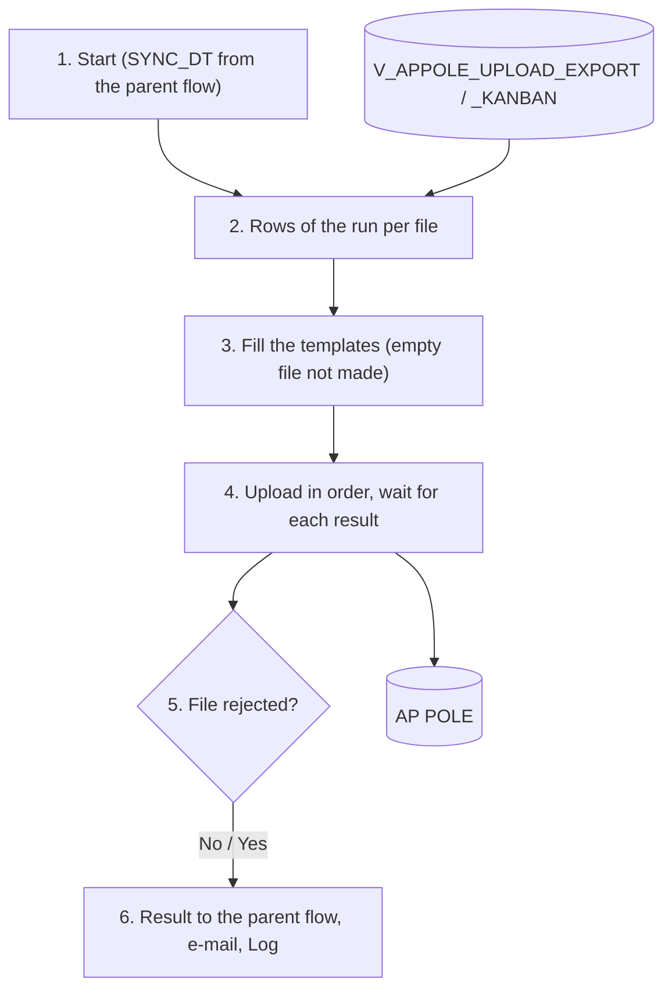

# XD07 – IF Cross Dock Master to AP POLE

> Generated from `deliverables/function_list_v2/specs/XD07_spec.json` (UISS `XD07_UISS_Batch_IFCrossDockMasterToAPPOLE.xlsx`). Do not edit by hand: change the spec and run `python3 prepare_code/build_md.py`. Document names: GTOPAS / NSP (prototype: G-System / Supplier System).

| Phase | Project | Block | Function | Created | By | Type |
|---|---|---|---|---|---|---|
| DR | Crossdock Optimization | Batch | XD07 RPA Cross Dock Master to AP POLE | 18-Oct-26 | FID Rayhan | batch |

## Revision

| Rev | Author | Date | Reviewed by | Description |
|---|---|---|---|---|
| 0.1 | FID Rayhan | 18-Oct-26 |  | Initial Draft |
| 0.2 | FID Rayhan | 17-Nov-26 |  | RPA on the AP POLE screens WLM9Q890 / WLM9Q860 instead of the SFTP interface file; source = XD01 Export Excel; part and destination scenarios; GTOPAS_SYNC_DT / APPOLE_SYNC_DT (from Crossdock_ap_pole_guide.xlsx). |
| 0.3 | FID Rayhan | 17-Nov-26 |  | [Sync] runs the RPA from the download: the bot downloads the XD01 Export Excel itself and fills the work sheet AP POLE Compare (source open point closed). |
| 0.4 | FID Rayhan | 17-Nov-26 |  | Sync Status rule of XD01 (No Sync only for a value sent to the target); a manual Active -> Inactive is also listed in Active to Inactive and deleted. |
| 0.5 | FID Rayhan | 18-Nov-26 |  | Sheet "Active to Inactive" removed (18-Nov): Inactive parts with No Sync / Failed are taken by [Sync] by their status. Parts to delete = sheet Kanban Crossdock Master, Status Inactive, Sync Status Waiting. |
| 0.6 | FID Rayhan | 19-Nov-26 |  | Notification email of the RPA (Power Automate): cases SUCCESS / FAILED / bot not started, recipients, subject, body, attachment, retry (4.6); LOG6. |
| 0.7 | FID Rayhan | 19-Nov-26 |  | Effective Month / Year = period (MM, YYYY); Current then Next; Order Type of the row; order of the screens when Max Case/Day goes down (19-Nov). |
| 0.8 | FID Rayhan | 20-Nov-26 |  | No response to NSP: the bot does not write TB_M_PART_CANDIDATE / TB_M_PART_CANDIDATE / TB_H_PART_CANDIDATE; the result is the notification e-mail; [Re-send last Sync] (20-Nov). |
| 0.9 | FID Rayhan | 20-Nov-26 |  | TB_R_CROSSDOCK_IF_RESULT removed; the parts of the run come from the send time on TB_M_PART_CANDIDATE (GTOPAS_SYNC_DT / APPOLE_SYNC_DT) and SYNC_RUN_ID (20-Nov). |
| 1.0 | FID Rayhan | 22-Nov-26 |  | Upload files LLM9Q910 / LLM9Q880 instead of the screen steps; source = TB_H_PART_CANDIDATE_STG_SYNC only; SEND_SEQ order 1 / 2 / 3 (22-Nov). |
| 1.1 | FID Rayhan | 23-Nov-26 |  | Source: views V_APPOLE_UPLOAD_KANBAN / _EXPORT on TB_H_STG_APPOLE_KANBAN / _EXPORT; files EXPORT_PRE, KANBAN, EXPORT_POST from OPERATION_TYPE; started by the RPA parent flow (scenario 1 after GTOPAS OK, scenario 2 at once) (23-Nov). |
| 1.2 | FID Rayhan | 26-Nov-26 |  | Staging: no SYNC_RUN_ID, the run is SYNC_DT (one value per [Sync] click / rollover); one unsent row per key (a new change updates it, back to the sent value deletes it); SYNC_STATUS 0 / 1. SQL: prepare_code/sql/crossdock_staging_sync.sql. |

## 1. General

### Objective

- To make the cross dock master of AP POLE follow NSP by an RPA that uploads the files Cross Dock Kanban Part Master (LLM9Q910) and Export Customer Cross Dock Master (LLM9Q880), filled from the stored templates.
- Source data: the views V_APPOLE_UPLOAD_KANBAN and V_APPOLE_UPLOAD_EXPORT on TB_H_STG_APPOLE_KANBAN / _EXPORT (read-only DB user), rows of the run (SYNC_DT) of [Sync] / [Re-send last Sync]. NSP set every rule at the save; the views only read it.
- Order: EXPORT_PRE (Export rows of the parts whose Max goes down) -> KANBAN -> EXPORT_POST (every other Export row). AP POLE checks every row: total Max Shipping Box (RCS) of the part <= Max Shipping Box Qty.
- Started by the RPA parent flow: in scenario 1 only after XD06 succeeded; in scenario 2 at once (refer 4.1).
- The robot writes nothing back to NSP; the result comes by the notification e-mail.

### Operation flow

*Operation flow* (no image)

### Input

| Name | Type | Description |
|---|---|---|
| V_APPOLE_UPLOAD_EXPORT | DB view | Export rows of the run with FILE_NO (1 EXPORT_PRE / 3 EXPORT_POST) and ROW_ORDER |
| V_APPOLE_UPLOAD_KANBAN | DB view | Kanban rows of the run with OPERATION_TYPE 1 to 4 (file KANBAN) |
| Templates LLM9Q910 / LLM9Q880 | File | Stored upload templates (not downloaded from AP POLE) |

### Output

| Name | Type | Description |
|---|---|---|
| AP POLE Cross Dock Kanban Part Master | System | Uploaded file LLM9Q910 (not in NSP scope) |
| AP POLE Export Customer Cross Dock Master | System | Uploaded files LLM9Q880 (not in NSP scope) |
| Log | DB | One record per run; notification e-mail |

### Parameters

| Name | Description |
|---|---|
| Target system | 'APPOLE' (AP POLE, https://ap-pole.toyota-asia.com/lm9/) |
| Method | RPA desktop flow CDX_XD07_APPOLE started by the Power Automate parent flow CDX_SYNC_PARENT; upload of LLM9Q910 / LLM9Q880 |
| User | RPA bot user with AP POLE login; read-only DB user on NSP |
| Operator ID | 'P6' (fixed) in LLM9Q910 |
| Transport Code | '2' (fixed) in LLM9Q880 |

### LLM9Q910 Cross Dock Kanban Part Master (file KANBAN, order 2)

| Column | NSP source / rule |
|---|---|
| Effective Month / Year | EFFECTIVE_MONTH_YEAR (MM/YYYY) |
| Operator ID | 'P6' |
| Part No. | PART_NO with "-" |
| Part Name | PART_NAME |
| Shipping Box Qty | SHIPPING_BOX_QTY (Pcs/Case) |
| Max Shipping Box Qty | MAX_SHIPPING_BOX_QTY (Max Case/Day) |
| Max Allowance Qty | MAX_ALLOWANCE_QTY |
| Packing/Pallet Type ... Outer-Qty | Empty |

### LLM9Q880 Export Customer Cross Dock Master (files EXPORT_PRE and EXPORT_POST, orders 1 and 3)

| Column | NSP source / rule |
|---|---|
| Effective Month / Year | EFFECTIVE_MONTH_YEAR (MM/YYYY) |
| Part No. | PART_NO without "-" |
| Buyer-PD | BUYER_PD (DEST_CODE as 5-2, e.g. 9722D-10) |
| Order Type | ORDER_TYPE |
| Transport Code | TRANSPORT_CODE '2' |
| Max Shipping Box (RCS) | MAX_SHIPPING_BOX_RCS (0 for DELETE) |
| Shipping Box Qty, Max Shipping Box by Part No., Max Allowance Qty, Packing/Pallet Type | Empty |

## 2. Function flow

1. The parent flow starts XD07 with SYNC_DT (scenario 1 after XD06 succeeded, scenario 2 at once). NSP has already set the rows to SYNC_STATUS 1 with this SYNC_DT. Write LOG1.
2. Read the views (read-only DB user) for the SYNC_DT of the run:
  - V_APPOLE_UPLOAD_EXPORT WHERE FILE_NO = 1 (EXPORT_PRE) and FILE_NO = 3 (EXPORT_POST), ORDER BY PERIOD, NSP_PART_NO, ROW_ORDER, STG_ID.
  - V_APPOLE_UPLOAD_KANBAN (OPERATION_TYPE 1 to 4), ORDER BY PERIOD, PART_NO.
3. Fill the stored templates: one file per kind, Current and Next period together (Effective Month / Year per row). Name <template>_<SYNC_DT YYYYMMDDHHMMSS>_<order>_<name>.xls, e.g. LLM9Q880_20261204100000_1_EXPORT_PRE.xls. A file without rows is not made.
  - Inside an Export file, per part: rows going down or DELETE (ROW_ORDER 1) first, then up or ADD (ROW_ORDER 2).
4. Upload the files one at a time: 1 EXPORT_PRE -> 2 KANBAN -> 3 EXPORT_POST, and wait for each result. Write LOG3 per file.
5. A rejected file stops the run (LOG4): the files already uploaded stay in AP POLE; the next files wait for [Re-send last Sync].
6. Return STATUS to the parent flow; the parent flow sends the notification e-mail (SUCCESS / FAILED). Write LOG6 and LOG2. The robot writes nothing to NSP.

## 3. Data edit mapping

#### 1. Insert LLM9Q910 Cross Dock Kanban Part Master (upload file) – File KANBAN (order 2): one row per Kanban row of the run with OPERATION_TYPE 1 to 4
- Source: V_APPOLE_UPLOAD_KANBAN (keys: SYNC_DT = SYNC_DT of the run (SYNC_STATUS 1))

| Source field | Destination field | Description |
|---|---|---|
| EFFECTIVE_MONTH_YEAR | Effective Month / Year | MM/YYYY |
| OPERATOR_ID | Operator ID | 'P6' |
| PART_NO | Part No. | With "-" |
| PART_NAME | Part Name |  |
| SHIPPING_BOX_QTY | Shipping Box Qty | Pcs/Case |
| MAX_SHIPPING_BOX_QTY | Max Shipping Box Qty | Max Case/Day |
| MAX_ALLOWANCE_QTY | Max Allowance Qty | Shipping Box Qty x Max Shipping Box Qty |

#### 2. Insert LLM9Q880 Export Customer Cross Dock Master (upload files) – Files EXPORT_PRE and EXPORT_POST: one row per Export row of the run, ordered by ROW_ORDER per part
- Source: V_APPOLE_UPLOAD_EXPORT (keys: SYNC_DT = SYNC_DT of the run (SYNC_STATUS 1), FILE_NO = 1 (EXPORT_PRE) / 3 (EXPORT_POST))

| Source field | Destination field | Description |
|---|---|---|
| EFFECTIVE_MONTH_YEAR | Effective Month / Year | MM/YYYY |
| PART_NO | Part No. | Without "-" |
| BUYER_PD | Buyer-PD | 5-2 format |
| ORDER_TYPE | Order Type |  |
| TRANSPORT_CODE | Transport Code | '2' |
| MAX_SHIPPING_BOX_RCS | Max Shipping Box (RCS) | 0 for DELETE |

#### 3. Insert Log – Messages of the run
- Source: RPA run

| Source field | Destination field | Description |
|---|---|---|
| - | BATCH_ID | 'XD07_RPA_APPOLE' |
| - | SYNC_DT | SYNC_DT of the run |
| - | STATUS | SUCCESS / FAILED |
| - | MESSAGE | LOG1 - LOG6 |
| - | START_DT / END_DT | Start and end date-time |

## 4. Function description

### 4.1 Parent Flow and Scenarios

- One Power Automate parent flow per run (CDX_SYNC_PARENT), started by NSP with SYNC_DT (the run) and RUN_TYPE (SYNC, RESEND, ROLLOVER).
- Scenario 1 (run with GTOPAS rows: a part becomes Active or Inactive, a destination is added or removed): XD06 GTOPAS first; XD07 AP POLE starts only when every GTOPAS row succeeded. When GTOPAS fails, AP POLE stops: XD07 does not start and the e-mail says FAILED.
- Scenario 2 (run without GTOPAS rows: Max Case/Day, Pcs/Case, Case/Day, order type of a destination that stays): XD07 only.
- Period Rollover (RUN_TYPE ROLLOVER): XD06 only, for the GTOPAS rows of the new Current period.
- Choice of the scenario: SELECT COUNT(*) FROM TB_H_STG_GTOPAS WHERE SYNC_STATUS = '1' AND SYNC_DT = <SYNC_DT of the run> (> 0: scenario 1).

### 4.2 Files and Order

- Upload files of AP POLE (views): EXPORT_PRE (LLM9Q880, order 1) = Export rows of the parts whose Kanban row of the run has OPERATION_TYPE 1; KANBAN (LLM9Q910, order 2) = Kanban rows of the run with OPERATION_TYPE 1 to 4; EXPORT_POST (LLM9Q880, order 3) = every other Export row of the run. Inside a file, per part, rows going down or DELETE (ROW_ORDER 1) come before rows going up or ADD (ROW_ORDER 2). An empty file is not made. File name <template>_<SYNC_DT YYYYMMDDHHMMSS>_<order>_<name>.xls.
- View rules: FILE_NO = 1 (EXPORT_PRE) when the Kanban row of the same run, part and period has OPERATION_TYPE 1, else 3 (EXPORT_POST; every part of a run has its Kanban row, OPERATION_TYPE 1 to 5). ROW_ORDER = 1 when MAX_SHIPPING_BOX_RCS is lower than the value sent before for the key (same period, else the latest earlier period), else 2. V_APPOLE_UPLOAD_KANBAN leaves out OPERATION_TYPE 5.
- Why the order: AP POLE checks every uploaded row (total Max Shipping Box (RCS) of the part <= Max Shipping Box Qty). When Max goes down the destinations come down first (EXPORT_PRE); when Max goes up, stays or is new the Max goes first (KANBAN). Inside a file the total first goes down, then up to the end value, so it never passes the Max.
- AP POLE keeps the rows of an Effective Month active until a newer month comes; NSP still sends every row of a new period.

| OPERATION_TYPE | Meaning | Upload order of the part |
|---|---|---|
| 1 | Max down | EXPORT_PRE, then KANBAN |
| 2 | Max up | KANBAN, then EXPORT_POST |
| 3 | Max same (only Pcs/Case changed, or a new period with the same Max) | KANBAN, then EXPORT_POST |
| 4 | Never sent (new part) | KANBAN, then EXPORT_POST |
| 5 | Kanban unchanged, only the destinations changed (ACTION KEEP) | EXPORT_POST only |

### 4.3 Errors and Re-send

- A rejected file stops the run: the files already uploaded stay in AP POLE, the next files are not uploaded.
- When the e-mail says FAILED, the D/S team clicks [Re-send last Sync] before the next [Sync]: the same SYNC_DT and the same files; AP POLE sets the same values again, so a repeat is safe.
- Rules and simulation: deliverables/function_list_v2/erd/proposal_staging_sync (Proposal_Tables_Staging_Per_Target.xlsx, simulation/Staging_Header_Order.html, simulation/Staging_Per_Target_Full_Flow_Simulation.xlsx).

| Case | GTOPAS (XD06) | AP POLE (XD07) | D/S does |
|---|---|---|---|
| Scenario 1, GTOPAS fails on a row | Other rows still done; failed rows listed | Not started | [Re-send last Sync]: GTOPAS again, then AP POLE |
| Scenario 1, GTOPAS OK, AP POLE rejects a row | Done | Stops at that row; next files not sent | [Re-send last Sync] |
| Scenario 2, AP POLE rejects a row | Skipped | Stops at that row | [Re-send last Sync] |
| Period Rollover, GTOPAS fails | Failed rows listed | Not part of the rollover | Re-send the rollover run |
| Robot or PC down before the start | Not started | Not started | [Re-send last Sync] |

### 4.4 Notification Email (Power Automate)

- The parent flow sends one email per run, so the user knows the result without opening NSP.
- The email holds the result of every target of the run: GTOPAS and AP POLE in scenario 1 (AP POLE 'not started' when GTOPAS failed), AP POLE only in scenario 2, GTOPAS only for the Period Rollover.
- One email per run: the retries of the same run send no email; only the final result does.

| No | Case | When the email is sent | Subject result |
|---|---|---|---|
| E1 | Run without error | End of the run, after the last row / file of every target | SUCCESS |
| E2 | Run stopped by an error (try-catch) | After the automatic retries of the cloud flow are used up (retry count and interval in the flow settings, proposal 2 times, 10 minutes) | FAILED |
| E3 | Bot could not start (machine offline, login of NSP / AP POLE failed, desktop flow time out) | Cloud flow branch "run after = failed / timed out" of the desktop flow action | FAILED |
| - | No AP POLE row in the run (only a Period Rollover) | XD07 is not started; the email shows GTOPAS only | - |

| Item | Content |
|---|---|
| Sender | Shared mailbox of the RPA (Office 365 Outlook connector "Send an email (V2)"), TBC |
| To | User who clicked [Sync] (e-mail sent by NSP in the request of the flow) + D/S team mailing list |
| Cc | RPA PIC; for FAILED also the NSP PIC |
| Subject | [Crossdock Sync][SYNC \| RESEND \| ROLLOVER][SUCCESS \| FAILED] Run <SYNC_DT> - <n> part(s) |
| Body 1. Run | SYNC_DT, RUN_TYPE, scenario, targets run, started / ended, [Sync] by <user> at <date-time>, period(s) sent |
| Body 2. Summary | Parts processed; part added / edited / deleted, Buyer-PD added / edited / deleted |
| Body 3. Error (FAILED) | Step, part, destination and message of the error (LOG4 / LOG5); parts not processed |
| Body 4. Action | SUCCESS: no action. FAILED: click [Re-send last Sync] on Crossdock Master Setting; contact the RPA PIC when it fails again |
| Body 5. Links | Folder of the RPA work file (SharePoint / OneDrive, TBC); link to the run in Power Automate (for the RPA PIC) |
| Attachment | The upload files of the run with the AP POLE result per file. Above the mail size limit: link only |
| Language | English |

- Example subject: [Crossdock Sync][SYNC][FAILED] Run 20261127103000 - 12 part(s).
- Recipients (mailing list, RPA PIC, NSP PIC) are set in the flow settings, not in the code of the bot.
- LOG6 is written when the email is sent; when sending fails, the run result stays and the RPA PIC sees it in the Power Automate run history.

## 5. Logging messages

| ID | Event | Cause | Type | Message | Action |
|---|---|---|---|---|---|
| LOG1 | Batch start | Parent flow: scenario 1 after GTOPAS OK, or scenario 2 | Info | RPA cross dock master to AP POLE started. Run <SYNC_DT>, <n> file(s). | system: Write the log.; user: - |
| LOG2 | Batch end | Bot finishes | Info | RPA cross dock master to AP POLE ended. Run <SYNC_DT>, files uploaded <f>, rows <r>, status <STATUS>. | system: Write the log.; user: - |
| LOG3 | File uploaded | AP POLE accepted the file | Info | <FILE_NAME> uploaded: <n> row(s). | system: Write the log.; user: - |
| LOG4 | Error (try-catch) | Login, upload screen, AP POLE error of a row, timeout | Error | RPA to AP POLE stopped at <FILE_NAME> row <n>: <ERROR_DETAIL>. Files not uploaded: <list>. | system: Stop the bot. STATUS FAILED; the next files are not uploaded.; user: Click [Re-send last Sync]; contact PIC if it persists. |
| LOG5 | Unexpected error | Any other system error | Critical | Unexpected error: <ERROR_DETAIL>. | system: Stop. STATUS = ERROR.; user: User contact PIC |
| LOG6 | Notification email | End of the run (SUCCESS / FAILED) | Info | Notification email <SUCCESS / FAILED> of run <SYNC_DT> sent to <recipients>. | system: Write the log.; user: Read the email; FAILED: click [Re-send last Sync]. |

## 7. Tables

#### TB_H_STG_APPOLE_KANBAN (history, proposed)
AP POLE Kanban rows in the format of the upload file LLM9Q910, one row per Kanban change of a part + period (one unsent row at a time: a new change updates it), plus the header row (OPERATION_TYPE 5) when only the destinations changed. Written by SP_STG_WRITE (XD01, XD02, XD05); SYNC_STATUS and SYNC_DT set by SP_STG_SYNC. Read by XD07 through V_APPOLE_UPLOAD_KANBAN and V_APPOLE_UPLOAD_EXPORT.

| Column | Type | PK | Null | Description |
|---|---|---|---|---|
| STG_ID | BIGINT | Y | N | Running number: order of the inserts |
| PERIOD | CHAR(6) |  | N | Calculation period YYYYMM. FK1 (PART_NO, PERIOD) -> TB_M_PART_CANDIDATE |
| ACTION | VARCHAR(6) |  | N | ADD (new part, new period) / EDIT (Pcs/Case or Max changed) / KEEP (header written by an Export save, Kanban unchanged) |
| PART_STATUS | VARCHAR(10) |  | N | Active / Inactive in the period when the row is written (an Inactive part stays in the AP POLE Kanban) |
| EFFECTIVE_MONTH_YEAR | CHAR(7) |  | N | MM/YYYY of PERIOD. File / screen column: Effective Month / Year |
| OPERATOR_ID | CHAR(2) |  | N | Always P6. File / screen column: Operator ID. Default 'P6' |
| PART_NO | VARCHAR(TBD) |  | N | Part number with "-" (NSP format); FK1. File / screen column: Part No. |
| PART_NAME | VARCHAR(TBD) |  | N | From TB_M_PART_CANDIDATE at the insert. File / screen column: Part Name |
| SHIPPING_BOX_QTY | NUMBER(5) |  | N | Pcs/Case. File / screen column: Shipping Box Qty |
| MAX_SHIPPING_BOX_QTY | NUMBER(5) |  | N | Max Case/Day. File / screen column: Max Shipping Box Qty |
| MAX_ALLOWANCE_QTY | NUMBER(9) |  | N | Shipping Box Qty x Max Shipping Box Qty. File / screen column: Max Allowance Qty |
| OPERATION_TYPE | NUMBER(1) |  | N | Header of the part, set by SP_STG_WRITE at the save: 1 = Max down, 2 = Max up, 3 = Max same (only Pcs/Case changed, or a new period with the same Max), 4 = never sent, 5 = Kanban unchanged, only the destinations changed (ACTION KEEP). 1 to 4 against the last Max sent: same period, else the latest earlier period. Upload: 1 -> the Export rows of the part in EXPORT_PRE before KANBAN; 2, 3, 4 -> KANBAN then EXPORT_POST; 5 -> EXPORT_POST only, the row is not in the KANBAN file |
| SOURCE | VARCHAR(6) |  | N | SCREEN / UPLOAD / BATCH (XD05) |
| UPLOAD_ID | VARCHAR(TBD) |  | Y | Upload of the Kanban or Export Excel (Log); NULL when SOURCE is not UPLOAD |
| SYNC_STATUS | CHAR(1) |  | N | 0 = to send (written or updated by SP_STG_WRITE), 1 = sent (SP_STG_SYNC at [Sync], SP_STG_ROLLOVER for GTOPAS). One row with 0 per key at a time: a new change of the key updates it. Default '0' |
| SYNC_DT | DATETIME2(0) |  | Y | Time of the [Sync] click (or of the Period Rollover), the same value for every row of that click: the RPA reads the rows of a run by SYNC_DT; [Re-send last Sync] = MAX(SYNC_DT); Last Sent on the screen = latest value |
| CREATED_BY | VARCHAR(20) |  | N | User of the save / upload, or XD05BATCH |
| CREATED_DT | DATETIME |  | N | Time of the insert (same transaction as the master update) |
| CHANGED_BY | VARCHAR(20) |  | Y | User of the save that updated the unsent row, of [Sync], or XD05BATCH (Period Rollover) |
| CHANGED_DT | DATETIME |  | Y | Time of that update |

#### TB_H_STG_APPOLE_EXPORT (history, proposed)
AP POLE Export rows in the format of the upload file LLM9Q880, one row per added, changed or removed destination + order type of a part + period (one unsent row per key: a new change updates it). Written by SP_STG_WRITE (XD01, XD03, XD05); SYNC_STATUS and SYNC_DT set by SP_STG_SYNC. Read by XD07 through V_APPOLE_UPLOAD_EXPORT.

| Column | Type | PK | Null | Description |
|---|---|---|---|---|
| STG_ID | BIGINT | Y | N | Running number: order of the inserts |
| PERIOD | CHAR(6) |  | N | Calculation period YYYYMM. FK1 (NSP_PART_NO, PERIOD) -> TB_M_PART_CANDIDATE |
| NSP_PART_NO | VARCHAR(TBD) |  | N | Part number with "-" (key back to NSP); FK1 |
| DEST_CODE | CHAR(7) |  | N | Destination code, 7 digits. No FK: a DELETE row points to a removed destination |
| ACTION | VARCHAR(6) |  | N | ADD / EDIT / DELETE (DELETE = Max Shipping Box (RCS) 0) |
| EFFECTIVE_MONTH_YEAR | CHAR(7) |  | N | MM/YYYY of PERIOD. File / screen column: Effective Month / Year |
| PART_NO | VARCHAR(TBD) |  | N | Part number without "-". File / screen column: Part No. |
| BUYER_PD | CHAR(8) |  | N | DEST_CODE in 5-2 format. File / screen column: Buyer-PD |
| ORDER_TYPE | VARCHAR(2) |  | N | '**', 'C', '9', 'V' (system master). File / screen column: Order Type |
| TRANSPORT_CODE | CHAR(1) |  | N | Always 2. File / screen column: Transport Code. Default '2' |
| MAX_SHIPPING_BOX_RCS | NUMBER(5) |  | N | Case/Day of the destination; 0 = delete. File / screen column: Max Shipping Box (RCS) |
| SOURCE | VARCHAR(6) |  | N | SCREEN / UPLOAD / BATCH (XD05) |
| UPLOAD_ID | VARCHAR(TBD) |  | Y | Upload of the Kanban or Export Excel (Log); NULL when SOURCE is not UPLOAD |
| SYNC_STATUS | CHAR(1) |  | N | 0 = to send (written or updated by SP_STG_WRITE), 1 = sent (SP_STG_SYNC at [Sync], SP_STG_ROLLOVER for GTOPAS). One row with 0 per key at a time: a new change of the key updates it. Default '0' |
| SYNC_DT | DATETIME2(0) |  | Y | Time of the [Sync] click (or of the Period Rollover), the same value for every row of that click: the RPA reads the rows of a run by SYNC_DT; [Re-send last Sync] = MAX(SYNC_DT); Last Sent on the screen = latest value |
| CREATED_BY | VARCHAR(20) |  | N | User of the save / upload, or XD05BATCH |
| CREATED_DT | DATETIME |  | N | Time of the insert (same transaction as the master update) |
| CHANGED_BY | VARCHAR(20) |  | Y | User of the save that updated the unsent row, of [Sync], or XD05BATCH (Period Rollover) |
| CHANGED_DT | DATETIME |  | Y | Time of that update |
