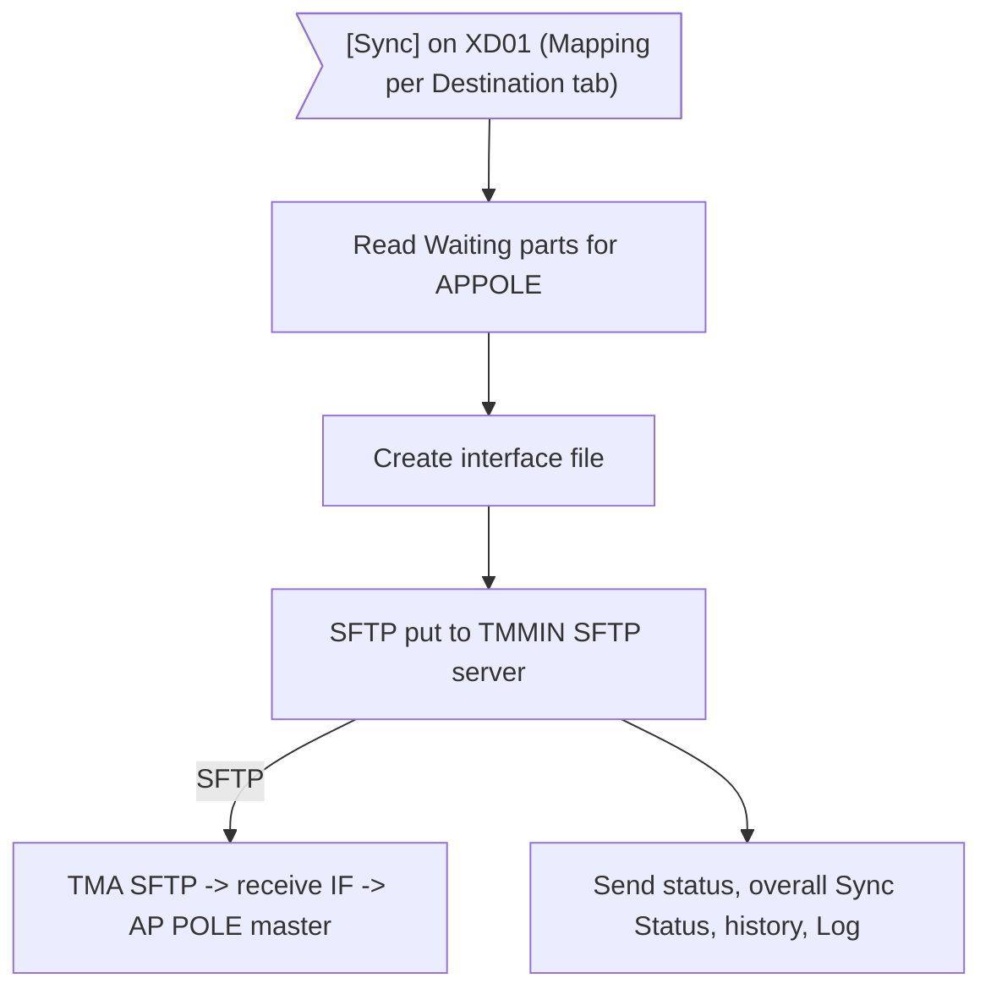
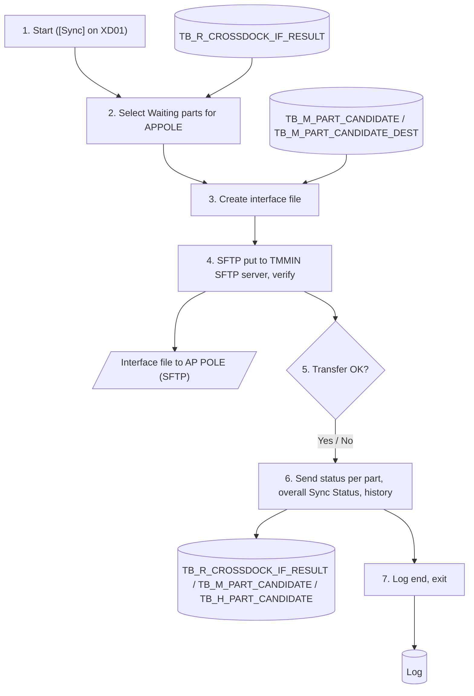

# XD07 – IF Cross Dock Master to AP POLE

> Generated from `deliverables/function_list_v2/specs/XD07_spec.json` (UISS `XD07_UISS_Batch_IFCrossDockMasterToAPPOLE.xlsx`). Do not edit by hand: change the spec and run `python3 prepare_code/build_md.py`. Document names: GTOPAS / NSP (prototype: G-System / Supplier System).

| Phase | Project | Block | Function | Created | By | Type |
|---|---|---|---|---|---|---|
| DR | Crossdock Optimization | Batch | XD07 IF Cross Dock Master to AP POLE | 18-Oct-26 | FID Rayhan | batch |

## Revision

| Rev | Author | Date | Reviewed by | Description |
|---|---|---|---|---|
| 0.1 | FID Rayhan | 18-Oct-26 |  | Initial Draft |

## 1. General

### Objective

- To send the cross dock master of the parts waiting for synchronisation to AP POLE: Active parts with Pcs/Case, Max Case/Day, Effective Start Date and all destinations with Case/Day of the ongoing period. Parts that became Inactive are sent with CROSSDOCK_FLAG 'N' (one record, no destination): AP POLE deletes the part at part level in Cross Dock Kanban Part Master (same as [Delete] on AP POLE screen WLM9Q890) (decided 30-Oct). Source: Part List (TB_M_PART_CANDIDATE) and Part Mapping per Destination (TB_M_PART_CANDIDATE_DEST).
- Interface method: interface file by SFTP, Option #3 of 'NSP Cross Dock Interfacing Data': NSP Send IF -> TMMIN SFTP -> TMA SFTP -> receive IF (TMA) -> AP POLE master. SFTP details, file format and the AP POLE tables are not detailed in this document.
- A part is sent as one complete set: AP POLE adds a new part, updates an existing part (Pcs/Case, Max Case/Day and destinations) and deletes an Inactive part (see 4.2), so a change such as Philippines up and Thailand down, or a removed destination, arrives as one consistent update.
- The send status per part is kept in TB_R_CROSSDOCK_IF_RESULT (dummy table); together with XD06 (GTOPAS) it gives the overall Sync Status shown on the Cross Dock Part Master screen (XD01).

### Operation flow

### Input

| Name | Type | Description |
|---|---|---|
| TB_R_CROSSDOCK_IF_RESULT | DB | Rows TARGET_SYSTEM = 'APPOLE' with IF_STATUS = '3' (Waiting), set by [Sync] on XD01 |
| TB_M_PART_CANDIDATE | DB | Part List: PART_NO, PART_STATUS, PCS_CASE, MAX_CASE_DAY, EFFECTIVE_START_DATE |
| TB_M_PART_CANDIDATE_DEST | DB | Part Mapping per Destination: PERIOD, DEST_CODE, CASE_DAY of the ongoing period |

### Output

| Name | Type | Description |
|---|---|---|
| Interface file to AP POLE (SFTP) | File | XD_CDMASTER_APPOLE_<YYYYMMDDHHMMSS>.csv: one record per part x destination (see Interface Data), put on the TMMIN SFTP server |
| AP POLE: Crossdock Kanban Part Master and Crossdock Export Part Master (AP POLE) | System | Inserted / updated by the receive IF of the TMA; the part is deleted when CROSSDOCK_FLAG 'N' (not in NSP scope) |
| TB_R_CROSSDOCK_IF_RESULT | DB | Dummy table: send status of 'APPOLE' per part (1 / 2), file name, message |
| TB_M_PART_CANDIDATE | DB | Overall SYNC_STATUS, SYNC_DT, SYNC_MESSAGE of the part |
| TB_H_PART_CANDIDATE | DB | History record per part (event SYNC, source IF) |
| Log | DB | Start, file, transfer and end messages |

### Parameters

| Name | Description |
|---|---|
| Target system | 'APPOLE' (AP POLE) |
| User | IF batch user ID |
| Interface method | interface file by SFTP, Option #3 of 'NSP Cross Dock Interfacing Data': NSP Send IF -> TMMIN SFTP -> TMA SFTP -> receive IF (TMA) -> AP POLE master. SFTP details, file format and the AP POLE tables are not detailed in this document. |

### Interface Data

| Field | Source | Format | M | Business rule |
|---|---|---|---|---|
| SEND_ID | Generated | CHAR(14) | Y | Run of the send (YYYYMMDDHHMMSS); all records of one file have the same SEND_ID and are processed as one set |
| PART_NO | TB_M_PART_CANDIDATE.PART_NO | VARCHAR(TBD) | Y | Cross dock part with Sync Status Waiting: Active parts, and parts that became Inactive since the last send |
| CROSSDOCK_FLAG | TB_M_PART_CANDIDATE.PART_STATUS | CHAR(1) | Y | 'Y' = Active / 'N' = Inactive: the receive IF deletes the part in Cross Dock Kanban Part Master (same as [Delete] on AP POLE screen WLM9Q890), which has one row per part number; only PART_NO, CROSSDOCK_FLAG, SEND_ID and SEND_DT are filled (decided 30-Oct) |
| PCS_CASE | TB_M_PART_CANDIDATE.PCS_CASE | NUMBER(TBD) | Y | Pieces per crossdock case; used to convert pieces to cases |
| MAX_CASE_DAY | TB_M_PART_CANDIDATE.MAX_CASE_DAY | NUMBER(TBD) | Y | Maximum cases per day of the part through crossdock (= total Case/Day of its destinations) |
| EFFECTIVE_START_DATE | TB_M_PART_CANDIDATE.EFFECTIVE_START_DATE | DATE (YYYYMMDD) | Y | Date from which the cross dock setting of the part applies |
| PERIOD | TB_M_PART_CANDIDATE_DEST.PERIOD | CHAR(6) | Y | Calculation period of the mapping (ongoing period, YYYYMM) |
| DEST_CODE | TB_M_PART_CANDIDATE_DEST.DEST_CODE | CHAR(7) | Y | Destination code (buyer code + PD code, TB_M_H0125_DESTINATION); one record per destination |
| CASE_DAY | TB_M_PART_CANDIDATE_DEST.CASE_DAY | NUMBER(TBD) | Y | Cases per day allocated to the destination (minimum 1; sum per part = MAX_CASE_DAY) |
| SEND_DT | Generated | DATETIME | Y | Date-time the file is created |

### Execution Schedule

| Item | Description |
|---|---|
| Trigger | On demand: [Sync] on XD01 (Mapping per Destination tab) starts XD07 and XD06. No scheduler. |
| Method | interface file by SFTP, Option #3 of 'NSP Cross Dock Interfacing Data': NSP Send IF -> TMMIN SFTP -> TMA SFTP -> receive IF (TMA) -> AP POLE master. SFTP details, file format and the AP POLE tables are not detailed in this document. |
| Order | Independent of XD06; both run after [Sync]. |

## 2. Function flow

1. [Sync] on XD01 sets the parts to Waiting (SYNC_STATUS = '3' in TB_M_PART_CANDIDATE, IF_STATUS = '3' for 'APPOLE' and 'GTOPAS' in TB_R_CROSSDOCK_IF_RESULT) and starts XD07. Write LOG1.
2. Select the parts with TARGET_SYSTEM = 'APPOLE' and IF_STATUS = '3' in TB_R_CROSSDOCK_IF_RESULT. Keep CHANGED_DT of each part.
  - PART_STATUS Active: sent with its destinations (CROSSDOCK_FLAG 'Y').
  - PART_STATUS Inactive: sent with CROSSDOCK_FLAG 'N' so AP POLE deletes the part.
  - No part: write LOG2 and exit.
3. Create the interface file XD_CDMASTER_APPOLE_<YYYYMMDDHHMMSS>.csv in the outbound folder (see Interface File / Interface Data):
  - Per part: PART_NO, CROSSDOCK_FLAG 'Y', PCS_CASE, MAX_CASE_DAY, EFFECTIVE_START_DATE from TB_M_PART_CANDIDATE.
  - Per destination of the ongoing period: PERIOD, DEST_CODE, CASE_DAY from TB_M_PART_CANDIDATE_DEST (one record each).
  - Inactive part: one record with PART_NO and CROSSDOCK_FLAG 'N'; the other fields of the part and destination are blank.
  - Same SEND_ID and SEND_DT on every record. Error: LOG3, all parts Failed (step 6).
4. Put the file by SFTP on the TMMIN SFTP server (outbound folder) and verify the transfer (file size / record count). The file is forwarded to the TMA SFTP server, where the receive IF of the TMA inserts / updates Crossdock Kanban Part Master and Crossdock Export Part Master (AP POLE).
  - Transfer error: retry (parameter); still failing: LOG4.
  - Transfer OK: move the local file to the backup folder.
5. Set the send status of every part of the file in TB_R_CROSSDOCK_IF_RESULT:
  - Transfer OK (file on the TMMIN SFTP server): IF_STATUS = '1', IF_DT = now, IF_FILE_NAME = file name, IF_MESSAGE blank.
  - File or transfer error: IF_STATUS = '2', IF_DT = now, IF_MESSAGE = error (LOG3 / LOG4).
  - The status is the result of the SFTP transfer.
6. Update the overall Sync Status of each part in TB_M_PART_CANDIDATE and record the history:
  - CHANGED_DT differs from step 2 (part changed while sending): SYNC_STATUS = '0' (No Sync).
  - Else, status of 'APPOLE' and of 'GTOPAS' in TB_R_CROSSDOCK_IF_RESULT: one still '3' -> SYNC_STATUS stays '3'; both '1' -> '1' (Success); one '2' -> '2' (Failed, SYNC_MESSAGE = target + reason).
  - SYNC_DT = now when SYNC_STATUS becomes 1 or 2.
  - Insert TB_H_PART_CANDIDATE: event SYNC, source IF, FIELD_NAME SYNC_STATUS, REMARK = 'APPOLE: ' + result / message.
7. Write LOG2 with the file name and the number of parts / records sent. Exit.

## 3. Data edit mapping

#### 1. Insert Interface file to AP POLE (SFTP) – One record per part x destination
- Source: TB_M_PART_CANDIDATE + TB_M_PART_CANDIDATE_DEST (keys: PART_NO = Waiting part, PERIOD = Ongoing period)

| Source field | Destination field | Description |
|---|---|---|
| - | SEND_ID | Run of the send (YYYYMMDDHHMMSS); all records of one file have the same SEND_ID and are processed as one set |
| PART_NO | PART_NO | Same value |
| PART_STATUS | CROSSDOCK_FLAG | 'Y' Active / 'N' Inactive (AP POLE deletes the part; other fields blank) |
| PCS_CASE | PCS_CASE | Same value |
| MAX_CASE_DAY | MAX_CASE_DAY | Same value |
| EFFECTIVE_START_DATE | EFFECTIVE_START_DATE | Same value |
| PERIOD | PERIOD | Same value |
| DEST_CODE | DEST_CODE | Same value |
| CASE_DAY | CASE_DAY | Same value |
| - | SEND_DT | Date-time the file is created |

#### 2. Update TB_R_CROSSDOCK_IF_RESULT – Dummy table: rows of the parts of the file for 'APPOLE'
- Source: Result of the file / transfer
- Destination keys: PART_NO + TARGET_SYSTEM = Part of the file + 'APPOLE'

| Source field | Destination field | Description |
|---|---|---|
|  | IF_STATUS | '1' transfer OK / '2' file or transfer error |
|  | IF_DT | Date-time of the result |
|  | IF_FILE_NAME | Name of the interface file |
|  | IF_MESSAGE | Error when '2'; blank when '1' |
|  | CHANGED_BY | IF batch user ID |
|  | CHANGED_DT | Server system date-time |
|  | PART_NO | Not changed |
|  | TARGET_SYSTEM | Not changed |
|  | PERIOD | Not changed |
|  | CREATED_BY | Not changed |
|  | CREATED_DT | Not changed |

#### 3. Update TB_M_PART_CANDIDATE – Overall Sync Status of the part
- Source: TB_R_CROSSDOCK_IF_RESULT (keys: PART_NO = Part of the file (both target rows))
- Destination keys: PART_NO = Part of the file

| Source field | Destination field | Description |
|---|---|---|
|  | SYNC_STATUS | '0' when CHANGED_DT changed; else '3' while a target is Waiting, '1' when both '1', '2' when a target is '2' |
|  | SYNC_DT | Date-time when SYNC_STATUS becomes 1 or 2; else not changed |
|  | SYNC_MESSAGE | Target + reason when Failed; blank when Success |
|  | PART_NO | Not changed |
|  | PART_NAME | Not changed |
|  | MIN_MAD | Not changed |
|  | PCS_CASE | Not changed |
|  | MAX_CASE_DAY | Not changed |
|  | TOTAL_PCS_DAY | Not changed |
|  | EFFECTIVE_START_DATE | Not changed |
|  | PART_STATUS | Not changed |
|  | LAST_SOURCE | Not changed |
|  | LAST_UPLOAD_ID | Not changed |
|  | CREATED_BY | Not changed |
|  | CREATED_DT | Not changed |
|  | CHANGED_BY | Not changed |
|  | CHANGED_DT | Not changed |

#### 4. Insert TB_H_PART_CANDIDATE – One record per part of the file
- Source: Result of the part

| Source field | Destination field | Description |
|---|---|---|
|  | HIST_ID | Auto (identity) |
|  | PART_NO | Part sent |
|  | PERIOD | Ongoing calculation period |
|  | EVENT_TYPE | 'SYNC' |
|  | SOURCE | 'IF' |
|  | UPLOAD_ID | NULL |
|  | DEST_CODE | NULL |
|  | FIELD_NAME | 'SYNC_STATUS' |
|  | OLD_VALUE | 'Waiting' |
|  | NEW_VALUE | New overall status (Waiting / Success / Failed / No Sync) |
|  | REMARK | 'APPOLE: ' + 'sent <file name>' or IF_MESSAGE |
|  | CREATED_BY | IF batch user ID |
|  | CREATED_DT | Server system date-time |

#### 5. Insert Log – Messages of the run
- Source: Result of this run

| Source field | Destination field | Description |
|---|---|---|
|  | BATCH_ID | 'XD07_IF_APPOLE' |
|  | STATUS | SUCCESS / ERROR |
|  | MESSAGE | LOG1 - LOG5 |
|  | START_DT / END_DT | Start and end date-time |

## 4. Function description

### 4.1 Business Process

- The D/S team maintains the cross dock master on XD01 (Part List: Pcs/Case, Max Case/Day, Effective Start Date; Mapping per Destination: Case/Day per destination of the ongoing period, created by XD05 process 2 and adjusted by screen or upload XD03).
- Every change sets the part to No Sync. The D/S team clicks [Sync] when the changes are complete; Active parts and parts that became Inactive are sent; Candidate parts are not.
- AP POLE adds a part that it does not have yet, updates an existing part (Pcs/Case, Max Case/Day and all destinations) and deletes an Inactive part (see 4.2).

- Interface method: interface file by SFTP, Option #3 of 'NSP Cross Dock Interfacing Data': NSP Send IF -> TMMIN SFTP -> TMA SFTP -> receive IF (TMA) -> AP POLE master. SFTP details, file format and the AP POLE tables are not detailed in this document.
- Parts that became Inactive (XD05 process 1) are sent with CROSSDOCK_FLAG 'N' and without destinations: the receive IF of the TMA deletes the part (one row per part number) in Cross Dock Kanban Part Master (same as [Delete] on AP POLE screen WLM9Q890) (decided 30-Oct). GTOPAS deletes all their rows too (XD06, RPA).

### 4.2 Field Rules

| Part in the file | In AP POLE | Receive IF of the TMA (Cross Dock Kanban Part Master) |
|---|---|---|
| CROSSDOCK_FLAG 'Y' | N | Add the part (Part No, Pcs/Case, Max Case/Day), then add its destinations with Case/Day |
| CROSSDOCK_FLAG 'Y' | Y | Edit the part: update Pcs/Case and Max Case/Day, and make its destinations and Case/Day equal to the file |
| CROSSDOCK_FLAG 'N' (Inactive) | Y | Delete the part (one row per part number) |

- Fields, source and business rule: see Interface Data (General Description). The field names on the side of the target follow the target layout.
- Sum of CASE_DAY of the records of a part <= MAX_CASE_DAY (guaranteed by XD05 and the save checks of XD01 / XD03; a lower total is allowed).
- PERIOD is always the ongoing period; past periods are never sent.

### 4.3 Status and Dummy Table

- TB_R_CROSSDOCK_IF_RESULT is a dummy table that keeps the send status per part and target; the real output of XD07 is the interface file sent to AP POLE.
- Overall SYNC_STATUS: Waiting while a target is Waiting, Success when both targets are sent, Failed when one target failed (the next [Sync] sends the part again to both targets; repeatable, AP POLE gets the complete set again).
- A part changed on XD01 or by upload while it is being sent gets SYNC_STATUS = No Sync, so the newer data is sent by the next [Sync].

### 4.4 Open Points

- Field names on the side of the target follow the target layout (not detailed in this document).
- Receive IF of the TMA: Add / Edit / Delete as in 4.2 - to be confirmed with the TMA.

## 5. Logging messages

| ID | Event | Cause | Type | Message | Action |
|---|---|---|---|---|---|
| LOG1 | Batch start | [Sync] on XD01 | Info | IF cross dock master to AP POLE started. <n> part(s). | system: Write the log.; user: - |
| LOG2 | Batch end | Batch finishes | Info | IF cross dock master to AP POLE ended. File <FILE_NAME>, parts <n>, records <r>, status <STATUS>. | system: Write the log.; user: - |
| LOG3 | Create file | Interface file cannot be created | Error | Cannot create the interface file to AP POLE: <ERROR_DETAIL>. | system: All parts of the run IF_STATUS = 2. Stop.; user: Click [Sync] again; contact PIC if it persists. |
| LOG4 | SFTP transfer | AP POLE SFTP not available / transfer fails after retry | Error | SFTP transfer of <FILE_NAME> to AP POLE failed: <ERROR_DETAIL>. | system: All parts of the file IF_STATUS = 2. Keep the file in the outbound folder.; user: Click [Sync] again later; contact PIC if it persists. |
| LOG5 | Unexpected error | Any other system error | Critical | Unexpected error: <ERROR_DETAIL>. | system: Stop. STATUS = ERROR.; user: User contact PIC |

## 7. Tables

#### TB_R_CROSSDOCK_IF_RESULT (transaction, proposed)
Dummy table (proposed): send status of the cross dock master per part and target system (XD06 GTOPAS, XD07 AP POLE). The real output is the interface data sent to the target (AP POLE: file by SFTP; GTOPAS: RPA). The overall Sync Status of the part stays in TB_M_PART_CANDIDATE.

| Column | Type | PK | Null | Description |
|---|---|---|---|---|
| PART_NO | VARCHAR(TBD) | Y | N | Part number (TB_M_PART_CANDIDATE) |
| TARGET_SYSTEM | VARCHAR(10) | Y | N | 'GTOPAS' (XD06) / 'APPOLE' (XD07) |
| PERIOD | CHAR(6) |  | N | Calculation period of the mapping sent (YYYYMM) |
| IF_STATUS | VARCHAR(1) |  | N | '3' Waiting / '1' Success / '2' Failed |
| IF_DT | DATETIME |  | Y | Date-time of the result of the target system |
| IF_FILE_NAME | VARCHAR(100) |  | Y | Name of the interface file (AP POLE) or RPA input file (GTOPAS) |
| IF_MESSAGE | VARCHAR(500) |  | Y | Reason when Failed; blank when Success |
| CREATED_BY | VARCHAR(TBD) |  | N | User who created the record |
| CREATED_DT | DATETIME |  | N | Created date and time |
| CHANGED_BY | VARCHAR(TBD) |  | N | User who last changed the record |
| CHANGED_DT | DATETIME |  | N | Last changed date and time |

#### TB_M_PART_CANDIDATE (transaction, existing)
Candidate part setting, one record per part (Part List data, no calculation period). Target of a successful upload.

| Column | Type | PK | Null | Description |
|---|---|---|---|---|
| PART_NO | VARCHAR(TBD) | Y | N | Part number; length follows TB_M_PART_MASTER |
| PART_NAME | VARCHAR(TBD) |  | N | Retrieved from TB_M_PART_MASTER by PART_NO |
| MIN_MAD | INT |  | N | Minimum MAD (mandatory); reference compared with the MAD result of the calculation |
| PCS_CASE | INT |  | N | Pieces per case (> 0) |
| MAX_CASE_DAY | INT |  | N | Total Case/Day of the part (> 0) |
| TOTAL_PCS_DAY | INT |  | N | PCS_CASE x MAX_CASE_DAY |
| EFFECTIVE_START_DATE | DATE |  | Y | Effective start date; required while the part is Candidate |
| PART_STATUS | VARCHAR(TBD) |  | N | Candidate / Active / Inactive |
| SYNC_STATUS | CHAR(1) |  | N | 0 = No Sync, 3 = Waiting, 1 = Success, 2 = Failed |
| SYNC_DT | DATETIME |  | Y | Date-time of the last IF function result |
| SYNC_MESSAGE | VARCHAR(TBD) |  | Y | Reason of the last Failed sync |
| LAST_SOURCE | VARCHAR(TBD) |  | N | CALC / SCREEN / UPLOAD |
| LAST_UPLOAD_ID | VARCHAR(TBD) |  | Y | Upload that last changed the record |
| CREATED_BY | VARCHAR(TBD) |  | N | User who created the record |
| CREATED_DT | DATETIME |  | N | Created date and time |
| CHANGED_BY | VARCHAR(TBD) |  | N | User who last changed the record |
| CHANGED_DT | DATETIME |  | N | Last changed date and time |

#### TB_M_PART_CANDIDATE_DEST (transaction, existing)
Destination mapping, one record per part, calculation period and destination (Mapping per Destination data). Target of a successful upload.

| Column | Type | PK | Null | Description |
|---|---|---|---|---|
| PART_NO | VARCHAR(TBD) | Y | N | Part number; FK to TB_M_PART_CANDIDATE |
| PERIOD | CHAR(6) | Y | N | Calculation period, YYYYMM e.g. 202609; displayed as Sep 2026 |
| DEST_CODE | CHAR(7) | Y | N | Destination code (buyer code + PD code, 7 digits); exists in TB_M_H0125_DESTINATION (Destination Master) |
| CASE_DAY | INT |  | N | Allocated Case/Day of the destination (> 0) |
| CREATED_BY | VARCHAR(TBD) |  | N | User who created the record |
| CREATED_DT | DATETIME |  | N | Created date and time |
| CHANGED_BY | VARCHAR(TBD) |  | N | User who last changed the record |
| CHANGED_DT | DATETIME |  | N | Last changed date and time |

#### TB_H_PART_CANDIDATE (history, proposed)
History of every change of a crossdock part (Add / Edit by screen or upload, mapping changes, Sync results, status changes and mappings made by the calculation batches). Read by the History setting modal of Part List (index PART_NO, CREATED_DT). No retention limit: the history is kept (no housekeeping job, decided 30-Oct).

| Column | Type | PK | Null | Description |
|---|---|---|---|---|
| HIST_ID | BIGINT | Y | N | Running number (identity) |
| PART_NO | VARCHAR(TBD) |  | N | Part number; length follows TB_M_PART_MASTER |
| PERIOD | CHAR(6) |  | Y | Calculation period YYYYMM for MAPPING / SYNC / CALC; NULL for ADD / EDIT (Part List has no period) |
| EVENT_TYPE | VARCHAR(10) |  | N | ADD / EDIT / MAPPING / SYNC / CALC |
| SOURCE | VARCHAR(10) |  | N | SCREEN / UPLOAD / IF / BATCH |
| UPLOAD_ID | VARCHAR(TBD) |  | Y | Upload of the change (Log); NULL when not from an upload |
| DEST_CODE | CHAR(7) |  | Y | Destination code (7 digits) for MAPPING; NULL for other events |
| FIELD_NAME | VARCHAR(30) |  | N | Changed field: PCS_CASE, MAX_CASE_DAY, MIN_MAD, PART_STATUS, EFFECTIVE_START_DATE, CASE_DAY, SYNC_STATUS |
| OLD_VALUE | VARCHAR(255) |  | Y | Value before the change; NULL for ADD or an added destination |
| NEW_VALUE | VARCHAR(255) |  | Y | Value after the change; NULL for a removed destination |
| REMARK | VARCHAR(500) |  | Y | Free text, e.g. SYNC_MESSAGE of a Failed sync |
| CREATED_BY | VARCHAR(20) |  | N | User who made the change (IF batch user ID for SYNC, batch user ID for BATCH) |
| CREATED_DT | DATETIME |  | N | Date and time of the change |
