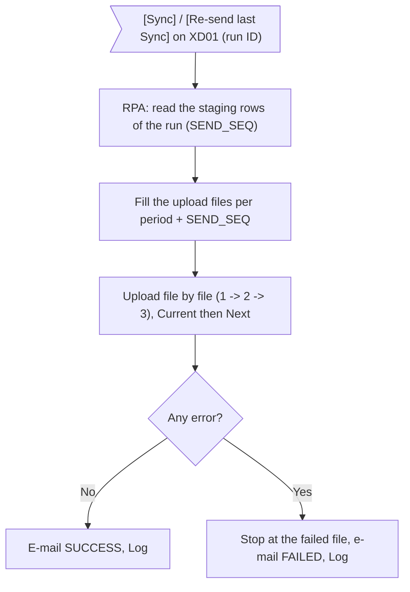
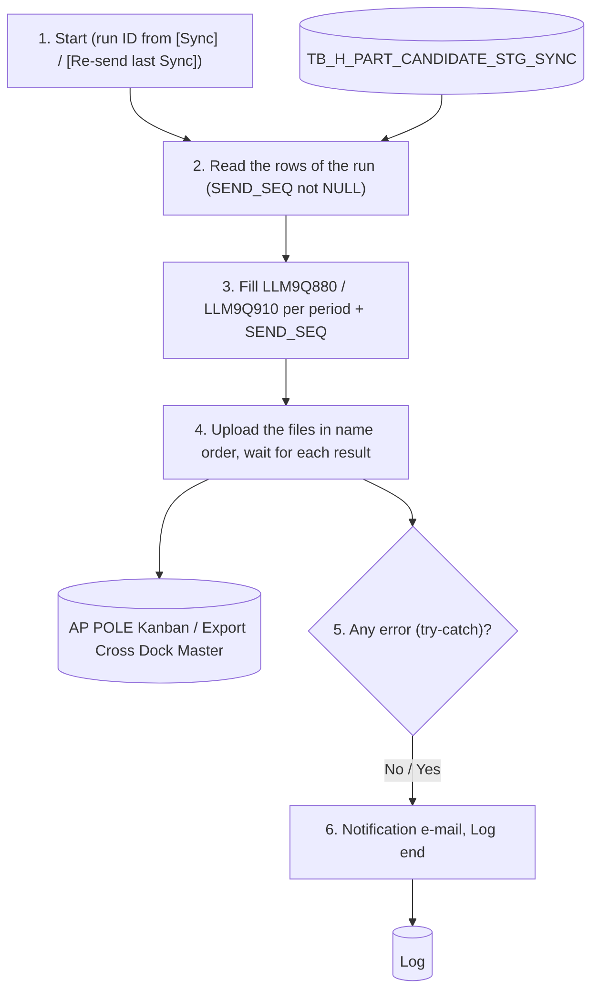

# XD07 – IF Cross Dock Master to AP POLE

> Generated from `deliverables/function_list_v2/specs/XD07_spec.json` (UISS `XD07_UISS_Batch_IFCrossDockMasterToAPPOLE.xlsx`). Do not edit by hand: change the spec and run `python3 prepare_code/build_md.py`. Document names: GTOPAS / NSP (prototype: G-System / Supplier System).

| Phase | Project | Block | Function | Created | By | Type |
|---|---|---|---|---|---|---|
| DR | Crossdock Optimization | Batch | XD07 RPA Cross Dock Master to AP POLE | 18-Oct-26 | FID Rayhan | batch |

## Revision

| Rev | Author | Date | Reviewed by | Description |
|---|---|---|---|---|
| 0.1 | FID Rayhan | 18-Oct-26 |  | Initial Draft |
| 0.2 | FID Rayhan | 17-Nov-26 |  | RPA on the AP POLE screens WLM9Q890 / WLM9Q860 instead of the SFTP interface file; source = XD01 Export Excel; part and destination scenarios; GTOPAS_SYNC_DT / APPOLE_SYNC_DT (from Crossdock_ap_pole_guide.xlsx). |
| 0.3 | FID Rayhan | 17-Nov-26 |  | [Sync] runs the RPA from the download: the bot downloads the XD01 Export Excel itself and fills the work sheet AP POLE Compare (source open point closed). |
| 0.4 | FID Rayhan | 17-Nov-26 |  | Sync Status rule of XD01 (No Sync only for a value sent to the target); a manual Active -> Inactive is also listed in Active to Inactive and deleted. |
| 0.5 | FID Rayhan | 18-Nov-26 |  | Sheet "Active to Inactive" removed (18-Nov): Inactive parts with No Sync / Failed are taken by [Sync] by their status. Parts to delete = sheet Kanban Crossdock Master, Status Inactive, Sync Status Waiting. |
| 0.6 | FID Rayhan | 19-Nov-26 |  | Notification email of the RPA (Power Automate): cases SUCCESS / FAILED / bot not started, recipients, subject, body, attachment, retry (4.6); LOG6. |
| 0.7 | FID Rayhan | 19-Nov-26 |  | Effective Month / Year = period (MM, YYYY); Current then Next; Order Type of the row; order of the screens when Max Case/Day goes down (19-Nov). |
| 0.8 | FID Rayhan | 20-Nov-26 |  | No response to NSP: the bot does not write TB_M_PART_CANDIDATE / TB_M_PART_CANDIDATE / TB_H_PART_CANDIDATE; the result is the notification e-mail; [Re-send last Sync] (20-Nov). |
| 0.9 | FID Rayhan | 20-Nov-26 |  | TB_R_CROSSDOCK_IF_RESULT removed; the parts of the run come from the send time on TB_M_PART_CANDIDATE (GTOPAS_SYNC_DT / APPOLE_SYNC_DT) and SYNC_RUN_ID (20-Nov). |
| 1.0 | FID Rayhan | 22-Nov-26 |  | Upload files LLM9Q910 / LLM9Q880 instead of the screen steps; source = TB_H_PART_CANDIDATE_STG_SYNC only; SEND_SEQ order 1 / 2 / 3 (22-Nov). |

## 1. General

### Objective

- To make the cross dock master of AP POLE equal to NSP by an RPA that uploads files (22-Nov): Cross Dock Kanban Part Master (LLM9Q910) and Export Customer Cross Dock Master (LLM9Q880), filled from the stored templates.
- Source data: only TB_H_PART_CANDIDATE_STG_SYNC (read-only DB user), rows of the run ID passed by [Sync] / [Re-send last Sync]. NSP has reduced the rows and set SEND_SEQ before the bot starts.
- Order: SEND_SEQ 1 Export (parts whose Max goes down) -> 2 Kanban -> 3 Export (every other part); Current period first, then Next. AP POLE checks every row: total Max Shipping Box (RCS) of the part <= Max Shipping Box Qty.
- The bot writes nothing back to NSP; the result comes by the notification e-mail.

### Operation flow

### Input

| Name | Type | Description |
|---|---|---|
| TB_H_PART_CANDIDATE_STG_SYNC | DB | Rows with APPOLE_SYNC_RUN_ID = run ID and SEND_SEQ not NULL; Kanban pair Pcs/Case + Max Case/Day from the latest Sync row of each field (refer 4.3) |
| Templates LLM9Q910 / LLM9Q880 | File | Stored upload templates (not downloaded from AP POLE) |

### Output

| Name | Type | Description |
|---|---|---|
| AP POLE Cross Dock Kanban Part Master | System | Uploaded file LLM9Q910 (not in NSP scope) |
| AP POLE Export Customer Cross Dock Master | System | Uploaded files LLM9Q880 (not in NSP scope) |
| Log | DB | One record per run; notification e-mail |

### Parameters

| Name | Description |
|---|---|
| Target system | 'APPOLE' (AP POLE, https://ap-pole.toyota-asia.com/lm9/) |
| Method | RPA upload of LLM9Q910 / LLM9Q880 (22-Nov; no screen steps, no SFTP file) |
| User | RPA bot user with AP POLE login; read-only DB user on NSP |
| Operator ID | 'P6' (fixed) in LLM9Q910 |
| Transport Code | '2' (fixed) in LLM9Q880 |

### LLM9Q910 Cross Dock Kanban Part Master (file 2)

| Column | NSP source / rule |
|---|---|
| Effective Month / Year | PERIOD (MM / YYYY) |
| Operator ID | 'P6' |
| Part No. | PART_NO with "-" |
| Part Name | PART_NAME |
| Shipping Box Qty | PCS_CASE (latest Sync row) |
| Max Shipping Box Qty | MAX_CASE_DAY (latest Sync row) |
| Max Allowance Qty | Shipping Box Qty x Max Shipping Box Qty |
| Packing/Pallet Type ... Outer-Qty | Empty |

### LLM9Q880 Export Customer Cross Dock Master (files 1 and 3)

| Column | NSP source / rule |
|---|---|
| Effective Month / Year | PERIOD (MM / YYYY) |
| Part No. | PART_NO without "-" |
| Buyer-PD | DEST_CODE as 5-2 (e.g. 9722D-10) |
| Order Type | ORDER_TYPE |
| Transport Code | '2' |
| Max Shipping Box (RCS) | NEW_VALUE (0 for DELETE) |
| Shipping Box Qty, Max Shipping Box by Part No., Max Allowance Qty, Packing/Pallet Type | Empty |

## 2. Function flow

1. NSP starts the flow with the run ID after [Sync] / [Re-send last Sync] (the staging is already updated). Write LOG1. The whole run is inside one try-catch.
2. Read TB_H_PART_CANDIDATE_STG_SYNC (read-only DB user): rows with APPOLE_SYNC_RUN_ID = run ID and SEND_SEQ not NULL.
  - Kanban rows (SEND_SEQ 2): one row per part + period; Pcs/Case and Max Case/Day = NEW_VALUE of the latest row with APPOLE_SYNC_STATUS 1 of each field (this run or an earlier one), so the pair is complete when only one field changed.
  - Export rows (SEND_SEQ 1 / 3): Max Shipping Box (RCS) = NEW_VALUE (0 for DELETE).
3. Fill the stored templates: one file per period + SEND_SEQ, name <template>_<run ID>_<period>_<SEND_SEQ>.xls (e.g. LLM9Q880_20261127100000_202611_1.xls). A file without rows is not made.
  - Inside an Export file: per part the rows going down / deleted first, then up / added (AP POLE checks row by row).
4. Upload the files one at a time in the order of their names (Current period first, then Next) and wait for each result. Write LOG3 per file.
  - File 1 (Export, only parts whose Max goes down) -> file 2 (Kanban) -> file 3 (Export, every other part).
5. Any error (try-catch): stop at the failed file, write LOG4. The files already uploaded stay in AP POLE; the other files wait for [Re-send last Sync].
6. Send the notification e-mail (SUCCESS / FAILED), write LOG6 and LOG2. The bot writes nothing to NSP.

## 3. Data edit mapping

#### 1. Insert LLM9Q910 Cross Dock Kanban Part Master (upload file) – One row per part + period (file 2)
- Source: TB_H_PART_CANDIDATE_STG_SYNC (keys: APPOLE_SYNC_RUN_ID = Run ID, SEND_SEQ = 2)

| Source field | Destination field | Description |
|---|---|---|
| PERIOD | Effective Month / Year | MM / YYYY |
| - | Operator ID | 'P6' |
| PART_NO | Part No. | With "-" |
| PART_NAME | Part Name |  |
| NEW_VALUE (PCS_CASE) | Shipping Box Qty | Latest row with APPOLE_SYNC_STATUS 1 of PCS_CASE for the part + period |
| NEW_VALUE (MAX_CASE_DAY) | Max Shipping Box Qty | Latest row with APPOLE_SYNC_STATUS 1 of MAX_CASE_DAY |
| - | Max Allowance Qty | Shipping Box Qty x Max Shipping Box Qty |

#### 2. Insert LLM9Q880 Export Customer Cross Dock Master (upload files) – One row per destination + order type (files 1 and 3)
- Source: TB_H_PART_CANDIDATE_STG_SYNC (keys: APPOLE_SYNC_RUN_ID = Run ID, LEVEL_TYPE / SEND_SEQ = 'EXPORT' / 1 or 3)

| Source field | Destination field | Description |
|---|---|---|
| PERIOD | Effective Month / Year | MM / YYYY |
| PART_NO | Part No. | Without "-" |
| DEST_CODE | Buyer-PD | 5-2 format |
| ORDER_TYPE | Order Type |  |
| - | Transport Code | '2' |
| NEW_VALUE | Max Shipping Box (RCS) | 0 for DELETE |

#### 3. Insert Log – Messages of the run
- Source: Result of this run

| Source field | Destination field | Description |
|---|---|---|
|  | BATCH_ID | 'XD07_RPA_APPOLE' |
|  | RUN_ID | Run ID |
|  | STATUS | SUCCESS / ERROR |
|  | MESSAGE | LOG1 - LOG6 |
|  | START_DT / END_DT | Start and end date-time |

## 4. Function description

### 4.1 Business Process

- Procurement maintains the Kanban Crossdock Master and the D/S team the Export Crossdock Master on XD01; XD05 makes the Next period on day D. Every value change is a row of TB_H_PART_CANDIDATE_STG_SYNC (refer XD01 5.24).
- The D/S team clicks [Sync]: NSP reduces the Non Sync rows of the Current and Next period (first OLD / last NEW per key), sets SEND_SEQ, the run ID and LAST_SYNC_DATE_APPOLE, then starts this bot.
- Decisions and simulation: deliverables/function_list_v2/erd/proposal_staging_sync (Summary_Staging_Sync_Decisions.md, simulation/Full_Sync_Flow_Simulation.xlsx).

### 4.2 Upload Files and Order

| SEND_SEQ | File | Rows |
|---|---|---|
| 1 | LLM9Q880 Export, before Kanban | EXPORT rows of a part whose Max Case/Day goes down (destinations lowered first) |
| 2 | LLM9Q910 Kanban | Every KANBAN change and new part (Pcs/Case and Max in one row) |
| 3 | LLM9Q880 Export, after Kanban | EXPORT rows of every other part: Max up, new part, no KANBAN row (moves, deletes, Inactive) |

- File name <template>_<run ID>_<period>_<SEND_SEQ>.xls; one file per period + SEND_SEQ; Current first, then Next. A file without rows is not made.
- AP POLE checks every row: total Max Shipping Box (RCS) of the part <= Max Shipping Box Qty. Inside an Export file the rows of a part going down / deleted come first, then up / added.
- Delete of a Buyer-PD = Max Shipping Box (RCS) 0 (the row stays in AP POLE with 0). An Inactive part stays in the Kanban with its Buyer-PD 0; in the following months it has no Export row.

### 4.3 Data from the Staging

- Rows of the run: APPOLE_SYNC_RUN_ID = run ID and SEND_SEQ not NULL (Superseded rows and keys ending on their first value have no SEND_SEQ).
- Kanban row: Pcs/Case and Max Case/Day = NEW_VALUE of the latest row with APPOLE_SYNC_STATUS 1 of each field for the part + period (this run or an earlier one; XD05 always writes both on day D).
- Part Name from the staging (PART_NAME column).
- Queries: deliverables/function_list_v2/erd/proposal_staging_sync/sql/staging_sync_queries.sql (Kanban file, Export files).

### 4.4 Try-Catch and Re-send

- The whole run is in one try-catch. Any error (login, upload screen, AP POLE error of a row, timeout) stops the run at that file.
- Files uploaded before the error stay in AP POLE. The D/S team clicks [Re-send last Sync]: the files of the last run are made and uploaded again in the same order (the values are set, so a repeat is safe).
- NSP does not receive the result (no response); the staging stays Sync. The e-mail tells SUCCESS / FAILED.

### 4.5 Notification Email (Power Automate, 19-Nov)

- The cloud flow of the RPA sends one email per run of XD07 (AP POLE), so the user knows the result without opening NSP.
- One email per target: XD06 (GTOPAS) and XD07 (AP POLE) run as separate bots, so a [Sync] gives two emails.
- One email per run: the retries of the same run do not send an email; only the final result does.

| No | Case | When the email is sent | Subject result |
|---|---|---|---|
| E1 | Run without error | End of the run, after the last part | SUCCESS |
| E2 | Run stopped by an error (try-catch) | After the automatic retries of the cloud flow are used up (retry count and interval in the flow settings, proposal 2 times, 10 minutes) | FAILED |
| E3 | Bot could not start (machine offline, login of NSP / AP POLE failed, desktop flow time out) | Cloud flow branch "run after = failed / timed out" of the desktop flow action | FAILED |
| - | Nothing to send (no row with SEND_SEQ in the run) | No email | - |

| Item | Content |
|---|---|
| Sender | Shared mailbox of the RPA (Office 365 Outlook connector "Send an email (V2)"), TBC |
| To | User who clicked [Sync] (e-mail sent by NSP in the request of the flow) + D/S team mailing list |
| Cc | RPA PIC; for FAILED also the NSP PIC |
| Subject | [Crossdock Sync][AP POLE][SUCCESS \| FAILED] Run <RUN_ID> - <n> part(s) |
| Body 1. Run | RUN_ID, target AP POLE, started / ended, [Sync] by <user> at <date-time>, period(s) sent |
| Body 2. Summary | Parts processed; part added / edited / deleted, Buyer-PD added / edited / deleted |
| Body 3. Error (FAILED) | Step, part, destination and message of the error (LOG4 / LOG5); parts not processed |
| Body 4. Action | SUCCESS: no action. FAILED: click [Re-send last Sync] on Crossdock Master Setting; contact the RPA PIC when it fails again |
| Body 5. Links | Folder of the RPA work file (SharePoint / OneDrive, TBC); link to the run in Power Automate (for the RPA PIC) |
| Attachment | The upload files of the run with the AP POLE result per file. Above the mail size limit: link only |
| Language | English |

- Example subject: [Crossdock Sync][AP POLE][FAILED] Run 20261127103000 - 12 part(s).
- Recipients (mailing list, RPA PIC, NSP PIC) are set in the flow settings, not in the code of the bot.
- LOG6 is written when the email is sent; when sending fails, the run result stays and the RPA PIC sees it in the Power Automate run history.

### 4.6 Open Points

- Upload screen of AP POLE for LLM9Q910 / LLM9Q880 (Common File Upload) - steps of the bot TBC with the AP POLE team.

## 5. Logging messages

| ID | Event | Cause | Type | Message | Action |
|---|---|---|---|---|---|
| LOG1 | Batch start | [Sync] / [Re-send last Sync] on XD01 | Info | RPA cross dock master to AP POLE started. Run <RUN_ID>, <n> file(s). | system: Write the log.; user: - |
| LOG2 | Batch end | Bot finishes | Info | RPA cross dock master to AP POLE ended. Run <RUN_ID>, files uploaded <f>, rows <r>, status <STATUS>. | system: Write the log.; user: - |
| LOG3 | File uploaded | AP POLE accepted the file | Info | <FILE_NAME> uploaded: <n> row(s). | system: Write the log.; user: - |
| LOG4 | Error (try-catch) | Login, upload screen, AP POLE error of a row, timeout | Error | RPA to AP POLE stopped at <FILE_NAME> row <n>: <ERROR_DETAIL>. Files not uploaded: <list>. | system: Stop the bot.; user: Click [Re-send last Sync]; contact PIC if it persists. |
| LOG5 | Unexpected error | Any other system error | Critical | Unexpected error: <ERROR_DETAIL>. | system: Stop. STATUS = ERROR.; user: User contact PIC |
| LOG6 | Notification email | End of the run (SUCCESS / FAILED) | Info | Notification email <SUCCESS / FAILED> of run <RUN_ID> sent to <recipients>. | system: Write the log.; user: Read the email; FAILED: click [Re-send last Sync]. |

## 7. Tables

#### TB_H_PART_CANDIDATE_STG_SYNC (history, proposed)
Staging of every value change of the Kanban / Export Crossdock Master for the sync to AP POLE (XD07) and GTOPAS (XD06) (22-Nov). Inserted by XD01 (screen), XD02 / XD03 (upload) and XD05 in the same transaction as the master update; updated only by [Sync], [Re-send last Sync] and the Period Rollover. The RPA reads only this table. TB_H_PART_CANDIDATE (screen history) is kept as it is.

| Column | Type | PK | Null | Description |
|---|---|---|---|---|
| HIST_ID | BIGINT | Y | N | Running number (identity): order of the changes |
| PART_NO | VARCHAR(TBD) |  | N | Part number (NSP format, with "-"); FK1 (PART_NO, PERIOD) -> TB_M_PART_CANDIDATE |
| PART_NAME | VARCHAR(TBD) |  | N | Part Name copied from TB_M_PART_CANDIDATE at the insert (Part Name of the Kanban upload file) |
| PERIOD | CHAR(6) |  | N | Calculation period YYYYMM; Effective Month / Year of the AP POLE upload |
| PART_STATUS | VARCHAR(10) |  | N | Status of the part in this period when the row is written (Active / Inactive). Inactive: the part stays in the AP POLE Kanban, its Export rows are DELETE with NEW_VALUE 0 |
| LEVEL_TYPE | VARCHAR(6) |  | N | KANBAN = parent (Kanban Crossdock Master), EXPORT = destination (Export Crossdock Master) |
| DEST_CODE | CHAR(7) |  | Y | EXPORT only: destination code. No FK (a DELETE row points to a removed destination) |
| ORDER_TYPE | VARCHAR(2) |  | Y | EXPORT only: '**', 'C', '9', 'V' |
| FIELD_NAME | VARCHAR(30) |  | N | KANBAN: PCS_CASE, MAX_CASE_DAY. EXPORT: CASE_DAY |
| ACTION | VARCHAR(6) |  | N | ADD / EDIT / DELETE |
| OLD_VALUE | VARCHAR(10) |  | Y | Value before the change; NULL on ADD |
| NEW_VALUE | VARCHAR(10) |  | Y | Value after the change; 0 on DELETE |
| SOURCE | VARCHAR(6) |  | N | BATCH (XD05) / SCREEN / UPLOAD |
| UPLOAD_ID | VARCHAR(TBD) |  | Y | Upload of the Kanban or Export Excel (Log); NULL when SOURCE is not UPLOAD |
| APPOLE_SYNC_STATUS | CHAR(1) |  | N | 0 = Non Sync (default), 1 = Sync, 2 = Superseded (an earlier row of the same key, not sent). The part + period is AP POLE Non Sync while it has a row with 0 |
| APPOLE_SYNC_DT | DATETIME |  | Y | Time of the [Sync] that sent the row to AP POLE (status 1 and 2); Last Sent AP POLE = latest value |
| SEND_SEQ | NUMBER(1) |  | Y | Upload file: 1 = Export (LLM9Q880) before the Kanban file, only for a part whose Max goes down; 2 = Kanban (LLM9Q910); 3 = Export after the Kanban file (every other part). Set at [Sync] on the last row of each key; NULL for 2 and for a key that ends on its first value |
| APPOLE_SYNC_RUN_ID | VARCHAR(14) |  | Y | AP POLE run ID YYYYMMDDHHMMSS; [Re-send last Sync] takes the rows of the last run |
| GTOPAS_SYNC_STATUS | CHAR(1) |  | Y | NULL = not for GTOPAS (KANBAN rows, EXPORT EDIT). 0 = Non Sync: EXPORT ADD / DELETE (destination appears / disappears). 1 = Sync: [Sync] for the Current period, the Period Rollover for the new period |
| GTOPAS_SYNC_DT | DATETIME |  | Y | Time of the [Sync] / Period Rollover that sent the row to GTOPAS; Last Sent GTOPAS = latest value |
| GTOPAS_SYNC_RUN_ID | VARCHAR(14) |  | Y | GTOPAS run ID ([Sync], [Re-send last Sync] or the Period Rollover) |
| CREATED_BY | VARCHAR(20) |  | N | User of the save / upload, or XD05BATCH |
| CREATED_DT | DATETIME |  | N | Time of the insert (same transaction as the master update) |
| CHANGED_BY | VARCHAR(20) |  | Y | User of [Sync] / [Re-send last Sync], XD05BATCH for the Period Rollover |
| CHANGED_DT | DATETIME |  | Y | Time of that update |
