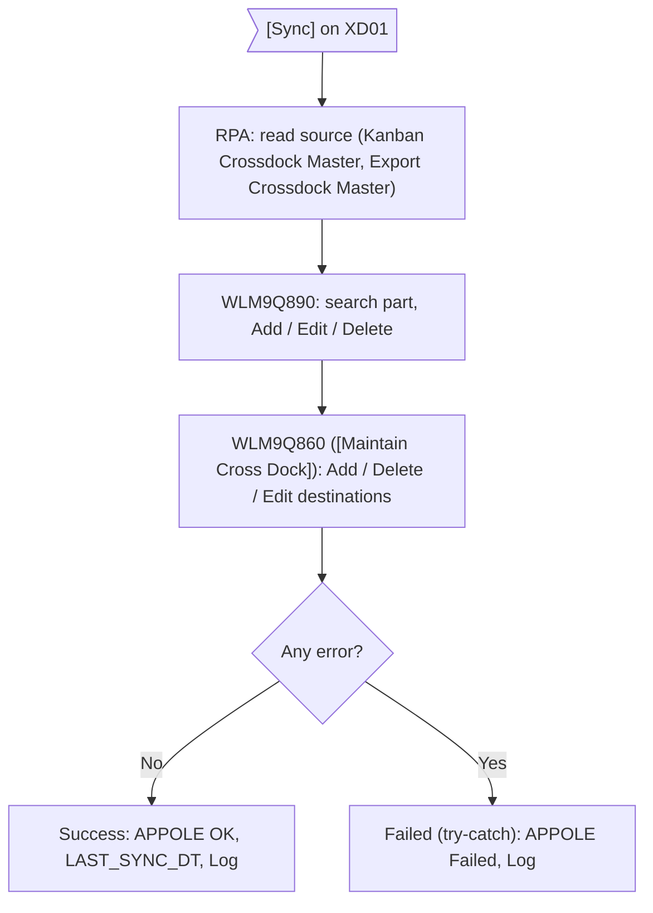
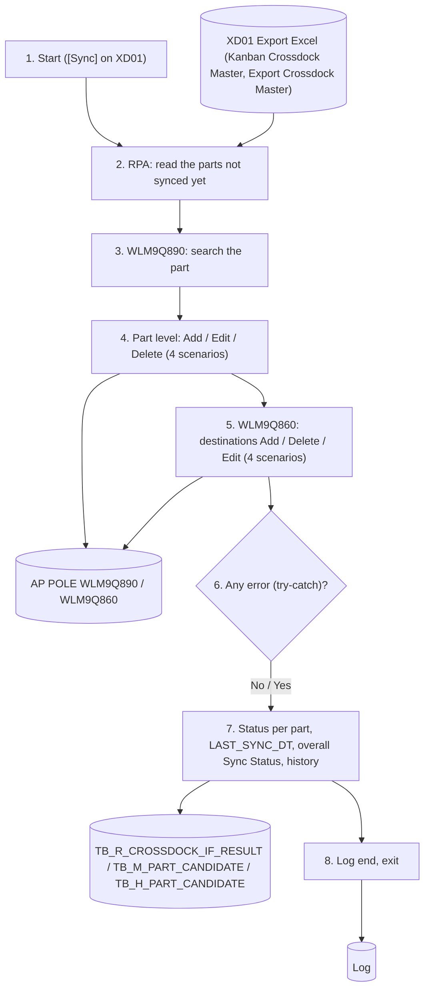

# XD07 – IF Cross Dock Master to AP POLE

> Generated from `deliverables/function_list_v2/specs/XD07_spec.json` (UISS `XD07_UISS_Batch_IFCrossDockMasterToAPPOLE.xlsx`). Do not edit by hand: change the spec and run `python3 prepare_code/build_md.py`. Document names: GTOPAS / NSP (prototype: G-System / Supplier System).

| Phase | Project | Block | Function | Created | By | Type |
|---|---|---|---|---|---|---|
| DR | Crossdock Optimization | Batch | XD07 RPA Cross Dock Master to AP POLE | 18-Oct-26 | FID Rayhan | batch |

## Revision

| Rev | Author | Date | Reviewed by | Description |
|---|---|---|---|---|
| 0.1 | FID Rayhan | 18-Oct-26 |  | Initial Draft |
| 0.2 | FID Rayhan | 17-Nov-26 |  | RPA on the AP POLE screens WLM9Q890 / WLM9Q860 instead of the SFTP interface file; source = XD01 Export Excel; part and destination scenarios; LAST_SYNC_DT (from Crossdock_ap_pole_guide.xlsx). |
| 0.3 | FID Rayhan | 17-Nov-26 |  | [Sync] runs the RPA from the download: the bot downloads the XD01 Export Excel itself and fills the work sheet AP POLE Compare (source open point closed). |
| 0.4 | FID Rayhan | 17-Nov-26 |  | Sync Status rule of XD01 (No Sync only for a value sent to the target); a manual Active -> Inactive is also listed in Active to Inactive and deleted. |
| 0.5 | FID Rayhan | 18-Nov-26 |  | Sheet "Active to Inactive" removed (18-Nov): Inactive parts with No Sync / Failed are taken by [Sync] by their status. Parts to delete = sheet Kanban Crossdock Master, Status Inactive, Sync Status Waiting. |
| 0.6 | FID Rayhan | 19-Nov-26 |  | Notification email of the RPA (Power Automate): cases SUCCESS / FAILED / bot not started, recipients, subject, body, attachment, retry (4.6); LOG6. |
| 0.7 | FID Rayhan | 19-Nov-26 |  | Effective Month / Year = period (MM, YYYY); Current then Next; Order Type of the row; order of the screens when Max Case/Day goes down (19-Nov). |

## 1. General

### Objective

- To make the cross dock master of AP POLE equal to NSP by an RPA process on the AP POLE web screens (decided 17-Nov, replaces the SFTP interface file): part level on WLM9Q890 Cross Dock Kanban Part Master, destination level on WLM9Q860 Export Customer Cross Dock Master.
- Source data: the Export Excel files of XD01, downloaded by the bot itself after [Sync] (decided 17-Nov): Kanban Crossdock Master (Status, Part Name, Pcs/Case, Max Case/Day), Export Crossdock Master of the ongoing period (Destination Code, Dest Case/Day, Last Sync Date); only the parts with Sync Status Waiting.
- Part level: a part that became Active is added (or edited when AP POLE still has it), an Active part with a new Pcs/Case or Max Case/Day is edited, a part that went Active -> Inactive is deleted. Destination level: destinations are added, deleted or edited so that AP POLE has the same Buyer-PD and Max Shipping Box Qty as NSP.
- Step by step guide with the AP POLE screens: deliverables/user_guide/Crossdock_User_Guide_AP_POLE.xlsx.

### Operation flow

### Input

| Name | Type | Description |
|---|---|---|
| XD01 Export Excel: Kanban Crossdock Master | File | Downloaded by the bot after [Sync]. Sheet Kanban Crossdock Master: Part Number, Part Name, Pcs/Case, Max Case/Day, Status, Sync Status |
| XD01 Export Excel: Export Crossdock Master | File | Downloaded by the bot after [Sync]. Sheet Export Crossdock Master (ongoing period): Part Number, Destination Code, Dest Case/Day, Sync Status |
| TB_R_CROSSDOCK_IF_RESULT | DB | Parts Waiting for 'APPOLE' (IF_STATUS = '3'), set by [Sync] on XD01; LAST_SYNC_DT |
| AP POLE WLM9Q890 / WLM9Q860 | System | Current part and destination rows of AP POLE, read by the bot (search per part) |

### Output

| Name | Type | Description |
|---|---|---|
| AP POLE WLM9Q890 Cross Dock Kanban Part Master | System | Part added / edited / deleted by the bot (not in NSP scope) |
| AP POLE WLM9Q860 Export Customer Cross Dock Master | System | Buyer-PD rows added / edited / deleted by the bot (not in NSP scope) |
| TB_R_CROSSDOCK_IF_RESULT | DB | Result of 'APPOLE' per Waiting part (1 / 2), run ID, message, LAST_SYNC_DT on Success |
| TB_M_PART_CANDIDATE | DB | Overall SYNC_STATUS, SYNC_DT, SYNC_MESSAGE of the part |
| TB_H_PART_CANDIDATE | DB | History record per part (event SYNC, source RPA) |
| Log | DB | Start, counts (added / edited / deleted per screen), error and end messages |

### Parameters

| Name | Description |
|---|---|
| Target system | 'APPOLE' (AP POLE, https://ap-pole.toyota-asia.com/lm9/) |
| Method | RPA bot on the AP POLE web screens (decided 17-Nov; no SFTP interface file) |
| User | RPA bot user with AP POLE login (Operator ID: TBC) |
| Menu | Master Maintenance > Cross Dock Kanban Part Master |
| Effective Month / Year | Search: Effective From = first day, To = last day of the month; Add: next month (auto by AP POLE) |

### AP POLE WLM9Q890 Cross Dock Kanban Part Master (part level)

| AP POLE item | NSP source / rule |
|---|---|
| Effective Month / Year | Auto generated (next month) / auto generated |
| Operator ID | TBC (e.g. P5, P6 on the AP POLE screen) |
| Part No. | PART_NO (AP POLE shows it with "-", e.g. 52101-BZA40) |
| Part Name | PART_NAME |
| Shipping Box Qty | PCS_CASE (Pcs/Case) |
| Max Shipping Box Qty | MAX_CASE_DAY (Max Case/Day) |
| Max Allowance Qty | Calculated by AP POLE = Shipping Box Qty x Max Shipping Box Qty (e.g. 6 x 20 = 120) |
| Buttons | [Search], [Add], [Edit] (pop up WLM9Q891, [Save]), [Delete], [Maintain Cross Dock] (opens WLM9Q860 for the ticked part) |

### AP POLE WLM9Q860 Export Customer Cross Dock Master (destination level)

| AP POLE item | NSP source / rule |
|---|---|
| Buyer-PD | DEST_CODE: 5-digit buyer code + "-" + 2-digit PD code (9722D88 -> 9722D-88) |
| Order Type | '**' |
| Transport Code | Always '2' |
| Max Shipping Box Qty | CASE_DAY of the destination (Dest Case/Day) |
| Max Allowance Qty | Calculated by AP POLE = Shipping Box Qty of the part x Max Shipping Box Qty |
| Total Shipping Allocated (Export Supply) | Sum of Max Shipping Box Qty of the destinations; may not be more than Max Shipping Box Qty of the part |
| Buttons | [Add], [Edit], [Delete], [Back] |

## 2. Function flow

1. [Sync] on XD01 sets the parts to Waiting (SYNC_STATUS = '3', IF_STATUS = '3' for 'GTOPAS' and 'APPOLE') and starts the RPA bot. Write LOG1. The whole run is inside one try-catch.
2. The bot logs in to NSP and downloads the XD01 Export Excel: Export Crossdock Master (ongoing period, Sync Status = Waiting) and Kanban Crossdock Master; it reads them. It adds the work sheet AP POLE Compare to the file (part / Buyer-PD, NSP value, AP POLE value, Action Add / Edit / Delete / Keep, Result, AP POLE message).
  - Parts to process = Sync Status No Sync / Waiting (not synced since the last change). Part level from Kanban Crossdock Master (Status, Part Name, Pcs/Case, Max Case/Day); destination level from Export Crossdock Master (Destination Code, Dest Case/Day); parts to delete = Kanban Crossdock Master rows with Status Inactive (Waiting).
3. AP POLE menu Master Maintenance > Cross Dock Kanban Part Master (WLM9Q890): Effective From = first day, To = last day of the month, Part No. = part of the source, [Search].
4. Part level (4.2): add, edit or delete the part on WLM9Q890.
  - Add / Edit: Shipping Box Qty = PCS_CASE, Max Shipping Box Qty = MAX_CASE_DAY, [Save]. Delete: tick the part, [Delete].
5. Destination level (4.3): tick the part, [Maintain Cross Dock] (opens WLM9Q860), compare the Buyer-PD rows with the NSP destinations and add, delete or edit them; [Back].
  - Add: Buyer-PD = DEST_CODE (5-2 format), Order Type **, Transport Code 2, Max Shipping Box Qty = Dest Case/Day.
  - Total Shipping Allocated may not be more than Max Shipping Box Qty of the part: delete the destinations not in NSP before adding.
6. Try-catch: any error (login, screen not available, timeout, AP POLE error message, source file not readable) stops the bot at once.
  - The whole run is Failed (one fails, all fail): LOG4 with the step, part and destination. Changes made before the error stay in AP POLE (no rollback on the screen); the next run compares again and completes the rest.
7. Set the result of every Waiting part for 'APPOLE' in TB_R_CROSSDOCK_IF_RESULT and the overall Sync Status:
  - No error: IF_STATUS = '1', IF_DT and LAST_SYNC_DT = now, IF_MESSAGE = 'part <added / edited / deleted>, dest added <n>, deleted <n>, edited <n>'. Error: IF_STATUS = '2', IF_DT = now, LAST_SYNC_DT not changed.
  - TB_M_PART_CANDIDATE: CHANGED_DT changed since step 2 -> '0' (No Sync); else 'GTOPAS' and 'APPOLE' both '1' -> '1' (Success), one '2' -> '2' (Failed), one still '3' -> stays '3'.
  - Insert TB_H_PART_CANDIDATE: event SYNC, source RPA, FIELD_NAME SYNC_STATUS, REMARK = 'APPOLE: ' + IF_MESSAGE.
8. Write LOG2 with the counts (parts added / edited / deleted, destinations added / deleted / edited) and the status. Exit.

## 3. Data edit mapping

#### 1. Insert / Update / Delete AP POLE WLM9Q890 Cross Dock Kanban Part Master (by RPA) – Part level, scenarios of 4.2 (not in NSP scope; done on the screen)
- Source: XD01 Export Excel Kanban Crossdock Master (downloaded by the bot) (keys: Sync Status = No Sync / Waiting)
- Destination keys: Part No. + Effective Month / Year = Part of the source, current month

| Source field | Destination field | Description |
|---|---|---|
| - | Effective Month / Year | Auto generated by AP POLE (next month) |
| - | Operator ID | TBC |
| PART_NO | Part No. | With "-" as shown by AP POLE |
| PART_NAME | Part Name |  |
| PCS_CASE | Shipping Box Qty |  |
| MAX_CASE_DAY | Max Shipping Box Qty |  |
| - | Max Allowance Qty | Calculated by AP POLE |

#### 2. Insert / Update / Delete AP POLE WLM9Q860 Export Customer Cross Dock Master (by RPA) – Destination level, scenarios of 4.3 (not in NSP scope; done on the screen)
- Source: XD01 Export Excel Export Crossdock Master (downloaded by the bot) (keys: Period = Ongoing period)
- Destination keys: Part No. + Buyer-PD = Destination of the part

| Source field | Destination field | Description |
|---|---|---|
| DEST_CODE | Buyer-PD | 5-2 format with "-" (9722D88 -> 9722D-88) |
| - | Order Type | '**' |
| - | Transport Code | Always '2' |
| CASE_DAY | Max Shipping Box Qty | Dest Case/Day |
| - | Max Allowance Qty | Calculated by AP POLE |

#### 3. Update TB_R_CROSSDOCK_IF_RESULT – Dummy table: rows of the parts of the file for 'APPOLE'
- Source: Result of the file / transfer
- Destination keys: PART_NO + TARGET_SYSTEM = Part of the file + 'APPOLE'

| Source field | Destination field | Description |
|---|---|---|
|  | IF_STATUS | '1' run without error / '2' run stopped by an error (try-catch, all parts) |
|  | IF_DT | Date-time of the result |
|  | IF_FILE_NAME | RPA run ID (YYYYMMDDHHMMSS) |
|  | IF_MESSAGE | Error when '2'; blank when '1' |
|  | CHANGED_BY | IF batch user ID |
|  | CHANGED_DT | Server system date-time |
|  | PART_NO | Not changed |
|  | TARGET_SYSTEM | Not changed |
|  | PERIOD | Not changed |
|  | CREATED_BY | Not changed |
|  | CREATED_DT | Not changed |

#### 4. Update TB_M_PART_CANDIDATE – Overall Sync Status of the part
- Source: TB_R_CROSSDOCK_IF_RESULT (keys: PART_NO = Part of the file (both target rows))
- Destination keys: PART_NO = Part of the file

| Source field | Destination field | Description |
|---|---|---|
|  | SYNC_STATUS | '0' when CHANGED_DT changed; else '3' while a target is Waiting, '1' when both '1', '2' when a target is '2' |
|  | SYNC_DT | Date-time when SYNC_STATUS becomes 1 or 2; else not changed |
|  | SYNC_MESSAGE | Target + reason when Failed; blank when Success |
|  | PART_NO | Not changed |
|  | PART_NAME | Not changed |
|  | MIN_MAD | Not changed |
|  | PCS_CASE | Not changed |
|  | MAX_CASE_DAY | Not changed |
|  | TOTAL_PCS_DAY | Not changed |
|  | EFFECTIVE_START_DATE | Not changed |
|  | PART_STATUS | Not changed |
|  | LAST_SOURCE | Not changed |
|  | LAST_UPLOAD_ID | Not changed |
|  | CREATED_BY | Not changed |
|  | CREATED_DT | Not changed |
|  | CHANGED_BY | Not changed |
|  | CHANGED_DT | Not changed |

#### 5. Insert TB_H_PART_CANDIDATE – One record per part of the file
- Source: Result of the part

| Source field | Destination field | Description |
|---|---|---|
|  | HIST_ID | Auto (identity) |
|  | PART_NO | Part sent |
|  | PERIOD | Ongoing calculation period |
|  | EVENT_TYPE | 'SYNC' |
|  | SOURCE | 'IF' |
|  | UPLOAD_ID | NULL |
|  | DEST_CODE | NULL |
|  | FIELD_NAME | 'SYNC_STATUS' |
|  | OLD_VALUE | 'Waiting' |
|  | NEW_VALUE | New overall status (Waiting / Success / Failed / No Sync) |
|  | REMARK | 'APPOLE: ' + IF_MESSAGE |
|  | CREATED_BY | IF batch user ID |
|  | CREATED_DT | Server system date-time |

#### 6. Insert Log – Messages of the run
- Source: Result of this run

| Source field | Destination field | Description |
|---|---|---|
|  | BATCH_ID | 'XD07_IF_APPOLE' |
|  | STATUS | SUCCESS / ERROR |
|  | MESSAGE | LOG1 - LOG5 |
|  | START_DT / END_DT | Start and end date-time |

## 4. Function description

### 4.1 Business Process

- The Procurement team maintains the Kanban Crossdock Master and the D/S team the Export Crossdock Master on XD01. Every change of a value sent to GTOPAS / AP POLE sets the part to No Sync (Sync Status rule of XD01, 17-Nov).
- The D/S team clicks [Sync] when the changes are complete; that is the only manual step. The RPA bot downloads the Excel, fills the work sheet and makes AP POLE equal to NSP (XD07) and GTOPAS (XD06).
- RPA on the AP POLE web screens (decided 17-Nov): the SFTP interface file is no longer used. Part level on WLM9Q890, destination level on WLM9Q860 ([Maintain Cross Dock] of the ticked part).
- Source data: the XD01 Export Excel files (Kanban Crossdock Master, Export Crossdock Master), downloaded by the bot after [Sync]; parts with Sync Status Waiting. Steps with the screens: deliverables/user_guide/Crossdock_User_Guide_AP_POLE.xlsx.

### 4.2 Part Level Scenarios (WLM9Q890 Cross Dock Kanban Part Master)

- Common steps: Effective From = first day, To = last day of the month; Part No. = part of the source; [Search].

| No | Status in the source | Action of the bot |
|---|---|---|
| 1 | Candidate -> Active | Search the part; [Add]: Part No., Shipping Box Qty = Pcs/Case, Max Shipping Box Qty = Max Case/Day; [Save] |
| 2 | Inactive -> Active | Search the part: not in AP POLE -> [Add]; in AP POLE -> [Edit] Pcs/Case and Max Case/Day |
| 3 | Active -> Inactive | Search the part, tick it, [Delete] (source: Kanban Crossdock Master, Status Inactive, Waiting) |
| 4 | Active, Pcs/Case or Max Case/Day changed | Search the part, [Edit] Shipping Box Qty / Max Shipping Box Qty, [Save] |

### 4.3 Destination Level Scenarios (WLM9Q860 Export Customer Cross Dock Master)

- Common steps: search the part on WLM9Q890 (4.2), tick the part, [Maintain Cross Dock].
- Total Shipping Allocated (Export Supply) = sum of Max Shipping Box Qty of the destinations; it may not be more than Max Shipping Box Qty of the part.

| No | Change in the source | Action of the bot |
|---|---|---|
| 1 | Destination added, Total Shipping Allocated < Max Case/Day | [Add]: Buyer-PD, Max Shipping Box Qty = Dest Case/Day |
| 2 | Destination added, Total Shipping Allocated = Max Case/Day | Compare NSP and AP POLE; [Delete] the Buyer-PD not in NSP first, then [Add] the destinations of NSP not in AP POLE |
| 3 | Destination removed | Compare NSP and AP POLE; [Delete] the Buyer-PD not in NSP |
| 4 | Dest Case/Day changed | Compare NSP and AP POLE; [Edit] Max Shipping Box Qty to the NSP value |

### 4.4 Try-Catch and Status

- The whole bot run is in one try-catch. Any error stops the run: login failed, screen not available, timeout, an AP POLE error message, source file not readable.
- One fails, all fail: every Waiting part gets 'APPOLE' IF_STATUS = '2' (Failed) and the overall Sync Status Failed; LAST_SYNC_DT is not changed. The D/S team clicks [Sync] again.
- Changes made before the error stay in AP POLE (no rollback on the screen). The next run compares again and completes the rest.
- On Success: IF_STATUS = '1', IF_DT and LAST_SYNC_DT = date-time of the result (shown as Last Sync on XD01).

### 4.5 Alternative: Common File Upload (WLM98010)

- AP POLE also accepts an upload: Report Type LM9Q900 - Upload Kanban Part Master (columns Effective Month, Effective Year, Operator ID, Part No., Part Name, Shipping Box Qty, Max Shipping Box Qty, Max Allowance Qty, ...) and LM9Q870 - Upload Export Customer Cross Dock Master (columns Effective Month, Effective Year, Part No., Buyer-PD, Order Type, Transport Code, Max Shipping Box (RCS), ...).
- Whether the bot uses the screens (4.2 / 4.3) or the upload is to be confirmed (refer 4.6).

### 4.6 Notification Email (Power Automate, 19-Nov)

- The cloud flow of the RPA sends one email per run of XD07 (AP POLE), so the user knows the result without opening NSP.
- One email per target: XD06 (GTOPAS) and XD07 (AP POLE) run as separate bots, so a [Sync] gives two emails.
- One email per run: the retries of the same run do not send an email; only the final result does.

| No | Case | When the email is sent | Subject result |
|---|---|---|---|
| E1 | Run without error | End of the run, after the last part | SUCCESS |
| E2 | Run stopped by an error (try-catch) | After the automatic retries of the cloud flow are used up (retry count and interval in the flow settings, proposal 2 times, 10 minutes) | FAILED |
| E3 | Bot could not start (machine offline, login of NSP / AP POLE failed, desktop flow time out) | Cloud flow branch "run after = failed / timed out" of the desktop flow action | FAILED |
| - | Nothing to process (no part Waiting) | No email | - |

| Item | Content |
|---|---|
| Sender | Shared mailbox of the RPA (Office 365 Outlook connector "Send an email (V2)"), TBC |
| To | User who clicked [Sync] (e-mail sent by NSP in the request of the flow) + D/S team mailing list |
| Cc | RPA PIC; for FAILED also the NSP PIC |
| Subject | [Crossdock Sync][AP POLE][SUCCESS \| FAILED] Run <RUN_ID> - <n> part(s) |
| Body 1. Run | RUN_ID, target AP POLE, started / ended, [Sync] by <user> at <date-time>, period(s) sent |
| Body 2. Summary | Parts processed; part added / edited / deleted, Buyer-PD added / edited / deleted |
| Body 3. Error (FAILED) | Step, part, destination and message of the error (LOG4 / LOG5); parts not processed |
| Body 4. Action | SUCCESS: no action. FAILED: click [Sync] again on Crossdock Master Setting; contact the RPA PIC when it fails again |
| Body 5. Links | Folder of the RPA work file (SharePoint / OneDrive, TBC); link to the run in Power Automate (for the RPA PIC) |
| Attachment | The downloaded Excel with the work sheet AP POLE Compare (action, result and message per row). Above the mail size limit: link only |
| Language | English |

- Example subject: [Crossdock Sync][AP POLE][FAILED] Run 20261127103000 - 12 part(s).
- Recipients (mailing list, RPA PIC, NSP PIC) are set in the flow settings, not in the code of the bot.
- LOG6 is written when the email is sent; when sending fails, the run result stays and the RPA PIC sees it in the Power Automate run history.

### 4.7 Open Points

- Operator ID of the bot on AP POLE (P5, P6 seen on the screen) - TBC.
- Screen steps (4.2 / 4.3) or Common File Upload (4.5) - TBC.
- Source: the XD01 Export Excel, downloaded by the bot after [Sync] (decided 17-Nov, closed).
- Effective Month of a new part: next month (auto by AP POLE); a change for the current month - TBC with the AP POLE team.

### 4.8 Period, Order Type and Order of the Screens (19-Nov)

- Effective Month / Year of WLM9Q890 and WLM9Q860 = the period of the NSP data: MM and YYYY (e.g. 202612 -> 12 / 2026).
- One [Sync] sends the Current period first, then the Next period. The Next period is sent on day D after XD05; on day 1 nothing new is sent.
- Order Type of a Buyer PD row = ORDER_TYPE of the Export Crossdock Master row ('**', 'C', '9', 'V'); key in AP POLE: Buyer PD + Order Type.
- Max Case/Day of the period goes down: 1. WLM9Q860 Delete / Edit the Buyer PD rows (Total Shipping Allocated <= new max), 2. WLM9Q890 Edit Max Shipping Box Qty. Goes up or stays: 1. WLM9Q890 Add / Edit the part, 2. WLM9Q860 Delete, Edit, then Add.
- Simulation: deliverables/function_list_v2/simulation/XD07_Simulation_AP_POLE_Period.xlsx.

## 5. Logging messages

| ID | Event | Cause | Type | Message | Action |
|---|---|---|---|---|---|
| LOG1 | Batch start | [Sync] on XD01 | Info | RPA cross dock master to AP POLE started. <n> Waiting part(s). | system: Write the log.; user: - |
| LOG2 | Batch end | Bot finishes | Info | RPA cross dock master to AP POLE ended. Parts added <a>, edited <e>, deleted <d>; destinations added <da>, deleted <dd>, edited <de>; status <STATUS>. | system: Write the log.; user: - |
| LOG3 | Change done | Part or destination changed on the screen | Info | <ADD / EDIT / DELETE> <PART_NO> <BUYER_PD>: <AP POLE message>. | system: Write the log.; user: - |
| LOG4 | Error (try-catch) | Login, screen, timeout, AP POLE error message or source file error | Error | RPA to AP POLE stopped at <STEP> <PART_NO> <BUYER_PD>: <ERROR_DETAIL>. All Waiting parts Failed. | system: Stop the bot. IF_STATUS = 2 for every Waiting part.; user: Click [Sync] again; contact PIC if it persists. |
| LOG5 | Unexpected error | Any other system error | Critical | Unexpected error: <ERROR_DETAIL>. | system: Stop. STATUS = ERROR. All Waiting parts Failed.; user: User contact PIC |
| LOG6 | Notification email | End of the run (SUCCESS / FAILED) | Info | Notification email <SUCCESS / FAILED> of run <RUN_ID> sent to <recipients>. | system: Write the log.; user: Read the email; FAILED: click [Sync] again. |

## 7. Tables

#### TB_R_CROSSDOCK_IF_RESULT (transaction, proposed)
Dummy table (proposed): send status of the cross dock master per part and target system (XD06 GTOPAS, XD07 AP POLE). The real output is the change made by the RPA on the target screens (GTOPAS WVJA5204, AP POLE WLM9Q890 / WLM9Q860). The overall Sync Status of the part stays in TB_M_PART_CANDIDATE.

| Column | Type | PK | Null | Description |
|---|---|---|---|---|
| PART_NO | VARCHAR(TBD) | Y | N | Part number (TB_M_PART_CANDIDATE) |
| TARGET_SYSTEM | VARCHAR(10) | Y | N | 'GTOPAS' (XD06) / 'APPOLE' (XD07) |
| PERIOD | CHAR(6) | Y | N | Calculation period of the data sent (YYYYMM); part of the key: one row per part, target and period (19-Nov) |
| IF_STATUS | VARCHAR(1) |  | N | '0' No Sync / '3' Waiting / '1' Success / '2' Failed (per period, 19-Nov) |
| IF_DT | DATETIME |  | Y | Date-time of the result of the target system |
| LAST_SYNC_DT | DATETIME |  | Y | Date-time of the last Success of the part for this target (kept when a later run is Failed); NULL when never synced. Shown as Last Sync on XD01. |
| IF_FILE_NAME | VARCHAR(100) |  | Y | RPA run ID (GTOPAS and AP POLE) |
| IF_MESSAGE | VARCHAR(500) |  | Y | Reason when Failed; blank when Success |
| CREATED_BY | VARCHAR(TBD) |  | N | User who created the record |
| CREATED_DT | DATETIME |  | N | Created date and time |
| CHANGED_BY | VARCHAR(TBD) |  | N | User who last changed the record |
| CHANGED_DT | DATETIME |  | N | Last changed date and time |

#### TB_M_PART_CANDIDATE (transaction, existing)
Kanban Crossdock Master: one record per part and calculation period (19-Nov; before: one record per part).

| Column | Type | PK | Null | Description |
|---|---|---|---|---|
| PART_NO | VARCHAR(TBD) | Y | N | Part number; length follows TB_M_PART_MASTER |
| PERIOD | CHAR(6) | Y | N | Calculation period YYYYMM (19-Nov): one row per part and period. Current: screen / upload; Next: made by XD05 on day D (view only until day 1); Past: view only |
| PART_NAME | VARCHAR(TBD) |  | N | Retrieved from TB_M_PART_MASTER by PART_NO |
| MIN_MAD | INT |  | N | Minimum MAD (mandatory); reference compared with the MAD result of the calculation |
| PCS_CASE | INT |  | N | Pieces per case (> 0) |
| MAX_CASE_DAY | INT |  | N | Total Case/Day of the part (> 0) |
| TOTAL_PCS_DAY | INT |  | N | PCS_CASE x MAX_CASE_DAY |
| EFFECTIVE_START_DATE | DATE |  | Y | Effective start date; required while the part is Candidate |
| PART_STATUS | VARCHAR(TBD) |  | N | Candidate / Active / Inactive |
| SYNC_STATUS | CHAR(1) |  | N | 0 = No Sync, 3 = Waiting, 1 = Success, 2 = Failed |
| SYNC_DT | DATETIME |  | Y | Date-time of the last IF function result |
| SYNC_MESSAGE | VARCHAR(TBD) |  | Y | Reason of the last Failed sync |
| LAST_SOURCE | VARCHAR(TBD) |  | N | CALC / SCREEN / UPLOAD |
| LAST_UPLOAD_ID | VARCHAR(TBD) |  | Y | Upload that last changed the record |
| CREATED_BY | VARCHAR(TBD) |  | N | User who created the record |
| CREATED_DT | DATETIME |  | N | Created date and time |
| CHANGED_BY | VARCHAR(TBD) |  | N | User who last changed the record |
| CHANGED_DT | DATETIME |  | N | Last changed date and time |

#### TB_M_PART_CANDIDATE_DEST (transaction, existing)
Export Crossdock Master: one record per part, calculation period, destination and order type.

| Column | Type | PK | Null | Description |
|---|---|---|---|---|
| PART_NO | VARCHAR(TBD) | Y | N | Part number; FK to TB_M_PART_CANDIDATE |
| PERIOD | CHAR(6) | Y | N | Calculation period, YYYYMM e.g. 202609; displayed as Sep 2026 |
| DEST_CODE | CHAR(7) | Y | N | Destination code (buyer code + PD code, 7 digits); exists in TB_M_H0125_DESTINATION (Destination Master) |
| ORDER_TYPE | VARCHAR(2) | Y | N | Order Type of the row (system master: '**', 'C', '9', 'V'; default '**'). One row per part, period, destination and order type (19-Nov) |
| CASE_DAY | INT |  | N | Allocated Case/Day of the destination (> 0) |
| CREATED_BY | VARCHAR(TBD) |  | N | User who created the record |
| CREATED_DT | DATETIME |  | N | Created date and time |
| CHANGED_BY | VARCHAR(TBD) |  | N | User who last changed the record |
| CHANGED_DT | DATETIME |  | N | Last changed date and time |

#### TB_H_PART_CANDIDATE (history, proposed)
History of every change of a crossdock part (Add / Edit by screen or upload, mapping changes, Sync results, status changes and mappings made by the calculation batches). Read by the History setting modal of Kanban Crossdock Master (index PART_NO, CREATED_DT). No retention limit: the history is kept (no housekeeping job, decided 30-Oct).

| Column | Type | PK | Null | Description |
|---|---|---|---|---|
| HIST_ID | BIGINT | Y | N | Running number (identity) |
| PART_NO | VARCHAR(TBD) |  | N | Part number; length follows TB_M_PART_MASTER |
| PERIOD | CHAR(6) |  | Y | Calculation period YYYYMM for MAPPING / SYNC / CALC; NULL for ADD / EDIT (Kanban Crossdock Master has no period) |
| EVENT_TYPE | VARCHAR(10) |  | N | ADD / EDIT / MAPPING / SYNC / CALC |
| SOURCE | VARCHAR(10) |  | N | SCREEN / UPLOAD / IF / RPA / BATCH |
| UPLOAD_ID | VARCHAR(TBD) |  | Y | Upload of the change (Log); NULL when not from an upload |
| DEST_CODE | CHAR(7) |  | Y | Destination code (7 digits) for MAPPING; NULL for other events |
| FIELD_NAME | VARCHAR(30) |  | N | Changed field: PCS_CASE, MAX_CASE_DAY, MIN_MAD, PART_STATUS, EFFECTIVE_START_DATE, CASE_DAY, SYNC_STATUS |
| OLD_VALUE | VARCHAR(255) |  | Y | Value before the change; NULL for ADD or an added destination |
| NEW_VALUE | VARCHAR(255) |  | Y | Value after the change; NULL for a removed destination |
| REMARK | VARCHAR(500) |  | Y | Free text, e.g. SYNC_MESSAGE of a Failed sync |
| CREATED_BY | VARCHAR(20) |  | N | User who made the change (IF batch user ID for SYNC, batch user ID for BATCH) |
| CREATED_DT | DATETIME |  | N | Date and time of the change |
