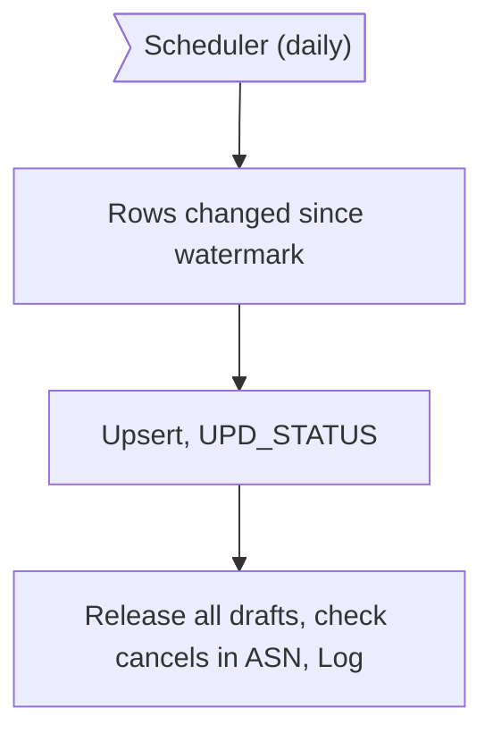
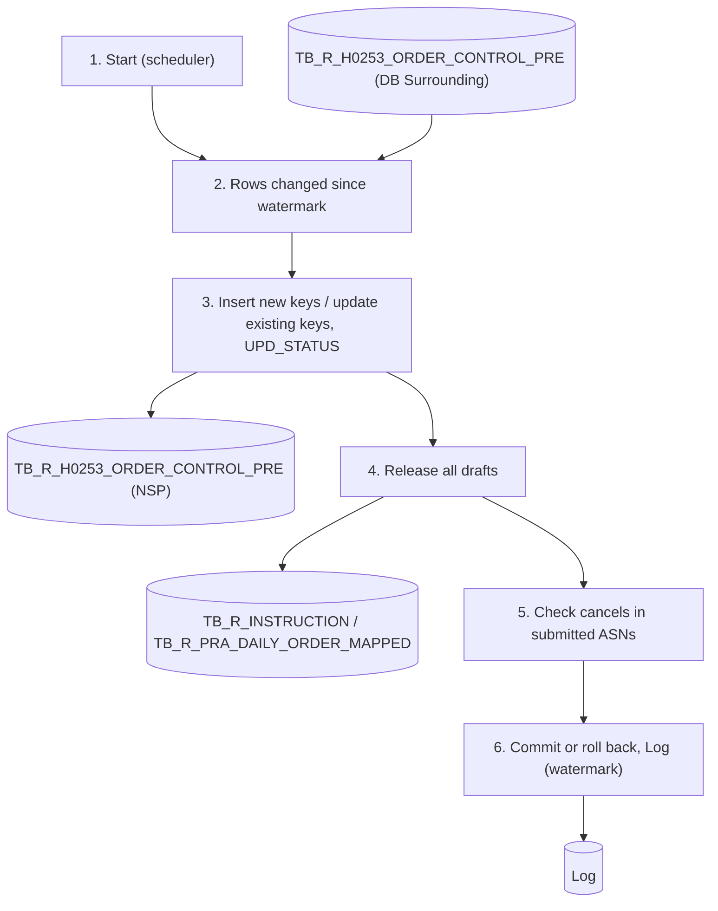

# XD08 – Order Control Information to NSP Batch

> Generated from `deliverables/function_list_v2/specs/XD08_spec.json` (UISS `XD08_UISS_Batch_OrderControlInfoToNSP.xlsx`). Do not edit by hand: change the spec and run `python3 prepare_code/build_md.py`. Document names: GTOPAS / NSP (prototype: G-System / Supplier System).

| Phase | Project | Block | Function | Created | By | Type |
|---|---|---|---|---|---|---|
| DR | Crossdock Optimization | Batch | XD08 Order Control Information to NSP Batch | 18-Oct-26 | FID Rayhan | batch |

## Revision

| Rev | Author | Date | Reviewed by | Description |
|---|---|---|---|---|
| 0.1 | FID Rayhan | 18-Oct-26 |  | Initial Draft |

## 1. General

### Objective

- To keep TB_R_H0253_ORDER_CONTROL_PRE in NSP up to date with the crossdock customer order lines of GTOPAS (replicated in DB Surrounding), in one batch (decided 23-Oct; the former XD12 is merged into XD08): the rows changed since the last successful run are inserted (new key) or updated.
- ORDER_STATUS keeps the value of the first replication; a later change in GTOPAS is written to UPD_STATUS: '6' received / allocated, '2' cancelled. Lines with UPD_STATUS are not taken by XD09.
- Every run releases all drafts of TB_R_INSTRUCTION (Create ASN done, Submit not done): the cases come back in the delivery plan of XD10.
- A cancel of qty already in a submitted ASN is not changed by the batch: it is listed in Change Order Number (XD11) for the D/S team.

### Operation flow

### Input

| Name | Type | Description |
|---|---|---|
| TB_R_H0253_ORDER_CONTROL_PRE (DB Surrounding) | DB | Order control data, pre-order picking info (I/F H02-53, DVJO950); insert / update table |
| TB_R_H0253_ORDER_CONTROL_PRE (NSP) | DB | Existing NSP rows (key check, NSP columns) |
| TB_R_INSTRUCTION | DB | Drafts (ASN_NO NULL) and submitted rows (cancel check) |
| Log | DB | Watermark of the last successful run |

### Output

| Name | Type | Description |
|---|---|---|
| TB_R_H0253_ORDER_CONTROL_PRE (NSP) | DB | Rows inserted / updated; PO_MAPPED_FLAG 'N' for the lines of released drafts |
| TB_R_INSTRUCTION | DB | Draft rows deleted |
| TB_R_PRA_DAILY_ORDER_MAPPED | DB | MAPPED_QTY of the released drafts given back |
| Log | DB | One record per run with status, counts and watermark; LOG5 / LOG6 per cancel in an ASN |

### Parameters

| Name | Description |
|---|---|
| Watermark | Last INTF_UPDATE_DT taken by the previous successful run of this batch (kept in the Log); first run: all rows |
| Statuses | '7' / '6' / '2' of crossdock lines; '6' / '2' go to UPD_STATUS |

### Execution Schedule

| Item | Description |
|---|---|
| Trigger | Daily scheduler after GTOPAS has provided the data (27:30); auto retry 3 times. |
| Order | One batch (decided 23-Oct): runs after GTOPAS has provided the data (1 time/day, 27:30); XD12 is merged into XD08. |

## 2. Function flow

1. The scheduler starts the batch (daily, after GTOPAS has provided the data). Write LOG1.
2. Read the rows of TB_R_H0253_ORDER_CONTROL_PRE (DB Surrounding) with INTF_UPDATE_DT > watermark (crossdock lines, ORDER_STATUS '7', '6' or '2').
  - New crossdock lines, changed qty, split serials (partial cancel / receipt) and status changes.
3. Upsert into TB_R_H0253_ORDER_CONTROL_PRE (NSP) per unique key (incl. SERIAL_NO):
  - New key: insert all source columns; HOLD_FLAG = 'N', PO_MAPPED_FLAG = 'N'; UPD_STATUS = NULL when the source status is '7', else the source status.
  - Existing key: update the source columns except ORDER_STATUS (first value kept); UPD_STATUS = source ORDER_STATUS when it is '6' or '2'; HOLD_FLAG / PO_MAPPED_FLAG not changed.
4. Serial split (a line in more than one ASN is split by GTOPAS into a received part and a remaining part):
  - Keep each part linked to its ASN in TB_R_INSTRUCTION: the received part to the ASN sent first, the remaining part to the next ASN. A part already in an ASN is not offered to the supplier again (PO_MAPPED_FLAG 'Y'). Write LOG7.
5. Release all drafts of TB_R_INSTRUCTION (rows with ASN_NO NULL), whatever changed:
  - Delete the rows; MAPPED_QTY of TB_R_PRA_DAILY_ORDER_MAPPED - their qty; PO_MAPPED_FLAG = 'N' on their lines.
  - The cases come back in the delivery plan of XD10; the supplier ticks them again and creates the ASN again (lines with UPD_STATUS are no longer taken).
6. Check the lines with UPD_STATUS '2' that have rows in TB_R_INSTRUCTION with ASN_NO (cancel of qty in a submitted ASN):
  - Write LOG5 per line and ASN; the line is listed in Change Order Number (XD11). Nothing is changed in the ASN.
  - Cancelled qty not a multiple of pcs/case: LOG6 (abnormality).
7. No error: commit, save the new watermark (max INTF_UPDATE_DT taken) in the Log, LOG2. Error: roll back, watermark not changed, LOG3. Exit.

## 3. Data edit mapping

#### 1. Insert / Update TB_R_H0253_ORDER_CONTROL_PRE (NSP) – Upsert per unique key (insert when the key is new, else update)
- Source: TB_R_H0253_ORDER_CONTROL_PRE (DB Surrounding) (keys: INTF_UPDATE_DT = > watermark, ORDER_STATUS = '7' / '6' / '2' of crossdock lines)
- Destination keys: Unique key (incl. SERIAL_NO) = Key of the source row

| Source field | Destination field | Description |
|---|---|---|
| CUSTOMER_CD | CUSTOMER_CD | Same value as the source (insert and update) |
| CUSTOMER_ORDER_NO | CUSTOMER_ORDER_NO | Same value as the source (insert and update) |
| ORDER_DT | ORDER_DT | Same value as the source (insert and update) |
| ORDER_TIME | ORDER_TIME | Same value as the source (insert and update) |
| DESTINATION_CD | DESTINATION_CD | Same value as the source (insert and update) |
| DETAILED_ITEM_NO | DETAILED_ITEM_NO | Same value as the source (insert and update) |
| SERIAL_NO | SERIAL_NO | Same value as the source (insert and update) |
| TOPAS_ORDER_TYPE | TOPAS_ORDER_TYPE | Same value as the source (insert and update) |
| DEMAND_HISTORY_UPDATE_DT | DEMAND_HISTORY_UPDATE_DT | Same value as the source (insert and update) |
| SHIPPING_MAKER_CD | SHIPPING_MAKER_CD | Same value as the source (insert and update) |
| SHIPPING_PART_NO | SHIPPING_PART_NO | Same value as the source (insert and update) |
| ORIGINAL_SHIPPING_QTY | ORIGINAL_SHIPPING_QTY | Same value as the source (insert and update) |
| ORDER_STATUS_QTY | ORDER_STATUS_QTY | Same value as the source (insert and update) |
| ORDER_STATUS | ORDER_STATUS | Insert: same value as the source; update: not changed (first value kept) |
| BO_INSTRUCTION_CD | BO_INSTRUCTION_CD | Same value as the source (insert and update) |
| BO_RELEASE_DT | BO_RELEASE_DT | Same value as the source (insert and update) |
| ORDER_GROUP | ORDER_GROUP | Same value as the source (insert and update) |
| DIRECT_DELIVERY_CD | DIRECT_DELIVERY_CD | Same value as the source (insert and update) |
| DIRECT_DELIVERY_FLAG | DIRECT_DELIVERY_FLAG | Same value as the source (insert and update) |
| CURRENCY_CD | CURRENCY_CD | Same value as the source (insert and update) |
| LANDED_COST | LANDED_COST | Same value as the source (insert and update) |
| NET_PRICE | NET_PRICE | Same value as the source (insert and update) |
| SALES_PRICE | SALES_PRICE | Same value as the source (insert and update) |
| EXPORT_SALES_PRICE | EXPORT_SALES_PRICE | Same value as the source (insert and update) |
| SPECIAL_PRICE_CD | SPECIAL_PRICE_CD | Same value as the source (insert and update) |
| ORDER_DISCOUNT_CD | ORDER_DISCOUNT_CD | Same value as the source (insert and update) |
| ITEM_DISCOUNT_RATE | ITEM_DISCOUNT_RATE | Same value as the source (insert and update) |
| FIRST_ALLOCATION_DT | FIRST_ALLOCATION_DT | Same value as the source (insert and update) |
| BO_HISTORY_CD | BO_HISTORY_CD | Same value as the source (insert and update) |
| ORDER_ERROR_CD | ORDER_ERROR_CD | Same value as the source (insert and update) |
| RA_CD | RA_CD | Same value as the source (insert and update) |
| PENDING_ORDER_CD | PENDING_ORDER_CD | Same value as the source (insert and update) |
| ORDER_PORTION_CD | ORDER_PORTION_CD | Same value as the source (insert and update) |
| ORDER_STATUS_DT | ORDER_STATUS_DT | Same value as the source (insert and update) |
| SHIPPING_PROCESS_CTRL_CD | SHIPPING_PROCESS_CTRL_CD | Same value as the source (insert and update) |
| PROCUREMENT_PROCESS_CTRL_CD | PROCUREMENT_PROCESS_CTRL_CD | Same value as the source (insert and update) |
| DANGEROUS_GOODS_CLASS | DANGEROUS_GOODS_CLASS | Same value as the source (insert and update) |
| CREATE_DEMAND_FLAG | CREATE_DEMAND_FLAG | Same value as the source (insert and update) |
| SPECIAL_CUSTOMER_FLAG | SPECIAL_CUSTOMER_FLAG | Same value as the source (insert and update) |
| POSS_TRANSMISSION_JUDG_FLAG | POSS_TRANSMISSION_JUDG_FLAG | Same value as the source (insert and update) |
| REGISTRANT_ID | REGISTRANT_ID | Same value as the source (insert and update) |
| UPDATE_JOB_ID | UPDATE_JOB_ID | Same value as the source (insert and update) |
| UPDATE_OPERATION_ID | UPDATE_OPERATION_ID | Same value as the source (insert and update) |
| INTF_UPDATE_DT | INTF_UPDATE_DT | Same value as the source (insert and update) |
|  | HOLD_FLAG | 'N' on insert; not changed on update (PO_MAPPED_FLAG: refer the draft release) |
|  | PO_MAPPED_FLAG | 'N' on insert; not changed on update (PO_MAPPED_FLAG: refer the draft release) |
|  | UPD_STATUS | Insert: NULL when the source status is 7, else the source status ('6' / '2'). Update: source ORDER_STATUS when it is '6' or '2'; not changed when '7' |
|  | CREATE_DT | Batch system date-time / batch user ID on insert; not changed on update |
|  | CREATE_BY | Batch system date-time / batch user ID on insert; not changed on update |
|  | UPDATE_DT | Batch system date-time / batch user ID |
|  | UPDATE_BY | Batch system date-time / batch user ID |

#### 2. Delete TB_R_INSTRUCTION – Every run: all drafts (Create ASN not submitted) are released, whatever changed
- Source: TB_R_INSTRUCTION (rows with ASN_NO NULL = drafts)
- Destination keys: ASN_NO = IS NULL

| Source field | Destination field | Description |
|---|---|---|
|  | (row) | Deleted |

#### 3. Update TB_R_PRA_DAILY_ORDER_MAPPED – Mapped qty of the released drafts given back
- Source: TB_R_INSTRUCTION drafts (sum of QTY per PO line)
- Destination keys: PO_NO + MANIFEST_NO + MANIFEST_ITEM = PO lines of the drafts

| Source field | Destination field | Description |
|---|---|---|
|  | MAPPED_QTY | - QTY of the released rows |
|  | CHANGED_BY / CHANGED_DT | Batch user ID / system date-time |

#### 4. Update TB_R_H0253_ORDER_CONTROL_PRE (NSP) – Lines of the released drafts
- Source: TB_R_INSTRUCTION drafts (lines)
- Destination keys: Unique key (incl. SERIAL_NO) = Lines of the released rows

| Source field | Destination field | Description |
|---|---|---|
|  | PO_MAPPED_FLAG | 'N' |
|  | UPDATE_BY / UPDATE_DT | Batch user ID / system date-time |

#### 5. Insert Log – One record per run
- Source: Result of this run

| Source field | Destination field | Description |
|---|---|---|
|  | BATCH_ID | 'XD08_H0253' |
|  | STATUS | SUCCESS / FAILED |
|  | ROW_COUNT | Rows inserted / updated (0 when FAILED) |
|  | DRAFT_COUNT | Draft rows of TB_R_INSTRUCTION released |
|  | WATERMARK | Max INTF_UPDATE_DT taken in this run (next watermark; only when SUCCESS) |
|  | MESSAGE | Error message when FAILED |
|  | START_DT / END_DT | Start and end date-time |

## 4. Function description

- One batch for H0253 (decided 23-Oct): the former XD08 (status 7 / 6) and XD12 (status 2) are merged; the old XD11 cancel batch is replaced by the screen Change Order Number (XD11).
- The source table is insert / update: a crossdock line starts with status 7 and can change to 6 (received / allocated) or 2 (cancel). A partial cancel or receipt splits the line into a new SERIAL_NO (scenario files skenario_h0253.xlsx, simulasi_asn.xlsx).
- One line can be in more than one ASN. H0253 does not carry the received ASN No, so NSP assumes the ASNs are received in the order they were sent (TBC with GTOPAS; otherwise GTOPAS provides the received ASN No).
- UPD_STATUS: NULL = status 7 (no change); '6' = received / allocated in GTOPAS; '2' = cancelled in GTOPAS. ORDER_STATUS of NSP keeps the first value.
- Example (simulasi_asn_rev.xlsx, sheet Sample Input): 17-Oct CO-14101 → UPD_STATUS 6, CO-14102 (on hold, no ASN) → UPD_STATUS 2: nothing else; 19-Oct CO-14104 → UPD_STATUS 2 although in case 3 of ASN0003 → LOG5, listed in XD11; 21-Oct CO-14111 → UPD_STATUS 6 without ASN (candidate) and CO-14115 (12 pcs in ASN0006 + ASN0007) split by GTOPAS into serial 0000001 6 pcs (6) and 0000002 6 pcs (7): the ASN0007 row moves to serial 0000002 (LOG7).
- Drafts: every run deletes all TB_R_INSTRUCTION rows with ASN_NO NULL (Create ASN not submitted), gives the mapped qty back and sets PO_MAPPED_FLAG 'N'; rows with ASN_NO are never deleted. [Submit ASN] of XD10 re-checks the draft too.
- Only changed rows are read (INTF_UPDATE_DT > watermark); upsert and draft release run in one transaction; the watermark is saved only when the run succeeds.
- Read by XD09 (lines with UPD_STATUS NULL, not mapped, not on hold), XD10 and XD11. Table structure: see Appendix.

## 5. Logging messages

| ID | Event | Cause | Type | Message | Action |
|---|---|---|---|---|---|
| LOG1 | Batch start | Batch is called | Info | H0253 sync started. Watermark <WATERMARK>. | system: Write the log.; user: - |
| LOG2 | Batch end | Batch finishes | Info | H0253 sync ended. Status <STATUS>, inserted <INS>, updated <UPD> (UPD_STATUS 6: <N6>, 2: <N2>), drafts released <DRAFTS>. | system: Write the log; save the new watermark when SUCCESS.; user: - |
| LOG5 | Cancel after ASN | A line with UPD_STATUS '2' has qty in a submitted ASN | Warning | <CUSTOMER_ORDER_NO> <PART_NO>: <QTY> pcs cancelled in <ASN_NO>; listed in Change Order Number (XD11). | system: Write the log; nothing is changed in the ASN.; user: D/S team: Change Order Number (XD11). |
| LOG6 | Cancel qty check | Cancelled qty of a line in a submitted ASN is not a multiple of pcs/case (should not happen in GTOPAS) | Error | <CUSTOMER_ORDER_NO> <PART_NO>: cancelled qty <QTY> is not a multiple of pcs/case <PCS>. | system: Write the log (abnormality); the line is still listed in XD11.; user: D/S team checks with GTOPAS. |
| LOG7 | Serial split | A line in TB_R_INSTRUCTION is split into a new SERIAL_NO by GTOPAS | Info | <CUSTOMER_ORDER_NO> item <DETAILED_ITEM_NO> split into serial <SERIAL_NO>: <QTY> pcs of <ASN_NO> moved to the new serial. | system: Write the log.; user: - |
| LOG3 | Upsert | Read from DB Surrounding, insert / update in NSP or draft release fails | Error | Cannot replicate H0253 rows: <ERROR_DETAIL>. | system: Roll back; watermark not changed (rows taken again next run). STATUS = FAILED.; user: User contact PIC |
| LOG4 | Unexpected error | Any other system error | Critical | Unexpected error: <ERROR_DETAIL>. | system: Roll back. STATUS = FAILED.; user: User contact PIC |

## 7. Tables

#### TB_R_H0253_ORDER_CONTROL_PRE (transaction, existing)
Order control data, pre-order picking info (I/F H02-53, DVJO950) replicated from DB Surrounding by XD08. Structure from the GTOPAS I/F layout; physical names follow the existing table. Key (PK) = unique key of the I/F layout. Rows with UPD_STATUS 6 / 2 are kept for tracking (retention optional, TBC). UPD_STATUS is a new NSP column (proposed).

| Column | Type | PK | Null | Description |
|---|---|---|---|---|
| CUSTOMER_CD | VARCHAR(7) | Y | N | No.1 Customer Code |
| CUSTOMER_ORDER_NO | VARCHAR(8) | Y | N | No.2 Customer Order No. |
| ORDER_DT | DATE | Y | N | No.3 Order Date |
| ORDER_TIME | VARCHAR(6) | Y | N | No.4 Order Time |
| DESTINATION_CD | VARCHAR(7) | Y | N | No.5 Destination Code |
| DETAILED_ITEM_NO | VARCHAR(4) | Y | N | No.6 Detailed Item No. |
| SERIAL_NO | VARCHAR(7) | Y | N | No.7 Serial No., Card No. Part of the key; distinguishes split records of the same order line. Added to the source table by the DB Surrounding team (decided 19-Oct). |
| TOPAS_ORDER_TYPE | VARCHAR(1) |  | Y | No.8 TOPAS Order Type: '1': VOR, '2': E/O, '3': S/O, 'F': F/O |
| DEMAND_HISTORY_UPDATE_DT | DATE |  | Y | No.9 Demand History Update Date |
| SHIPPING_MAKER_CD | VARCHAR(1) |  | Y | No.10 Shipping Maker Code |
| SHIPPING_PART_NO | VARCHAR(15) |  | Y | No.11 Shipping P/No. |
| ORIGINAL_SHIPPING_QTY | NUMBER(8) |  | Y | No.12 Original Shipping Qty or Estimated Shipping Qty |
| ORDER_STATUS_QTY | NUMBER(8) |  | Y | No.13 Order Status Qty |
| ORDER_STATUS | VARCHAR(1) |  | Y | No.14 Order Status: '1': Pending '2': Reject/Cancel '3': B/O '4': Firm Order '5': Vender Direct '6': Allocation '7': Cross Dock In NSP: value of the first replication (normally '7'); a later change is written to UPD_STATUS |
| BO_INSTRUCTION_CD | VARCHAR(1) |  | Y | No.15 B/O Instruction Code: '1': B/O Cancel, '9': Follow-up |
| BO_RELEASE_DT | DATE |  | Y | No.16 B/O Release Date |
| ORDER_GROUP | VARCHAR(2) |  | Y | No.17 Order Group |
| DIRECT_DELIVERY_CD | VARCHAR(1) |  | Y | No.18 Direct Delivery Code: Blank: Not vendor direct delivery '1': Vendor direct delivery |
| DIRECT_DELIVERY_FLAG | VARCHAR(1) |  | Y | No.19 Direct Delivery Flag: '0': Not direct delivery, '1': Direct delivery |
| CURRENCY_CD | VARCHAR(3) |  | Y | No.20 Currency Code |
| LANDED_COST | NUMBER(14,3) |  | Y | No.21 Landed Cost: Constant '0' |
| NET_PRICE | NUMBER(14,3) |  | Y | No.22 Nett Price |
| SALES_PRICE | NUMBER(14,3) |  | Y | No.23 Sales Price |
| EXPORT_SALES_PRICE | NUMBER(14,3) |  | Y | No.24 Export Sales Price |
| SPECIAL_PRICE_CD | VARCHAR(1) |  | Y | No.25 Special Price Code: '1': Special price, Blank: Not applicable |
| ORDER_DISCOUNT_CD | VARCHAR(4) |  | Y | No.26 Order Discount Code |
| ITEM_DISCOUNT_RATE | NUMBER(6,1) |  | Y | No.27 Item Discount Rate |
| FIRST_ALLOCATION_DT | DATE |  | Y | No.28 1st Allocation Date |
| BO_HISTORY_CD | VARCHAR(1) |  | Y | No.29 B/O History Code: '0': Default, '1': B/O |
| ORDER_ERROR_CD | VARCHAR(2) |  | Y | No.30 Order Error Code |
| RA_CD | VARCHAR(2) |  | Y | No.31 R/A Code |
| PENDING_ORDER_CD | VARCHAR(2) |  | Y | No.32 Pending Order Code |
| ORDER_PORTION_CD | VARCHAR(1) |  | Y | No.33 Order Portion Code: '1': Reject '2': Alteration '3': Process '4': Amendment |
| ORDER_STATUS_DT | DATE |  | Y | No.34 Order Status Date |
| SHIPPING_PROCESS_CTRL_CD | VARCHAR(1) |  | Y | No.35 Shipping Process Control Code: Blank: No change '1': Higher priority to B/O |
| PROCUREMENT_PROCESS_CTRL_CD | VARCHAR(1) |  | Y | No.36 Procurement Process Control Code: '1': Skip substitution check '2': Skip large order division (including skipping irregular order check) '3': '2' + skip order taking check '4 |
| DANGEROUS_GOODS_CLASS | VARCHAR(4) |  | Y | No.37 Dangerous Goods Class |
| CREATE_DEMAND_FLAG | VARCHAR(1) |  | Y | No.38 Created Demand Flag: '0': Not created demand, '1': Created demand |
| SPECIAL_CUSTOMER_FLAG | VARCHAR(1) |  | Y | No.39 Special Customer Flag: '0': Regular, '1': Special |
| POSS_TRANSMISSION_JUDG_FLAG | VARCHAR(1) |  | Y | No.40 POSS Transmission Judgment Flag: '0': Out of target, '1': Transmission target |
| REGISTRANT_ID | VARCHAR(13) |  | Y | No.41 Registrant ID |
| UPDATE_JOB_ID | VARCHAR(8) |  | Y | No.42 Update Job ID |
| UPDATE_OPERATION_ID | VARCHAR(13) |  | Y | No.43 Update Operator ID |
| INTF_UPDATE_DT | TIMESTAMP |  | Y | No.44 Update Date & Time |
| HOLD_FLAG | VARCHAR(1) |  | N | NSP column: hold by the D/S team in ASN Cross Dock Creation (XD10) ('Y' / 'N'); 'N' on insert, never changed by XD08 |
| PO_MAPPED_FLAG | VARCHAR(1) |  | N | NSP column: 'Y' when the whole line is in TB_R_INSTRUCTION ([Create ASN] XD10, Change Order Number XD11); 'N' on insert; set back to 'N' by XD08 when a draft of the line is released |
| UPD_STATUS | VARCHAR(1) |  | Y | NSP column: status change in GTOPAS after the first replication: NULL = no change (status 7) / '6' = received or allocated (source ORDER_STATUS 6) / '2' = cancelled (source ORDER_STATUS 2). Set by XD08; lines with UPD_STATUS are not taken by XD09 |
| CREATE_DT | TIMESTAMP |  | Y | Created date and time (NSP) |
| CREATE_BY | VARCHAR(TBD) |  | Y | Created by (NSP) |
| UPDATE_DT | TIMESTAMP |  | Y | Updated date and time (NSP) |
| UPDATE_BY | VARCHAR(TBD) |  | Y | Updated by (NSP) |

#### TB_R_INSTRUCTION (transaction, proposed)
Real mapping made by [Create ASN]: one row per supplier case x customer order line x PO of the chosen blocks (case and line sequence of XD09). Rows are deleted by [Back] / [Cancel] on the Case List; [Submit ASN] (5.7) fills ASN_NO and CASE_NO. Columns proposed. Rows without ASN_NO are a draft: every run of XD08 releases all drafts (decided 23-Oct); a cancelled line in a submitted ASN is moved to other lines in Change Order Number (XD11).

| Column | Type | PK | Null | Description |
|---|---|---|---|---|
| INSTRUCTION_ID | BIGINT | Y | N | Running number (identity) |
| SUPPLIER_CD | VARCHAR(TBD) |  | N | Supplier code (one ASN = one Supplier Code + Plant) |
| SUPPLIER_PLANT | VARCHAR(TBD) |  | N | Supplier plant |
| CASE_SEQ | NUMBER(4) |  | N | Case sequence of the Create ASN (Case 1, 2, ...) |
| LINE_SEQ | NUMBER(4) |  | N | Order line x PO within the case |
| PART_NO | VARCHAR(15) |  | N | Part number of the case |
| ORDER_DT | DATE |  | N | Customer Order Date of the case |
| DESTINATION_CD | VARCHAR(7) |  | N | Destination of the case |
| CUSTOMER_CD | VARCHAR(7) |  | N | Customer code |
| CUSTOMER_ORDER_NO | VARCHAR(8) |  | N | Customer order number |
| DETAILED_ITEM_NO | VARCHAR(4) |  | N | Detailed item number |
| SERIAL_NO | VARCHAR(7) |  | N | Serial number |
| QTY | NUMBER(8) |  | N | Qty of the line mapped to the PO in this case |
| PO_NO | VARCHAR(TBD) |  | N | PO number |
| MANIFEST_NO | VARCHAR(TBD) |  | N | Manifest number of the Pra Daily Order |
| MANIFEST_ITEM | VARCHAR(TBD) |  | N | Manifest item number |
| ORDER_QTY | NUMBER(TBD) |  | N | PO qty |
| DELIVERY_DT | DATE |  | N | Delivery Date of the Search |
| RIT_CYCLE | VARCHAR(TBD) |  | N | Rit of the Search (route master, existing) |
| ROUTE | VARCHAR(TBD) |  | N | Route of the Rit (route master, existing) |
| DRAFT_ID | VARCHAR(20) |  | Y | Draft of one [Create ASN] (all rows of the creation); NULL after [Submit ASN] is not needed (ASN_NO filled). Every run of XD08 deletes the rows with ASN_NO NULL |
| ASN_NO | VARCHAR(TBD) |  | Y | ASN number; NULL until the ASN is submitted (5.7) |
| CASE_NO | VARCHAR(TBD) |  | Y | Case number; NULL until submitted (auto generated with the existing last sequence) |
| CREATED_BY | VARCHAR(TBD) |  | N | User who created the record |
| CREATED_DT | DATETIME |  | N | Created date and time |
| CHANGED_BY | VARCHAR(TBD) |  | N | User who last changed the record |
| CHANGED_DT | DATETIME |  | N | Last changed date and time |

#### TB_R_PRA_DAILY_ORDER_MAPPED (transaction, proposed)
New table: mapped qty per Pra Daily Order PO part (instead of a new column in the Pra Daily Order). Name and columns proposed.

| Column | Type | PK | Null | Description |
|---|---|---|---|---|
| PO_NO | VARCHAR(TBD) | Y | N | PO number (Pra Daily Order Manifest) |
| MANIFEST_NO | VARCHAR(TBD) | Y | N | Manifest number |
| MANIFEST_ITEM | VARCHAR(TBD) | Y | N | Manifest item number (Pra Daily Order Part) |
| PART_NO | VARCHAR(15) |  | N | Part number |
| SUPPLIER_CD | VARCHAR(TBD) |  | N | Supplier code |
| SUPPLIER_PLANT | VARCHAR(TBD) |  | N | Supplier plant |
| ORDER_QTY | NUMBER(TBD) |  | N | PO qty of the part |
| MAPPED_QTY | NUMBER(TBD) |  | N | Qty already mapped to customer orders by [Create ASN]; open qty = ORDER_QTY - MAPPED_QTY |
| CREATED_BY | VARCHAR(TBD) |  | N | User who created the record |
| CREATED_DT | DATETIME |  | N | Created date and time |
| CHANGED_BY | VARCHAR(TBD) |  | N | User who last changed the record |
| CHANGED_DT | DATETIME |  | N | Last changed date and time |

## Sample Input

**Sample XD08 runs - simulasi_asn_rev.xlsx (PART-X, 16-22 Oct)**

- Rows of TB_R_H0253_ORDER_CONTROL_PRE (DB Surrounding) changed since the last run and the result in the NSP replicate. ORDER_STATUS of NSP keeps the first value (7); the change is written to UPD_STATUS. No draft is open at 03:30 in this data (drafts would be released by every run).

### A. Runs (03:30) and result

| Run | Source change (GTOPAS) | NSP replicate | TB_R_INSTRUCTION / Log |
|---|---|---|---|
| 16-Oct | Order date 15-Oct: CO-14101 VN 6, CO-14102 TH 6 (status 7) | Insert; UPD_STATUS NULL, HOLD_FLAG N, PO_MAPPED_FLAG N | - |
| 17-Oct | CO-14101 → 6, CO-14102 → 2; order date 16-Oct: CO-14103 TH 6 | CO-14101 UPD_STATUS 6; CO-14102 UPD_STATUS 2 (PO_MAPPED_FLAG stays N); CO-14103 insert | CO-14102 has no ASN: nothing else |
| 18-Oct | CO-14103 → 6; order date 17-Oct: CO-14104 TH 6, CO-14105 VN 6, CO-14106 VN 3, CO-14107 VN 3, CO-14109 PH 6, CO-14110 982220 6 | CO-14103 UPD_STATUS 6; 6 lines insert | - |
| 19-Oct | CO-14105 / 06 / 07 / 09 → 6 (ASN0003 received), CO-14104 → 2; order date 18-Oct: CO-14112 VN, CO-14113 PH, CO-14114 982220 | UPD_STATUS 6 / 2; 3 lines insert | CO-14104 is in ASN0003 case 3: LOG5, listed in XD11 (waiting for a candidate) |
| 20-Oct | CO-14110, CO-14112 / 13 / 14 → 6; order date 19-Oct: CO-14111 TH 6, CO-14115 VN 12 | UPD_STATUS 6; 2 lines insert | - |
| 21-Oct | CO-14111 → 6 (pcs of ASN0003 case 3); CO-14115 serial 0000001 → 6 qty 6 + new serial 0000002 qty 6 status 7 | CO-14111 UPD_STATUS 6 (candidate in XD11); CO-14115/0000001 qty 12 → 6, UPD_STATUS 6; CO-14115/0000002 insert, PO_MAPPED_FLAG Y | Serial split: the ASN0007 row moves to serial 0000002 (ASN0006 stays on 0000001); LOG7 |
| 22-Oct | CO-14115/0000002 → 6 (ASN0007 received) | UPD_STATUS 6 | - |

### B. Serial split of CO-14115 (one line in 2 ASNs) - TB_R_INSTRUCTION

| INSTRUCTION_ID | Customer Order | Serial No before | Serial No after | Qty | PO | ASN_NO |
|---|---|---|---|---|---|---|
| 12 | CO-14115 | 0000001 | 0000001 | 6 | T0409015 | ASN0006 |
| 13 | CO-14115 | 0000001 | 0000002 | 6 | T0409016 | ASN0007 |
