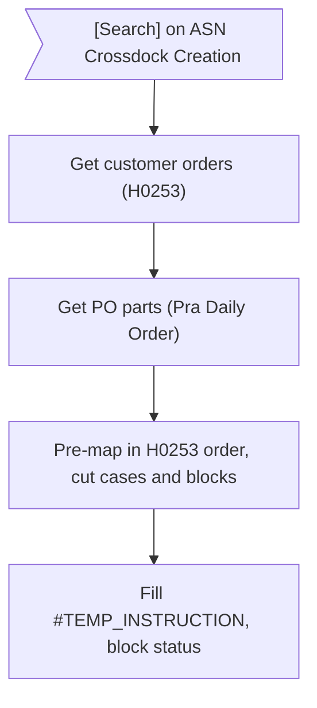
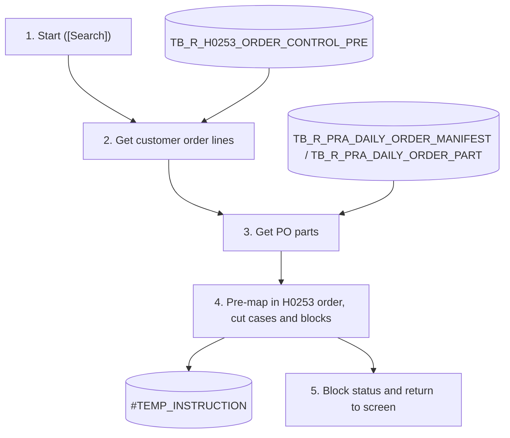

# XD09 – Mapping Customer Order and PO Batch

> Generated from `deliverables/function_list_v2/specs/XD09_spec.json` (UISS `XD09_UISS_Batch_MappingCustomerOrderPO.xlsx`). Do not edit by hand: change the spec and run `python3 prepare_code/build_md.py`. Document names: GTOPAS / NSP (prototype: G-System / Supplier System).

| Phase | Project | Block | Function | Created | By | Type |
|---|---|---|---|---|---|---|
| DR | Crossdock Optimization | Batch | XD09 Mapping Customer Order and PO Batch | 18-Oct-26 | FID Rayhan | batch |

## Revision

| Rev | Author | Date | Reviewed by | Description |
|---|---|---|---|---|
| 0.1 | FID Rayhan | 18-Oct-26 |  | Initial Draft |

## 1. General

### Objective

- To get the open qty of the crossdock customer orders (H0253, order status 7, Hold Flag N) in the H0253 order, pre-map them to the crossdock supplier PO parts (Pra Daily Order: manifests with TB_R_PRA_DAILY_ORDER_MANIFEST.CROSS_DOCK_FLAG = 'X'; their part data from TB_R_PRA_DAILY_ORDER_PART (join MANIFEST_NO)), cut them into supplier cases and blocks (ASN options) into the temporary table #TEMP_INSTRUCTION.
- To give ASN Crossdock Creation (XD10) the delivery plan per Part Number + Customer Order Date with Case Qty, PO Readiness (case), the ASN options (blocks that can be sent) and the status Ready / Partially Ready / Not Ready.
- It runs when the user clicks [Search] on XD10; there is no scheduler. The real mapping is done later by [Create ASN] on XD10.
- Crossdock PO (decided 20-Oct): the order is taken from the manifest with TB_R_PRA_DAILY_ORDER_MANIFEST.CROSS_DOCK_FLAG = 'X' and its part data from TB_R_PRA_DAILY_ORDER_PART (MANIFEST_NO). The PO line is identified by MANIFEST_NO + MANIFEST_ITEM (PO_ITEM can differ from MANIFEST_ITEM; one PO can have several manifests).

### Operation flow

### Input

| Name | Type | Description |
|---|---|---|
| Delivery Date, Rit, Route | Screen | From the Delivery section of XD10 (carried to the ASN) |
| TB_R_H0253_ORDER_CONTROL_PRE | DB | ORDER_STATUS = '7', UPD_STATUS IS NULL (no status change in GTOPAS), HOLD_FLAG = 'N', PO_MAPPED_FLAG = 'N'; open qty = ORDER_STATUS_QTY - qty of the line already in TB_R_INSTRUCTION; latest data (replicated by XD08) |
| TB_R_PRA_DAILY_ORDER_MANIFEST / TB_R_PRA_DAILY_ORDER_PART | DB | manifests with TB_R_PRA_DAILY_ORDER_MANIFEST.CROSS_DOCK_FLAG = 'X'; their part data from TB_R_PRA_DAILY_ORDER_PART (join MANIFEST_NO); latest data; by PO_DT ascending |
| TB_R_PRA_DAILY_ORDER_MAPPED | DB | New table: MAPPED_QTY per PO part; open PO qty = ORDER_QTY - MAPPED_QTY |
| TB_R_INSTRUCTION | DB | Qty of each line already mapped (open Case List or submitted ASN) |
| TB_M_PART_CANDIDATE | DB | PCS_CASE of the part |

### Output

| Name | Type | Description |
|---|---|---|
| #TEMP_INSTRUCTION | Temp | One row per line x PO x supplier case; PO_NO NULL for the qty still without a PO |
| ASN Crossdock Creation (XD10) | Screen | Delivery plan: Customer Order Date, Part Number, Case Qty, PO Readiness (case), ASN options, ASN Status |

### Parameters

| Name | Description |
|---|---|
| Delivery Date | Chosen on XD10; carried to the ASN |
| Rit / Route | Chosen on XD10; carried to the ASN |
| Supplier | Supplier of the login user |

### Grouping Keys

| Field Name |
|---|
| PART_NO + ORDER_DT (unit; units by ORDER_DT ascending) |
| H0253 order: ORDER_DT (Allocation Priority), CUSTOMER_CD, CUSTOMER_ORDER_NO, ORDER_DT, ORDER_TIME, DESTINATION_CD, DETAILED_ITEM_NO, SERIAL_NO |
| CASE_SEQ (PCS_CASE pcs in H0253 order) |
| GROUP_SEQ (block up to a valid cut) |

### Execution Schedule

| Item | Description |
|---|---|
| Trigger | On demand: [Search] on ASN Crossdock Creation (XD10). No scheduler. |

## 2. Function flow

1. The user clicks [Search] on ASN Crossdock Creation (XD10) with Delivery Date and Rit. The previous content of the temporary table of the session is cleared.
2. Get the customer order lines from TB_R_H0253_ORDER_CONTROL_PRE:
  - ORDER_STATUS = '7' (Cross Dock), UPD_STATUS IS NULL (no status change in GTOPAS), HOLD_FLAG = 'N', PO_MAPPED_FLAG = 'N'; latest data; open qty = ORDER_STATUS_QTY - qty of the line already in TB_R_INSTRUCTION (> 0). Lines changed in GTOPAS (UPD_STATUS '6' / '2', set by XD08) are not taken.
  - Get: Customer Code, Customer Order No, Order Date, Order Time, Destination Code, Detailed Item No, Serial No, Part Number, Order Status Qty; Pcs/Case of the part from TB_M_PART_CANDIDATE.
3. Get the PO parts from TB_R_PRA_DAILY_ORDER_MANIFEST + TB_R_PRA_DAILY_ORDER_PART:
  - manifests with TB_R_PRA_DAILY_ORDER_MANIFEST.CROSS_DOCK_FLAG = 'X'; their part data from TB_R_PRA_DAILY_ORDER_PART (join MANIFEST_NO); latest data; open PO qty = ORDER_QTY - MAPPED_QTY of TB_R_PRA_DAILY_ORDER_MAPPED (0 when no row) > 0; ordered by Order Date ascending (FIFO).
  - Get: PO Number, Manifest Number, Supplier Code / Plant, Sub Supplier Code / Plant, Order Type, Dock Code, PO Order Qty, Order Date, ETD Ori, Manifest Item, Part Number.
4. Per unit (Part Number + Customer Order Date, oldest date first), pre-map in H0253 order (see 4.1 and 4.2) and insert the result in #TEMP_INSTRUCTION.
  - Lines in H0253 order: 1) Allocation Priority (= Customer Order Date), 2) Customer Code, 3) Customer Order No, 4) Customer Order Date, 5) Customer Order Time, 6) Destination Code, 7) Detailed Item No, 8) Serial No.
  - Each PO qty (PO_DT ascending) goes to the open qty in this order; a line may be split over several POs.
  - The pcs are cut into supplier cases of PCS_CASE pcs in this order (a case can hold several lines and destinations); each slice line x PO x case is one row.
5. Mark the valid cuts, number the blocks, set the status of each block and return the delivery plan to XD10 (see 4.3).
  - Error: clear the temporary table, show the error on the screen and record the Log (FAILED).

## 3. Data edit mapping

#### 1. Insert #TEMP_INSTRUCTION – Line x PO x supplier case pre-mapping (temporary)
- Source: TB_R_H0253_ORDER_CONTROL_PRE + TB_R_PRA_DAILY_ORDER_MANIFEST / TB_R_PRA_DAILY_ORDER_PART + TB_R_INSTRUCTION + TB_M_PART_CANDIDATE (keys: H0253.SHIPPING_PART_NO = = TB_R_PRA_DAILY_ORDER_PART.PART_NO, TB_R_PRA_DAILY_ORDER_PART.MANIFEST_NO = = TB_R_PRA_DAILY_ORDER_MANIFEST.MANIFEST_NO with TB_R_PRA_DAILY_ORDER_MANIFEST.CROSS_DOCK_FLAG = 'X')

| Source field | Destination field | Description |
|---|---|---|
|  | INSTRUCTION_ID | Running number |
|  | SORT_SEQ | H0253 order of the line in the unit |
| H0253.CUSTOMER_CD | CUSTOMER_CD |  |
| H0253.CUSTOMER_ORDER_NO | CUSTOMER_ORDER_NO |  |
| H0253.ORDER_DT | ORDER_DT |  |
| H0253.ORDER_TIME | ORDER_TIME |  |
| H0253.DESTINATION_CD | DESTINATION_CD |  |
| H0253.DETAILED_ITEM_NO | DETAILED_ITEM_NO |  |
| H0253.SERIAL_NO | SERIAL_NO |  |
| H0253.SHIPPING_PART_NO | PART_NO |  |
| H0253.ORDER_STATUS | ORDER_STATUS |  |
| H0253.ORDER_STATUS_QTY | CUST_ORDER_QTY |  |
|  | OPEN_ORDER_QTY | H0253.ORDER_STATUS_QTY - SUM(TB_R_INSTRUCTION.QTY) of the line |
|  | ASSIGNED_QTY | Qty of the slice (line x PO x case) |
| TB_R_PRA_DAILY_ORDER_PART.PO_NO | PO_NO | NULL for the open remainder |
| TB_R_PRA_DAILY_ORDER_PART.MANIFEST_NO | MANIFEST_NO |  |
| TB_R_PRA_DAILY_ORDER_PART.MANIFEST_ITEM | MANIFEST_ITEM |  |
| TB_R_PRA_DAILY_ORDER_MANIFEST.PO_DT | PO_DT |  |
| TB_R_PRA_DAILY_ORDER_PART.ORDER_QTY | ORDER_QTY |  |
| TB_R_PRA_DAILY_ORDER_MANIFEST.SUPPLIER_CD | SUPPLIER_CD |  |
| TB_R_PRA_DAILY_ORDER_MANIFEST.SUPPLIER_PLANT | SUPPLIER_PLANT |  |
| TB_R_PRA_DAILY_ORDER_MANIFEST.SUB_SUPP_CD | SUB_SUPPLIER_CD |  |
| TB_R_PRA_DAILY_ORDER_MANIFEST.SUB_SUPP_PLANT | SUB_SUPPLIER_PLANT |  |
| TB_R_PRA_DAILY_ORDER_MANIFEST.ORDER_TYPE | ORDER_TYPE |  |
| TB_R_PRA_DAILY_ORDER_PART.DOCK_CD | DOCK_CD |  |
| ETD Ori (source column TBC) | ETD_ORI |  |
| TB_M_PART_CANDIDATE.PCS_CASE | PCS_CASE |  |
|  | CASE_SEQ | Supplier case: running number every PCS_CASE pcs in H0253 order |
|  | LINE_SEQ | Sequence of the slice in the case |
|  | CUM_DEST_QTY | Cumulative qty of the destination in the unit |
|  | SEQ_QTY | MOD(CUM_DEST_QTY - 1, PCS_CASE) + 1: fill of the warehouse case of the destination (refer 4.3) |
|  | CUT_FLAG | 'Y' when, after this case, every destination is a multiple of PCS_CASE (refer 4.3) |
|  | GROUP_SEQ | Block number: +1 after each valid cut |
|  | CROSSDOCK_STATUS | '6' Ready when the block and every earlier block have no PO_NO NULL; else '7' (refer 4.3) |

## 4. Function description

XD09 runs on [Search] of XD10 and builds the delivery plan in #TEMP_INSTRUCTION. Nothing permanent is saved: [Create ASN] (XD10) writes TB_R_INSTRUCTION, PO_MAPPED_FLAG and MAPPED_QTY. Examples: simulasi_asn_rev.xlsx (sheet Sample Input).

### 4.1 Customer Order Lines Taken

- The H0253 replicate has the lines of a Customer Order Date from the next day (XD08 run). A line is taken when ORDER_STATUS = 7, UPD_STATUS IS NULL, HOLD_FLAG = N and open qty > 0 (open qty = ORDER_STATUS_QTY - qty of the line in TB_R_INSTRUCTION).
- Not taken: a line on hold (CO-14102 on 16-Oct), a cancelled line (UPD_STATUS 2: CO-14102 from 17-Oct, CO-14104 from 19-Oct), a line received in GTOPAS (UPD_STATUS 6: CO-14111 on 21-Oct), the qty already in an ASN (CO-14115: open 6 after ASN0006, 0 after ASN0007).
- Order of the lines (ORDER BY): ORDER_DT (Allocation Priority), CUSTOMER_CD, CUSTOMER_ORDER_NO, ORDER_DT, ORDER_TIME, DESTINATION_CD, DETAILED_ITEM_NO, SERIAL_NO, per unit = Part Number + Customer Order Date, units of a part oldest date first. Example 18-Oct: CO-14105, CO-14106, CO-14107 (9715300), CO-14104 (9722D10), CO-14109 (9811100), CO-14110 (982200). SORT_SEQ = row number per unit.

### 4.2 PO Assignment

- One PO per Part Number per Customer Order Date: PO date = order date + 1, PO qty = total order qty of all destinations of that date. Open PO qty = ORDER_QTY - MAPPED_QTY.
- The open PO qty is given in PO date order (then PO No) to the lines in the order of 4.1, oldest unit first. A PO qty left by an order that is not sent goes to the next lines: T0409011 (CO-14102 on hold, then cancelled) covers CO-14103; T0409012 then covers CO-14105.
- PO qty lower than the order qty of the date (Short PO) is an abnormality: order date 17-Oct = 30 pcs, T0409013 = 18 pcs; the last 6 pcs (CO-14110) have no PO (PO_NO NULL) and wait for the split PO T0409014 of 19-Oct.

### 4.3 Supplier Cases and Cut

- The pcs of a unit are cut into supplier cases of PCS_CASE pcs in the order of 4.1 (CASE_SEQ from 1 per unit). A case can hold several lines: case 2 of 17-Oct = CO-14106 3 + CO-14107 3. A line can be in several cases: CO-14115 12 pcs = cases 1 and 2.
- CUT_FLAG = Y after a case where the cumulative qty of every destination of the unit is a multiple of PCS_CASE (the warehouse packs 1 case = 1 destination); the ASN may stop only there. SEQ_QTY = fill of the warehouse case of the destination (1..PCS_CASE).
- A case is Ready (CROSSDOCK_STATUS 6) when it and every earlier case of the unit have a PO, else Not Ready (7). 18-Oct: cases 1-4 Ready, case 5 Not Ready → unit Partially Ready, Short PO.

### 4.4 Delivery Plan on XD10

- One row per unit with its cases (Case, Qty, Remaining Qty without PO, PO, status) and the PO check (order qty of the date vs PO qty). Units without a pre-mapped case and units fully in an ASN are not listed.
- Per Part Number the oldest Customer Order Date is sent first: on 19-Oct the cases of 18-Oct can be ticked only together with or after case 1 of 17-Oct (CO-14110). A Not Ready case of an older date holds the later dates.
- After the receiving in GTOPAS XD08 sets UPD_STATUS 6 and the line is no longer taken; a partly received line is split into a new SERIAL_NO and each part stays with its ASN (CO-14115: serial 0000001 = ASN0006, serial 0000002 = ASN0007), so nothing is taken again.

## 5. Logging messages

| ID | Event | Cause | Type | Message | Action |
|---|---|---|---|---|---|
| LOG1 | Mapping Customer Order and PO | Read or insert fails | Error | Mapping Customer Order and PO failed for Delivery Date <DELIVERY_DT> <RIT>: <ERROR_DETAIL>. | system: Clear the temporary table.; user: Retry; contact PIC if it persists. |
| LOG2 | Unexpected error | Any other system error | Critical | Unexpected error: <ERROR_DETAIL>. | system: Clear the temporary table.; user: User contact PIC |

## 6. Appendix

Sample [Search] of simulasi_asn_rev.xlsx: see sheet Sample Input.

### Query: H0253 lines in H0253 order (Allocation Priority = Customer Order Date)

WITH MAPPED AS (SELECT CUSTOMER_CD, CUSTOMER_ORDER_NO, ORDER_DT, DESTINATION_CD, DETAILED_ITEM_NO, SERIAL_NO, SUM(QTY) AS MAPPED_QTY

                FROM TB_R_INSTRUCTION

                GROUP BY CUSTOMER_CD, CUSTOMER_ORDER_NO, ORDER_DT, DESTINATION_CD, DETAILED_ITEM_NO, SERIAL_NO),

OPEN_LINE AS (SELECT H.*, H.ORDER_DT AS ALLOCATION_PRIORITY,

                     H.ORDER_STATUS_QTY - COALESCE(M.MAPPED_QTY, 0) AS OPEN_ORDER_QTY

              FROM TB_R_H0253_ORDER_CONTROL_PRE H

              LEFT JOIN MAPPED M ON M.CUSTOMER_CD = H.CUSTOMER_CD AND M.CUSTOMER_ORDER_NO = H.CUSTOMER_ORDER_NO

                   AND M.ORDER_DT = H.ORDER_DT AND M.DESTINATION_CD = H.DESTINATION_CD

                   AND M.DETAILED_ITEM_NO = H.DETAILED_ITEM_NO AND M.SERIAL_NO = H.SERIAL_NO

              WHERE H.ORDER_STATUS = '7' AND H.UPD_STATUS IS NULL AND H.HOLD_FLAG = 'N' AND H.PO_MAPPED_FLAG = 'N')

SELECT ROW_NUMBER() OVER (PARTITION BY SHIPPING_PART_NO, ORDER_DT

                          ORDER BY ALLOCATION_PRIORITY, CUSTOMER_CD, CUSTOMER_ORDER_NO, ORDER_DT, ORDER_TIME,

                                   DESTINATION_CD, DETAILED_ITEM_NO, SERIAL_NO) AS SORT_SEQ,

       SHIPPING_PART_NO, ALLOCATION_PRIORITY, CUSTOMER_CD, CUSTOMER_ORDER_NO, ORDER_DT, ORDER_TIME,

       DESTINATION_CD, DETAILED_ITEM_NO, SERIAL_NO, ORDER_STATUS_QTY, OPEN_ORDER_QTY

FROM OPEN_LINE

WHERE OPEN_ORDER_QTY > 0

ORDER BY SHIPPING_PART_NO, ALLOCATION_PRIORITY, CUSTOMER_CD, CUSTOMER_ORDER_NO, ORDER_DT, ORDER_TIME,

         DESTINATION_CD, DETAILED_ITEM_NO, SERIAL_NO

## 7. Tables

#### #TEMP_INSTRUCTION (temp, proposed)
Temporary table of one Search run (session): the open qty of the customer order lines (H0253, order status 7, Hold Flag N) in H0253 order, pre-mapped to the supplier POs (Pra Daily Order) and cut into supplier cases and blocks. One row per line x PO x supplier case; PO_NO NULL for the qty still without a PO. Columns proposed.

| Column | Type | PK | Null | Description |
|---|---|---|---|---|
| INSTRUCTION_ID | BIGINT | Y | N | Running number within the session |
| SORT_SEQ | NUMBER(6) |  | N | H0253 order of the line within the unit (refer 4.1) |
| CUSTOMER_CD | VARCHAR(7) |  | N | H0253.CUSTOMER_CD (order key 1) |
| CUSTOMER_ORDER_NO | VARCHAR(8) |  | N | H0253.CUSTOMER_ORDER_NO (order key 2) |
| ORDER_DT | DATE |  | N | Customer Order Date (H0253.ORDER_DT; unit and order key 3) |
| ORDER_TIME | VARCHAR(6) |  | N | H0253.ORDER_TIME (order key 4) |
| DESTINATION_CD | VARCHAR(7) |  | N | H0253.DESTINATION_CD (order key 5) |
| DETAILED_ITEM_NO | VARCHAR(4) |  | N | H0253.DETAILED_ITEM_NO (order key 6) |
| SERIAL_NO | VARCHAR(7) |  | N | H0253.SERIAL_NO (order key 7) |
| PART_NO | VARCHAR(15) |  | N | Order part number (H0253.SHIPPING_PART_NO) |
| ORDER_STATUS | VARCHAR(1) |  | N | H0253.ORDER_STATUS ('7' Cross Dock) |
| CUST_ORDER_QTY | NUMBER(8) |  | N | Order status qty of the customer order line (H0253.ORDER_STATUS_QTY) |
| OPEN_ORDER_QTY | NUMBER(8) |  | N | Qty of the line not yet in TB_R_INSTRUCTION (sent or in an open Case List) |
| ASSIGNED_QTY | NUMBER(8) |  | N | Qty of this slice (line x PO x supplier case) |
| PO_NO | VARCHAR(TBD) |  | Y | Supplier PO number (Pra Daily Order Manifest); NULL while not assigned |
| MANIFEST_NO | VARCHAR(TBD) |  | Y | Manifest number |
| MANIFEST_ITEM | VARCHAR(TBD) |  | Y | Manifest item number (Pra Daily Order Part) |
| PO_DT | DATE |  | Y | Order date of the PO (PO Date) |
| ORDER_QTY | NUMBER(TBD) |  | Y | Order qty of the PO part |
| SUPPLIER_CD | VARCHAR(TBD) |  | Y | Supplier code |
| SUPPLIER_PLANT | VARCHAR(TBD) |  | Y | Supplier plant |
| SUB_SUPPLIER_CD | VARCHAR(TBD) |  | Y | Sub supplier code |
| SUB_SUPPLIER_PLANT | VARCHAR(TBD) |  | Y | Sub supplier plant |
| ORDER_TYPE | VARCHAR(TBD) |  | Y | Order type of the PO |
| DOCK_CD | VARCHAR(TBD) |  | Y | Dock code |
| ETD_ORI | DATE |  | Y | Original ETD |
| PCS_CASE | NUMBER(4) |  | N | Pcs per case of the part (TB_M_PART_CANDIDATE.PCS_CASE) |
| CASE_SEQ | NUMBER(4) |  | N | Supplier case of the slice within the unit (PCS_CASE pcs in H0253 order) |
| LINE_SEQ | NUMBER(4) |  | N | Sequence of the slice within the case |
| CUM_DEST_QTY | NUMBER(8) |  | N | Cumulative qty of the destination within the unit up to this slice |
| SEQ_QTY | NUMBER(4) |  | N | Fill of the warehouse case (1 case = 1 destination) of the destination after this slice: 1..PCS_CASE, starts again after PCS_CASE |
| CUT_FLAG | VARCHAR(1) |  | N | 'Y' on the last slice of a case after which the ASN may stop (every destination a multiple of PCS_CASE) |
| GROUP_SEQ | NUMBER(4) |  | N | Case Group (block) of the slice: the cases up to and including a valid cut; the cases of a group are sent together |
| CROSSDOCK_STATUS | VARCHAR(1) |  | N | Status of the block: '6' Ready (the block and every earlier block have a PO) / '7' Not Ready |

#### TB_R_PRA_DAILY_ORDER_MAPPED (transaction, proposed)
New table: mapped qty per Pra Daily Order PO part (instead of a new column in the Pra Daily Order). Name and columns proposed.

| Column | Type | PK | Null | Description |
|---|---|---|---|---|
| PO_NO | VARCHAR(TBD) | Y | N | PO number (Pra Daily Order Manifest) |
| MANIFEST_NO | VARCHAR(TBD) | Y | N | Manifest number |
| MANIFEST_ITEM | VARCHAR(TBD) | Y | N | Manifest item number (Pra Daily Order Part) |
| PART_NO | VARCHAR(15) |  | N | Part number |
| SUPPLIER_CD | VARCHAR(TBD) |  | N | Supplier code |
| SUPPLIER_PLANT | VARCHAR(TBD) |  | N | Supplier plant |
| ORDER_QTY | NUMBER(TBD) |  | N | PO qty of the part |
| MAPPED_QTY | NUMBER(TBD) |  | N | Qty already mapped to customer orders by [Create ASN]; open qty = ORDER_QTY - MAPPED_QTY |
| CREATED_BY | VARCHAR(TBD) |  | N | User who created the record |
| CREATED_DT | DATETIME |  | N | Created date and time |
| CHANGED_BY | VARCHAR(TBD) |  | N | User who last changed the record |
| CHANGED_DT | DATETIME |  | N | Last changed date and time |

## Sample Input

**Sample [Search] - simulasi_asn_rev.xlsx (PART-X, 6 pcs/case, 16-20 Oct)**

- Same data as simulasi_asn_rev.xlsx and the prototype (ASN Creation, business dates 16-20 Oct). One PO per Customer Order Date (PO date = order date + 1); the ASNs of the earlier days are already submitted (ASN0001 ... ASN0007).
- Each table = #TEMP_INSTRUCTION of one [Search]. Sort Seq and Case start again at 1 per unit (Part Number + Customer Order Date).

### A. 16-Oct: CO-14102 is on hold, only CO-14101 is taken; T0409011 keeps 6 pcs open

| Sort Seq | Order Date | Customer Code | Cust Order No | Dest | Open Qty | PO No | Assigned Qty | Case | Cum Dest Qty | Seq Qty | Cut | Status |
|---|---|---|---|---|---|---|---|---|---|---|---|---|
| 1 | 15-Oct | 9715300 | CO-14101 | VN | 6 | T0409011 | 6 | 1 | 6 | 6 | Y | Ready |

### B. 17-Oct: CO-14102 cancelled (UPD_STATUS 2); CO-14103 takes the rest of T0409011 (older PO date); T0409012 stays open

| Sort Seq | Order Date | Customer Code | Cust Order No | Dest | Open Qty | PO No | Assigned Qty | Case | Cum Dest Qty | Seq Qty | Cut | Status |
|---|---|---|---|---|---|---|---|---|---|---|---|---|
| 1 | 16-Oct | 9722D10 | CO-14103 | TH | 6 | T0409011 | 6 | 1 | 6 | 6 | Y | Ready |

### C. 18-Oct: order date 17-Oct, 4 destinations, 30 pcs; PO 24 pcs (T0409012 rest 6 + T0409013 18): Short PO, case 5 Not Ready

| Sort Seq | Order Date | Customer Code | Cust Order No | Dest | Open Qty | PO No | Assigned Qty | Case | Cum Dest Qty | Seq Qty | Cut | Status |
|---|---|---|---|---|---|---|---|---|---|---|---|---|
| 1 | 17-Oct | 9715300 | CO-14105 | VN | 6 | T0409012 | 6 | 1 | 6 | 6 | Y | Ready |
| 2 | 17-Oct | 9715300 | CO-14106 | VN | 3 | T0409013 | 3 | 2 | 9 | 3 | N | Ready |
| 3 | 17-Oct | 9715300 | CO-14107 | VN | 3 | T0409013 | 3 | 2 | 12 | 6 | Y | Ready |
| 4 | 17-Oct | 9722D10 | CO-14104 | TH | 6 | T0409013 | 6 | 3 | 6 | 6 | Y | Ready |
| 5 | 17-Oct | 9811100 | CO-14109 | PH | 6 | T0409013 | 6 | 4 | 6 | 6 | Y | Ready |
| 6 | 17-Oct | 982200 | CO-14110 | 982220 | 6 | — | 6 | 5 | 6 | 6 | Y | Not Ready |

### D. 19-Oct: rest of 17-Oct (CO-14104 cancelled, cases 1-4 in ASN0003) with the split PO T0409014, then order date 18-Oct

| Sort Seq | Order Date | Customer Code | Cust Order No | Dest | Open Qty | PO No | Assigned Qty | Case | Cum Dest Qty | Seq Qty | Cut | Status |
|---|---|---|---|---|---|---|---|---|---|---|---|---|
| 1 | 17-Oct | 982200 | CO-14110 | 982220 | 6 | T0409014 | 6 | 1 | 6 | 6 | Y | Ready |
| 1 | 18-Oct | 9715300 | CO-14112 | VN | 6 | T0409014 | 6 | 1 | 6 | 6 | Y | Ready |
| 2 | 18-Oct | 9811100 | CO-14113 | PH | 6 | T0409015 | 6 | 2 | 6 | 6 | Y | Ready |
| 3 | 18-Oct | 982200 | CO-14114 | 982220 | 6 | T0409015 | 6 | 3 | 6 | 6 | Y | Ready |

### E. 20-Oct: order date 19-Oct: CO-14115 12 pcs = 2 cases (one line in 2 ASNs), CO-14111

| Sort Seq | Order Date | Customer Code | Cust Order No | Dest | Open Qty | PO No | Assigned Qty | Case | Cum Dest Qty | Seq Qty | Cut | Status |
|---|---|---|---|---|---|---|---|---|---|---|---|---|
| 1 | 19-Oct | 9715300 | CO-14115 | VN | 12 | T0409015 | 6 | 1 | 6 | 6 | Y | Ready |
| 1 | 19-Oct | 9715300 | CO-14115 | VN | 12 | T0409016 | 6 | 2 | 12 | 6 | Y | Ready |
| 2 | 19-Oct | 9722D10 | CO-14111 | TH | 6 | T0409016 | 6 | 3 | 6 | 6 | Y | Ready |

### F. PO per Customer Order Date (PO date = order date + 1, qty = total order qty of all destinations)

| Customer Order Date | Destinations | Total Order Qty | PO No | PO Date | PO Qty | Check | Split PO |
|---|---|---|---|---|---|---|---|
| 15-Oct | 2 | 12 | T0409011 | 16-Oct | 12 | OK | - |
| 16-Oct | 1 | 6 | T0409012 | 17-Oct | 6 | OK | - |
| 17-Oct | 4 | 30 | T0409013 | 18-Oct | 18 | Short PO (12 pcs) | T0409014 12 (19-Oct) |
| 18-Oct | 3 | 18 | T0409015 | 19-Oct | 18 | OK | - |
| 19-Oct | 2 | 18 | T0409016 | 20-Oct | 18 | OK | - |
