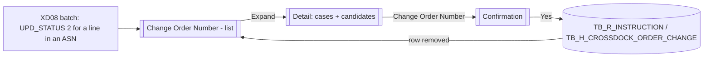
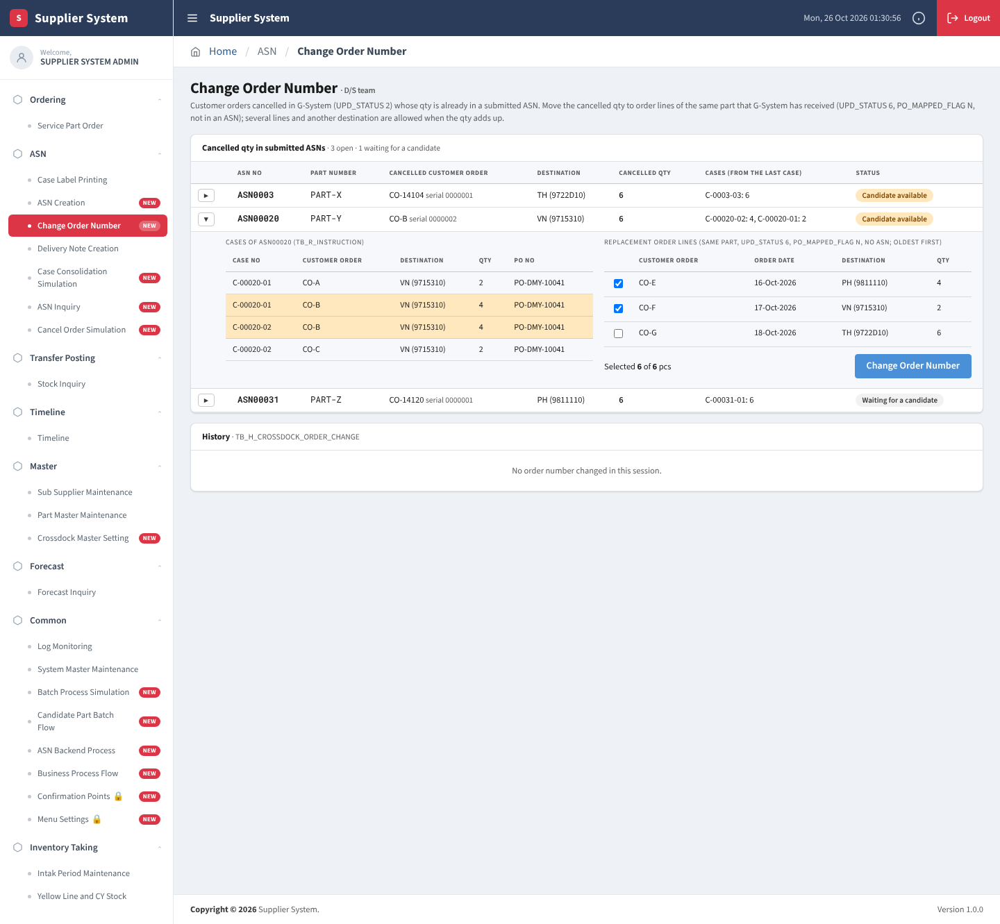
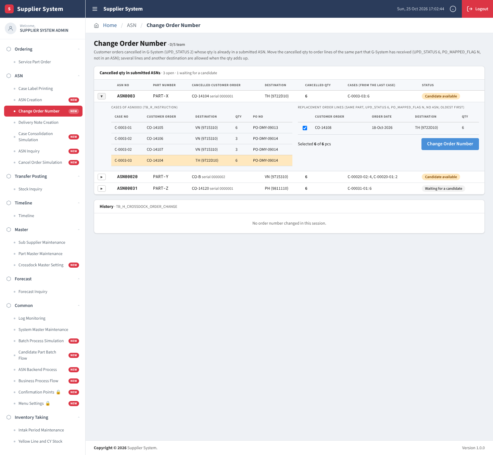
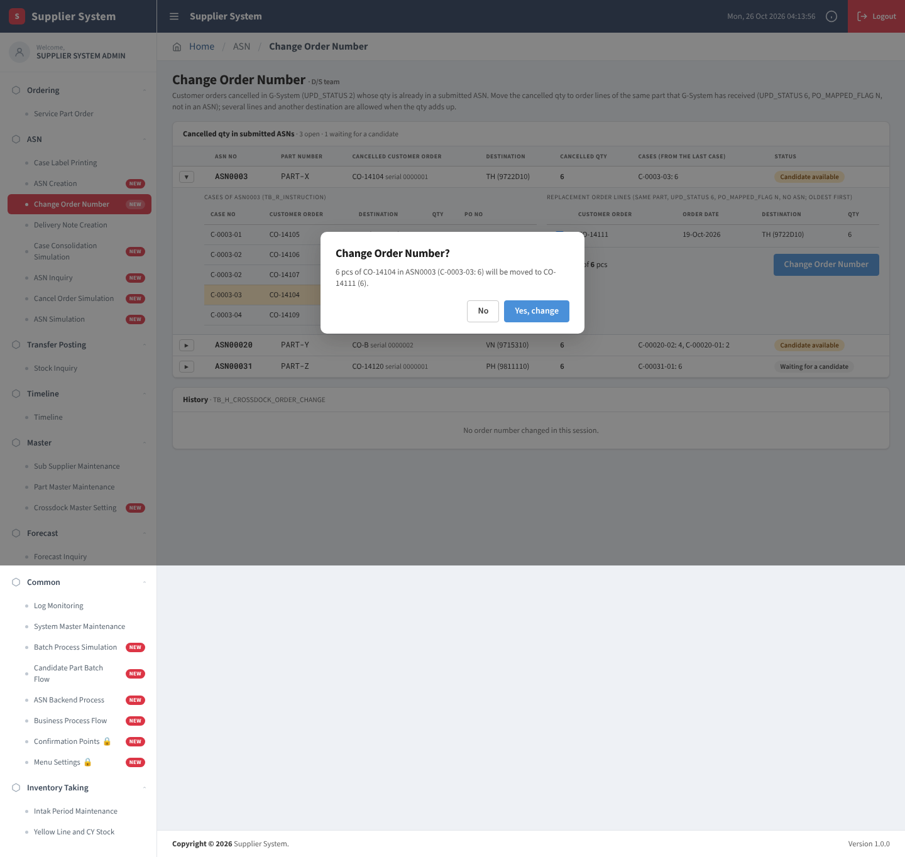
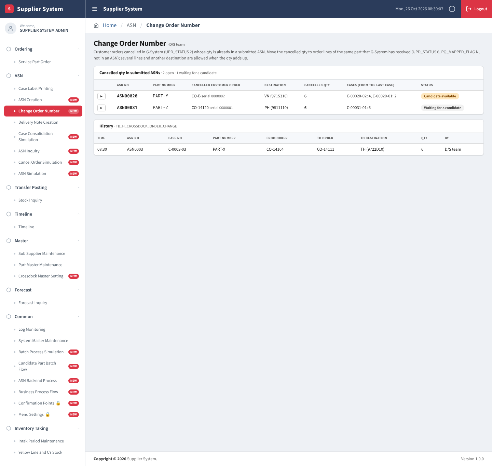

# XD11 – Change Order Number Screen

> Generated from `deliverables/function_list_v2/specs/XD11_spec.json` (UISS `XD11_UISS_Screen_ChangeOrderNumber.xlsx`). Do not edit by hand: change the spec and run `python3 prepare_code/build_md.py`. Document names: GTOPAS / NSP (prototype: G-System / Supplier System).

| Phase | Project | Block | Function | Created | By | Type |
|---|---|---|---|---|---|---|
| DR | Crossdock Optimization | Screen | XD11 Change Order Number Screen | 18-Oct-26 | FID Rayhan | screen |

## Revision

| Rev | Author | Date | Reviewed by | Description |
|---|---|---|---|---|
| 0.1 | FID Rayhan | 18-Oct-26 |  | Initial Draft |

## 1. General

### Objective

- To list the customer order lines cancelled in GTOPAS (UPD_STATUS '2', set by XD08) whose qty is already in a submitted ASN.
- To move the cancelled qty to order lines of the same part that GTOPAS has received (UPD_STATUS '6', PO_MAPPED_FLAG 'N', not in an ASN), so that the cases of the ASN keep a valid customer order (decided 23-Oct; replaces the former XD11 cancel batch and the CONFLICT handling outside the system).
- D/S team only: sub menu of ASN (next to ASN Creation).

### Display order – Cancelled qty

| Field | Order |
|---|---|
| ASN No | Ascending |
| Customer Order Date of the cancelled line | Ascending |

### Display order – Replacement order lines

| Field | Order |
|---|---|
| Customer Order Date | Ascending (oldest first) |
| Customer Order No | Ascending |

### Buttons

| Button | Function |
|---|---|
| Expand (replacement) | Show the cases of the ASN (TB_R_INSTRUCTION) and the replacement order lines of a cancelled qty. |
| Candidate (check box) | Choose the replacement order lines; the qty of the ticked lines must add up to the cancelled qty. |
| Change Order Number | Enabled when the ticked qty equals the cancelled qty; opens the confirmation. |
| Yes / No | Yes: move the qty (TB_R_INSTRUCTION, PO_MAPPED_FLAG, history). No: close the confirmation. |

### Screen modes (E = enabled, D = disabled)

| Mode | Section | Description | Expand (replacement) | Candidate (check box) | Change Order Number | Yes / No |
|---|---|---|---|---|---|---|
| List Mode | Cancelled qty in submitted ASNs | One row per cancelled line and ASN; status Candidate available / Waiting for a candidate | E | D | D | D |
| List Mode | History | Changes of TB_H_CROSSDOCK_ORDER_CHANGE | D | D | D | D |
| Detail Mode | Cases of the ASN / Replacement order lines | Rows of the cancelled line highlighted; candidates oldest first, pre-ticked | E | E | E | D |
| Detail Mode | Confirmation | Modal | D | D | D | E |

- 1) Only the D/S team opens this screen (menu right in Menu Settings).
- 2) A cancelled qty stays in the list until it is moved (no time limit); without candidate it is shown as Waiting for a candidate.
- 3) [Change Order Number] is enabled only when the ticked qty equals the cancelled qty (message no. 2 otherwise).

## 2. Screen flow

### Screen Flow - Change Order Number

## 3. Screen layout

### 1. List Mode: ASN0003 (CO-14104 cancelled after the ASN, candidate CO-14111), ASN00020 (partial cancel of CO-B, ERD SIM-6), ASN00031 (waiting for a candidate)

### 2. Detail of ASN0003 (simulasi_asn.xlsx: CO-14104 cancelled after the ASN; candidate CO-14111, UPD_STATUS 6)

### 3. Confirmation

### 4. After the change: row removed from the list, history written

## 4. Item description

| No | Item | Source | Field | Type | Len | I/O | Control | Justified | Initial | Req | Format | Validation | Description |
|---|---|---|---|---|---|---|---|---|---|---|---|---|---|
| **<Cancelled Qty in Submitted ASNs Section>** |  |  |  |  |  |  |  |  |  |  |  |  |  |
| 1 | Expand | - | - | - | - | I | Button | Center | Enabled | N | - | - | Opens the detail (cases and candidates) of the row. |
| 2 | ASN No | TB_R_INSTRUCTION | ASN_NO | Char | 15 | O | Label | Left | - | N | - | - | Submitted ASN that holds the cancelled qty. |
| 3 | Part Number | TB_R_H0253_ORDER_CONTROL_PRE | SHIPPING_PART_NO | Char | 15 | O | Label | Left | - | N | - | - | Part number of the cancelled line. |
| 4 | Cancelled Customer Order | TB_R_H0253_ORDER_CONTROL_PRE | CUSTOMER_ORDER_NO / SERIAL_NO | Char | - | O | Label | Left | - | N | - | - | Line with UPD_STATUS '2' (serial of the status 2 row). |
| 5 | Destination | TB_R_H0253_ORDER_CONTROL_PRE | DESTINATION_CD | Char | 7 | O | Label | Left | - | N | - | - | Destination of the cancelled line. |
| 6 | Cancelled Qty | TB_R_H0253_ORDER_CONTROL_PRE | ORDER_STATUS_QTY (UPD_STATUS 2) | Number | - | O | Label | Right | - | N | ZZZ9 | - | Qty cancelled by GTOPAS that is in the ASN. |
| 7 | Cases (from the last case) | TB_R_INSTRUCTION | CASE_NO / QTY | Char | - | O | Label | Left | - | N | - | - | Proposal of the qty to move: from the last case of the ASN backwards (e.g. C-00020-02: 4, C-00020-01: 2); a row is split when only part of it is needed. |
| 8 | Status | Computed | - | Char | - | O | Label | Left | - | N | - | - | Candidate available (amber) / Waiting for a candidate (grey). |
| **<Detail: Cases of the ASN>** |  |  |  |  |  |  |  |  |  |  |  |  |  |
| 9 | Case No / Customer Order / Destination / Qty / PO No | TB_R_INSTRUCTION | CASE_NO, CUSTOMER_ORDER_NO, DESTINATION_CD, QTY, PO_NO | Char | - | O | Grid | Left | - | N | - | - | All rows of the ASN; rows of the cancelled line highlighted. |
| **<Detail: Replacement Order Lines>** |  |  |  |  |  |  |  |  |  |  |  |  |  |
| 10 | Candidate (check box) | Key-in | - | Char | - | I | CheckBox | Center | <pre-ticked> | N | - | - | Lines of the same part with UPD_STATUS '6', PO_MAPPED_FLAG 'N' and no row in TB_R_INSTRUCTION; oldest Customer Order Date first. Pre-ticked: oldest lines whose qty adds up to the cancelled qty. Another destination is allowed. |
| 11 | Customer Order / Order Date / Destination / Qty | TB_R_H0253_ORDER_CONTROL_PRE | CUSTOMER_ORDER_NO, ORDER_DT, DESTINATION_CD, ORDER_STATUS_QTY | Char | - | O | Grid | Left | - | N | - | - | Candidate line. |
| 12 | Selected qty | Computed | - | Number | - | O | Label | Left | - | N | - | - | 'Selected {n} of {q} pcs'; red text when it differs from the cancelled qty. |
| 13 | Change Order Number | - | - | - | - | I | Button | Center | Disabled | N | - | - | Refer Operation 5.2. |
| **<History Section>** |  |  |  |  |  |  |  |  |  |  |  |  |  |
| 14 | Time / ASN No / Case No / Part / From Order / To Order / To Destination / Qty / By | TB_H_CROSSDOCK_ORDER_CHANGE | CREATED_DT, ASN_NO, CASE_NO, PART_NO, FROM_*, TO_*, QTY, CREATED_BY | Char | - | O | Grid | Left | - | N | - | - | Changes made (newest first). |

## 5. Data edit mapping

#### 1. Update / Insert TB_R_INSTRUCTION – [Yes]: per case piece, the qty moves to the replacement line
- Source: Cases of the cancelled line (from the last case) + ticked candidates
- Destination keys: INSTRUCTION_ID = Rows of the cancelled line in the ASN

| Source field | Destination field | Description |
|---|---|---|
|  | QTY | Whole row moved: not changed. Part of the row: reduced by the moved qty (the rest stays with the cancelled line) |
|  | CUSTOMER_CD / CUSTOMER_ORDER_NO / ORDER_DT / DESTINATION_CD / DETAILED_ITEM_NO / SERIAL_NO | Whole row: replaced by the key of the replacement line. Part of the row: a new row is inserted with the key of the replacement line and the moved qty; ASN_NO, CASE_NO, CASE_SEQ, PO_NO, MANIFEST_NO, MANIFEST_ITEM copied |
|  | CHANGED_BY / CHANGED_DT | Login user ID / server system date-time |

#### 2. Update TB_R_H0253_ORDER_CONTROL_PRE – Replacement lines
- Source: Ticked candidates
- Destination keys: Unique key (incl. SERIAL_NO) = Ticked lines

| Source field | Destination field | Description |
|---|---|---|
|  | PO_MAPPED_FLAG | 'Y' (PO and ASN through the moved qty) |
|  | UPDATE_BY / UPDATE_DT | Login user ID / system date-time |

#### 3. - TB_R_H0253_ORDER_CONTROL_PRE – Not changed: PO_MAPPED_FLAG stays 'Y', UPD_STATUS stays '2'
- Source: Cancelled line
- Destination keys: Unique key (incl. SERIAL_NO) = Cancelled line

| Source field | Destination field | Description |
|---|---|---|
|  | PO_MAPPED_FLAG | Not changed |

#### 4. Insert TB_H_CROSSDOCK_ORDER_CHANGE – History of the change
- Source: Each moved piece

| Source field | Destination field | Description |
|---|---|---|
|  | HIST_ID | Running number |
|  | ASN_NO | ASN of the case |
|  | CASE_NO | Case of the moved qty |
|  | PART_NO | Part number |
|  | FROM_CUSTOMER_CD | Cancelled line: CUSTOMER_CD |
|  | FROM_CUSTOMER_ORDER_NO | Cancelled line: CUSTOMER_ORDER_NO |
|  | FROM_ORDER_DT | Cancelled line: ORDER_DT |
|  | FROM_DESTINATION_CD | Cancelled line: DESTINATION_CD |
|  | FROM_DETAILED_ITEM_NO | Cancelled line: DETAILED_ITEM_NO |
|  | FROM_SERIAL_NO | Cancelled line: SERIAL_NO of the status 2 row |
|  | TO_CUSTOMER_CD | Replacement line: CUSTOMER_CD |
|  | TO_CUSTOMER_ORDER_NO | Replacement line: CUSTOMER_ORDER_NO |
|  | TO_ORDER_DT | Replacement line: ORDER_DT |
|  | TO_DESTINATION_CD | Replacement line: DESTINATION_CD (may differ from the cancelled line) |
|  | TO_DETAILED_ITEM_NO | Replacement line: DETAILED_ITEM_NO |
|  | TO_SERIAL_NO | Replacement line: SERIAL_NO |
|  | QTY | Moved qty |
|  | FROM_INSTRUCTION_ID | Row of TB_R_INSTRUCTION the qty was taken from |
|  | TO_INSTRUCTION_ID | Row of TB_R_INSTRUCTION of the replacement (same row when the whole row moved) |
|  | CREATED_BY | Login user ID (D/S team) |
|  | CREATED_DT | Server system date-time |

## 6. Operation description

### 5.1 List Mode

a. On display, every line with UPD_STATUS '2' that has rows in TB_R_INSTRUCTION with ASN_NO is listed, one row per line and ASN. Lines cancelled without ASN (no row, or drafts released by XD08) are not listed.
b. Cancelled qty = qty of the status 2 row of the line in the ASN; the proposal of the cases is taken from the last case of the ASN backwards.
c. Status: Candidate available when at least one candidate exists; else Waiting for a candidate (the row stays until a candidate appears). No row: message no. 1.

### 5.2 Detail Mode and Change Order Number

a. Candidates: lines of the same part with UPD_STATUS '6', PO_MAPPED_FLAG 'N' and no row in TB_R_INSTRUCTION, oldest Customer Order Date first. Another destination is allowed. The oldest lines whose qty adds up to the cancelled qty are pre-ticked; the D/S team can change the ticks.
b. [Change Order Number] is enabled only when the ticked qty equals the cancelled qty (message no. 2 as hint otherwise). Confirmation message no. 3.
c. [Yes], in one transaction: the cancelled qty is moved case by case (from the last case) to the ticked lines in their order; a TB_R_INSTRUCTION row is updated when it moves completely and split (new row) when only part of it moves. The ASN, its cases, CASE_NO and PO do not change. Replacement lines: PO_MAPPED_FLAG 'Y'. Cancelled line: not changed. One history record per moved piece. The row leaves the list.
d. Re-check in the same transaction: when a candidate was taken in the meantime (PO_MAPPED_FLAG 'Y' or row in TB_R_INSTRUCTION), nothing is saved and message no. 4 is shown; the detail is refreshed.

### 5.3 Example (simulasi_asn_rev.xlsx; sheet Sample Input)

a. 18-Oct: cases 1-4 of order date 17-Oct are sent in ASN0003 (case 3 = CO-14104, TH, 6 pcs, a middle row). 19-Oct: CO-14104 is cancelled (waiting for a candidate). 21-Oct: CO-14111 (TH, 6 pcs, order date 19-Oct) is received in GTOPAS (UPD_STATUS 6, PO_MAPPED_FLAG N, no ASN). The D/S team moves the 6 pcs of case C-0003-03 to CO-14111.
b. Other example (ERD SIM-6, partial cancel): CO-B 8 pcs in ASN00020 (case 1: 4, case 2: 4), 6 pcs cancelled: case 2 4 pcs + 2 of the 4 pcs of case 1 (row split) move to CO-E (4) and CO-F (2).

## 7. Display messages

| ID | Event | Cause | Type | Message | Action |
|---|---|---|---|---|---|
| **List** |  |  |  |  |  |
| MSG1 | Open the screen | No cancelled qty in a submitted ASN | Info | No cancelled qty in a submitted ASN. | - |
| **Change Order Number** |  |  |  |  |  |
| MSG2 | Tick candidates | Ticked qty differs from the cancelled qty | Info | Selected {n} of {q} pcs: the qty must add up to {q}. | Tick other candidates. |
| MSG3 | Click [Change Order Number] | Confirmation | Confirmation | {q} pcs of {Customer Order} in {ASN No} ({cases}) will be moved to {replacement lines}. | Yes / No. |
| MSG4 | Click [Yes] | A candidate was taken in the meantime | Error | {Customer Order} is no longer available. The candidates are refreshed. | Tick again. |

## 8. Logging messages

_None._

## 9. Tables

#### TB_H_CROSSDOCK_ORDER_CHANGE (history, proposed)
New history table (replaces TB_R_CROSSDOCK_CANCEL_RESULT): one record per moved piece of qty (ASN case x cancelled line x replacement line) of Change Order Number (XD11). Name and columns proposed.

| Column | Type | PK | Null | Description |
|---|---|---|---|---|
| HIST_ID | BIGINT | Y | N | Running number |
| ASN_NO | VARCHAR(15) |  | N | ASN of the case |
| CASE_NO | VARCHAR(9) |  | N | Case of the moved qty |
| PART_NO | VARCHAR(15) |  | N | Part number |
| FROM_CUSTOMER_CD | VARCHAR(7) |  | N | Cancelled line: CUSTOMER_CD |
| FROM_CUSTOMER_ORDER_NO | VARCHAR(8) |  | N | Cancelled line: CUSTOMER_ORDER_NO |
| FROM_ORDER_DT | DATE |  | N | Cancelled line: ORDER_DT |
| FROM_DESTINATION_CD | VARCHAR(7) |  | N | Cancelled line: DESTINATION_CD |
| FROM_DETAILED_ITEM_NO | VARCHAR(4) |  | N | Cancelled line: DETAILED_ITEM_NO |
| FROM_SERIAL_NO | VARCHAR(7) |  | N | Cancelled line: SERIAL_NO of the status 2 row |
| TO_CUSTOMER_CD | VARCHAR(7) |  | N | Replacement line: CUSTOMER_CD |
| TO_CUSTOMER_ORDER_NO | VARCHAR(8) |  | N | Replacement line: CUSTOMER_ORDER_NO |
| TO_ORDER_DT | DATE |  | N | Replacement line: ORDER_DT |
| TO_DESTINATION_CD | VARCHAR(7) |  | N | Replacement line: DESTINATION_CD (may differ from the cancelled line) |
| TO_DETAILED_ITEM_NO | VARCHAR(4) |  | N | Replacement line: DETAILED_ITEM_NO |
| TO_SERIAL_NO | VARCHAR(7) |  | N | Replacement line: SERIAL_NO |
| QTY | NUMBER(8) |  | N | Moved qty |
| FROM_INSTRUCTION_ID | BIGINT |  | N | Row of TB_R_INSTRUCTION the qty was taken from |
| TO_INSTRUCTION_ID | BIGINT |  | N | Row of TB_R_INSTRUCTION of the replacement (same row when the whole row moved) |
| CREATED_BY | VARCHAR(20) |  | N | Login user ID (D/S team) |
| CREATED_DT | DATETIME |  | N | Server system date-time |

#### TB_R_INSTRUCTION (transaction, proposed)
Real mapping made by [Create ASN]: one row per supplier case x customer order line x PO of the chosen blocks (case and line sequence of XD09). Rows are deleted by [Back] / [Cancel] on the Case List; [Submit ASN] (5.7) fills ASN_NO and CASE_NO. Columns proposed. Rows without ASN_NO are a draft: every run of XD08 releases all drafts (decided 23-Oct); a cancelled line in a submitted ASN is moved to other lines in Change Order Number (XD11).

| Column | Type | PK | Null | Description |
|---|---|---|---|---|
| INSTRUCTION_ID | BIGINT | Y | N | Running number (identity) |
| SUPPLIER_CD | VARCHAR(TBD) |  | N | Supplier code (one ASN = one Supplier Code + Plant) |
| SUPPLIER_PLANT | VARCHAR(TBD) |  | N | Supplier plant |
| CASE_SEQ | NUMBER(4) |  | N | Case sequence of the Create ASN (Case 1, 2, ...) |
| LINE_SEQ | NUMBER(4) |  | N | Order line x PO within the case |
| PART_NO | VARCHAR(15) |  | N | Part number of the case |
| ORDER_DT | DATE |  | N | Customer Order Date of the case |
| DESTINATION_CD | VARCHAR(7) |  | N | Destination of the case |
| CUSTOMER_CD | VARCHAR(7) |  | N | Customer code |
| CUSTOMER_ORDER_NO | VARCHAR(8) |  | N | Customer order number |
| DETAILED_ITEM_NO | VARCHAR(4) |  | N | Detailed item number |
| SERIAL_NO | VARCHAR(7) |  | N | Serial number |
| QTY | NUMBER(8) |  | N | Qty of the line mapped to the PO in this case |
| PO_NO | VARCHAR(TBD) |  | N | PO number |
| MANIFEST_NO | VARCHAR(TBD) |  | N | Manifest number of the Pra Daily Order |
| MANIFEST_ITEM | VARCHAR(TBD) |  | N | Manifest item number |
| ORDER_QTY | NUMBER(TBD) |  | N | PO qty |
| DELIVERY_DT | DATE |  | N | Delivery Date of the Search |
| RIT_CYCLE | VARCHAR(TBD) |  | N | Rit of the Search (route master, existing) |
| ROUTE | VARCHAR(TBD) |  | N | Route of the Rit (route master, existing) |
| DRAFT_ID | VARCHAR(20) |  | Y | Draft of one [Create ASN] (all rows of the creation); NULL after [Submit ASN] is not needed (ASN_NO filled). Every run of XD08 deletes the rows with ASN_NO NULL |
| ASN_NO | VARCHAR(TBD) |  | Y | ASN number; NULL until the ASN is submitted (5.7) |
| CASE_NO | VARCHAR(TBD) |  | Y | Case number; NULL until submitted (auto generated with the existing last sequence) |
| CREATED_BY | VARCHAR(TBD) |  | N | User who created the record |
| CREATED_DT | DATETIME |  | N | Created date and time |
| CHANGED_BY | VARCHAR(TBD) |  | N | User who last changed the record |
| CHANGED_DT | DATETIME |  | N | Last changed date and time |

#### TB_R_PRA_DAILY_ORDER_MAPPED (transaction, proposed)
New table: mapped qty per Pra Daily Order PO part (instead of a new column in the Pra Daily Order). Name and columns proposed.

| Column | Type | PK | Null | Description |
|---|---|---|---|---|
| PO_NO | VARCHAR(TBD) | Y | N | PO number (Pra Daily Order Manifest) |
| MANIFEST_NO | VARCHAR(TBD) | Y | N | Manifest number |
| MANIFEST_ITEM | VARCHAR(TBD) | Y | N | Manifest item number (Pra Daily Order Part) |
| PART_NO | VARCHAR(15) |  | N | Part number |
| SUPPLIER_CD | VARCHAR(TBD) |  | N | Supplier code |
| SUPPLIER_PLANT | VARCHAR(TBD) |  | N | Supplier plant |
| ORDER_QTY | NUMBER(TBD) |  | N | PO qty of the part |
| MAPPED_QTY | NUMBER(TBD) |  | N | Qty already mapped to customer orders by [Create ASN]; open qty = ORDER_QTY - MAPPED_QTY |
| CREATED_BY | VARCHAR(TBD) |  | N | User who created the record |
| CREATED_DT | DATETIME |  | N | Created date and time |
| CHANGED_BY | VARCHAR(TBD) |  | N | User who last changed the record |
| CHANGED_DT | DATETIME |  | N | Last changed date and time |

## Sample Input

**Sample Change Order Number - simulasi_asn_rev.xlsx (ASN0003, 21-Oct)**

- 18-Oct: cases 1-4 of PART-X 17-Oct in ASN0003. 19-Oct: CO-14104 (TH 6, case 3) is cancelled in GTOPAS (UPD_STATUS 2, LOG5): listed, waiting for a candidate. 21-Oct: CO-14111 (TH 6, order date 19-Oct) is received in GTOPAS with the pcs of case 3 (UPD_STATUS 6, PO_MAPPED_FLAG N, no ASN): candidate.

### A. List and detail

| ASN No | Part | Cancelled order | Cancelled qty | Cases (from the last case) | Candidate | Status |
|---|---|---|---|---|---|---|
| ASN0003 | PART-X | CO-14104 / 0000001 | 6 | C-0003-03: 6 | CO-14111 TH 6 (19-Oct) | Candidate available |

### B. TB_R_INSTRUCTION (same row updated; case, PO and ASN not changed)

| INSTRUCTION_ID | CASE_NO | Customer Order before | Customer Order after | Destination | Qty | PO | ASN_NO |
|---|---|---|---|---|---|---|---|
| 6 | C-0003-03 | CO-14104 | CO-14111 | 9722D10 | 6 | T0409013 | ASN0003 |

### C. Other tables

| Table | Key | Column | Before | After |
|---|---|---|---|---|
| TB_R_H0253_ORDER_CONTROL_PRE | CO-14111 / 0000001 | PO_MAPPED_FLAG | N | Y |
| TB_R_H0253_ORDER_CONTROL_PRE | CO-14104 / 0000001 | PO_MAPPED_FLAG | Y | Y (not changed) |
| TB_H_CROSSDOCK_ORDER_CHANGE | HIST_ID 1 | (new row) | - | ASN0003, C-0003-03, CO-14104 → CO-14111, 6, instruction 6 → 6 |

### D. Scenarios

| No | Scenario | Expected result |
|---|---|---|
| N1 | 19-Oct: CO-14104 cancelled, no candidate yet | Row listed with status Waiting for a candidate (no time limit). |
| N2 | 21-Oct: tick CO-14111 and click [Change Order Number] → Yes | Sections B and C; the row leaves the list. |
| N3 | Partial cancel (ERD SIM-6): CO-B 6 of 8 pcs in ASN00020 | Moved from the last case backwards: case 2 4 pcs → CO-E, 2 of the 4 pcs of case 1 → CO-F (row split). |
| E1 | The candidate was taken in another session | MSG4; nothing is saved; candidates refreshed. |
