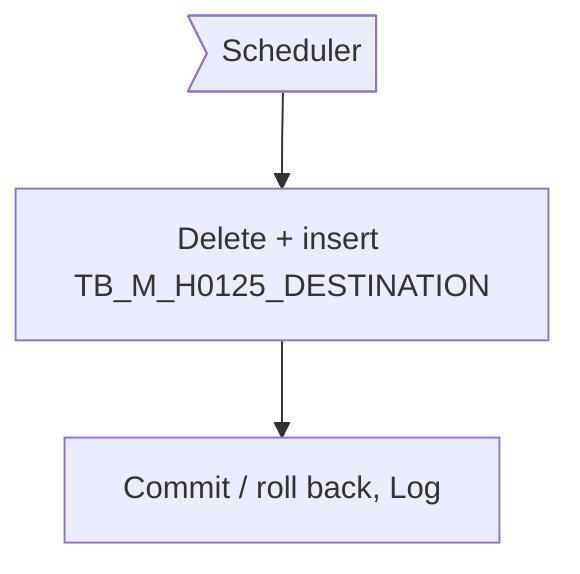
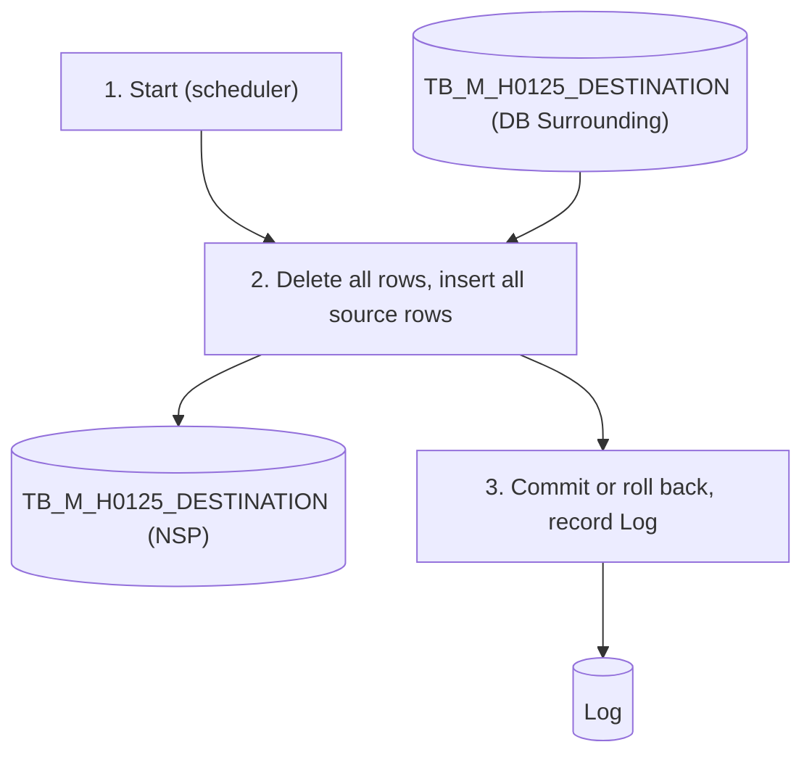

# XD13 – Destination Master Synch into NSP

> Generated from `deliverables/function_list_v2/specs/XD13_spec.json` (UISS `XD13_UISS_Batch_DestinationMasterSync.xlsx`). Do not edit by hand: change the spec and run `python3 prepare_code/build_md.py`. Document names: GTOPAS / NSP (prototype: G-System / Supplier System).

| Phase | Project | Block | Function | Created | By | Type |
|---|---|---|---|---|---|---|
| DR | Crossdock Optimization | Batch | XD13 Destination Master Synch into NSP | 18-Oct-26 | FID Rayhan | batch |

## Revision

| Rev | Author | Date | Reviewed by | Description |
|---|---|---|---|---|
| 0.1 | FID Rayhan | 18-Oct-26 |  | Initial Draft |

## 1. General

### Objective

- To replicate TB_M_H0125_DESTINATION from DB Surrounding to the table with the same name in NSP.
- The NSP table is fully replaced every run (delete - insert). In case any error occurs, the run is rolled back and NSP keeps the data of the last successful run.

### Operation flow

### Input

| Name | Type | Description |
|---|---|---|
| TB_M_H0125_DESTINATION (DB Surrounding) | DB | Destination master (I/F H01-25, DVJO820) |

### Output

| Name | Type | Description |
|---|---|---|
| TB_M_H0125_DESTINATION (NSP) | DB | if successful: same rows as the source |
| Log | DB | One record per run with status SUCCESS / FAILED |

### Parameters

| Name | Description |
|---|---|
| - | No parameter. All rows of the source table are copied. |

### Execution Schedule

| Item | Description |
|---|---|
| Trigger | Scheduler after GTOPAS has provided the data (1 time/week, 21:30); auto retry 3 times. |

## 2. Function flow

1. The scheduler starts the batch.
2. Delete all rows of TB_M_H0125_DESTINATION (NSP) and insert all rows of TB_M_H0125_DESTINATION (DB Surrounding) (same columns and values).
3. No error: commit. Error: roll back step 2 (one transaction). Record the result in the Log. Exit.

## 3. Data edit mapping

#### 1. Delete TB_M_H0125_DESTINATION (NSP) – All rows (full replace)
- Source: TB_M_H0125_DESTINATION (NSP)

| Source field | Destination field | Description |
|---|---|---|
|  | DESTINATION_CD | Row is deleted |
|  | CUSTOMER_CD | Row is deleted |
|  | DOMESTIC_OVERSEA_CLASS_CD | Row is deleted |
|  | ORDER_TRANSPORTATION_CD | Row is deleted |
|  | BO_INSTRUCTION_CD | Row is deleted |
|  | TARIFF_CD_INPUT_REQUIRED_FLAG | Row is deleted |
|  | QUP_PROCESS_CD | Row is deleted |
|  | DEPOT_DEST_JUDGMENT_FLAG | Row is deleted |
|  | REGION_CD | Row is deleted |
|  | REGION_NAME | Row is deleted |
|  | DESTINATION_GROUPING_CD | Row is deleted |
|  | FREIGHT_AGENT_CD_AIR | Row is deleted |
|  | FREIGHT_AGENT_CD_SEA | Row is deleted |
|  | FREIGHT_AGENT_CD_LAND | Row is deleted |
|  | PACKING_TYPE_CD | Row is deleted |
|  | DESTINATION_OPERATOR_CD | Row is deleted |
|  | DESTINATION_OPERATOR_NAME | Row is deleted |
|  | DESTINATION_NAME_ENG | Row is deleted |
|  | DESTINATION_NAME_LOCAL | Row is deleted |
|  | COUNTRY_NAME_ENG | Row is deleted |
|  | COUNTRY_NAME_LOCAL | Row is deleted |
|  | POSTAL_CD_ENG | Row is deleted |
|  | POSTAL_CD_LOCAL | Row is deleted |
|  | STATE_CD_ENG | Row is deleted |
|  | STATE_CD_LOCAL | Row is deleted |
|  | DESTINATION_ADDR1_ENG | Row is deleted |
|  | DESTINATION_ADDR2_ENG | Row is deleted |
|  | DESTINATION_ADDR1_LOCAL | Row is deleted |
|  | DESTINATION_ADDR2_LOCAL | Row is deleted |
|  | PHONE_NO | Row is deleted |
|  | FAX_NO | Row is deleted |
|  | REGISTRANT_ID | Row is deleted |
|  | UPDATE_JOB_ID | Row is deleted |
|  | UPDATE_OPERATOR_ID | Row is deleted |
|  | INTF_UPDATE_DT | Row is deleted |
|  | CREATE_DT | Row is deleted |
|  | CREATE_BY | Row is deleted |
|  | UPDATE_DT | Row is deleted |
|  | UPDATE_BY | Row is deleted |

#### 2. Insert TB_M_H0125_DESTINATION (NSP) – Every source row
- Source: TB_M_H0125_DESTINATION (DB Surrounding)

| Source field | Destination field | Description |
|---|---|---|
| DESTINATION_CD | DESTINATION_CD | Same value as the source |
| CUSTOMER_CD | CUSTOMER_CD | Same value as the source |
| DOMESTIC_OVERSEA_CLASS_CD | DOMESTIC_OVERSEA_CLASS_CD | Same value as the source |
| ORDER_TRANSPORTATION_CD | ORDER_TRANSPORTATION_CD | Same value as the source |
| BO_INSTRUCTION_CD | BO_INSTRUCTION_CD | Same value as the source |
| TARIFF_CD_INPUT_REQUIRED_FLAG | TARIFF_CD_INPUT_REQUIRED_FLAG | Same value as the source |
| QUP_PROCESS_CD | QUP_PROCESS_CD | Same value as the source |
| DEPOT_DEST_JUDGMENT_FLAG | DEPOT_DEST_JUDGMENT_FLAG | Same value as the source |
| REGION_CD | REGION_CD | Same value as the source |
| REGION_NAME | REGION_NAME | Same value as the source |
| DESTINATION_GROUPING_CD | DESTINATION_GROUPING_CD | Same value as the source |
| FREIGHT_AGENT_CD_AIR | FREIGHT_AGENT_CD_AIR | Same value as the source |
| FREIGHT_AGENT_CD_SEA | FREIGHT_AGENT_CD_SEA | Same value as the source |
| FREIGHT_AGENT_CD_LAND | FREIGHT_AGENT_CD_LAND | Same value as the source |
| PACKING_TYPE_CD | PACKING_TYPE_CD | Same value as the source |
| DESTINATION_OPERATOR_CD | DESTINATION_OPERATOR_CD | Same value as the source |
| DESTINATION_OPERATOR_NAME | DESTINATION_OPERATOR_NAME | Same value as the source |
| DESTINATION_NAME_ENG | DESTINATION_NAME_ENG | Same value as the source |
| DESTINATION_NAME_LOCAL | DESTINATION_NAME_LOCAL | Same value as the source |
| COUNTRY_NAME_ENG | COUNTRY_NAME_ENG | Same value as the source |
| COUNTRY_NAME_LOCAL | COUNTRY_NAME_LOCAL | Same value as the source |
| POSTAL_CD_ENG | POSTAL_CD_ENG | Same value as the source |
| POSTAL_CD_LOCAL | POSTAL_CD_LOCAL | Same value as the source |
| STATE_CD_ENG | STATE_CD_ENG | Same value as the source |
| STATE_CD_LOCAL | STATE_CD_LOCAL | Same value as the source |
| DESTINATION_ADDR1_ENG | DESTINATION_ADDR1_ENG | Same value as the source |
| DESTINATION_ADDR2_ENG | DESTINATION_ADDR2_ENG | Same value as the source |
| DESTINATION_ADDR1_LOCAL | DESTINATION_ADDR1_LOCAL | Same value as the source |
| DESTINATION_ADDR2_LOCAL | DESTINATION_ADDR2_LOCAL | Same value as the source |
| PHONE_NO | PHONE_NO | Same value as the source |
| FAX_NO | FAX_NO | Same value as the source |
| REGISTRANT_ID | REGISTRANT_ID | Same value as the source |
| UPDATE_JOB_ID | UPDATE_JOB_ID | Same value as the source |
| UPDATE_OPERATOR_ID | UPDATE_OPERATOR_ID | Same value as the source |
| INTF_UPDATE_DT | INTF_UPDATE_DT | Same value as the source |
| CREATE_DT | CREATE_DT | Same value as the source |
| CREATE_BY | CREATE_BY | Same value as the source |
| UPDATE_DT | UPDATE_DT | Same value as the source |
| UPDATE_BY | UPDATE_BY | Same value as the source |

#### 3. Insert Log – One record per run
- Source: Result of this run

| Source field | Destination field | Description |
|---|---|---|
|  | BATCH_ID | 'H0125_SYNC' |
|  | STATUS | SUCCESS / FAILED |
|  | ROW_COUNT | Rows inserted (0 when FAILED) |
|  | MESSAGE | Error message when FAILED |
|  | START_DT | Start date and time |
|  | END_DT | End date and time |

## 4. Function description

- Full replace (delete - insert); all columns are copied as they are, no conversion.
- Delete and insert run in one transaction (all-or-nothing). When the run fails, NSP keeps the data of the last successful run.
- Schedule is set in the system master (TBC). Table structure: see Appendix.

## 5. Logging messages

| ID | Event | Cause | Type | Message | Action |
|---|---|---|---|---|---|
| LOG1 | Batch start | Batch is called | Info | H0125 sync started. | system: Write the log.; user: - |
| LOG2 | Batch end | Batch finishes | Info | H0125 sync ended. Status <STATUS>, rows <ROW_COUNT>. | system: Write the log.; user: - |
| LOG3 | Copy table | Read from DB Surrounding or insert into NSP fails | Error | Cannot replicate TB_M_H0125_DESTINATION: <ERROR_DETAIL>. | system: Roll back. STATUS = FAILED.; user: User contact PIC |
| LOG4 | Unexpected error | Any other system error | Critical | Unexpected error: <ERROR_DETAIL>. | system: Roll back. STATUS = FAILED.; user: User contact PIC |

## 7. Tables

#### TB_M_H0125_DESTINATION (master, existing)
Destination master (I/F H01-25, DVJO820) replicated from DB Surrounding. Structure from the GTOPAS I/F layout; physical names follow the existing table. Key (PK) = unique key of the I/F layout.

| Column | Type | PK | Null | Description |
|---|---|---|---|---|
| DESTINATION_CD | VARCHAR(7) | Y | N | Used by Crossdock (destination list, upload check, DEST_CODE). No.1 Destination Code |
| CUSTOMER_CD | VARCHAR(7) |  | N | No.2 Customer Code |
| DOMESTIC_OVERSEA_CLASS_CD | VARCHAR(1) |  | N | No.3 Domestic/Overseas Classification Code: '1': Domestic, '2': Overseas |
| ORDER_TRANSPORTATION_CD | VARCHAR(1) |  | N | No.4 Order Transportation Code: 1':AIR '2':SEA '3':LAND |
| BO_INSTRUCTION_CD | VARCHAR(1) |  | N | No.5 B/O Instruction Code: 'K': B/O Cancel, 'F': Follow-up, 'M': Follow-up(S/O only) |
| TARIFF_CD_INPUT_REQUIRED_FLAG | VARCHAR(1) |  | N | No.6 Tariff Code Input Required Flag: '0':Not check '1':check |
| QUP_PROCESS_CD | VARCHAR(1) |  | N | No.7 QUP Process Code: '1':Round-up '2':Not change '3':Round-down |
| DEPOT_DEST_JUDGMENT_FLAG | VARCHAR(1) |  | N | No.8 Depot Destination Judgment Flag: "0":Not Depot "1":Depot |
| REGION_CD | VARCHAR(2) |  | N | No.9 Region Code |
| REGION_NAME | VARCHAR(50) |  | Y | No.10 Region Name |
| DESTINATION_GROUPING_CD | VARCHAR(7) |  | N | No.11 Destination Grouping Code |
| FREIGHT_AGENT_CD_AIR | VARCHAR(3) |  | N | No.12 Freight Agent Code (Air) |
| FREIGHT_AGENT_CD_SEA | VARCHAR(3) |  | N | No.13 Freight Agent Code (Sea) |
| FREIGHT_AGENT_CD_LAND | VARCHAR(3) |  | N | No.14 Freight Agent Code (Land) |
| PACKING_TYPE_CD | VARCHAR(2) |  | N | No.15 Packing Type Code: '1': 40 feet (FCL) '2': 20 feet (FCL) '3': LCL |
| DESTINATION_OPERATOR_CD | VARCHAR(2) |  | Y | No.16 Destination Operator Code |
| DESTINATION_OPERATOR_NAME | VARCHAR(20) |  | Y | No.17 Destination Operator Name |
| DESTINATION_NAME_ENG | VARCHAR(50) |  | N | Used by Crossdock (shown with the code). No.18 Destination Name |
| DESTINATION_NAME_LOCAL | VARCHAR(75) |  | Y | No.19 Destination Name (Local Language) |
| COUNTRY_NAME_ENG | VARCHAR(36) |  | Y | No.20 Country Name |
| COUNTRY_NAME_LOCAL | VARCHAR(54) |  | Y | No.21 Country Name (Local Language) |
| POSTAL_CD_ENG | VARCHAR(10) |  | Y | No.22 Postal Code |
| POSTAL_CD_LOCAL | VARCHAR(15) |  | Y | No.23 Postal Code (Local Language) |
| STATE_CD_ENG | VARCHAR(6) |  | Y | No.24 State Code |
| STATE_CD_LOCAL | VARCHAR(9) |  | Y | No.25 State Code (Local Language) |
| DESTINATION_ADDR1_ENG | VARCHAR(50) |  | N | No.26 Destination Address1 |
| DESTINATION_ADDR2_ENG | VARCHAR(50) |  | Y | No.27 Destination Address2 |
| DESTINATION_ADDR1_LOCAL | VARCHAR(75) |  | Y | No.28 Destination Address1(Local Language) |
| DESTINATION_ADDR2_LOCAL | VARCHAR(75) |  | Y | No.29 Destination Address2(Local Language) |
| PHONE_NO | VARCHAR(20) |  | Y | No.30 Phone No. |
| FAX_NO | VARCHAR(20) |  | Y | No.31 Fax No. |
| REGISTRANT_ID | VARCHAR(13) |  | Y | No.32 Registrant ID |
| UPDATE_JOB_ID | VARCHAR(8) |  | Y | No.33 Update Job ID |
| UPDATE_OPERATOR_ID | VARCHAR(13) |  | Y | No.34 Update Operator ID |
| INTF_UPDATE_DT | TIMESTAMP |  | Y | No.35 Update Date & Time |
| CREATE_DT | TIMESTAMP |  | Y | Created date and time (NSP) |
| CREATE_BY | VARCHAR(TBD) |  | Y | Created by (NSP) |
| UPDATE_DT | TIMESTAMP |  | Y | Updated date and time (NSP) |
| UPDATE_BY | VARCHAR(TBD) |  | Y | Updated by (NSP) |
