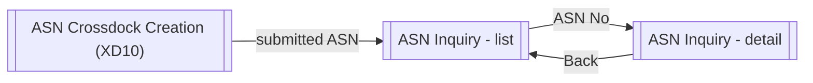
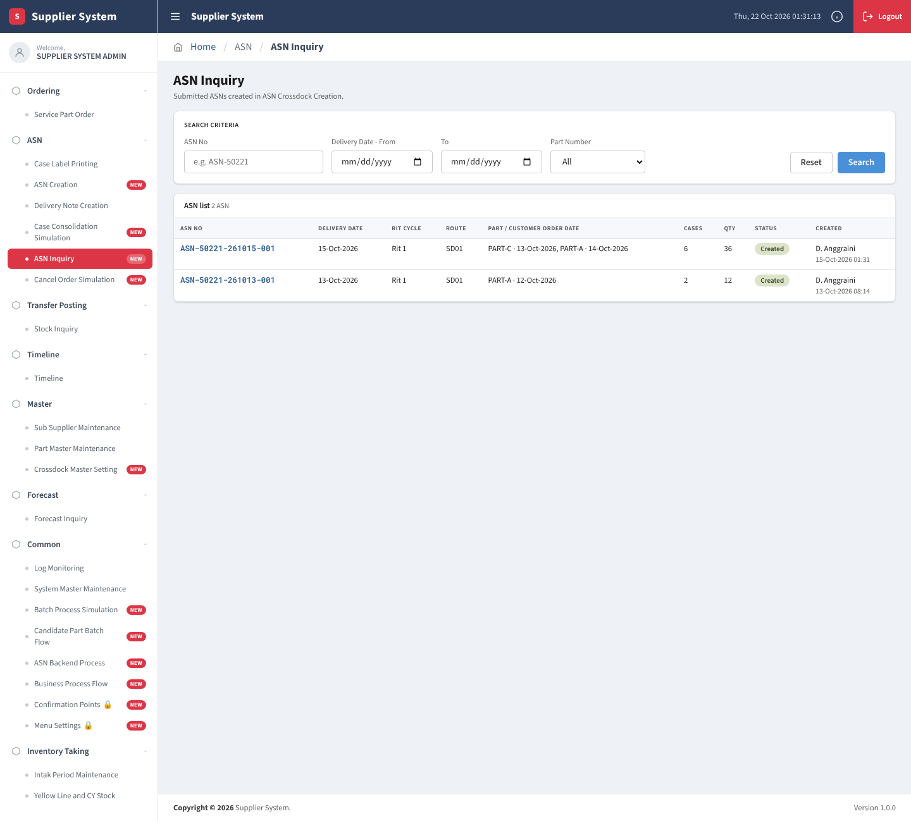
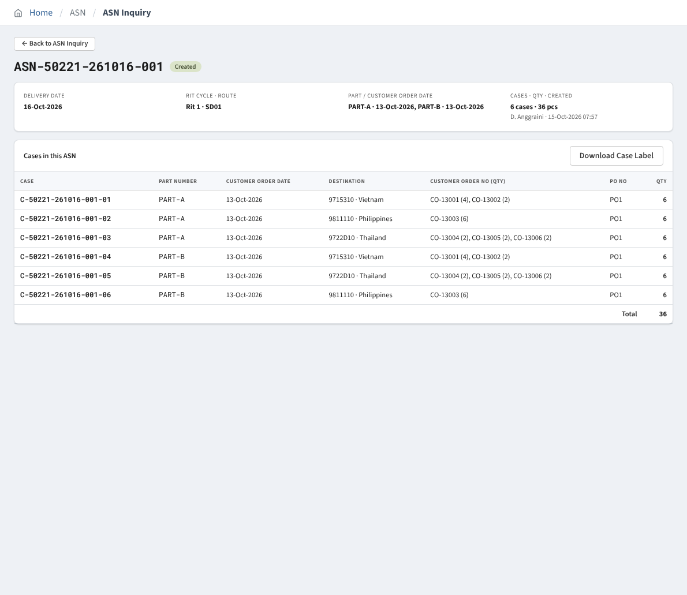

# XD15 – ASN Crossdock Inquiry Screen (Buffer)

> Generated from `deliverables/function_list_v2/specs/XD15_spec.json` (UISS `XD15_UISS_Screen_ASNCrossdockInquiry.xlsx`). Do not edit by hand: change the spec and run `python3 prepare_code/build_md.py`. Document names: GTOPAS / NSP (prototype: G-System / Supplier System).

| Phase | Project | Block | Function | Created | By | Type |
|---|---|---|---|---|---|---|
| DR | Crossdock Optimization | Screen | XD15 ASN Crossdock Inquiry Screen (Buffer) | 18-Oct-26 | FID Rayhan | screen |

## Revision

| Rev | Author | Date | Reviewed by | Description |
|---|---|---|---|---|
| 0.1 | FID Rayhan | 18-Oct-26 |  | Initial Draft |

## 1. General

### Objective

- To search the ASNs submitted in ASN Crossdock Creation (XD10).
- To display the cases of one ASN (read only) and download its case labels.

### Display order – ASN list

| Field | Order |
|---|---|
| Submit date-time (CREATED_DT) | Descending |

### Display order – Cases

| Field | Order |
|---|---|
| Case No | Ascending |

### Buttons

| Button | Function |
|---|---|
| Search | Retrieve ASNs by ASN No, Delivery Date range and Part Number. |
| Reset | Clear criteria and reset the screen to its initial value. |
| ASN No (link) | Open the detail of the ASN. |
| Back | Return from the detail to the ASN list. |
| Download Case Label | Download the labels of all cases of the ASN. Label format follows the existing case label: 1 case label = 1 case of 1 destination, may list several customer order numbers. |

### Screen modes (E = enabled, D = disabled)

| Mode | Section | Description | Search | Reset | ASN No (link) | Back | Download Case Label |
|---|---|---|---|---|---|---|---|
| List Mode | Search Criteria | Criteria blank; all ASNs listed | E | E | D | D | D |
| List Mode | ASN list | One row per ASN | D | D | E | D | D |
| Detail Mode | ASN summary | Delivery Date, Rit Cycle, units, cases / qty, created | D | D | D | E | D |
| Detail Mode | Cases | Read-only case list | D | D | D | D | E |

## 2. Screen flow

### Screen Flow - ASN Inquiry

## 3. Screen layout

### 1. List Mode

### 2. Detail Mode

## 4. Item description

| No | Item | Source | Field | Type | Len | I/O | Control | Justified | Initial | Req | Format | Validation | Description |
|---|---|---|---|---|---|---|---|---|---|---|---|---|---|
| **<Search Criteria Section>** |  |  |  |  |  |  |  |  |  |  |  |  |  |
| 1 | ASN No | Key-in | - | Char | TBD | I | Text box | Left | Blank | N | - | Contains, case-insensitive | Enter = [Search]. |
| 2 | Delivery Date - From / To | Key-in | - | Date | - | I | Date picker | Left | Blank | N | DD-Mon-YYYY | - | Range of Delivery Date, inclusive. |
| 3 | Part Number | Key-in | - | Char | 15 | I | Combo Box | Left | All | N | - | - | ASNs that contain the part. |
| 4 | Search | - | - | - | - | I | Button | Center | Enabled | N | - | - | Refer Operation Description 5.1. |
| 5 | Reset | - | - | - | - | I | Button | Center | Enabled | N | - | - | Refer Operation Description 5.1. |
| **<ASN List Section>** |  |  |  |  |  |  |  |  |  |  |  |  |  |
| 6 | ASN No | TB_R_DAILY_ORDER_MANIFEST | ASN_NO | Char | TBD | O | Link | Left | - | N | - | - | Opens Detail Mode. |
| 7 | Delivery Date | TB_R_DAILY_ORDER_MANIFEST | DELIVERY_DT | Date | - | O | Label | Left | - | N | DD-Mon-YYYY | - |  |
| 8 | Rit Cycle / Route | TB_R_DAILY_ORDER_MANIFEST | RIT_CYCLE / ROUTE | Char | TBD | O | Label | Left | - | N | - | - |  |
| 9 | Part / Customer Order Date | TB_R_DAILY_ORDER_PART | PART_NO / ORDER_DT | Char | - | O | Label | Left | - | N | - | - | Units of the ASN. |
| 10 | Cases / Qty | TB_R_DAILY_ORDER_MANIFEST | TOTAL_CASE / TOTAL_QTY | Number | - | O | Label | Right | - | N | ZZ9 / ZZ,ZZ9 | - |  |
| 11 | Status | TB_R_DAILY_ORDER_MANIFEST | ASN_STATUS | Char | TBD | O | Label | Left | - | N | - | - | '1' Created (green). |
| 12 | Created | TB_R_DAILY_ORDER_MANIFEST | CREATED_BY / CREATED_DT | Char | - | O | Label | Left | - | N | DD-Mon-YYYY HH:MM | - | User and date-time of submit. |
| **<Detail Mode>** |  |  |  |  |  |  |  |  |  |  |  |  |  |
| 13 | Back | - | - | - | - | I | Button | Center | Enabled | N | - | - | Returns to the ASN list. |
| 14 | ASN summary | TB_R_DAILY_ORDER_MANIFEST | - | Char | - | O | Label | Left | - | N | - | - | Delivery Date, Rit Cycle · Route, units, cases · qty, created. |
| 15 | Download Case Label | - | - | - | - | I | Button | Center | Enabled | N | - | - | Downloads the labels of all cases (existing label format). |
| 16 | Case No | TB_R_DAILY_ORDER_PART | CASE_NO | Char | TBD | O | Grid | Left | - | N | - | - | Case number of the ASN. |
| 17 | Part Number / Customer Order Date / Destination | TB_R_DAILY_ORDER_PART | PART_NO / ORDER_DT / DESTINATION_CD | Char | - | O | Grid | Left | - | N | - | - | Key of the case. |
| 18 | Customer Order No (qty) / PO No / Qty | TB_R_DAILY_ORDER_PART | CUSTOMER_ORDER_NO / PO_NO / QTY | Char | - | O | Grid | Left | - | N | - | - | Order lines packed in the case; total of all cases. |

## 5. Data edit mapping

## 6. Operation description

### 5.1 List Mode

a. On first display all crossdock ASNs of the existing table TB_R_DAILY_ORDER_MANIFEST are listed, newest first. Supplier: its own Supplier Code + Plant; D/S team: all suppliers.
b. [Search] applies ASN No (contains), Delivery Date range and Part Number (ASNs whose cases contain the part). [Reset] clears them. No row: message no. 1.
c. Clicking an ASN No opens Detail Mode.

### 5.2 Detail Mode

a. Shows the ASN summary and its cases from the existing table TB_R_DAILY_ORDER_PART (rows with the ASN No), grouped by CASE_NO. All items are read only.
b. [Download Case Label]: follows the existing case label of NSP. [Back] returns to the list in the current search state.
c. The screen does not change data (display only). There is no Cancel ASN: an order is cancelled in the source (H0253 order status '2') for lines already on hold (HOLD_FLAG = 'Y'), not in NSP (refer XD08 / XD11).

## 7. Display messages

| ID | Event | Cause | Type | Message | Action |
|---|---|---|---|---|---|
| **Search Operation** |  |  |  |  |  |
| MSG1 | Click [Search] button | No ASN matches | Info | No ASN matches this search. | Change the criteria. |

## 8. Logging messages

_None._

## 9. Tables

#### TB_R_DAILY_ORDER_MANIFEST (transaction, existing)
Existing ASN manifest (GTOPAS SPS DB structure TR-01). Submit ASN: one row per Pra Daily Order manifest of the cases, all with the same ASN_NO. Only the columns used are listed.

| Column | Type | PK | Null | Description |
|---|---|---|---|---|
| DEPOT_CD | VARCHAR(20) |  | Y | Depot Code |
| SUPPLIER_CD | VARCHAR(4) |  | N | Supplier Code |
| SUPPLIER_PLANT | VARCHAR(1) |  | N | Supplier Plant Code |
| SUB_SUPP_CD | VARCHAR(4) |  | Y | Sub Supplier Code |
| SUB_SUPP_PLANT | VARCHAR(1) |  | Y | Sub Supplier Plant Code |
| SUPPLIER_NAME | VARCHAR(50) |  | Y | Supplier Name |
| PO_NO | VARCHAR(20) |  | N | PO Number |
| ASN_NO | VARCHAR(15) |  | N | ASN Number |
| PO_DATE | DATETIME |  | N | PO Date |
| ASN_DATE | DATETIME |  | N | ASN Date |
| SUB_MANIFEST_NO | VARCHAR(20) | Y | N | Sub Manifest Number |
| MANIFEST_NO | VARCHAR(16) | Y | N | Manifest Number |
| ORDER_TYPE | VARCHAR(1) |  | Y | Order Type |
| CROSS_DOCK_FLAG | VARCHAR(3) |  | Y | Cross Dock Flag |
| DOCK_CD | VARCHAR(2) |  | Y | Dock Code |
| TOTAL_ITEM | NUMERIC |  | N | Total Item |
| TOTAL_QTY | NUMERIC |  | N | Total Quantity |
| DELIVERY_DT_ORI | DATETIME |  | Y | Delivery Date Original |
| SUB_ROUTE_CD | VARCHAR(10) |  | N | Sub Route Code |
| SUB_ROUTE_SEQ | VARCHAR(2) |  | N | Sub Route Seq |
| SUB_ROUTE_DT | DATETIME |  | Y | Sub Route Date |
| STATUS | VARCHAR(3) |  | N | Status |
| CREATED_BY | VARCHAR(20) |  | N | Created By |
| CREATED_DT | DATETIME |  | N | Created Date |

#### TB_R_DAILY_ORDER_PART (transaction, existing)
Existing ASN part (TR-02). Submit ASN: one row per manifest item and case (a case can hold several manifest items). Only the columns used are listed.

| Column | Type | PK | Null | Description |
|---|---|---|---|---|
| PO_NO | VARCHAR(20) |  | N | PO Number |
| PO_ITEM | VARCHAR(4) |  | N | PO Item |
| SUB_MANIFEST_NO | VARCHAR(20) | Y | N | Sub Manifest Number |
| MANIFEST_NO | VARCHAR(16) | Y | N | Manifest Number |
| MANIFEST_ITEM | NUMERIC | Y | N | Manifest Item |
| CASE_NO | VARCHAR(9) | Y | N | Case Number |
| ASN_NO | VARCHAR(15) |  | N | ASN Number |
| ASN_DATE | DATETIME |  | N | ASN Date |
| PART_NO | VARCHAR(20) |  | N | Part Number |
| PART_NAME | VARCHAR(50) |  | N | Part Name |
| PO_QTY | NUMERIC |  | N | PO Quantity |
| DELIVERY_QTY | NUMERIC |  | N | Delivery Quantity |
| QTY_PER_CONTAINER | NUMERIC |  | N | Quantity Per Container |
| DELIVERY_DT_ORI | DATETIME |  | Y | Delivery Date Original |
| KANBAN_NO | VARCHAR(4) |  | Y | Kanban Number |
| PART_BARCODE | VARCHAR(25) |  | Y | Part Barcode |
| STATUS | VARCHAR(3) |  | N | Status |
| CREATED_BY | VARCHAR(20) |  | N | Created By |
| CREATED_DT | DATETIME |  | N | Created Date |

## Sample Input

**Sample ASN Crossdock Inquiry - simulasi_asn_rev.xlsx (supplier 50221-1)**

- ASNs of the simulation after 22-Oct (the prototype shows the ASNs created before the business date). Case numbers as in the prototype; the real format follows the existing numbering.

### A. List Mode

| ASN No | Delivery Date | Rit · Route | Part / Customer Order Date | Cases | Qty | Status |
|---|---|---|---|---|---|---|
| ASN0001 | 16-Oct-2026 | Rit 1 · SD01 | PART-X / 15-Oct | 1 | 6 | Created |
| ASN0002 | 17-Oct-2026 | Rit 1 · SD01 | PART-X / 16-Oct | 1 | 6 | Created |
| ASN0003 | 18-Oct-2026 | Rit 1 · SD01 | PART-X / 17-Oct | 4 | 24 | Created |
| ASN0004 | 19-Oct-2026 | Rit 1 · SD01 | PART-X / 17-Oct | 1 | 6 | Created |
| ASN0005 | 19-Oct-2026 | Rit 1 · SD01 | PART-X / 18-Oct | 3 | 18 | Created |
| ASN0006 | 20-Oct-2026 | Rit 1 · SD01 | PART-X / 19-Oct | 1 | 6 | Created |
| ASN0007 | 20-Oct-2026 | Rit 2 · SD02 | PART-X / 19-Oct | 1 | 6 | Created |

### B. Detail Mode of ASN0003 (after Change Order Number of 21-Oct)

| Case No | Part | Customer Order Date | Destination | Customer Order No | Qty | PO No |
|---|---|---|---|---|---|---|
| C-0003-01 | PART-X | 17-Oct-2026 | 9715310 | CO-14105 | 6 | T0409012 |
| C-0003-02 | PART-X | 17-Oct-2026 | 9715310 | CO-14106 3 + CO-14107 3 | 6 | T0409013 |
| C-0003-03 | PART-X | 17-Oct-2026 | 9722D10 | CO-14111 (was CO-14104) | 6 | T0409013 |
| C-0003-04 | PART-X | 17-Oct-2026 | 9811110 | CO-14109 | 6 | T0409013 |
